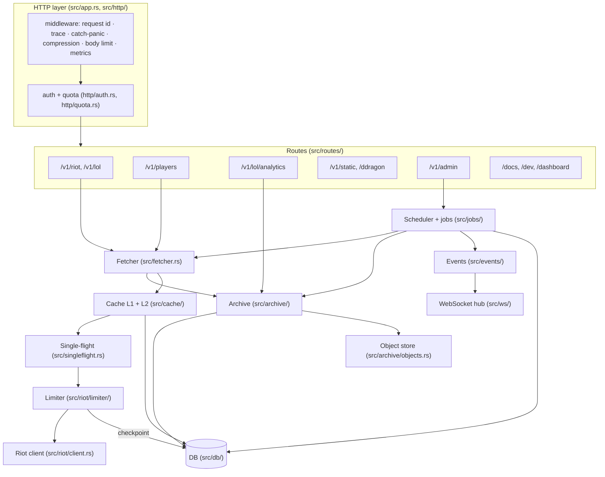

# Components

The modules inside the riot-proxy binary, what each is responsible for, and how they depend on one another.

## Module map

Every box below is a Rust module under `src/`; every arrow is a function call or a channel. There is no network hop inside the binary.

Reads from a route or a job all pass through the fetcher; the archive is the only module that touches object storage; the scheduler is the only module that claims jobs.

## Responsibilities

| Module | Responsibility | Key types and entry points |
|---|---|---|
| `app.rs` | Builds the axum router and the middleware stack, runs the server with a 10 s graceful drain | `router()`, `serve()`, `AppState` (`src/app.rs:40-67,69-119,199-233`) |
| `cli/` | Subcommands: `serve`, `migrate`, `key`, `healthcheck`, `spec`, `backup`, `migrate-v1`, `packs`, and `riot` behind the `dev-cli` feature | `cli::run` (`src/cli/mod.rs:70-121`); the boot sequence in `cli/serve.rs` |
| `config.rs` | Flags, environment and `.env` merged by figment, validated as a whole; production refusals; `Secret` wrapper | `Config::load`, `VARS` (`src/config.rs:23-90,568-602`) |
| `http/` | Request ids, auth guards (`require_read`, `require_admin`), per-consumer quota, CORS for the admin API, the error envelope, validators, recent-request rings | `src/http/auth.rs`, `quota.rs`, `cors.rs`, `error.rs`, `validate.rs`, `recent.rs` |
| `routes/` | One file per prefix; handlers carry `#[utoipa::path]` so the OpenAPI document is generated from the same registration (`routes::docs::api_router`) | `src/routes/docs.rs:116-141` |
| `fetcher.rs` | The single read funnel: archive, L1, single-flight, limiter, client, store; stale-while-revalidate; retries; `X-Cache` values | `Fetcher::fetch`, `FetchOptions` (`src/fetcher.rs:281-367,402-608`) |
| `cache/` | L1 in moka with soft and hard TTLs and negative entries; L2 write-behind to the SQLite `cache` table; cache keys scoped by the Riot key hash | `src/cache/l1.rs`, `l2.rs`, `keys.rs` |
| `singleflight.rs` | One upstream task per key for concurrent misses; the leader's task survives waiter cancellation | `SingleFlight::run` (`src/singleflight.rs:73-105`) |
| `riot/` | Endpoint registry with TTLs and routing kind; platform and region mapping; the reqwest client; the header-driven sliding-log limiter and its checkpoint | `src/riot/endpoints.rs`, `routing.rs`, `client.rs`, `limiter/` |
| `archive/` | Immutable bodies (zstd), per-participant facts, builds, tier stamps, ranks, analytics rebuilds, packs and the object store, index recovery | `src/archive/matches.rs`, `facts.rs`, `analytics.rs`, `pack.rs`, `objects.rs`, `offload.rs`, `recovery.rs` |
| `jobs/` | Durable SQLite-backed queue, rate-limit-aware claims, workers, ticks, every job handler | `src/jobs/scheduler.rs`, `ticks.rs`, `mod.rs` (kinds and handlers) |
| `events/`, `ws/` | Typed events published to per-topic broadcast channels and fanned out to sockets | `src/events/mod.rs`, `src/ws/hub.rs`, `socket.rs`, `protocol.rs` |
| `db/` | One writer thread, a reader pool, pragmas, embedded refinery migrations, disk gauges | `Db::write`, `Db::read` (`src/db/mod.rs:259-316`) |
| `metrics.rs`, `telemetry.rs` | The metric catalogue (v1 names) and the Prometheus exporter; tracing setup | `src/metrics.rs:93-372`, `src/telemetry.rs` |
| `stats.rs` | The dashboard's sampled snapshot and the metrics history in SQLite | `src/stats.rs` |
| `static/` | The Data Dragon mirror on disk and image fill-on-request | `src/static/mod.rs`, `images.rs` |
| `ui/` | The three embedded pages: `dev-ui.html`, `showcase.html`, `admin.html` | `src/routes/ui.rs` |

## Boundaries worth knowing

- **Auth is a route layer, not a handler concern.** The read routers are wrapped in `require_read` and the admin router in `require_admin` at registration (`src/routes/docs.rs:118-141`); `/healthz`, `/readyz`, `/metrics`, `/ddragon/*`, `/docs` and the pages are outside both.
- **The fetcher owns upstream policy.** The client classifies and never retries (`src/riot/client.rs:8-10`); negative caching, stale fallbacks, the service-429 backoff and the 5xx retries live in the fetcher (`src/fetcher.rs:9-14`).
- **The archive never fails a request.** A read failure in SQLite or the bucket logs a warning and returns nothing, so the fetcher goes to Riot (`src/archive/mod.rs:128-144`, `src/archive/matches.rs:217-304`).
- **Jobs and routes share the fetcher but not the budget.** Routes fetch at interactive priority with a 2 s wait budget; jobs at bulk priority with a 1 s yield budget, after which the job gives its worker back (`src/fetcher.rs:133-151`, `src/jobs/scheduler.rs:124-141`).
- **The object store is attached once.** `Db::attach_objects` stores the bucket handle so every archive read can resolve an offloaded body without the callers changing (`src/db/mod.rs:188-196`).

The design these modules implement is `docs/design/03-architecture.md`; where the code has moved on from the design, the inventories under `docs/_meta/scratch/` record the differences and [../_meta/gaps.md](../_meta/gaps.md) lists them.

---
**Sources:** `src/lib.rs`, `src/app.rs:L40-L119`, `src/cli/mod.rs:L70-L121`, `src/routes/docs.rs:L116-L141`, `src/fetcher.rs:L9-L14,L133-L151`, `src/riot/client.rs:L8-L10`, `src/archive/mod.rs:L128-L144`, `src/db/mod.rs:L188-L196,L259-L316`, `src/jobs/scheduler.rs:L124-L141`, `docs/design/03-architecture.md#component-diagram`
**Last verified:** 2026-10-20 against commit `b7b363c`
