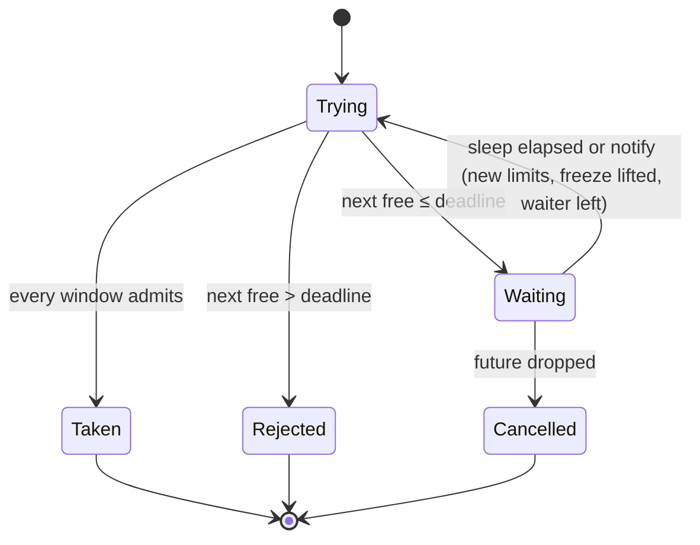
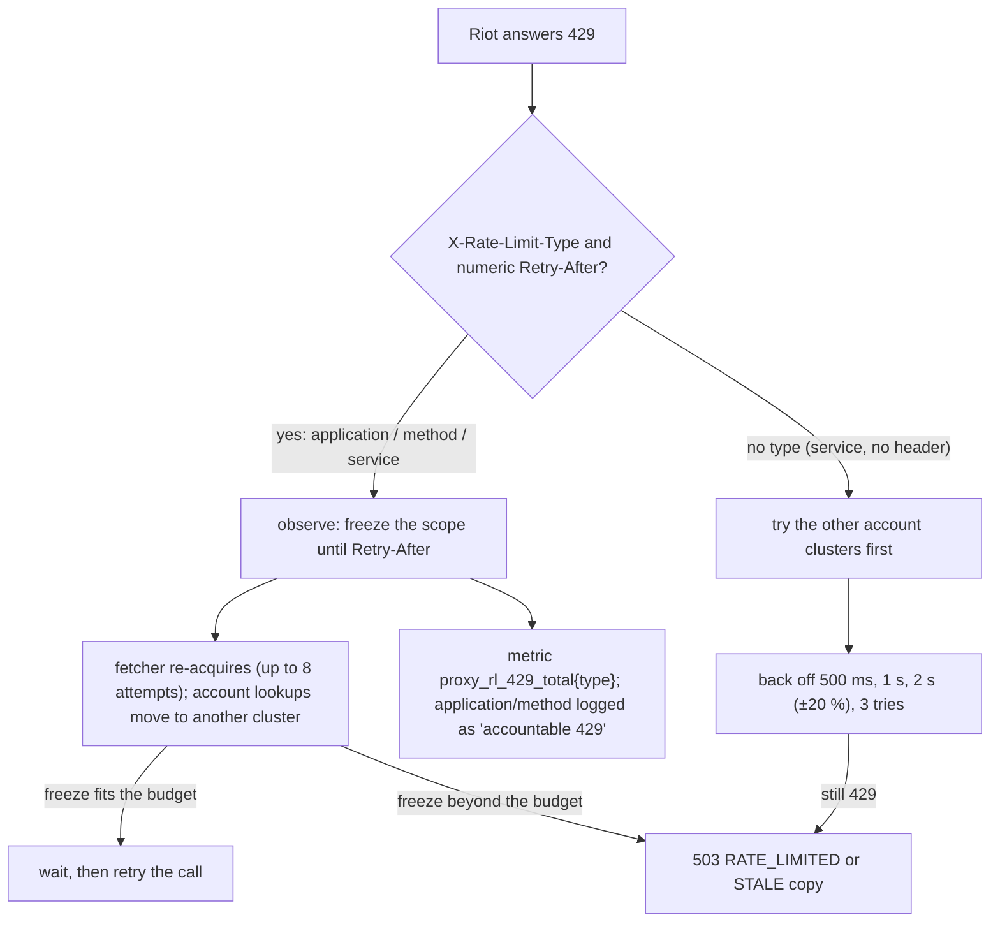

# Concurrency and rate limiting

How riot-proxy stays inside Riot's limits with one key, how interactive requests are kept ahead of background work, how the job queue claims work without exceeding the limiter, and what happens on a 429.

## The limiter model

One `Limiter` holds a map of scopes. A scope is a routing value on a Riot host: a platform such as `euw1` or a region such as `europe` (`src/riot/limiter/mod.rs:97-110`, `src/riot/endpoints.rs:315-321`). Each scope has application windows and, per method id, method windows; each window is a sliding log of admission instants with a `limit` and a `seconds` length (ADR-023, `src/riot/limiter/bucket.rs:15-121`). A request is admitted only if every applicable window has room now.

| Aspect | Behaviour | Source |
|---|---|---|
| Bootstrap | A new scope starts with the personal-key app limits `20:1,100:120` and no method windows | `src/riot/limiter/headers.rs:30-41`, `mod.rs:307-310` |
| Learning | After every upstream response, `X-App-Rate-Limit` and `X-Method-Rate-Limit` reconfigure the windows (same lengths keep their admissions) and the `-Count` headers pad usage upward, never down | `mod.rs:370-401`, `bucket.rs:100-105,140-162` |
| Permit | A token once taken is spent whether or not the call succeeds | `mod.rs:50-56` |
| Budget | `acquire` fails at once with `RATE_LIMITED` if the next free slot is beyond the caller's budget; it never waits out a budget it cannot meet (ADR-025) | `mod.rs:262-300` |
| Freeze | A typed 429 (`application`, `method` or `service`) with a numeric `Retry-After` freezes the whole scope until then; freezes only extend | `mod.rs:396-431` |
| Checkpoint | Every 10 s and at shutdown the windows are written to `limiter_state`; on boot a checkpoint older than 120 s restores every window as full | `src/riot/limiter/persist.rs:21-25,141-175` |

Per-consumer quotas are separate: a 60 s sliding window of `quota_per_min` admissions per consumer id, answered with `429 QUOTA_EXCEEDED` and `X-RateLimit-*` headers (`src/http/quota.rs:320-431`). Being over quota is never reported as `RATE_LIMITED`.

## Priorities

| Caller | Priority | Budget | What happens when the budget is exceeded |
|---|---|---|---|
| HTTP route | Interactive | `CLIENT_WAIT_BUDGET_MS` (2000) | `503 RATE_LIMITED` with `Retry-After`, or a cached copy inside its hard TTL served as `STALE` |
| Job | Bulk | `JOB_YIELD_BUDGET_MS` (1000) | The job yields: back to `pending` with `run_after = retry_at`, attempts not counted |
| Background refresh | Bulk | 15 min | Logged at debug; the stale entry stays |

Sources: `src/fetcher.rs:40-45,133-151,356-361`, `src/jobs/scheduler.rs:124-141`.

Bulk callers also respect a ceiling: while a scope has had an interactive request in the last `BULK_IDLE_AFTER_S` (30 s), bulk may use `BULK_USAGE_CEILING` (0.80) of every window; once idle, `BULK_IDLE_CEILING` (0.95). An interactive waiter on a scope makes bulk stand aside until it is served (`src/riot/limiter/mod.rs:117-125,229-235,329-344`; ADR-126).

## Acquire states

The per-acquire state machine is what a request or a job goes through inside the limiter (`src/riot/limiter/mod.rs:262-300`).

`Waiting` registers a waiter so bulk stands aside; `Cancelled` withdraws it through a drop guard so a cancelled request never leaves a phantom waiter (`mod.rs:127-175`). Reasons for waiting, in evaluation order: the scope is frozen, bulk is over its ceiling, an interactive waiter is queued, or a window is full (`mod.rs:315-359`).

## Scope states

Each scope is in one of two knowledge states with two orthogonal flags.

```mermaid
stateDiagram-v2
    [*] --> Bootstrap: first acquire or observe
    Bootstrap --> Known: X-App-Rate-Limit seen (observe) or checkpoint with known=true
    Known --> Known: headers reconfigure windows
    state "Frozen (flag)" as Frozen
    Bootstrap --> Frozen: typed 429 + Retry-After
    Known --> Frozen: typed 429 + Retry-After
    Frozen --> Known: now ≥ frozen_until at next try
    state "Busy / Idle (flag)" as Busy
    Known --> Busy: interactive acquire sets last_interactive; idle after BULK_IDLE_AFTER_S
```

A scope is never evicted (`src/riot/limiter/mod.rs`, no removal path). The restore on boot sets `limiter_restored` even when the checkpoint could not be read, so `/readyz` reports `limiter:true` after a fresh start (`src/cli/serve.rs:75-81`).

## What happens on a 429

An accountable 429 means the limiter's accounting diverged from Riot's and is logged at error level (`src/riot/limiter/mod.rs:416-430`); the Prometheus rule `AccountableRateLimit429` alerts on it (`ops/prometheus-alerts.yml`). The fetcher's loop is bounded by 8 attempts (`src/fetcher.rs:41,508-547`).

## Account clusters

Account-v1 is served by three clusters. A request without a region tries `asia`, `americas`, `europe` in that order, taking the first with a token available now and avoiding a cluster that just answered a service 429; all three share one cache entry keyed on the literal host `account` (`src/riot/routing.rs:148-153`, `src/fetcher.rs:610-648`, `src/cache/keys.rs:72-79`; ADR-066). `sea` platforms route account calls to `asia` (`src/riot/routing.rs:174-181`).

## The job queue

Jobs live in the SQLite `jobs` table; there is no in-memory queue (ADR-047, ADR-137). `JOB_CONCURRENCY` workers (default 8) claim with one `UPDATE … RETURNING` statement that takes, per rate-limit lane, the best ready row, skipping lanes the limiter reports blocked, methods at their ceiling and kinds at their `JOB_KIND_LIMITS` cap (`src/db/store.rs:98-133`, `src/riot/limiter/mod.rs:520-594`; SCH-01, ADR-089).

| Concept | Rule | Source |
|---|---|---|
| Lane | Riot-calling kinds get `(lane, method)` from their payload: a platform or the match-v5 region, and the endpoint id; other kinds have no lane and can be capped by `JOB_KIND_LIMITS` | `src/jobs/lanes.rs:425-468` |
| Priority bands | 0 interactive (a just-finished game, a missing timeline half), 100 + depth/10 archive by depth, 10 000 polls, 20 000–20 006 backfill and crawl stages, 30 000 maintenance, rebuilds and `aggregate:delta`, 40 000 timeline backfill | `src/jobs/mod.rs:74-89`, `src/jobs/ladder.rs:48-61` |
| Dedupe | A unique partial index on `(kind, dedupe_key)` while pending or running; a duplicate enqueue returns the existing id (`already-queued`) or promotes a pending row's priority | `src/db/migrations/V0001__init.sql:44`, `src/jobs/scheduler.rs:225-269` |
| Retry | Up to 5 attempts; backoff 30 s × 2^attempts ± 20 % where `attempts` includes the current run, so the first retry waits about 60 s | `src/jobs/scheduler.rs:40-42,160-171,1070-1075` |
| Yield | A limiter wait beyond `JOB_YIELD_BUDGET_MS` re-queues the job at `retry_at` without counting an attempt; long jobs call `take_turns()` to let others in | `src/jobs/scheduler.rs:145-150,1082-1084` |
| Recovery | Rows left `running` by a crash go back to `pending` on boot | `src/jobs/scheduler.rs:963-973` |
| Idle | A worker with nothing claimable sleeps until the next `run_after` or blocked lane frees, at most 1 s, and is woken by any enqueue | `src/jobs/scheduler.rs:996-1025` |
| Analytics on the writer | `aggregate:analytics` holds the writer for a step at a time and runs one at a time (`JOB_KIND_LIMITS`); `aggregate:delta` (THR-03) is one job for every ladder, deduped to one, whose batches are separate write transactions sized toward `AGGREGATE_DELTA_TARGET_MS` with a 50 ms pause between them, so other writes interleave | `src/jobs/analytics.rs:93-96,856-950` |
| Retention | `done` rows are deleted after 7 days by `maintenance`; `failed` rows stay until purged | `src/jobs/maintenance.rs:36,237-240` |

Every job kind, its trigger, priority and tables is tabulated in `docs/_meta/scratch/jobs-and-observability.md` §3 and summarised for operators in [../operations/runbook.md](../operations/runbook.md).

## Other concurrency limits

| Limit | Value | Source |
|---|---|---|
| tokio worker threads | `min(cores, 4)` | `src/cli/mod.rs:123-126` |
| SQLite writer | one thread, queue of 1024 closures | `src/db/mod.rs:41-42,160-172` |
| SQLite readers | `available_parallelism()` connections behind a semaphore | `src/db/mod.rs:82-89,195-198` |
| Riot HTTP pool | 32 idle connections per host, 60 s idle | `src/riot/client.rs:27-28` |
| L2 write-behind | 10 000 queued rows, flushed every 2 s or 500 rows | `src/cache/l2.rs:23-28` |
| Object-store reads | `ARCHIVE_OBJECT_CONCURRENCY` (16) ranged GETs in flight | `src/archive/matches.rs:265-269` |
| WebSocket | 256 events buffered per topic; 200 topics per socket; ping every 30 s, dropped after 2 missed | `src/ws/hub.rs:20`, `src/ws/protocol.rs:23-29` |
| Refresh windows | one `?refresh=true` per part per puuid per 60 s | `src/routes/players/refresh.rs:18` |
| Request body | 1 MiB | `src/app.rs:30-31` |

---
**Sources:** `src/riot/limiter/mod.rs:L50-L175,L229-L300,L307-L431,L520-L594`, `src/riot/limiter/bucket.rs:L15-L162`, `src/riot/limiter/headers.rs:L30-L41`, `src/riot/limiter/persist.rs:L21-L25,L141-L175`, `src/http/quota.rs:L320-L431`, `src/fetcher.rs:L40-L45,L133-L151,L356-L361,L508-L547,L610-L648`, `src/riot/routing.rs:L148-L181`, `src/cache/keys.rs:L72-L79`, `src/jobs/scheduler.rs:L40-L42,L124-L171,L225-L269,L963-L1025,L1070-L1084`, `src/jobs/lanes.rs:L425-L468`, `src/jobs/mod.rs:L74-L89`, `src/db/store.rs:L98-L133`, `src/db/mod.rs:L41-L42,L82-L89,L158-L198`, `src/cli/serve.rs:L75-L81`, `ops/prometheus-alerts.yml`, `docs/design/05-rate-limiter.md`, `docs/design/06-jobs-and-realtime.md`
**Last verified:** 2026-10-22 against commit `6eda84e`
