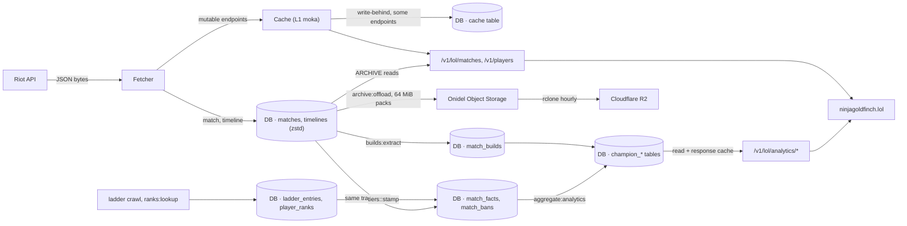

# Data flow

How a Riot payload becomes an archived body, a row of facts, an analytics table and finally a consumer response, with every storage touchpoint along the way.

## The pipeline

Raw bodies enter once and are never modified; everything after the archive is derived and can be rebuilt.

The archive is the only source for facts; the ladder and rank lookups add the tier each participant played at; the analytics rebuild joins the three and writes the tables the site reads.

## Stage by stage

### 1. Riot payload to cache or archive

The fetcher stores a 2xx body in one of two ways (`src/fetcher.rs:487-506`):

- **Mutable endpoints** (summoner, league, mastery, spectator, match ids, rotations, status, account) go to L1 under `{keyScope}:{endpoint}:{host}:{params}[:{queryHash}]` with the endpoint's soft and hard TTL (`src/cache/keys.rs:72-90`). Endpoints flagged `persist_l2` (account, summoner, mastery, the ladder reads) are also queued for the SQLite `cache` table so they survive a restart (`src/riot/endpoints.rs:88-285`, `src/cache/l2.rs:23-28`). Bodies are stored as the bytes Riot sent; passthrough routes forward them untouched.
- **Immutable endpoints** (`match.byId`, `match.timeline`) go to the archive: zstd level 3 into `matches.body_zstd` or `timelines.body_zstd`, with `region`, `patch` (`major.minor` from `gameVersion`), `queue_id`, `game_end_ms`, `game_duration`, `body_size` and `archived_at` (`src/archive/matches.rs:33,351-396`). The two halves are archived together: storing one queues the other as an `archive:match` job at priority 0 (`src/archive/mod.rs:88-110`, ADR-118).

A league-entries body is also "observed": the player's ranks are recorded in `player_ranks` and late tier stamps are applied (`src/archive/mod.rs:180-201`).

### 2. Body to facts

In the same write transaction as the match body, `facts::write` extracts one `match_facts` row per participant: team, position, champion, win, kills, deaths, assists, items, runes (a positional array), summoner spells, cs, gold, damage, vision, and `facts_version` (currently 4); bans go to `match_bans`; `remake` and `game_duration` go on the match row (`src/archive/matches.rs:137-154`, `src/archive/facts.rs:19,329-379`). When the extraction version moves, boot queues `facts:reextract`, which re-derives rows batch by batch from the stored bodies (`src/jobs/analytics.rs:404-477`).

### 3. Timeline to builds

`builds:extract` reads timelines whose match has facts and no `match_builds` row at `BUILDS_VERSION` 3, and derives each participant's starter items, boots, finished items in order and skill order, using the mirrored `item.json` to know which items are finished (`src/archive/builds.rs:24,381-407`, `src/jobs/analytics.rs:488-580`). Two champion-specific rules apply: Viego's possession is not counted as his skill points and Udyr's R ranks with Q, W and E (ADR-131, ADR-132).

### 4. Ladder and ranks to tier stamps

A crawl writes `ladder_entries` for every player on the ladder and `players` rows for the ones it discovers (`src/jobs/ladder/store.rs:214-295`); `ranks:lookup` and the poll jobs write `player_ranks` (`src/archive/ranks.rs:53-66`). `tiers::stamp` sets `match_facts.tier` from those tables, or `UNKNOWN`, when a match is archived and in the `tiers:backfill` job; a rank seen within `TIER_LATE_STAMP_DAYS` (14) re-stamps `UNKNOWN` rows (`src/archive/tiers.rs:33-90`, ADR-127, ADR-138).

### 5. Facts to analytics

`aggregate:analytics` runs per `(platform, queue)` ladder over the newest `AGGREGATE_PATCH_LIMIT` patches (default 4; 0 means all). It clears and re-inserts the champion tables with `INSERT … SELECT` over `match_facts` joined to `matches`, keyed by key scope, platform, queue, tier, patch, champion, role, remake and side; writes the tier-summed `champion_stats_totals` and the per-floor totals; then matchups, items, runes, spells, set builds and matchup builds; records `analytics_runs`; clears and warms the response cache; publishes `analytics.updated` (`src/jobs/analytics.rs:247-385`, `src/archive/analytics.rs:70-98,135-540`). It runs after every completed crawl, on `AGGREGATE_INTERVAL_S` if set, and on `POST /v1/admin/analytics/recompute`; one rebuild runs at a time by default (`JOB_KIND_LIMITS`).

### 6. Analytics to the consumer

`/v1/lol/analytics/*` reads the aggregate tables, caches each response in memory per rebuild generation (`ANALYTICS_CACHE_ENTRIES`, default 512), and answers with a weak `ETag`, `Cache-Control: private, max-age=300` and `X-Cache: HIT` or `MISS` (`src/routes/analytics.rs:577-629`, `src/routes/analytics/cache.rs`). The site calls `/v1/lol/analytics/champions` with `queue=RANKED_SOLO_5x5&minGames=0&limit=500` and caches the rendered page at the edge for 10 minutes (ninjagoldfinch-lol `src/lib/domain/champion-stats.ts:93-107`, `src/lib/server/cache.ts:5-16`).

### 7. Bodies to object storage

Within hours of being archived a body is packed: `archive:offload` builds a 64 MiB pack per kind (matches and timelines separately, bodies sorted by match id), uploads it to `packs/<kind>/<yyyy>/<mm>/<ulid>.pack`, verifies size and digest, and records `body_packs` and `body_locations` in one transaction. Fourteen days after the match was archived the local copy is freed: `body_zstd` becomes the empty blob and `offloaded_at` is set (`src/archive/offload.rs:72-170`, `src/jobs/offload.rs:146-195`). Reads of freed bodies fetch byte ranges from the pack (stage 1 of [request-lifecycle.md](./request-lifecycle.md#archived-match)). The hourly rclone timer mirrors the bucket to Cloudflare R2; the daily snapshot of the two map tables goes to `index/` ([../integration/object-storage.md](../integration/object-storage.md)).

## Where each kind of data lives

| Data | Primary store | Copies | Rebuildable from |
|---|---|---|---|
| Riot key, consumer keys (hashed) | `/etc/riot-proxy/env`, `consumers` table | SQLite backups | no (consumers must be re-minted) |
| Mutable Riot responses | L1 memory | `cache` table for L2 endpoints | Riot, on demand |
| Match and timeline bodies | `matches`, `timelines` for 14 days, then the Onidel bucket | R2 replica | Riot, on demand (`ARCHIVE_OBJECT_URL` unset makes offloaded rows miss and re-fetch) |
| Pack map | `body_packs`, `body_locations` | backups; daily `index/` snapshot; each pack's own index | `packs reindex` |
| Facts, bans, builds, tier stamps | SQLite | backups | the bodies (`facts:reextract`, `builds:extract`, `tiers:backfill`) |
| Ladder entries, ranks | SQLite | backups | a new crawl / lookups |
| Analytics tables | SQLite | backups | `aggregate:analytics` |
| Jobs, limiter checkpoint, metrics history | SQLite | backups | regenerated in operation |
| Data Dragon mirror | `$DATA_DIR/ddragon` | none | the CDN |

The table in [../data/schema.md](../data/schema.md) gives every column; [../data/caching.md](../data/caching.md) gives every TTL.

---
**Sources:** `src/fetcher.rs:L487-L506`, `src/cache/keys.rs:L72-L90`, `src/cache/l2.rs:L23-L28`, `src/riot/endpoints.rs:L88-L285`, `src/archive/matches.rs:L33,L137-L154,L351-L396`, `src/archive/mod.rs:L88-L110,L180-L201`, `src/archive/facts.rs:L19,L329-L379`, `src/archive/builds.rs:L24,L381-L407`, `src/archive/tiers.rs:L33-L90`, `src/archive/ranks.rs:L53-L66`, `src/jobs/analytics.rs:L247-L385,L404-L580`, `src/archive/analytics.rs:L70-L98`, `src/routes/analytics.rs:L577-L629`, `src/archive/offload.rs:L72-L170`, `src/jobs/offload.rs:L146-L195`, `docs/_meta/scratch/persistence.md`, `docs/_meta/scratch/siblings.md` §1.5
**Last verified:** 2026-10-19 against commit `52fa67d`
