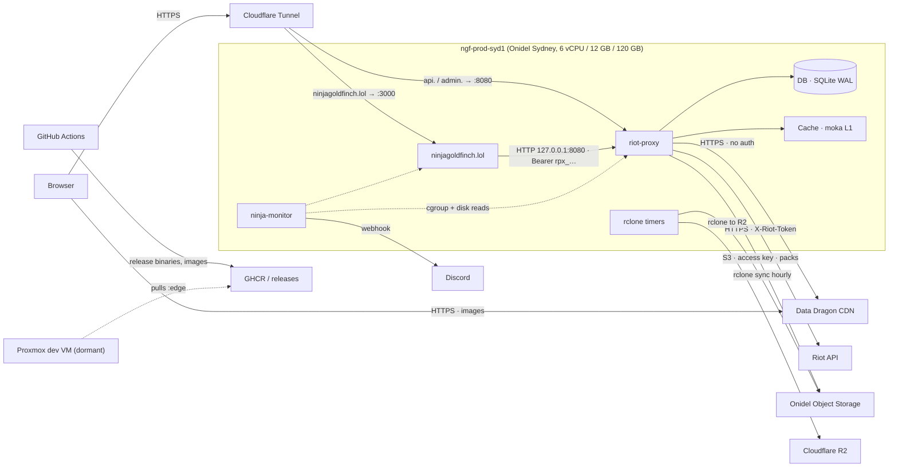

# System overview

Where riot-proxy sits in the ninjagoldfinch.lol platform, what it is responsible for, and why it exists as a separate service.

## The platform in one picture

The platform is three services on one Onidel Sydney VPS plus two object stores, with Cloudflare as the only public edge. This diagram shows every system a request or a byte can touch.

The browser only ever talks to Cloudflare and to Riot's image CDN. ninjagoldfinch.lol talks to riot-proxy over loopback with a consumer key. riot-proxy is the only process that holds the Riot key and the only process that reads or writes the Onidel bucket. The rclone timers on the box copy the bucket and the SQLite backups to Cloudflare R2. GitHub Actions never touches the VPS; a person installs each release (see [../workflows/release-process.md](../workflows/release-process.md)).

## Responsibility split

| Service | Owns | Never does |
|---|---|---|
| riot-proxy | The Riot API key; Riot's rate limits; caching; the immutable match and timeline archive; tracked-player polling; the ranked ladder crawl; champion analytics; consumer keys and quotas; the operator dashboard; the Data Dragon mirror | Render pages; hold site state; serve bodies from the bucket to the public |
| ninjagoldfinch.lol | Pages for players, matches and champions; URL and patch handling; edge cache headers; its own Data Dragon lookups in memory | Call Riot; hold the Riot key; cache player or analytics bodies; call riot-proxy from the browser |
| ninja-monitor | Host and per-service CPU, memory, disk sampling; Discord alerts | Probe HTTP endpoints; store history on disk |

Evidence: the site's single proxy client is `ninjagoldfinch-lol/src/lib/server/proxy.ts`, its image URLs point at Riot's CDN (`src/lib/assets.ts:7-8`), and ninja-monitor has no HTTP integration with the proxy (see [../_meta/scratch/siblings.md](../_meta/scratch/siblings.md) §2.2 for the grep evidence, reproduced in [../integration/service-communication.md](../integration/service-communication.md)).

## Why riot-proxy exists

A Riot key gives one application-level rate limit shared by every request made with it (`docs/design/03-architecture.md#why-one-process-is-not-a-compromise`). Everything that follows from that fact is this service:

- **Key custody.** The site holds only a consumer key with the `read` scope. The Riot key lives in `/etc/riot-proxy/env` on the box and is sent as `X-Riot-Token`, marked sensitive so it never appears in debug output (`src/riot/client.rs:33,241-243`).
- **One limiter, one process.** Two proxies would split the budget and need coordination, so the design is a single binary, a single SQLite file and an in-process limiter (ADR-001, ADR-002). Throughput is bounded by the key (a personal key allows 20 requests per second and 100 per two minutes, `src/riot/limiter/headers.rs:30-41`), not by the host.
- **Caching and the archive.** Riot responses are cached in memory with stale-while-revalidate and persisted for some endpoints; matches and timelines are immutable and archived forever, first in SQLite and after fourteen days only in the Onidel bucket (`docs/design/12-object-storage-and-hosting.md`).
- **Derived data.** The ladder crawl, facts extraction and analytics rebuilds turn the archive into champion statistics the site reads with one call per page.
- **Realtime and operations.** A WebSocket hub, Prometheus metrics with v1's names, an embedded dashboard and admin API.

## Runtime shape

One process, four tokio worker threads at most (`src/cli/mod.rs:123-126`), one SQLite writer thread and a reader pool sized to the CPU count (`src/db/mod.rs:180-183`), `JOB_CONCURRENCY` background workers (default 8), and periodic ticks. Cold start is the migration check, the limiter restore and the L1 warm from L2; the process listens within a second (`docs/design/03-architecture.md#process-model`, `src/cli/serve.rs:43-148`). The internal structure is in [components.md](./components.md).

## Environments at a glance

| Environment | Base URL | Auth | Object storage |
|---|---|---|---|
| Production | `http://127.0.0.1:8080` on `ngf-prod-syd1`; public `https://api.ninjagoldfinch.lol`; admin `https://admin.ninjagoldfinch.lol` | consumer keys; Cloudflare Access on `admin.` | Onidel `riot-proxy-archive`, R2 replica |
| Local development | `http://127.0.0.1:8080` from `just dev` | keys, or `AUTH_DISABLED=true` | none, or `file:///…` |
| Proxmox dev VM (dormant) | `http://192.168.68.46:8080` | `AUTH_DISABLED` | none |

Details in [../integration/environments.md](../integration/environments.md).

---
**Sources:** `docs/design/03-architecture.md`, `docs/design/12-object-storage-and-hosting.md` (§Topology after the move, §As executed), `deploy/README.md`, `src/riot/client.rs:L33-L43`, `src/riot/limiter/headers.rs:L30-L41`, `src/cli/mod.rs:L123-L126`, `src/db/mod.rs:L180-L183`, `src/cli/serve.rs:L43-L148`, `docs/_meta/scratch/siblings.md`
**Last verified:** 2026-10-19 against commit `52fa67d`
