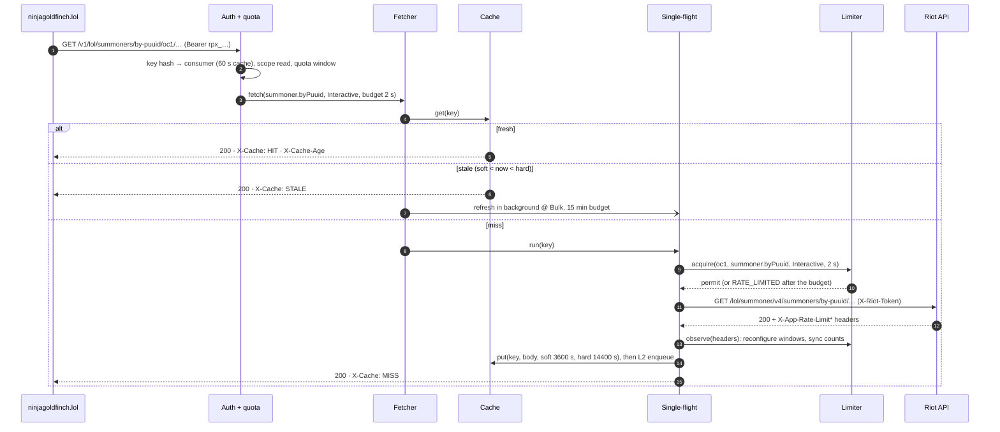
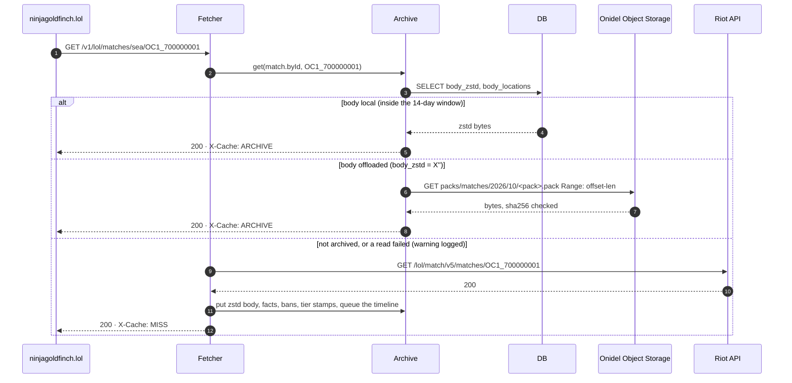
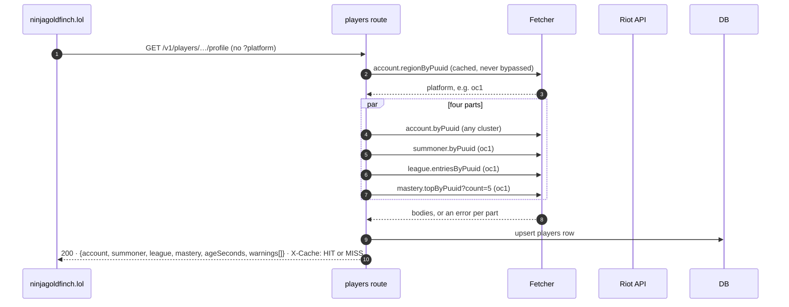
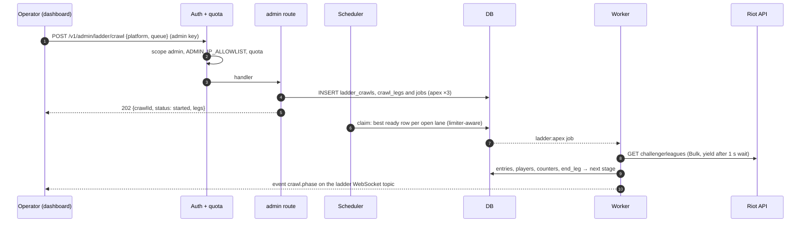

# Request lifecycle

What happens between a request arriving at riot-proxy and the response leaving, for the four request types that matter most: a cached passthrough read, an archived match, the player profile composite, and an admin request that queues a job.

## The middleware stack

Every request passes the same layers, innermost first: metrics and the recent-requests ring, the 1 MiB body limit, compression, the tracing span, panic capture, and the request id (`src/app.rs:103-118`). The request id is taken from an inbound `X-Request-Id` when it is at most 128 characters of `[A-Za-z0-9-_.:]`, otherwise a ULID is generated; it is echoed on every response, including the 404 fallback and panics (`src/http/request_id.rs:287-338`). Guarded routes then run `require_read` or `require_admin`: key lookup through a 60 s cache, scope check, admin IP allowlist, then the per-consumer quota, whose `X-RateLimit-*` headers go on every metered response (`src/http/auth.rs:319-343`).

## Passthrough read: cache hit, stale, miss

A `/v1/lol/summoners/by-puuid/{platform}/{puuid}` call shows every branch of the fetch funnel.

The order of checks is archive, then L1, then single-flight, then the limiter and the client (`src/fetcher.rs:281-367`). Numbers in the diagram: the interactive wait budget is `CLIENT_WAIT_BUDGET_MS`, default 2000 (`src/config.rs:716`); a background refresh runs at bulk priority with a 15 minute budget (`src/fetcher.rs:42-44`); the summoner endpoint's soft TTL is 3600 s and its hard TTL is four times that while `STALE_WHILE_REVALIDATE` is on (`src/riot/endpoints.rs:112-121,495-503`). A fresh negative entry answers `404 NOT_FOUND` with `X-Cache: HIT-NEG` (`src/fetcher.rs:300-307`). The single-flight leader's task is spawned, so a waiter that disconnects does not waste the limiter token (`src/singleflight.rs:1-12`).

When Riot answers badly, the fetcher decides (`src/fetcher.rs:498-607`): a 404 is negative-cached for `NEG_TTL_SECONDS` (30 s; 300 s for account lookups); a 401 or 403 becomes `502 UPSTREAM_ERROR` at once and logs `RIOT KEY REJECTED`; a typed 429 with a numeric `Retry-After` freezes the scope and the loop re-acquires, up to 8 attempts; an untyped 429 tries the other account clusters, then backs off 500 ms, 1 s, 2 s with 20 % jitter for three tries; a 5xx or network failure retries after 250 ms and 750 ms, then serves a cached copy inside its hard TTL as `STALE` or fails `502`. The full table is in [../api/errors.md](../api/errors.md).

## Archived match

A match body is immutable, so it is never cached with a TTL; it is archived and served from the archive forever.

The archive is consulted only for immutable endpoints (`src/fetcher.rs:286-297`). A local body is decoded from zstd and returned byte for byte; an empty `body_zstd` means the body was freed after packing, and `body_locations` gives the pack, offset and length for one ranged GET (`src/archive/matches.rs:176-313`). Any failure on that path logs one warning per pack and falls through to Riot, so an object-store outage degrades to a Riot fetch and nothing fails (`src/archive/mod.rs:128-144`). On a fresh fetch the archive stores the body, derives facts in the same transaction, and queues the match's timeline as an `archive:match` job at priority 0 when `ARCHIVE_TIMELINES` is on (`src/archive/mod.rs:88-110,146-178`). The match id's prefix must agree with the declared region, else `400 BAD_REGION` (`src/routes/lol.rs:53-64`).

## Player profile composite

`GET /v1/players/{puuid}/profile` fans out to four Riot endpoints concurrently and tolerates partial failure.

Without `?platform` the route resolves the platform from the account's active region first and answers `502 UPSTREAM_ERROR` if Riot's answer is not a known platform (`src/routes/players.rs:244-263`). The four parts run concurrently (`src/routes/players.rs:285-324`); a failed part becomes `null` with an entry in `warnings[]`, and only four failures make a `404` (`src/routes/players.rs:128-147,358-360`). The composite `X-Cache` is `MISS` if any part missed, else `HIT`, and `X-Cache-Age` is the oldest part (`src/routes/players.rs:66-105`). `?refresh=true` is allowed for any consumer here, but one refresh per part per puuid per 60 s wins; the others get `refreshed:false` and `refreshAvailableIn` (`src/routes/players/refresh.rs:18,43-71`). The first page of `/matches` also queues a `backfill:player` job (`src/routes/players.rs:547-599`).

## Admin request that queues a job

Admin writes are small: validate, enqueue, answer, and let the scheduler do the work.

The crawl is written in one transaction; a partial unique index refuses a second running crawl per ladder, so a duplicate request answers `already-running`, not `409` (`src/jobs/ladder.rs:237-318`, `src/routes/admin.rs:1700-1733`). The claim query takes the best ready row per rate-limit lane, skipping lanes the limiter reports blocked and kinds at their `JOB_KIND_LIMITS` cap (`src/db/store.rs:98-133`). A job whose fetch would wait longer than `JOB_YIELD_BUDGET_MS` (1000 ms) yields its worker and re-queues itself at `retry_at` (`src/jobs/scheduler.rs:124-141`). Phase transitions publish `crawl.phase` to the admin-only `ladder` topic (`src/jobs/ladder.rs:826-836`). The scheduler and its states are in [concurrency-and-rate-limiting.md](./concurrency-and-rate-limiting.md).

## Timeouts in one place

| Where | Value | Source |
|---|---|---|
| Riot connect / total | 10 s / 25 s | `src/riot/client.rs:29-31` |
| Interactive wait for a limiter token | `CLIENT_WAIT_BUDGET_MS` = 2000 | `src/config.rs:716` |
| Job wait before yielding | `JOB_YIELD_BUDGET_MS` = 1000 | `src/config.rs:711` |
| Background refresh budget | 15 min | `src/fetcher.rs:42-44` |
| `/readyz` SQLite probe (idle writer) | 2 s, of which 1.5 s waiting for the write lock | `src/routes/health.rs:21-27` |
| `/readyz` stall threshold (busy writer) | 5 s without progress stamps or CPU | `src/routes/health.rs:34-46` |
| Graceful drain after SIGTERM | 10 s | `src/app.rs:35` |
| Data Dragon connect / total | 15 s / 60 s | `src/jobs/ddragon.rs:260-261` |
| Site's budget per proxy call | 5 s analytics and static, 30 s otherwise | ninjagoldfinch-lol `src/lib/server/proxy.ts:55-64` (origin/main) |

---
**Sources:** `src/app.rs:L103-L118`, `src/http/request_id.rs:L287-L338`, `src/http/auth.rs:L319-L343`, `src/fetcher.rs:L36-L44,L281-L367,L402-L608`, `src/riot/endpoints.rs:L112-L121,L495-L503`, `src/singleflight.rs:L1-L12`, `src/archive/mod.rs:L88-L178`, `src/archive/matches.rs:L176-L313`, `src/routes/lol.rs:L53-L64`, `src/routes/players.rs:L66-L105,L128-L147,L244-L324,L547-L599`, `src/routes/players/refresh.rs:L18-L71`, `src/routes/admin.rs:L1700-L1733`, `src/jobs/ladder.rs:L237-L318,L826-L836`, `src/db/store.rs:L98-L133`, `src/jobs/scheduler.rs:L124-L141`, `docs/_meta/scratch/riot-and-cache.md` §1.5, `docs/_meta/scratch/siblings.md` §1.3
**Last verified:** 2026-10-20 against commit `b7b363c`
