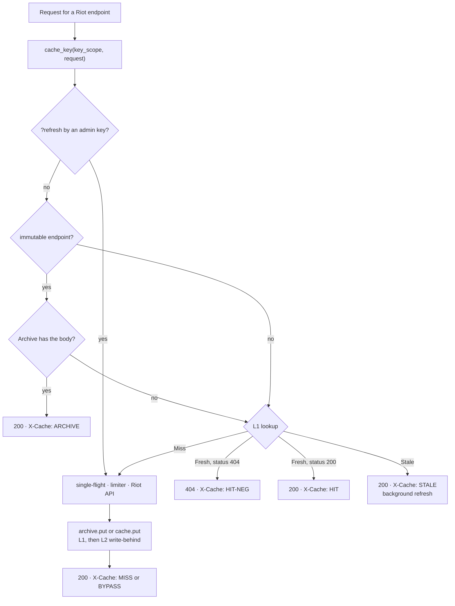

# Caching

What riot-proxy caches, where each tier lives, how entries are keyed, how long they last, what invalidates them and what a restart loses. The row layout of the persisted tier is in [schema.md](schema.md#cache-l2); the entry type is in [models.md](models.md#cache-entry).

## The tiers at a glance

| Tier | Holds | Where | Size bound | Survives restart |
|---|---|---|---|---|
| Archive | match and timeline bodies | SQLite `matches`, `timelines`, then packs in the bucket | unbounded | yes |
| L1 | every TTL'd endpoint, negative entries, the champion-pool document | moka, in process | `CACHE_L1_MAX_MB` (128 MB) by weight | no, rewarmed from L2 |
| L2 | endpoints with `persist_l2` | SQLite `cache` | none beyond the sweep | yes |
| Analytics responses | the five `/v1/lol/analytics/*` 200 bodies and ETags | in process LRU | `ANALYTICS_CACHE_ENTRIES` (512) | no, rewarmed by the next rebuild |
| Auth | consumer rows by key hash | moka, in process | 10 000 entries | no |
| Data Dragon mirror | patch JSON, queue table, images | `DATA_DIR/ddragon/` on disk | none | yes |

## A read through the tiers

The order the fetcher checks on a Riot-backed read (`src/fetcher.rs:301-367`).



Only the L1 lookup decides freshness; L2 is never read on the request path, it is loaded into L1 once at boot (`src/cli/serve.rs:84-92`). A miss or bypass goes through the single-flight map so concurrent misses for one key share one upstream call (`src/fetcher.rs:343-359`, `src/singleflight.rs:1-12`). When the limiter refuses or Riot fails, a copy inside its hard TTL is served as `STALE` (`fetcher.rs:415-428,460-466`).

## L1

- A `moka::future::Cache<String, Arc<CacheEntry>>` with `max_capacity = CACHE_L1_MAX_MB × 1024 × 1024` bytes (default 128, range 1–1 048 576, `src/config.rs:726`) and a weigher of `key.len() + body.len() + 128` (`src/cache/l1.rs:18-19,102-119`). An entry heavier than the whole budget is not kept.
- Freshness is the entry's own instants on tokio time: `Fresh` before `soft_expires`, `Stale` before `hard_expires`, else invalidated and `Miss` (`l1.rs:121-134`). moka's per-entry expiry is set to the hard TTL only to reclaim memory (`l1.rs:64-86`).
- Soft and hard TTLs come from the endpoint registry; hard = soft × 4 while `STALE_WHILE_REVALIDATE=true` (default), else hard = soft (`src/riot/endpoints.rs:13-14,476-489`, `config.rs:733`). A `Stale` hit is served and a bulk-priority refresh runs in the background with a 15-minute budget (`fetcher.rs:332-338,376-390`).
- A refresh that returns byte-identical bytes keeps `content_at` and restarts `fetched_at` and both expiries (`l1.rs:161-176`).
- Negative entries are 404s stored with `soft = hard = negative TTL`, never `Stale`: `NEG_TTL_SECONDS` (30) for most endpoints, `NEG_TTL_ACCOUNT_SECONDS` (300) for account-v1, none for the ladder, rotations, status and league-exp endpoints (`l1.rs:143-146`, `config.rs:727-728`, `endpoints.rs:93-284`).
- Immutable endpoints never enter L1: `put` returns `None` when the TTLs are `None` (`l1.rs:136-141`).
- `invalidate_where(pred)` removes every matching key and `keys_where` lists them without removing (`l1.rs:183-204`); both serve the admin purge.

## L2

- The SQLite `cache` table holds only endpoints with `persist_l2`: `account.byRiotId`, `account.byPuuid`, `account.regionByPuuid`, `summoner.byPuuid`, the four ladder endpoints and both mastery endpoints (`src/cache/mod.rs:58-64`, `endpoints.rs:639-657`). Negative entries for those endpoints are persisted too (`cache/mod.rs:52-56`).
- Write-behind: `put` enqueues a row on a bounded channel of 10 000; the writer flushes a batch of 500 rows or 2 s after a batch's first row, whichever comes first, as one `INSERT OR REPLACE` transaction; a full channel drops the row, logs a warning and bumps `cache_l2_dropped_total` (`src/cache/l2.rs:23-28,102-112,126-183`). The request path never waits.
- Boot: `warm` loads every row with `hard_expires > now` into L1, then `sweep` deletes rows with `hard_expires <= now` (`l2.rs:186-223`, `serve.rs:84-92`). Shutdown drops the sender and awaits the writer, which flushes the rest (`l2.rs:115-123`, `serve.rs:412`).
- The daily `maintenance` job runs `sweep` again (`src/jobs/maintenance.rs:251`).

## TTLs per endpoint

From the registry (`src/riot/endpoints.rs:93-284`); hard TTLs assume stale-while-revalidate on. `CACHE_TTL_OVERRIDES=key=seconds,…` replaces the soft TTL of every endpoint sharing an override key, and the hard TTL follows (`endpoints.rs:424-444,476-489`); keys naming only immutable endpoints (`match`, `timeline`) are logged as ineffective at boot (`endpoints.rs:498-512`).

| Endpoint id | Soft | Hard | Negative | L2 | Override key |
|---|---|---|---|---|---|
| `account.byRiotId`, `account.byPuuid`, `account.regionByPuuid` | 86 400 s | 345 600 s | 300 s | yes | `account` |
| `summoner.byPuuid` | 3 600 s | 14 400 s | 30 s | yes | `summoner` |
| `league.entriesByPuuid` | 300 s | 1 200 s | 30 s | no | `league` |
| `league.challenger`, `league.grandmaster`, `league.master`, `league.entriesByTier` | 120 s | 480 s | none | yes | `ladder` |
| `league.expEntries` | 120 s | 480 s | none | no | `ladder` |
| `match.idsByPuuid` | 120 s | 480 s | 30 s | no | `matchIds` |
| `match.byId`, `match.timeline` | archive | archive | 30 s | no | `match`, `timeline` (ineffective) |
| `spectator.activeGame` | 30 s | 120 s | 30 s | no | `spectator` |
| `mastery.byPuuid`, `mastery.topByPuuid` | 3 600 s | 14 400 s | 30 s | yes | `mastery` |
| `platform.championRotations` | 21 600 s | 86 400 s | none | no | `rotations` |
| `status.platformData` | 60 s | 240 s | none | no | `status` |

## Cache keys

`{key_scope}:{endpoint id}:{host}[:{param}]…[:{query hash}]` (`src/cache/keys.rs:72-90`): the host is the request's target host, or the literal `account` for account-v1 so every cluster shares one entry; path parameters stay readable (percent-encoded, so a value can never contain a bare `:`); the query is sorted, empty values dropped, both sides `encodeURIComponent`-encoded, then hashed to 16 hex characters of sha256 (`keys.rs:50-69`).

```text
3f9a1c2e:summoner.byPuuid:oc1.api.riotgames.com:AbC…
3f9a1c2e:match.idsByPuuid:sea.api.riotgames.com:AbC…:9c1d2e3f4a5b6c7d
3f9a1c2e:account.byPuuid:account:AbC…
3f9a1c2e:derived:pool:1a2b3c4d5e6f7a8b
```

`KeyScope` is the first 8 hex characters of `sha256(RIOT_API_KEY)`, derived at boot and stored nowhere (`keys.rs:24-42`). Changing the Riot key changes the scope: every L1 and L2 entry, every `players`, `match_facts`, `ladder_entries` and rank row written under the old key becomes inert rather than wrong, because PUUIDs are encrypted per key; the archive, keyed by plain match id, is untouched (`docs/design/04-data-and-cache.md:417-423`).

## The archive as a cache

`match.byId` and `match.timeline` have no TTL: a body is fetched once and served from `matches` or `timelines` forever, byte-identical, with `X-Cache: ARCHIVE`, `X-Cache-Age: 0` and no `X-Cache-Fetched-Age` (`fetcher.rs:306-317`, `src/routes/passthrough.rs:133-145`). An offloaded body is read back from its pack by byte range (`src/archive/matches.rs:232-328`); a body that cannot be read is dropped with a warning and the request goes to Riot (`src/archive/mod.rs:128-144`). The archive is never purged by `POST /v1/admin/cache/purge` (`src/routes/admin.rs:831-834`).

## Derived documents in L1

`GET /v1/players/{puuid}/champions` stores its JSON document in L1 under `derived_key(scope, "pool", <canonical target>)` with soft = hard = 300 s (`src/routes/players.rs:883-884,1050-1078`, `keys.rs:96-98`). A `Fresh` hit answers `X-Cache: HIT` with `X-Cache-Age`; a computed one answers `MISS` and `X-Cache-Age: 0`.

## Analytics response cache

- Each of the five analytics routes keeps its serialised 200 and `ETag` in an LRU of `ANALYTICS_CACHE_ENTRIES` entries (default 512, range 0–4 096; 0 stores nothing; `config.rs:767`, `src/routes/analytics/cache.rs:72-130`).
- Key: `route|keyScope|championId|part|…` with `~` for a part left open, every parameter as parsed, so two spellings of one query share an entry; the builds route appends `opponentId` last (`src/routes/analytics.rs:947-983`).
- Cleared by `Analytics::clear` after each `aggregate:analytics` rebuild's last commit (and after a failed one), once per `aggregate:delta` run that counted anything, after its last batch rather than per batch (`src/jobs/analytics.rs:815-818`), and by `/dev/reset`; a clear bumps a generation, and a miss that began before it does not store what it read (`cache.rs:1-19,107-137`). An entry also records the Data Dragon version it was built at; a lookup at another version is a miss (`cache.rs:89-100`).
- Concurrent misses for one key share one computation through a single-flight keyed by generation (`cache.rs:205-235`).
- After a rebuild, and after a delta for each ladder it counted in, the job warms, for every ladder queue, the champions call at `patch=all` and without a patch, the rebuilt platform's champions call and both patch lists (`cache.rs:178-187,240-264`).
- Serving: a hit sends `X-Cache: HIT`, a computed one `MISS`; both carry `Cache-Control: private, max-age=300` and a weak `ETag` `W/"<base64url(sha256(parts))>"`; on the champions, champion detail, matchups and builds routes the parts include the newest `computed_at` of the slice's `analytics_match_totals` rows, so a delta that adds a game anywhere in the slice changes the tag (THR-03; one more read per miss, `src/routes/analytics.rs:749-765`, `src/archive/analytics.rs:1375-1404`); `If-None-Match` listing that tag or `*` gets a 304 with the same headers (`analytics.rs:52,577-616`).

## Auth cache

Consumer lookups are cached in a moka cache of 10 000 entries keyed by the key's sha256: 60 s for a found consumer, 30 s for an unknown key (`src/http/auth.rs:29-32,206-209`). Revoking a consumer invalidates its entry (`auth.rs:263-265`).

## Data Dragon mirror

`ddragon:sync` writes patch JSON to `DATA_DIR/ddragon/<version>/` and the queue table to `ddragon/meta/queues.json`; images are fetched on first request into `ddragon/<version>/img/` (`src/jobs/ddragon.rs:239-285`, `src/static/images.rs`). Files under `/ddragon/*` are sent with `Cache-Control: public, max-age=31536000, immutable`; a non-200 carries no `Cache-Control` (`src/routes/statics.rs:26,79`).

## Refresh cooldowns

`?refresh=true` on the player composites is allowed for any consumer but metered per `(part, puuid)`: one claim per 60 s (`src/routes/players/refresh.rs:17-18,43-71`). Losing the race is not an error; the body says `refreshed: false` and `refreshAvailableIn` seconds, rounded up. The windows live in memory, so a restart allows at most one early refresh per player (`refresh.rs:5-7`). On the passthrough routes `?refresh` is honoured only for a key with the `admin` scope and skips cache reads while still writing (`src/routes/passthrough.rs:159-167`, `fetcher.rs:126-127`).

## ETag on pages

`/dashboard` and the other pages rendered at startup are sent with a strong `ETag` and `Cache-Control: no-cache`, so a reload revalidates with `If-None-Match` and costs a 304 (`src/routes/ui.rs:8-9,108-128`).

## Purging

`POST /v1/admin/cache/purge` takes a Redis-style glob (`*`, `?`, `[…]`, 1–200 characters) and removes matching keys from L1 and L2; `dryRun` only counts (`src/routes/admin.rs:816-883`). The pattern is prefixed with the current key scope unless it already starts with one (`keys.rs:103-114`), so `summoner.byPuuid:*` purges every summoner entry of this deployment. The archive is not a cache and is never purged.

## What a restart loses

| State | After restart |
|---|---|
| L1 | empty, then rewarmed from L2 before the listener opens (`serve.rs:84-92`); L1-only endpoints (league entries, spectator, match-id lists, rotations, status) start cold |
| L2 | kept; expired rows swept |
| Limiter buckets | restored from `limiter_state`; a checkpoint older than 120 s restores every window as full (`src/riot/limiter/persist.rs:23,92-94`) |
| Analytics responses | cold until the next rebuild's or delta's warm; the first visitor computes |
| Auth cache, refresh windows, single-flight map | empty |
| Recent-request ring, live job activity | empty (in memory only) |
| Offload trigger counter | 0; boot queues an `archive:offload` run to compensate (`src/cli/serve.rs:334-340`) |

---
**Sources:** `src/fetcher.rs:L301-L367`, `src/fetcher.rs:L376-L390`, `src/fetcher.rs:L415-L428`, `src/cache/l1.rs:L18-L19`, `src/cache/l1.rs:L64-L146`, `src/cache/l1.rs:L161-L204`, `src/cache/l2.rs:L23-L28`, `src/cache/l2.rs:L102-L223`, `src/cache/mod.rs:L39-L64`, `src/cache/keys.rs:L24-L114`, `src/riot/endpoints.rs:L13-L14`, `src/riot/endpoints.rs:L93-L284`, `src/riot/endpoints.rs:L424-L512`, `src/config.rs:L726-L733`, `src/config.rs:L767`, `src/cli/serve.rs:L84-L92`, `src/cli/serve.rs:L334-L340`, `src/cli/serve.rs:L412`, `src/routes/analytics.rs:L52`, `src/routes/analytics.rs:L577-L616`, `src/routes/analytics.rs:L749-L765`, `src/routes/analytics.rs:L947-L983`, `src/archive/analytics.rs:L1375-L1404`, `src/jobs/analytics.rs:L815-L818`, `src/routes/analytics/cache.rs:L1-L264`, `src/routes/players.rs:L883-L884`, `src/routes/players.rs:L1050-L1078`, `src/routes/players/refresh.rs:L5-L71`, `src/routes/passthrough.rs:L126-L167`, `src/routes/admin.rs:L816-L883`, `src/routes/statics.rs:L26`, `src/routes/statics.rs:L79`, `src/routes/ui.rs:L8-L9`, `src/routes/ui.rs:L108-L128`, `src/http/auth.rs:L29-L32`, `src/http/auth.rs:L206-L209`, `src/archive/matches.rs:L232-L328`, `src/archive/mod.rs:L128-L144`, `src/riot/limiter/persist.rs:L23`, `src/jobs/maintenance.rs:L251`, `src/jobs/ddragon.rs:L239-L285`, `docs/design/04-data-and-cache.md:L372-L436`, `docs/_meta/scratch/riot-and-cache.md`
**Last verified:** 2026-10-22 against commit `6eda84e`
