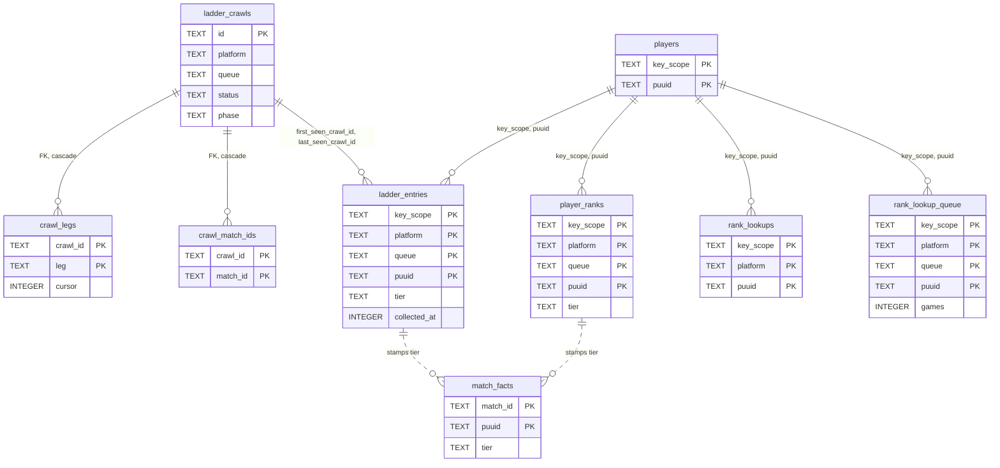

# SQLite schema: ladder, rank and analytics tables

The second half of the schema after V0030: the ladder crawl tables, the rank lookups that place archived players, the analytics tables rebuilt from `match_facts`, and the bookkeeping that lets `aggregate:delta` add new matches to them (THR-03, ADR-182). The core and archive groups, and the conventions that apply to every table, are in [schema.md](schema.md).

## Ladder and rank tables

The crawl log, the ladder itself, a crawl's outstanding work, and the three rank tables that feed `match_facts.tier`.

Only the two crawl children have declared foreign keys. The dotted edges are the tier stamp: when a match is archived, each participant's `match_facts.tier` is set to the newer of their `ladder_entries` and `player_ranks` row for that platform and queue, else `UNKNOWN` (`src/archive/tiers.rs:37-57`).

### ladder_crawls

[`V0004__ladder.sql`](../../src/db/migrations/V0004__ladder.sql) (`V0004:14-35`); `apex_capped` from [`V0008`](../../src/db/migrations/V0008__apex_capped.sql); `players_skipped` from [`V0030`](../../src/db/migrations/V0030__collect_cursor.sql).

| Column | Type | Constraints | Notes |
|---|---|---|---|
| `id` | TEXT | PRIMARY KEY | ULID |
| `key_scope`, `platform`, `queue` | TEXT | NOT NULL | `queue` is league-v4's name, `RANKED_SOLO_5x5` |
| `tier_floor` | TEXT | NOT NULL | lowest tier walked |
| `status` | TEXT | NOT NULL DEFAULT 'running' | `running`, `completed`, `failed`, `cancelled` |
| `phase` | TEXT | NOT NULL DEFAULT 'enumerate' | `enumerate`, `collect`, `archive` |
| `started_at` | INTEGER | NOT NULL | unix ms |
| `finished_at` | INTEGER | nullable | unix ms |
| `pages_fetched`, `entries_seen`, `players_discovered`, `backfills_enqueued`, `match_ids_seen`, `matches_queued`, `legs_failed` | INTEGER | NOT NULL DEFAULT 0 | v1's counters |
| `apex_capped` | TEXT | nullable | JSON list of apex tiers cut at Riot's 10 000 cap, e.g. `["MASTER"]` (`V0008:1-4`) |
| `players_skipped` | INTEGER | NOT NULL DEFAULT 0 | players the collect stage left out because their wins + losses equal their `collected_games` (THR-04, ADR-185; `V0030:8`) |

Indexes: `ladder_crawls_live UNIQUE (key_scope, platform, queue) WHERE status = 'running'` (one live crawl per ladder, `V0004:33-34`); `ladder_crawls_recent (key_scope, platform, queue, started_at)`. Written by `src/jobs/ladder/store.rs:101-107` (insert) and the counter, phase and finish updates (`:277-423`). Read by the crawl routes and the stats snapshot. Retention: a run log, never deleted (`V0004:5-6`).

### ladder_entries

`V0004:37-59`, and the collect cursor from [`V0030`](../../src/db/migrations/V0030__collect_cursor.sql). The ladder's latest state per player; outlives the crawl rows.

| Column | Type | Constraints | Notes |
|---|---|---|---|
| `key_scope`, `platform`, `queue`, `puuid` | TEXT | NOT NULL, PK | |
| `tier`, `division` | TEXT | NOT NULL | Riot's `tier` and `rank` |
| `league_points`, `wins`, `losses` | INTEGER | NOT NULL | |
| `veteran`, `inactive`, `fresh_blood`, `hot_streak` | INTEGER | NOT NULL DEFAULT 0 | Riot's flags as 0/1 |
| `first_seen_crawl_id` | TEXT | NOT NULL | set once |
| `last_seen_crawl_id` | TEXT | NOT NULL | restamped by every crawl that sees the player |
| `updated_at` | INTEGER | NOT NULL | unix ms |
| `collected_games` | INTEGER | nullable | `wins + losses` when the player's last collect walk finished; NULL until a first one does (THR-04, ADR-185; `V0030:6`) |
| `collected_at` | INTEGER | nullable | unix ms, when that walk began; the next crawl asks for games since then less `LADDER_COLLECT_OVERLAP_S` (`V0030:7`) |

Indexes: `ladder_entries_ladder (key_scope, platform, queue, tier, division, league_points)`, `ladder_entries_last_seen (last_seen_crawl_id)`, `ladder_entries_puuid (key_scope, puuid)` (`V0004:56-59`). Written by the apex and walk legs' page upsert (`src/jobs/ladder/store.rs:234-245`), which leaves the cursor alone, and the cursor by `store::stamp_cursor` after a finished collect walk. Read by the collect candidates (a player whose total equals `collected_games` is skipped), the tier stamp, the rank planner and the ladder routes. Retention: never deleted.

### crawl_legs and crawl_match_ids

`V0004:61-72`. `crawl_legs(crawl_id TEXT NOT NULL REFERENCES ladder_crawls(id) ON DELETE CASCADE, leg TEXT NOT NULL, cursor INTEGER)`, primary key `(crawl_id, leg)`: a crawl's outstanding jobs, `leg` like `ladder:walk:DIAMOND:I`, `cursor` a walk's next page. `crawl_match_ids(crawl_id … CASCADE, match_id TEXT NOT NULL)`, primary key `(crawl_id, match_id)`: the "collect" set of match ids to archive. Written by the legs (`store.rs:143,284,360,500,529`); each job deletes its own leg and the crawl's finish deletes the rest (`store.rs:360,429-430`). Retention: emptied as the crawl finishes.

### player_ranks

[`V0010__player_ranks.sql`](../../src/db/migrations/V0010__player_ranks.sql): `key_scope`, `platform`, `queue` (league-v4 queueType), `puuid` TEXT NOT NULL (primary key, that order), `tier`, `division` TEXT NOT NULL, `league_points INTEGER NOT NULL`, `fetched_at INTEGER NOT NULL` (unix ms). Written by `ranks::record` from every `league.entriesByPuuid` body the fetcher sees: the player's rows on that platform are deleted and one is inserted per ranked queue (`src/archive/ranks.rs:53-66`, `src/archive/mod.rs:180-198`). Read by the tier stamp. Retention: replaced per lookup.

### rank_lookups and rank_lookup_queue

[`V0011__rank_lookups.sql`](../../src/db/migrations/V0011__rank_lookups.sql). `rank_lookups(key_scope, platform, puuid TEXT NOT NULL, looked_up_at INTEGER NOT NULL)`, primary key `(key_scope, platform, puuid)`: when a player was last looked up on a platform, ranked or not, seeded from `player_ranks` (`V0011:14-16`). `rank_lookup_queue(key_scope, platform, queue, puuid TEXT NOT NULL, games INTEGER NOT NULL)`, primary key `(key_scope, platform, queue, puuid)`, index `rank_lookup_queue_next (key_scope, platform, queue, games DESC)`: the players a `ranks:lookup` run plans to ask about, most archived games first. Written by `ranks.rs:74-81` (stamp) and `:144-222` (plan, take, put back). Retention: the queue drains itself; the stamps are kept and reread against `RANK_LOOKUP_RECHECK_S`.

## Analytics tables

All derived: rebuilt per ladder by `aggregate:analytics`, and added to a batch of new matches at a time by `aggregate:delta` (THR-03). All `WITHOUT ROWID` since [`V0020`](../../src/db/migrations/V0020__without_rowid_derived.sql) except `analytics_runs` and `analytics_unsplit`.

```mermaid
erDiagram
    match_facts {
        TEXT match_id PK
        TEXT puuid PK
        TEXT tier
        INTEGER team_id
    }
    matches {
        TEXT match_id PK
        TEXT patch
        INTEGER remake
    }
    match_bans {
        TEXT match_id PK
    }
    match_builds {
        TEXT match_id PK
        TEXT puuid PK
    }
    analytics_slices {
        TEXT tier PK
        TEXT patch PK
        INTEGER matches
    }
    analytics_match_totals {
        TEXT patch PK
        INTEGER matches
    }
    analytics_floor_totals {
        TEXT floor_tier PK
        INTEGER matches
    }
    champion_stats {
        TEXT tier PK
        INTEGER champion_id PK
        TEXT side PK
    }
    champion_stats_totals {
        INTEGER champion_id PK
        TEXT side PK
    }
    champion_bans {
        TEXT tier PK
        INTEGER champion_id PK
    }
    champion_ban_totals {
        INTEGER champion_id PK
    }
    champion_ban_floor_totals {
        TEXT floor_tier PK
        INTEGER champion_id PK
    }
    champion_matchups {
        INTEGER champion_id PK
        INTEGER opponent_id PK
    }
    champion_items {
        INTEGER item_id PK
    }
    champion_runes {
        INTEGER keystone_id PK
    }
    champion_spells {
        INTEGER spell_a PK
        INTEGER spell_b PK
    }
    champion_builds {
        TEXT core PK
    }
    champion_build_parts {
        TEXT part PK
        TEXT value PK
    }
    champion_matchup_builds {
        INTEGER opponent_id PK
        TEXT core PK
    }
    champion_matchup_build_parts {
        TEXT part PK
        TEXT value PK
    }
    analytics_runs {
        TEXT platform PK
        TEXT queue PK
    }
    analytics_unsplit {
        TEXT platform PK
        TEXT queue PK
    }
    matches ||--o{ match_facts : "join"
    match_facts }o..o{ analytics_slices : "rebuild_champions"
    match_facts }o..o{ analytics_match_totals : "rebuild_champions"
    match_facts }o..o{ analytics_floor_totals : "rebuild_champions"
    match_facts }o..o{ champion_stats : "rebuild_champions"
    champion_stats }o..o{ champion_stats_totals : "summed over tier"
    match_bans }o..o{ champion_bans : "rebuild_champions"
    match_bans }o..o{ champion_ban_totals : "rebuild_champions"
    match_bans }o..o{ champion_ban_floor_totals : "rebuild_champions"
    match_facts }o..o{ champion_matchups : "rebuild_matchups"
    match_facts }o..o{ champion_items : "rebuild_builds"
    match_facts }o..o{ champion_runes : "rebuild_builds"
    match_facts }o..o{ champion_spells : "rebuild_builds"
    match_builds }o..o{ champion_builds : "rebuild_builds"
    champion_builds ||..o{ champion_build_parts : "same core"
    match_builds }o..o{ champion_matchup_builds : "rebuild_builds"
    champion_matchup_builds ||..o{ champion_matchup_build_parts : "same core"
```

Every dotted edge is an `INSERT … SELECT` in `src/archive/analytics.rs`; nothing is declared. The diagram shows only the distinguishing key columns; every aggregate also carries `key_scope`, `platform`, `queue`, `patch` and `remake`.

### How a rebuild writes them

`Scope::clear` deletes a table's rows for `(key_scope, platform, queue)` and the rebuilt patches, then `Scope::insert` runs an `INSERT … SELECT` binding `?1`–`?6` = key scope, platform, queue, queue id, patches JSON, now (`src/archive/analytics.rs:70-97`). The source is `ladder_facts`: facts of the platform's matches in the queue with a stamped tier and `team_id IN (100, 200)`, `tier` = `f.tier`, `side` = `blue` for team 100 else `red` (`analytics.rs:104-152`). Patches = the newest `AGGREGATE_PATCH_LIMIT` (default 4; 0 = all, `src/config.rs:772`); rows for older patches are kept (`analytics.rs:15-17`). A ladder on `analytics_unsplit`, or one not stamped in `analytics_stamped` while `AGGREGATE_DELTA_S` > 0, is rebuilt over every patch (`src/jobs/analytics.rs:438-457`). `remake` is a key everywhere, so a read excludes remakes (the default) or sums both (`V0005:9-10`). Six transactions, one per step of `STEPS` (`analytics.rs:205-256`): champions (`:346-418`), matchups (`:493-556`), then items, runes, spells and set builds (`:577-734`). Each step ends by setting its bit in `analytics_counted` for every match it read and deleting that step's `analytics_retract` rows for them (`stamp_step`, `src/archive/analytics/delta.rs:61-96`). A rebuild over every patch then writes the ladder's `analytics_stamped` row (`src/jobs/analytics.rs:498-518`). Nothing trims by age; `/dev/reset` wipes all.

### How a delta adds to them

`aggregate:delta` reads up to a batch of a stamped ladder's matches whose `analytics_counted.bits` is not 63 and whose facts are at the current `FACTS_VERSION`, plus matches with `analytics_retract` rows (`src/archive/analytics/delta.rs:233-299`). `count_batch` runs, in one write transaction, each missing step's statements over a temp copy of those matches' facts and upserts the result into the same tables, adding to their sums and setting `computed_at`; for a match with retract rows it first subtracts what the step counted at the old tier, and drops rows left counting nothing; then it sets the batch's bits to 63 and deletes its retract rows (`delta.rs:385-559`). Every table is a sum over disjoint matches, so a delta's output equals a rebuild's (`delta.rs:19-20`). Nothing is written for a ladder that is no longer ready (`delta.rs:392-394`).

### Column reference

Common key prefix on every aggregate: `key_scope TEXT`, `platform TEXT`, `queue TEXT`, `patch TEXT`, all `NOT NULL`; `remake INTEGER NOT NULL` (0/1); `tier TEXT` and `side TEXT NOT NULL` where listed (`''` on rows copied by V0017 and not yet split, `V0017:9-15`). `role` is `teamPosition` or `''`. Value columns are `INTEGER NOT NULL`; `computed_at` is unix ms.

| Table | Primary key, in order | Value columns | Meaning | DDL |
|---|---|---|---|---|
| `analytics_slices` | key_scope, platform, queue, tier, patch, remake | matches | distinct matches with a participant at the tier: the per-tier pick and ban denominator; a match counts in every tier it has a player in | `V0020:44-54` |
| `analytics_match_totals` | key_scope, platform, queue, patch, remake | matches | the same matches once each: the tierless denominator (ADR-123) | `V0015:7-13`, `V0020:56-67` |
| `analytics_floor_totals` | key_scope, platform, queue, floor_tier, patch, remake | matches | matches with a player at or above `floor_tier`, counted once per floor (`minTier`, ADR-170) | `V0026:10-17` |
| `champion_stats` | key_scope, platform, queue, tier, patch, champion_id, role, remake, side | games, wins, matches_picked, stated_games, kills, deaths, assists, cs, gold, damage, vision, duration_s | per-participant sums; `stated_games` = games with a K/D/A, `duration_s` = seconds of those games (`analytics.rs:378-393`) | `V0020:69-89` |
| `champion_stats_totals` | key_scope, platform, queue, patch, champion_id, role, remake, side | the same sums | `champion_stats` summed over tier, written from the rows just inserted (`totals_from`, `analytics.rs:264-279`); `champion_stats_slice` dropped at `V0025:40` | `V0025:16-30` |
| `champion_bans` | key_scope, platform, queue, tier, patch, champion_id, remake | bans | distinct matches it was banned in, per tier | `V0020:91-102` |
| `champion_ban_totals` | key_scope, platform, queue, patch, champion_id, remake | bans | the same once per match | `V0015:15-21`, `V0020:104-115` |
| `champion_ban_floor_totals` | key_scope, platform, queue, floor_tier, patch, champion_id, remake | bans | per floor | `V0026:19-25` |
| `champion_matchups` | key_scope, platform, queue, patch, champion_id, role, opponent_id, remake, tier, side | games, wins | lane pairs, one player per team per lane, mirrors excluded, recorded from both sides at the row's own player's tier (`analytics.rs:481-556`) | `V0020:117-128` |
| `champion_items` | …, champion_id, role, item_id, remake, tier, side | games, wins | slots 0–5, empty skipped, a player's duplicate item once (`analytics.rs:587-604`) | `V0020:130-141` |
| `champion_runes` | …, champion_id, role, keystone_id, sub_style_id, remake, tier, side | games, wins | from `runes[1]`, `runes[2]` | `V0020:143-155` |
| `champion_spells` | …, champion_id, role, spell_a, spell_b, remake, tier, side | games, wins | unordered pair, `spell_a <= spell_b` | `V0020:157-170` |
| `champion_builds` | …, champion_id, role, remake, core, tier, side | games, wins | `core` = JSON `[a,b]` of the first two finished items; players with two or more count | `V0020:172-184` |
| `champion_build_parts` | …, champion_id, role, remake, core, part, value, tier, side | games, wins | `part` ∈ item3, item4, item5, starter, boots, skill_order, runes, spells; `value` an item id, the starter JSON, `"QWE"`, `"keystone:subStyle"` or `"a:b"` (`analytics.rs:561-572`) | `V0020:186-200` |
| `champion_matchup_builds` | …, champion_id, role, opponent_id, remake, core, tier, side | games, wins | set builds against one lane opponent; `role` is a lane, never `''` | `V0027:10-19` |
| `champion_matchup_build_parts` | …, champion_id, role, opponent_id, remake, core, part, value, tier, side | games, wins | `part` ∈ item3, boots, runes, spells only | `V0027:21-30` |

### analytics_runs

[`V0006__analytics_runs.sql`](../../src/db/migrations/V0006__analytics_runs.sql), rebuilt by [`V0029__analytics_counted.sql`](../../src/db/migrations/V0029__analytics_counted.sql) (`V0029:52-67`) with `kind`, a rowid table: `key_scope`, `platform`, `queue`, `kind TEXT NOT NULL DEFAULT 'rebuild'` (`rebuild` or `delta`; primary key over the four), `at INTEGER NOT NULL` (unix ms the run ended), `status TEXT NOT NULL` (`completed` or `failed`), `ms INTEGER NOT NULL`, `steps TEXT NOT NULL` (JSON `{step: seconds}`; a delta's is `{"delta": seconds}`), `rows TEXT NOT NULL` (JSON `{table: rows}`, rows upserted for a delta), `games INTEGER NOT NULL`. One row per ladder and kind, `INSERT OR REPLACE` after every rebuild and every delta that counted something (`src/jobs/analytics.rs:215-239`). V0029 copied the old rows as `rebuild`. Read by the dashboard and `/v1/admin/metrics`.

### analytics_counted

`V0029:10-16`, `WITHOUT ROWID`: `match_id TEXT NOT NULL` (FK `matches` ON DELETE CASCADE), `key_scope TEXT NOT NULL`, `bits INTEGER NOT NULL`; primary key `(match_id, key_scope)`. One bit per rebuild step that has counted the match: 1 champions, 2 matchups, 4 items, 8 runes, 16 spells, 32 set builds; 63 is fully counted. Partial index `analytics_uncounted (key_scope, match_id) WHERE bits <> 63`, the delta's work list. Written at 0 by `matches::write_derived` for a solo or flex match (`src/archive/analytics/delta.rs:98-118`); bit 32 cleared by a match's first `match_builds` rows (`delta.rs:120-146`); bits set by each rebuild step and by a delta batch. Retention: goes with its match.

### analytics_retract

`V0029:18-27`, `WITHOUT ROWID`: `match_id TEXT NOT NULL` (FK `matches` cascade), `key_scope`, `puuid TEXT NOT NULL`, `step INTEGER NOT NULL` (one bit), `tier TEXT` (the tier that step counted the player at); primary key `(match_id, key_scope, puuid, step)`. Written by the trigger `match_facts_tier_moved` (`V0029:38-50`): `AFTER UPDATE OF tier ON match_facts` when the tier changes, one row per step set in the match's `analytics_counted.bits`, `INSERT OR IGNORE` so a tier that moves twice keeps the oldest. Deleted by the step that recounts the match (rebuild or delta). Retention: drains with the deltas.

### analytics_stamped

`V0029:29-36`, `WITHOUT ROWID`: `key_scope`, `platform`, `queue TEXT NOT NULL` (primary key), `stamped_at INTEGER` (start of the last full rebuild that stamped the ladder), `dirty_at INTEGER` (when a counted match's inputs were rewritten since). A ladder takes deltas only when `stamped_at` is set and `dirty_at` is NULL (`src/archive/analytics/delta.rs:199-222`). `dirty_at` is set when `write_derived` rewrites a counted match's facts from an older `FACTS_VERSION` or `builds::write` replaces rows a set-build step counted (`mark_dirty`, `delta.rs:158-178`); a full rebuild that started after the mark clears it (`mark_stamped`, `delta.rs:180-197`). Read by boot, `aggregate:delta` and `facts:reextract`, which queue a full rebuild for each configured ladder not ready (`src/jobs/analytics.rs:109-137`). V0029 creates it empty, so after the upgrade each ladder needs one full rebuild before its first delta.

### analytics_unsplit

[`V0017__tier_side_keys.sql`](../../src/db/migrations/V0017__tier_side_keys.sql) (`V0017:17-28`), a rowid table: `key_scope`, `platform`, `queue TEXT NOT NULL`, primary key over all three. Seeded by the migration with every ladder that had analytics rows; a listed ladder's next rebuild covers every patch and then deletes its row (`src/archive/analytics.rs:730-751`). Boot queues those rebuilds (`src/cli/serve.rs:311-319`). Drains itself.

---
**Sources:** `src/db/migrations/V0004__ladder.sql`, `V0005__analytics.sql`, `V0006__analytics_runs.sql`, `V0008__apex_capped.sql`, `V0010__player_ranks.sql`, `V0011__rank_lookups.sql`, `V0014__champion_builds.sql`, `V0015__analytics_totals.sql`, `V0017__tier_side_keys.sql`, `V0020__without_rowid_derived.sql`, `V0025__champion_stats_totals.sql`, `V0026__floor_totals.sql`, `V0027__matchup_builds.sql`, `V0029__analytics_counted.sql`, `src/archive/analytics.rs:L1-L152`, `src/archive/analytics.rs:L204-L386`, `src/archive/analytics.rs:L449-L751`, `src/archive/analytics/delta.rs:L1-L559`, `src/archive/tiers.rs:L37-L57`, `src/archive/ranks.rs:L53-L81`, `src/archive/mod.rs:L180-L198`, `src/jobs/ladder/store.rs:L101-L107`, `src/jobs/ladder/store.rs:L234-L245`, `src/jobs/analytics.rs:L109-L137`, `src/jobs/analytics.rs:L215-L239`, `src/jobs/analytics.rs:L438-L518`, `src/cli/serve.rs:L311-L333`, `src/config.rs:L772`, `docs/_meta/scratch/persistence.md`
**Last verified:** 2026-10-26 against commit `c9e1b33`
