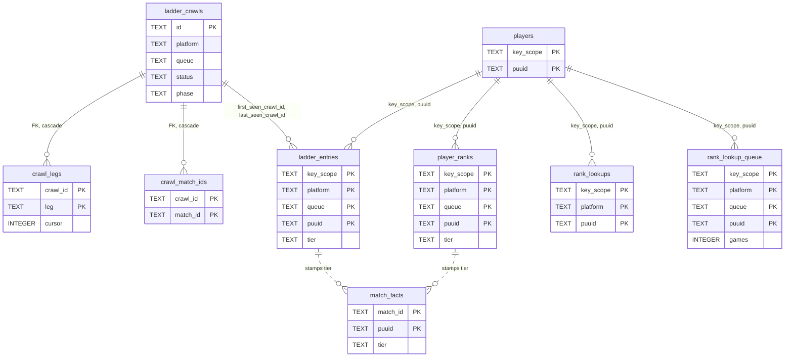

# SQLite schema: ladder, rank and analytics tables

The second half of the schema after V0027: the ladder crawl tables, the rank lookups that place archived players, and the analytics tables rebuilt from `match_facts`. The core and archive groups, and the conventions that apply to every table, are in [schema.md](schema.md).

## Ladder and rank tables

The crawl log, the ladder itself, a crawl's outstanding work, and the three rank tables that feed `match_facts.tier`.

Only the two crawl children have declared foreign keys. The dotted edges are the tier stamp: when a match is archived, each participant's `match_facts.tier` is set to the newer of their `ladder_entries` and `player_ranks` row for that platform and queue, else `UNKNOWN` (`src/archive/tiers.rs:37-57`).

### ladder_crawls

[`V0004__ladder.sql`](../../src/db/migrations/V0004__ladder.sql) (`V0004:14-35`); `apex_capped` from [`V0008`](../../src/db/migrations/V0008__apex_capped.sql).

| Column | Type | Constraints | Notes |
|---|---|---|---|
| `id` | TEXT | PRIMARY KEY | ULID |
| `key_scope`, `platform`, `queue` | TEXT | NOT NULL | `queue` is league-v4's name, `RANKED_SOLO_5x5` |
| `tier_floor` | TEXT | NOT NULL | lowest tier walked |
| `status` | TEXT | NOT NULL DEFAULT 'running' | `running`, `completed`, `failed`, `cancelled` |
| `phase` | TEXT | NOT NULL DEFAULT 'enumerate' | `enumerate`, `collect`, `archive` |
| `started_at` | INTEGER | NOT NULL | unix ms |
| `finished_at` | INTEGER | nullable | unix ms |
| `pages_fetched`, `entries_seen`, `players_discovered`, `backfills_enqueued`, `match_ids_seen`, `matches_queued`, `legs_failed` | INTEGER | NOT NULL DEFAULT 0 | v1's counters |
| `apex_capped` | TEXT | nullable | JSON list of apex tiers cut at Riot's 10 000 cap, e.g. `["MASTER"]` (`V0008:1-4`) |

Indexes: `ladder_crawls_live UNIQUE (key_scope, platform, queue) WHERE status = 'running'` (one live crawl per ladder, `V0004:33-34`); `ladder_crawls_recent (key_scope, platform, queue, started_at)`. Written by `src/jobs/ladder/store.rs:97-103` (insert) and the counter, phase and finish updates (`:277-423`). Read by the crawl routes and the stats snapshot. Retention: a run log, never deleted (`V0004:5-6`).

### ladder_entries

`V0004:37-59`. The ladder's latest state per player; outlives the crawl rows.

| Column | Type | Constraints | Notes |
|---|---|---|---|
| `key_scope`, `platform`, `queue`, `puuid` | TEXT | NOT NULL, PK | |
| `tier`, `division` | TEXT | NOT NULL | Riot's `tier` and `rank` |
| `league_points`, `wins`, `losses` | INTEGER | NOT NULL | |
| `veteran`, `inactive`, `fresh_blood`, `hot_streak` | INTEGER | NOT NULL DEFAULT 0 | Riot's flags as 0/1 |
| `first_seen_crawl_id` | TEXT | NOT NULL | set once |
| `last_seen_crawl_id` | TEXT | NOT NULL | restamped by every crawl that sees the player |
| `updated_at` | INTEGER | NOT NULL | unix ms |

Indexes: `ladder_entries_ladder (key_scope, platform, queue, tier, division, league_points)`, `ladder_entries_last_seen (last_seen_crawl_id)`, `ladder_entries_puuid (key_scope, puuid)` (`V0004:56-59`). Written by the apex and walk legs' page upsert (`src/jobs/ladder/store.rs:230-241`). Read by the tier stamp, the rank planner and the ladder routes. Retention: never deleted.

### crawl_legs and crawl_match_ids

`V0004:61-72`. `crawl_legs(crawl_id TEXT NOT NULL REFERENCES ladder_crawls(id) ON DELETE CASCADE, leg TEXT NOT NULL, cursor INTEGER)`, primary key `(crawl_id, leg)`: a crawl's outstanding jobs, `leg` like `ladder:walk:DIAMOND:I`, `cursor` a walk's next page. `crawl_match_ids(crawl_id … CASCADE, match_id TEXT NOT NULL)`, primary key `(crawl_id, match_id)`: the "collect" set of match ids to archive. Written by the legs (`store.rs:143,284,360,500,529`); each job deletes its own leg and the crawl's finish deletes the rest (`store.rs:360,429-430`). Retention: emptied as the crawl finishes.

### player_ranks

[`V0010__player_ranks.sql`](../../src/db/migrations/V0010__player_ranks.sql): `key_scope`, `platform`, `queue` (league-v4 queueType), `puuid` TEXT NOT NULL (primary key, that order), `tier`, `division` TEXT NOT NULL, `league_points INTEGER NOT NULL`, `fetched_at INTEGER NOT NULL` (unix ms). Written by `ranks::record` from every `league.entriesByPuuid` body the fetcher sees: the player's rows on that platform are deleted and one is inserted per ranked queue (`src/archive/ranks.rs:53-66`, `src/archive/mod.rs:180-198`). Read by the tier stamp. Retention: replaced per lookup.

### rank_lookups and rank_lookup_queue

[`V0011__rank_lookups.sql`](../../src/db/migrations/V0011__rank_lookups.sql). `rank_lookups(key_scope, platform, puuid TEXT NOT NULL, looked_up_at INTEGER NOT NULL)`, primary key `(key_scope, platform, puuid)`: when a player was last looked up on a platform, ranked or not, seeded from `player_ranks` (`V0011:14-16`). `rank_lookup_queue(key_scope, platform, queue, puuid TEXT NOT NULL, games INTEGER NOT NULL)`, primary key `(key_scope, platform, queue, puuid)`, index `rank_lookup_queue_next (key_scope, platform, queue, games DESC)`: the players a `ranks:lookup` run plans to ask about, most archived games first. Written by `ranks.rs:74-81` (stamp) and `:144-222` (plan, take, put back). Retention: the queue drains itself; the stamps are kept and reread against `RANK_LOOKUP_RECHECK_S`.

## Analytics tables

All derived, all rebuilt per ladder by `aggregate:analytics`, all `WITHOUT ROWID` since [`V0020`](../../src/db/migrations/V0020__without_rowid_derived.sql) except `analytics_runs` and `analytics_unsplit`.

Every dotted edge is an `INSERT … SELECT` in `src/archive/analytics.rs`; nothing is declared. The diagram shows only the distinguishing key columns; every aggregate also carries `key_scope`, `platform`, `queue`, `patch` and `remake`.

### How a rebuild writes them

`Scope::clear` deletes a table's rows for `(key_scope, platform, queue)` and the rebuilt patches, then `Scope::insert` runs an `INSERT … SELECT` binding `?1`–`?6` = key scope, platform, queue, queue id, patches JSON, now (`src/archive/analytics.rs:68-96`). The source is `ladder_facts`: facts of the platform's matches in the queue with a stamped tier and `team_id IN (100, 200)`, `tier` = `f.tier`, `side` = `blue` for team 100 else `red` (`analytics.rs:102-127`). Patches = the newest `AGGREGATE_PATCH_LIMIT` (default 4; 0 = all, `src/config.rs:753`); rows for older patches are kept (`analytics.rs:15-17`). `remake` is a key everywhere, so a read excludes remakes (the default) or sums both (`V0005:9-10`). Three transactions: champions (`analytics.rs:135-226`), matchups (`:352-358`), builds (`:379-490`). Nothing trims by age; `/dev/reset` wipes all.

### Column reference

Common key prefix on every aggregate: `key_scope TEXT`, `platform TEXT`, `queue TEXT`, `patch TEXT`, all `NOT NULL`; `remake INTEGER NOT NULL` (0/1); `tier TEXT` and `side TEXT NOT NULL` where listed (`''` on rows copied by V0017 and not yet split, `V0017:9-15`). `role` is `teamPosition` or `''`. Value columns are `INTEGER NOT NULL`; `computed_at` is unix ms.

| Table | Primary key, in order | Value columns | Meaning | DDL |
|---|---|---|---|---|
| `analytics_slices` | key_scope, platform, queue, tier, patch, remake | matches | distinct matches with a participant at the tier: the per-tier pick and ban denominator; a match counts in every tier it has a player in | `V0020:44-54` |
| `analytics_match_totals` | key_scope, platform, queue, patch, remake | matches | the same matches once each: the tierless denominator (ADR-123) | `V0015:7-13`, `V0020:56-67` |
| `analytics_floor_totals` | key_scope, platform, queue, floor_tier, patch, remake | matches | matches with a player at or above `floor_tier`, counted once per floor (`minTier`, ADR-170) | `V0026:10-17` |
| `champion_stats` | key_scope, platform, queue, tier, patch, champion_id, role, remake, side | games, wins, matches_picked, stated_games, kills, deaths, assists, cs, gold, damage, vision, duration_s | per-participant sums; `stated_games` = games with a K/D/A, `duration_s` = seconds of those games (`analytics.rs:173-184`) | `V0020:69-89` |
| `champion_stats_totals` | key_scope, platform, queue, patch, champion_id, role, remake, side | the same sums | `champion_stats` summed over tier, written from the rows just inserted (`analytics.rs:189-201`); `champion_stats_slice` dropped at `V0025:40` | `V0025:16-30` |
| `champion_bans` | key_scope, platform, queue, tier, patch, champion_id, remake | bans | distinct matches it was banned in, per tier | `V0020:91-102` |
| `champion_ban_totals` | key_scope, platform, queue, patch, champion_id, remake | bans | the same once per match | `V0015:15-21`, `V0020:104-115` |
| `champion_ban_floor_totals` | key_scope, platform, queue, floor_tier, patch, champion_id, remake | bans | per floor | `V0026:19-25` |
| `champion_matchups` | key_scope, platform, queue, patch, champion_id, role, opponent_id, remake, tier, side | games, wins | lane pairs, one player per team per lane, mirrors excluded, recorded from both sides at the row's own player's tier (`analytics.rs:295-350`) | `V0020:117-128` |
| `champion_items` | …, champion_id, role, item_id, remake, tier, side | games, wins | slots 0–5, empty skipped, a player's duplicate item once (`analytics.rs:381-398`) | `V0020:130-141` |
| `champion_runes` | …, champion_id, role, keystone_id, sub_style_id, remake, tier, side | games, wins | from `runes[1]`, `runes[2]` | `V0020:143-155` |
| `champion_spells` | …, champion_id, role, spell_a, spell_b, remake, tier, side | games, wins | unordered pair, `spell_a <= spell_b` | `V0020:157-170` |
| `champion_builds` | …, champion_id, role, remake, core, tier, side | games, wins | `core` = JSON `[a,b]` of the first two finished items; players with two or more count | `V0020:172-184` |
| `champion_build_parts` | …, champion_id, role, remake, core, part, value, tier, side | games, wins | `part` ∈ item3, item4, item5, starter, boots, skill_order, runes, spells; `value` an item id, the starter JSON, `"QWE"`, `"keystone:subStyle"` or `"a:b"` (`analytics.rs:363-374`) | `V0020:186-200` |
| `champion_matchup_builds` | …, champion_id, role, opponent_id, remake, core, tier, side | games, wins | set builds against one lane opponent; `role` is a lane, never `''` | `V0027:10-19` |
| `champion_matchup_build_parts` | …, champion_id, role, opponent_id, remake, core, part, value, tier, side | games, wins | `part` ∈ item3, boots, runes, spells only | `V0027:21-30` |

### analytics_runs

[`V0006__analytics_runs.sql`](../../src/db/migrations/V0006__analytics_runs.sql), a rowid table: `key_scope`, `platform`, `queue TEXT NOT NULL` (primary key), `at INTEGER NOT NULL` (unix ms the run ended), `status TEXT NOT NULL` (`completed` or `failed`), `ms INTEGER NOT NULL`, `steps TEXT NOT NULL` (JSON `{step: seconds}`), `rows TEXT NOT NULL` (JSON `{table: rows}`), `games INTEGER NOT NULL`. One row per ladder, `INSERT OR REPLACE` after every run (`src/jobs/analytics.rs:165-183`). Read by the dashboard.

### analytics_unsplit

[`V0017__tier_side_keys.sql`](../../src/db/migrations/V0017__tier_side_keys.sql) (`V0017:17-28`), a rowid table: `key_scope`, `platform`, `queue TEXT NOT NULL`, primary key over all three. Seeded by the migration with every ladder that had analytics rows; a listed ladder's next rebuild covers every patch and then deletes its row (`src/archive/analytics.rs:570-597`). Boot queues those rebuilds (`src/cli/serve.rs:302-311`). Drains itself.

---
**Sources:** `src/db/migrations/V0004__ladder.sql`, `V0005__analytics.sql`, `V0006__analytics_runs.sql`, `V0008__apex_capped.sql`, `V0010__player_ranks.sql`, `V0011__rank_lookups.sql`, `V0014__champion_builds.sql`, `V0015__analytics_totals.sql`, `V0017__tier_side_keys.sql`, `V0020__without_rowid_derived.sql`, `V0025__champion_stats_totals.sql`, `V0026__floor_totals.sql`, `V0027__matchup_builds.sql`, `src/archive/analytics.rs:L1-L127`, `src/archive/analytics.rs:L135-L226`, `src/archive/analytics.rs:L295-L546`, `src/archive/tiers.rs:L37-L57`, `src/archive/ranks.rs:L53-L81`, `src/archive/mod.rs:L180-L198`, `src/jobs/ladder/store.rs:L97-L103`, `src/jobs/ladder/store.rs:L230-L241`, `src/jobs/analytics.rs:L165-L183`, `src/cli/serve.rs:L302-L311`, `src/config.rs:L753`, `docs/_meta/scratch/persistence.md`
**Last verified:** 2026-10-19 against commit `52fa67d`
