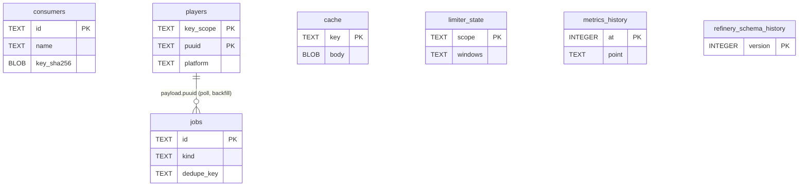
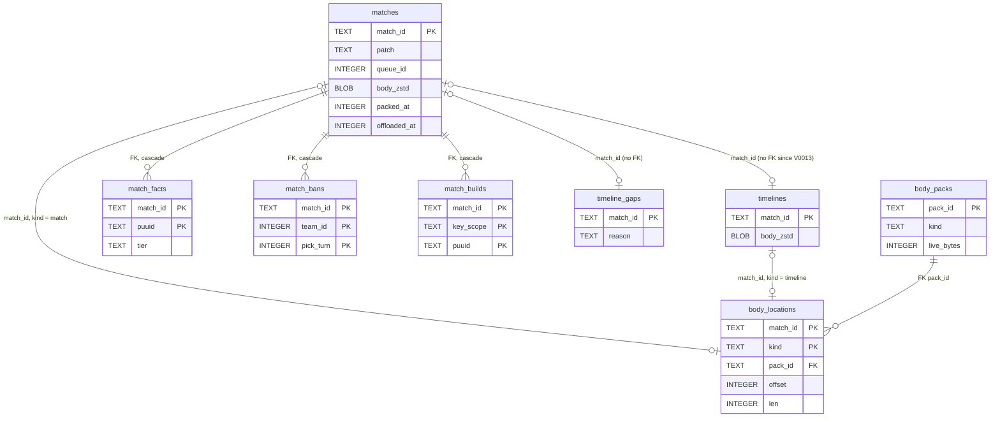

# SQLite schema: core and archive tables

Every table and index in `riot-proxy.db` after migration V0029, with what writes it, what reads it and how long rows live. This file covers the core (operational) and archive groups; the ladder, rank and analytics groups are in [schema-analytics.md](schema-analytics.md), including V0029's incremental-analytics bookkeeping: `analytics_counted`, `analytics_retract` and `analytics_stamped`, the `match_facts_tier_moved` trigger, and the `kind` column of `analytics_runs` (THR-03, ADR-182).

## Conventions

- One file, WAL mode, one writer thread and a reader pool (`src/db/mod.rs:26-42`). Migrations live in `src/db/migrations/` and are the authority for the DDL below; the local dev database on this box stops at V0006 and is not consulted for the schema.
- Timestamps are unix milliseconds in `INTEGER` columns; JSON lives in `TEXT`; match and timeline bodies are zstd level 3 `BLOB`s (`src/db/migrations/V0001__init.sql:2`, `V0002__archive.sql:3`, `src/archive/matches.rs:33`).
- `key_scope` is the first 8 hex characters of `sha256(RIOT_API_KEY)` (`src/cache/keys.rs:34-37`). Rows that hold encrypted Riot ids (PUUIDs) carry it; the archive does not, because match ids are not encrypted (`V0002:21`).
- Declared foreign keys are few: `match_facts`, `match_bans`, `match_builds`, `analytics_counted` and `analytics_retract` cascade from `matches`; `crawl_legs` and `crawl_match_ids` cascade from `ladder_crawls`; `body_locations.pack_id` references `body_packs`. `PRAGMA foreign_keys = ON` on every connection (`src/db/mod.rs:28-34`). Every other join in the diagrams is logical, not declared.
- 43 tables in total: the 40 that `/dev/reset` wipes plus `consumers`, `limiter_state` and `refinery_schema_history` (`src/routes/dev.rs:41-84`).

## Core tables

Logical relationships of the core group; `players` is the hub every per-player table joins to.

The job rows carry a player's PUUID in their JSON payload rather than a column, so the only edge is logical. `consumers`, `cache`, `limiter_state` and the two history tables stand alone.

### consumers

Created by [`V0001__init.sql`](../../src/db/migrations/V0001__init.sql) (`V0001:5-13`).

| Column | Type | Constraints | Notes |
|---|---|---|---|
| `id` | TEXT | PRIMARY KEY | ULID (`src/consumers.rs:145`) |
| `name` | TEXT | NOT NULL UNIQUE | |
| `key_sha256` | BLOB | NOT NULL UNIQUE | sha256 of the plaintext key, which is printed once and never stored (`src/consumers.rs:105-107`) |
| `scopes` | TEXT | NOT NULL | JSON array, sorted and de-duplicated: `["read"]` or `["read","admin"]` (`src/consumers.rs:141-153`) |
| `quota_per_min` | INTEGER | NOT NULL DEFAULT 600 | requests per rolling minute |
| `created_at` | INTEGER | NOT NULL | unix ms |
| `revoked_at` | INTEGER | nullable | unix ms; a revoked key keeps its row so it can never be reissued (`src/consumers.rs:228-283`) |

Indexes: the automatic ones for the primary key and the two `UNIQUE` columns. Written by `src/consumers.rs:155` (create, boot `bootstrap-admin`) and `:245,275` (revoke). Read by the auth lookup `WHERE key_sha256 = ? AND revoked_at IS NULL` (`src/consumers.rs:213-226`). Retention: never deleted, not wiped by `/dev/reset`.

### cache (L2)

`V0001:16-24`; `fetched_at` added by [`V0009__cache_fetched_at.sql`](../../src/db/migrations/V0009__cache_fetched_at.sql) (`V0009:4`).

| Column | Type | Constraints | Notes |
|---|---|---|---|
| `key` | TEXT | PRIMARY KEY | the canonical cache key, key scope included (see [caching.md](caching.md)) |
| `body` | BLOB | NOT NULL | Riot's response bytes as received, not zstd (`src/cache/l2.rs:164-170`) |
| `status` | INTEGER | NOT NULL | 200, or 404 for a negative entry |
| `content_at` | INTEGER | NOT NULL | unix ms the content was first seen (`X-Cache-Age`) |
| `fetched_at` | INTEGER | nullable | unix ms Riot last answered; pre-V0009 rows read `COALESCE(fetched_at, content_at)` (`src/cache/l2.rs:191-194`) |
| `soft_expires` | INTEGER | NOT NULL | unix ms |
| `hard_expires` | INTEGER | NOT NULL | unix ms |

Index: `cache_hard ON cache(hard_expires)` (`V0001:24`). Written by the write-behind `L2Writer` in batches of `INSERT OR REPLACE` (`src/cache/l2.rs:159-183`). Read by `warm` at boot (`l2.rs:186-216`) and the admin purge (`l2.rs:227-261`). Retention: `sweep` deletes `hard_expires <= now` at boot and in the daily `maintenance` job (`l2.rs:219-223`, `src/jobs/maintenance.rs:251`).

### limiter_state

`V0001:26-31`.

| Column | Type | Constraints | Notes |
|---|---|---|---|
| `scope` | TEXT | PRIMARY KEY | `app:euw1` or `method:euw1:match.byId` |
| `windows` | TEXT | NOT NULL | JSON `StoredScope` (shape in [models.md](models.md#limiter-checkpoint)) |
| `frozen_until` | INTEGER | nullable | unix ms |
| `updated_at` | INTEGER | NOT NULL | unix ms |

No secondary index. Written by `persist::save`, which deletes every row and re-inserts the current set in one transaction (`src/riot/limiter/persist.rs:178-194`) every 10 s and at shutdown (`persist.rs:25`, `src/cli/serve.rs:82,411`). Read once at boot (`persist.rs:196-213`, `serve.rs:76`); a checkpoint older than 120 s restores every window as full (`persist.rs:23,92-94`). Retention: replaced whole on every checkpoint; not wiped by `/dev/reset`.

### jobs

`V0001:33-45`; `lane`, `method` and two indexes from [`V0007__job_lane.sql`](../../src/db/migrations/V0007__job_lane.sql); `jobs_state_kind` from [`V0022__jobs_state_kind.sql`](../../src/db/migrations/V0022__jobs_state_kind.sql); `jobs_crawl_matches` from [`V0028__jobs_crawl_matches.sql`](../../src/db/migrations/V0028__jobs_crawl_matches.sql).

| Column | Type | Constraints | Notes |
|---|---|---|---|
| `id` | TEXT | PRIMARY KEY | ULID, monotonic (`src/jobs/scheduler.rs:190-198`) |
| `kind` | TEXT | NOT NULL | one of the 21 kinds in `src/jobs/mod.rs:20-71` |
| `dedupe_key` | TEXT | nullable | unique per kind while pending or running |
| `priority` | INTEGER | NOT NULL | lower runs first (`src/jobs/mod.rs:74-89`) |
| `payload` | TEXT | NOT NULL | JSON, per kind (see [models.md](models.md#job-payloads)) |
| `state` | TEXT | NOT NULL DEFAULT 'pending' | `pending`, `running`, `done`, `failed` |
| `attempts` | INTEGER | NOT NULL DEFAULT 0 | |
| `run_after` | INTEGER | NOT NULL | unix ms; backoff |
| `claimed_at`, `finished_at` | INTEGER | nullable | unix ms |
| `error` | TEXT | nullable | last failure |
| `lane` | TEXT | nullable | limiter scope the job's calls hit; NULL for kinds that never call Riot (`V0007:1-6`) |
| `method` | TEXT | nullable | the endpoint it mainly calls |

Indexes: `jobs_dedupe UNIQUE (kind, dedupe_key) WHERE state IN ('pending','running')` (`V0001:44`); `jobs_claim (state, run_after, priority) WHERE state = 'pending'` (`V0001:45`); `jobs_lane_claim (lane, priority, run_after, id) WHERE state = 'pending'` and `jobs_lane_running (lane) WHERE state = 'running'` (`V0007:8-9`); `jobs_state_kind (state, kind, run_after, finished_at)`, covering every count (`V0022:6`); `jobs_crawl_matches (priority, dedupe_key COLLATE NOCASE, state, run_after, finished_at) WHERE kind = 'archive:match'`, covering a crawl view's download count (`V0028:7-9`, ADR-179). Written by the scheduler (enqueue `INSERT OR IGNORE`, claim `UPDATE … RETURNING`, finish, retry, cancel; `src/jobs/scheduler.rs:225-263,1099-1113`, `src/db/store.rs:98-133`). Read by the claim loop, the dashboard counts and the ladder store. Retention: `maintenance` deletes `done` rows whose `finished_at` is older than 7 days (`src/jobs/maintenance.rs:36,237-240`); `failed` rows are never auto-deleted; `DELETE /v1/admin/jobs` purges pending or failed rows by kind in 5 000-row chunks (`scheduler.rs:797-840`).

### metrics_history

`V0001:47-50`.

| Column | Type | Constraints | Notes |
|---|---|---|---|
| `at` | INTEGER | PRIMARY KEY | unix ms of the sample |
| `point` | TEXT | NOT NULL | JSON `HistoryPoint` (`src/stats.rs:357-372`) |

Written every `METRICS_HISTORY_INTERVAL_S` (default 60 s) by `INSERT OR REPLACE` (`src/stats.rs:1001-1017`). Read by `GET /v1/admin/metrics/history`. Retention: each write keeps only the newest 1 440 rows (`src/stats.rs:43,1010-1012`) and `maintenance` deletes rows older than 24 h (`maintenance.rs:38,241-244`).

### players

[`V0002__archive.sql`](../../src/db/migrations/V0002__archive.sql) (`V0002:6-19`).

| Column | Type | Constraints | Notes |
|---|---|---|---|
| `key_scope` | TEXT | NOT NULL, PK part | |
| `puuid` | TEXT | NOT NULL, PK part | encrypted under the Riot key |
| `platform` | TEXT | NOT NULL | `oc1`, `euw1`, … |
| `game_name`, `tag_line` | TEXT | nullable | filled by profiles and `names:backfill` |
| `tracked` | INTEGER | NOT NULL DEFAULT 0 | polled by `poll:*` when 1 |
| `last_seen_match_id` | TEXT | nullable | `poll:matches` cursor |
| `backfill_state` | TEXT | nullable | JSON `BackfillState` (`src/jobs/archive.rs:83-100`) |
| `last_rank` | TEXT | nullable | JSON `{queue: {tier, rank, lp}}` snapshot for `rank.changed` |
| `in_game_id` | INTEGER | nullable | the game `poll:live` last saw |
| `updated_at` | INTEGER | NOT NULL | unix ms |

Primary key `(key_scope, puuid)`. Index `players_tracked ON players(tracked) WHERE tracked = 1` (`V0002:19`). Written by the profile upsert (`src/players.rs:63-75`), tracking and poll state (`:134,171`), the ladder crawl (untracked, `src/jobs/ladder/store.rs:246-250`), `backfill:player` and `names:backfill`. Read by every poll and composite route. Retention: never deleted outside `/dev/reset`.

### refinery_schema_history

Created by refinery itself, not by a migration file: `version int4 PRIMARY KEY, name VARCHAR(255), applied_on VARCHAR(255), checksum VARCHAR(255)` (dev database `sqlite_master`; SQLite stores `int4` as an integer affinity). Written only by the migration runner (`src/db/mod.rs:363-365`). One row per applied version, `applied_on` an ISO timestamp. See [migrations.md](migrations.md).

## Archive tables

The archive group: a match body, its derived rows, its timeline, and where a packed body lives once it is offloaded.

A timeline may exist before its match (`V0013:1-5`), which is why that edge is optional on both sides. `body_locations` is keyed by `(match_id, kind)`, so one match id can have a location in a match pack and another in a timeline pack.

### matches

`V0002:22-33`; `game_duration` from [`V0003`](../../src/db/migrations/V0003__cs_and_duration.sql); `remake`, `facts_version` from [`V0005`](../../src/db/migrations/V0005__analytics.sql); `packed_at`, `offloaded_at` and two partial indexes from [`V0023`](../../src/db/migrations/V0023__body_packs.sql); `matches_archived` from [`V0024`](../../src/db/migrations/V0024__matches_archived.sql).

| Column | Type | Constraints | Notes |
|---|---|---|---|
| `match_id` | TEXT | PRIMARY KEY | `OC1_700000001`: platform prefix then Riot's sequence |
| `region` | TEXT | NOT NULL | routing value the body was fetched from (`sea`, `europe`, …) |
| `patch` | TEXT | NOT NULL | `major.minor` of `info.gameVersion` (`src/archive/matches.rs:84-93`) |
| `queue_id` | INTEGER | NOT NULL | `info.queueId` |
| `game_end_ms` | INTEGER | NOT NULL | `info.gameEndTimestamp`, unix ms |
| `body_zstd` | BLOB | NOT NULL | zstd frame of the match-v5 body; `X''` once offloaded (`V0023:2-5`) |
| `body_size` | INTEGER | NOT NULL | uncompressed bytes |
| `archived_at` | INTEGER | NOT NULL | unix ms |
| `game_duration` | INTEGER | nullable | `info.gameDuration`, seconds (`V0003:5`) |
| `remake` | INTEGER | nullable | 1 when any participant has `gameEndedInEarlySurrender` (`V0005:4-7`) |
| `facts_version` | INTEGER | nullable | `FACTS_VERSION` that derived this match's rows; NULL before V0005 |
| `packed_at` | INTEGER | nullable | unix ms; in a verified pack |
| `offloaded_at` | INTEGER | nullable | unix ms; local copy freed |

Indexes: `matches_patch_queue (patch, queue_id)`, `matches_end (game_end_ms)` (`V0002:32-33`); `matches_facts_version (facts_version)` (`V0005:17`); `matches_to_pack (archived_at, packed_at) WHERE packed_at IS NULL` and `matches_to_free (archived_at, packed_at, offloaded_at) WHERE packed_at IS NOT NULL AND offloaded_at IS NULL` (`V0023:41-44`); `matches_archived (match_id, archived_at)` (`V0024:7`). Written by `put_stored` (upsert, clears `offloaded_at`; `src/archive/matches.rs:390-411`), `write_derived` (`:151-159`; it also inserts the match's `analytics_counted` row, `:162-168`), `pack::locate_on` (`packed_at`, `src/archive/pack.rs:337-351`) and `offload::free` (`body_zstd = X''`, `offloaded_at`; `src/archive/offload.rs:147-170`). Read by the archive read path (`matches.rs:193-230`), the player routes, analytics and the offload selectors. Retention: never deleted by any job; a body moves local, then packed, then offloaded (`V0023:2-5`).

### timelines

Rebuilt without its foreign key by [`V0013__timelines_standalone.sql`](../../src/db/migrations/V0013__timelines_standalone.sql) (`V0013:6-12`); `packed_at`, `offloaded_at` and two partial indexes from `V0023:39-40,45-48`.

| Column | Type | Constraints | Notes |
|---|---|---|---|
| `match_id` | TEXT | PRIMARY KEY | no FK: a timeline may arrive before its match |
| `body_zstd` | BLOB | NOT NULL | zstd frame of the timeline body; `X''` once offloaded |
| `packed_at`, `offloaded_at` | INTEGER | nullable | as on `matches` |

Indexes: `timelines_to_pack (match_id, packed_at) WHERE packed_at IS NULL`, `timelines_to_free (match_id, packed_at, offloaded_at) WHERE packed_at IS NOT NULL AND offloaded_at IS NULL`. Written by `put_timeline_stored` (`matches.rs:440-446`), `locate_on` and `free`. Read by the archive read path, `builds:extract` and `timelines:backfill`. Retention: never deleted.

### match_facts

One row per participant, a derivation of the match body except for `tier`. Rebuilt `WITHOUT ROWID` by [`V0021__facts_without_rowid.sql`](../../src/db/migrations/V0021__facts_without_rowid.sql) (`V0021:9-33`); `tier` arrived with [`V0019`](../../src/db/migrations/V0019__tier_on_facts.sql).

| Column | Type | Constraints | Notes |
|---|---|---|---|
| `match_id` | TEXT | NOT NULL, PK part, FK `matches` ON DELETE CASCADE | |
| `key_scope` | TEXT | NOT NULL | the scope whose key fetched the body |
| `puuid` | TEXT | NOT NULL, PK part | |
| `team_id` | INTEGER | NOT NULL | 100 or 200 on Summoner's Rift |
| `position` | TEXT | nullable | `teamPosition`; NULL where Riot sends none |
| `champion_id` | INTEGER | NOT NULL | |
| `win` | INTEGER | NOT NULL | |
| `kills`, `deaths`, `assists` | INTEGER | nullable | |
| `items` | TEXT | nullable | JSON `[item0..item5]`, 0 for an empty slot |
| `runes` | TEXT | nullable | JSON `[primaryStyle, keystone, subStyle, [perks], [stat perks] or null]` (`V0021:19`) |
| `summoners` | TEXT | nullable | JSON `[summoner1Id, summoner2Id]` |
| `facts_version` | INTEGER | NOT NULL | 4 today (`src/archive/facts.rs:19`) |
| `cs`, `gold`, `damage`, `vision` | INTEGER | nullable | V0003 and V0005 additions |
| `tier` | TEXT | nullable | NULL until stamped, then a Riot tier or `UNKNOWN`; never rewritten by `facts:reextract` (`V0019:7-9`) |

Primary key `(match_id, puuid)`, `WITHOUT ROWID`. Index `facts_player (key_scope, puuid, match_id)` (`V0021:33`); `facts_champ` was dropped at V0021. Written by `facts::write` (upsert without `tier`, deleting participants no longer in the body; `src/archive/facts.rs:329-379`) inside the archive transaction and `facts:reextract`; `tier` by `tiers::stamp` in the same transaction (`src/archive/tiers.rs:37-57`, `matches.rs:414`), `tiers:backfill` and the late stamp; a `tier` that changes fires the `match_facts_tier_moved` trigger (V0029), which writes `analytics_retract` rows for the steps that had counted the player ([schema-analytics.md](schema-analytics.md#analytics_retract)). Read by the champion pool, player pages, analytics rebuilds and the rank planner. Retention: rows disappear only with their match (never) or when a participant leaves the body.

### match_bans

`V0005:22-28`, rebuilt `WITHOUT ROWID` by [`V0020`](../../src/db/migrations/V0020__without_rowid_derived.sql) (`V0020:31-42`). Columns `match_id TEXT NOT NULL` (FK `matches`, cascade), `team_id INTEGER NOT NULL`, `pick_turn INTEGER NOT NULL`, `champion_id INTEGER NOT NULL`; primary key `(match_id, team_id, pick_turn)`. A ban of `-1` is left out (`src/archive/facts.rs:264-289`). Written by `facts::write_bans` (`DELETE` per match, then `INSERT OR IGNORE`; `facts.rs:292-301`). Read by the ban aggregates (`src/archive/analytics.rs:364-382`). Retention: replaced per match, never trimmed.

### match_builds

[`V0012__match_builds.sql`](../../src/db/migrations/V0012__match_builds.sql), rebuilt `WITHOUT ROWID` at `V0020:13-29`.

| Column | Type | Constraints | Notes |
|---|---|---|---|
| `match_id` | TEXT | NOT NULL, PK part, FK `matches` cascade | |
| `key_scope`, `puuid` | TEXT | NOT NULL, PK parts | |
| `starter` | TEXT | NOT NULL | JSON item ids bought before 60 s, trinkets left out, sorted |
| `boots` | INTEGER | nullable | first boots bought |
| `items` | TEXT | NOT NULL | JSON finished items in purchase order, at most 6 |
| `skills` | TEXT | NOT NULL | first 15 level-ups, `"QWEQQRQ…"` |
| `skill_order` | TEXT | nullable | `"QWE"`; four letters for Udyr |
| `builds_version` | INTEGER | NOT NULL | 3 today (`src/archive/builds.rs:24`) |

Written by `builds::write` from `builds:extract` (`src/archive/builds.rs:382-419`); a match's first rows clear its set-build bit in `analytics_counted`, rows replacing others mark its ladder dirty in `analytics_stamped` (`src/archive/analytics/delta.rs:120-145`). Read by `rebuild_builds` (`src/archive/analytics.rs:545-702`). Retention: replaced per match, never trimmed.

### timeline_gaps

[`V0018__timeline_gaps.sql`](../../src/db/migrations/V0018__timeline_gaps.sql): `match_id TEXT PRIMARY KEY`, `reason TEXT NOT NULL` (`"not_found"`), `marked_at INTEGER NOT NULL` (unix ms). No FK. Written by `timelines:backfill` on a Riot 404 (`src/jobs/timelines.rs:164-171`); read by the same job so it never asks again. Retention: never trimmed.

### body_packs

[`V0023__body_packs.sql`](../../src/db/migrations/V0023__body_packs.sql) (`V0023:10-18`).

| Column | Type | Constraints | Notes |
|---|---|---|---|
| `pack_id` | TEXT | PRIMARY KEY | ULID; the object key derives from it and `kind` |
| `kind` | TEXT | NOT NULL | `match` or `timeline` |
| `bytes` | INTEGER | NOT NULL | object size |
| `bodies` | INTEGER | NOT NULL | bodies in the pack |
| `live_bytes` | INTEGER | NOT NULL | bytes of bodies still located here |
| `sha256` | BLOB | NOT NULL | 32 bytes, of the whole object |
| `created_at` | INTEGER | NOT NULL | unix ms |

Written by `pack::record_on` after a verified upload (`src/archive/pack.rs:287-311`), `locate_on` (lowers `live_bytes` when a body moves, `pack.rs:326-330`) and `packs reindex` / `restore-index` (`src/archive/recovery.rs:397-414,542-571`). Read by stats, the `archive_packs` gauge and the index snapshot. Retention: never deleted by a job.

### body_locations

`V0023:21-30`, `WITHOUT ROWID`.

| Column | Type | Constraints | Notes |
|---|---|---|---|
| `match_id` | TEXT | NOT NULL, PK part | |
| `kind` | TEXT | NOT NULL, PK part | `match` or `timeline` |
| `pack_id` | TEXT | NOT NULL, FK `body_packs(pack_id)` | |
| `offset`, `len` | INTEGER | NOT NULL | byte range inside the pack |
| `sha256` | BLOB | NOT NULL | of the body's zstd bytes |

Index `body_locations_pack (pack_id)` (`V0023:30`). Written by `locate_on` (upsert, `pack.rs:331-350`) and `restore-index`. Read by the archive read path's `LEFT JOIN` (`matches.rs:201-204`), the free step's guard (`offload.rs:157-158`) and the snapshot. Retention: never deleted by a job; about 60 bytes per row (`docs/design/12-object-storage-and-hosting.md:209-210`).

---
**Sources:** `src/db/migrations/V0001__init.sql`, `V0002__archive.sql`, `V0003__cs_and_duration.sql`, `V0005__analytics.sql`, `V0007__job_lane.sql`, `V0009__cache_fetched_at.sql`, `V0012__match_builds.sql`, `V0013__timelines_standalone.sql`, `V0018__timeline_gaps.sql`, `V0019__tier_on_facts.sql`, `V0020__without_rowid_derived.sql`, `V0021__facts_without_rowid.sql`, `V0022__jobs_state_kind.sql`, `V0023__body_packs.sql`, `V0024__matches_archived.sql`, `V0028__jobs_crawl_matches.sql`, `V0029__analytics_counted.sql`, `src/db/mod.rs:L26-L42`, `src/db/mod.rs:L363-L365`, `src/archive/matches.rs:L33-L103`, `src/archive/matches.rs:L193-L230`, `src/archive/matches.rs:L390-L446`, `src/archive/analytics/delta.rs:L98-L145`, `src/archive/facts.rs:L19`, `src/archive/facts.rs:L292-L379`, `src/archive/builds.rs:L24`, `src/archive/pack.rs:L287-L354`, `src/archive/offload.rs:L147-L170`, `src/archive/tiers.rs:L37-L57`, `src/cache/l2.rs:L159-L223`, `src/riot/limiter/persist.rs:L23-L25`, `src/riot/limiter/persist.rs:L178-L213`, `src/consumers.rs:L105-L107`, `src/consumers.rs:L141-L155`, `src/consumers.rs:L213-L283`, `src/jobs/maintenance.rs:L36-L38`, `src/jobs/maintenance.rs:L237-L251`, `src/stats.rs:L43`, `src/stats.rs:L357-L372`, `src/stats.rs:L1001-L1017`, `src/routes/dev.rs:L41-L84`, `docs/_meta/scratch/persistence.md`, `docs/design/04-data-and-cache.md`, `docs/design/12-object-storage-and-hosting.md:L159-L221`
**Last verified:** 2026-10-22 against commit `6eda84e`
