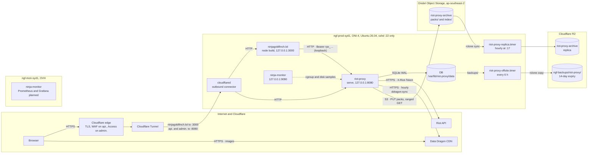

# Deployment overview

What runs on the production host `ngf-prod-syd1`, how traffic reaches it, where state and logs live, and who owns which ports, directories and users. The install steps are in [install.md](./install.md), every variable in [configuration.md](./configuration.md), and sizing in [capacity.md](./capacity.md).

## The host

| Fact | Value | Evidence |
|---|---|---|
| Host | `ngf-prod-syd1`, Onidel Sydney, plan ONI-4: 6 vCPU, 12 GB RAM, 120 GB NVMe (115 GB usable), 6 TB/month transfer | `docs/design/12-object-storage-and-hosting.md:474,772-778`; `PROGRESS.md:325` |
| OS | Ubuntu 26.04 LTS | `docs/design/12-object-storage-and-hosting.md:772` |
| Login | user `ninja`, key-only SSH, root login off; `ufw` allows inbound 22 only | `docs/design/12-object-storage-and-hosting.md:551-553,776-778` |
| Containers | none: the proxy is a static binary and the site is `node build`, both under systemd | `docs/design/12-object-storage-and-hosting.md:794-807`; `docs/workflows/release-process.md` |
| Storage | replicated network storage, about 3 ms median fsync and 10 MB/s cold random reads; the RAM keeps the SQLite file in page cache | `docs/design/12-object-storage-and-hosting.md:780-786` |
| Clock | UTC, `chrony` | `docs/design/12-object-storage-and-hosting.md:556-558` |

## Topology

The diagram shows every process on the box, the three object-storage buckets and the one path in from the Internet.

The only way in is the tunnel: `cloudflared` opens an outbound connection to Cloudflare and no DNS record points at the server's address (`docs/design/12-object-storage-and-hosting.md:532-537`). TLS terminates at Cloudflare; the proxy serves plain HTTP and refuses `TLS=true` (`README.md:116-118`; `src/config.rs:686-691`). The site calls the proxy over loopback with a consumer key, never through `api.` (`docs/design/12-object-storage-and-hosting.md:928-929`). The browser never calls the proxy; images come straight from Data Dragon (`docs/_meta/scratch/siblings.md:259-262`). `ninja-monitor` reads cgroups and the data directory; it does not call `/healthz`, `/readyz` or `/metrics` (`docs/_meta/scratch/siblings.md:210`).

## Processes and ports

Every listener is on loopback. Nothing but `sshd` is reachable from outside the box.

| Unit | Runs | User | Listens | Config | State | Evidence |
|---|---|---|---|---|---|---|
| `riot-proxy.service` | `/usr/local/bin/riot-proxy serve` | `riot-proxy` | `127.0.0.1:8080` (`HOST=127.0.0.1`, `PORT=8080`) | `/etc/riot-proxy/env`, root-only | `/var/lib/riot-proxy/data/` | `docs/design/07-deployment.md:74-95`; `docs/design/12-object-storage-and-hosting.md:551-556,585-601,806-807` |
| `ninjagoldfinch-lol.service` | `node build` (SvelteKit, adapter-node) | `ninjagoldfinch-lol` | `127.0.0.1:3000` | `/etc/ninjagoldfinch-lol/env` (`PROXY_URL`, `PROXY_KEY`, …) | checkout `/opt/ninjagoldfinch-lol`, home `/opt/ninjagoldfinch-lol-home` | `docs/design/12-object-storage-and-hosting.md:609-641`; `docs/_meta/scratch/siblings.md:134-146` |
| `cloudflared.service` | Cloudflare Tunnel connector, token-installed, `--token-file /etc/cloudflared/token` | not recorded | none (outbound only) | `/etc/cloudflared/token` | none | `docs/design/12-object-storage-and-hosting.md:636-640,803-807` |
| `ninja-monitor.service` | host and per-service sampler, alerts to a Discord webhook | `ninja-monitor` | `127.0.0.1:9090`, reached over an SSH local forward | `/etc/ninja-monitor/config.toml`, `/etc/ninja-monitor/env` | none on disk | `docs/design/12-object-storage-and-hosting.md:832-837`; `docs/_meta/scratch/siblings.md:182-197` |
| `riot-proxy-replica.timer` | `rclone sync onidel:riot-proxy-archive r2:riot-proxy-archive --metadata --transfers 16`, at 17 past each hour, `Persistent=true` | `DynamicUser` | none | `/etc/riot-proxy/rclone.conf` passed as a systemd credential | none | `deploy/riot-proxy-replica.service:12-19`; `deploy/riot-proxy-replica.timer:6-8` |
| `riot-proxy-offsite.timer` | every 6 h: `rclone copy` of `backups/` to R2 `ngf-backups/riot-proxy/`, `rclone check --one-way`, keep one local backup | not recorded | none | `/etc/rclone/r2.conf` | none | `docs/design/12-object-storage-and-hosting.md:808-826`; `deploy/README.md:151-152` |

Of these, the repository holds only `deploy/riot-proxy-replica.{service,timer}` and the proxy unit as designed (`docs/design/07-deployment.md:74-95`). The site's unit, the tunnel's unit, the monitor's config and the whole `riot-proxy-offsite` unit were made by hand on the box (`docs/design/12-object-storage-and-hosting.md:627,808-810`; `docs/_meta/scratch/siblings.md:135`).

> **TODO (unverified):** the live `/etc/systemd/system/riot-proxy.service` on `ngf-prod-syd1` is not in the repository; `docs/design/12-object-storage-and-hosting.md:589-592` copied it from the previous box unchanged. The user `cloudflared` and `riot-proxy-offsite` run as, and the exact `riot-proxy-offsite.service` text, are likewise unrecorded.

## Hostnames and the edge

| Hostname | Tunnel route | Edge policy | Evidence |
|---|---|---|---|
| `ninjagoldfinch.lol` | `http://127.0.0.1:3000` | public | `docs/design/12-object-storage-and-hosting.md:532-534` |
| `api.ninjagoldfinch.lol` | `http://127.0.0.1:8080`, path `*` | WAF rule "Block riot-proxy internal pages": blocks `/metrics`, `/dashboard*`, `/dev*`, `/v1/admin*` (and `/docs`); `/v1/ws`, `/healthz`, `/readyz` stay open | `docs/design/12-object-storage-and-hosting.md:863-866,905-916` |
| `admin.ninjagoldfinch.lol` | `http://127.0.0.1:8080` | Cloudflare Access, self-hosted application, One-time PIN only, policy "Owner only", session 24 h | `docs/design/12-object-storage-and-hosting.md:850-862,897-903` |

The tunnel's routes live in the Cloudflare dashboard, not in a file on the box (`docs/design/12-object-storage-and-hosting.md:893-895`). Because every request reaches the proxy from `cloudflared` at `127.0.0.1`, the proxy runs with `TRUST_PROXY=true` and an empty `ADMIN_IP_ALLOWLIST`; an allowlist of `127.0.0.1` refused every admin call through the tunnel (`docs/design/12-object-storage-and-hosting.md:868-873`; `docs/design/07-deployment.md:221`). Checks from outside after ADM-01: `api./metrics` 403, `api./v1/admin/stats` 403, `api./healthz` 200, `admin./dashboard` 302 to the Access login (`docs/design/12-object-storage-and-hosting.md:852-855`).

## Object storage and backups

| Store | Endpoint and region | Holds | Written by | Read by | Lifecycle | Evidence |
|---|---|---|---|---|---|---|
| Onidel bucket `riot-proxy-archive` | `https://s3.ap-southeast-2.onidel.cloud`, `ap-southeast-2`; 250 GB allocation, 3 M object cap | packed match and timeline bodies `packs/matches/<yyyy>/<mm>/<ULID>.pack`, `packs/timelines/…`; daily `index/packs-<date>.jsonl.zst` and `index/locations-<date>.jsonl.zst` | the proxy (`archive:offload`, `archive:index-snapshot`) | the proxy (ranged GETs on a local miss) and the replica timer | `index/` expires after 14 d; `packs/` never | `docs/design/12-object-storage-and-hosting.md:100-112,437-446,475`; `deploy/README.md:31-36`; `docs/_meta/scratch/persistence.md:332-334` |
| R2 bucket `riot-proxy-archive` | `https://<account id>.r2.cloudflarestorage.com`, region `auto` | hourly `rclone sync` copy of the above | `riot-proxy-replica.service` | nobody in normal operation; the restore drill, and the proxy if Onidel is gone | `index/` 21 d; multipart abort 1 d; `packs/` never | `deploy/README.md:26-36,140-142`; `deploy/riot-proxy-replica.service:13-16` |
| R2 bucket `ngf-backups`, prefix `riot-proxy/` | as above | daily `VACUUM INTO` copies of `riot-proxy.db` | `riot-proxy-offsite.timer` | the quarterly restore drill | objects deleted after 14 d; multipart abort 1 d | `docs/design/12-object-storage-and-hosting.md:815-818`; `deploy/README.md:149-152` |

The proxy only ever talks to the Onidel bucket; R2 is reached only by `rclone` from the box (`docs/_meta/scratch/persistence.md:375-378`). The SQLite file is never in the Onidel bucket; raw bodies are never in `ngf-backups` (`docs/design/12-object-storage-and-hosting.md:424-428`). [backup-and-restore.md](./backup-and-restore.md) has the procedures.

## Where logs and data live

| What | Where | Evidence |
|---|---|---|
| Proxy logs | journald, `sudo journalctl -u riot-proxy`; JSON on stdout when stdout is not a terminal (`LOG_FORMAT` default) | `docs/workflows/release-process.md` step 6; `src/config.rs:667-674`; `README.md:132` |
| Bootstrap admin key banner | stderr on first `serve` only, so it lands in journald as well | `src/cli/serve.rs:422-428` |
| Site logs | `journalctl -u ninjagoldfinch-lol` | `docs/_meta/scratch/siblings.md:145` |
| Replica logs | `journalctl -u riot-proxy-replica` | `deploy/README.md:93` |
| SQLite | `/var/lib/riot-proxy/data/riot-proxy.db` with `-wal` and `-shm` | `docs/_meta/scratch/persistence.md:398-402` |
| Daily backups | `/var/lib/riot-proxy/data/backups/riot-proxy-<YYYY-MM-DD>.db` | `src/jobs/maintenance.rs:40-41`; `src/cli/serve.rs:210-214` |
| Data Dragon mirror | `/var/lib/riot-proxy/data/ddragon/<version>/…` and `meta/queues.json` | `docs/_meta/scratch/persistence.md:406-412` |
| Site checkout | `/opt/ninjagoldfinch-lol` | `docs/design/12-object-storage-and-hosting.md:617-618` |

## Ownership

| Resource | Owner | Mode | Evidence |
|---|---|---|---|
| `/usr/local/bin/riot-proxy` | root | 0755 | `docs/design/12-object-storage-and-hosting.md:590` |
| `/etc/riot-proxy/env` | root, read by systemd before dropping to `riot-proxy` | 0600 (`umask 077`) | `docs/design/12-object-storage-and-hosting.md:594-601` |
| `/etc/riot-proxy/rclone.conf` | `root:root` | 0600 | `deploy/README.md:51` |
| `/var/lib/riot-proxy` and `data/` | `riot-proxy:riot-proxy` | the unit's only writable path (`ProtectSystem=strict`, `ReadWritePaths`) | `docs/design/12-object-storage-and-hosting.md:587`; `docs/design/07-deployment.md:88-89` |
| `/etc/ninjagoldfinch-lol/env` | root | 0600 (`umask 077`) | `docs/design/12-object-storage-and-hosting.md:626-627` |
| `/opt/ninjagoldfinch-lol` | `ninjagoldfinch-lol` (system user, home `/opt/ninjagoldfinch-lol-home`) | | `docs/design/12-object-storage-and-hosting.md:613-618` |
| `/etc/cloudflared/token` | root | | `docs/design/12-object-storage-and-hosting.md:636-640` |
| port 8080 | `riot-proxy` | reserved: the site's `PROXY_URL` is `http://127.0.0.1:8080` | `docs/design/12-object-storage-and-hosting.md:629` |
| port 3000 | `ninjagoldfinch-lol` | | `docs/design/12-object-storage-and-hosting.md:532-534` |
| port 9090 | `ninja-monitor` | | `docs/_meta/scratch/siblings.md:194` |

`ninja-monitor` needs read access to `/var/lib/riot-proxy` to measure it (`SupplementaryGroups=riot-proxy` or an ACL, `docs/_meta/scratch/siblings.md:208`).

> **TODO (unverified):** whether the production `ninja-monitor` has that group or ACL; `docs/_meta/scratch/siblings.md:238` records it as unknown.

## The monitoring box

`ngf-mon-syd1` is the previous production VPS (OVH Sydney, 2 cores, 3.7 GB), wiped on 2026-10-13: login user `ninja`, key-only SSH, `ninja-monitor` watching its own host and posting to its own Discord webhook. Prometheus and Grafana there, scraping `/metrics` over WireGuard rather than through the tunnel, are planned and not done (`docs/design/12-object-storage-and-hosting.md:838-848`; `docs/design/07-deployment.md:221`). It holds no Riot key and no database (`docs/design/12-object-storage-and-hosting.md:79-80`).

## Resource expectations

`ninja-monitor` on the box alerts when `riot-proxy` exceeds 2 GiB, the site 1 GiB and `cloudflared` 512 MiB of memory, when host memory falls below 15 %, disk passes 70 % and 85 %, or host CPU stays above 90 % for 20 minutes; a service counts as down after 30 s, repeating every 30 min (`docs/design/12-object-storage-and-hosting.md:832-837`). The proxy's own footprint is the SQLite page cache plus the L1 cache (`docs/design/07-deployment.md:173`); the host was chosen for RAM, not disk or cores, because the Riot key pins the request rate at 100 per 2 minutes (`docs/design/12-object-storage-and-hosting.md:480-487`). The arithmetic is in [capacity.md](./capacity.md).

---
**Sources:** `docs/design/07-deployment.md:L59-L95,L173,L221`, `docs/design/12-object-storage-and-hosting.md:L58-L112,L424-L446,L474-L487,L532-L558,L585-L641,L772-L848,L850-L937`, `deploy/README.md:L24-L36,L51,L93,L140-L152`, `deploy/riot-proxy-replica.service:L12-L19`, `deploy/riot-proxy-replica.timer:L6-L8`, `README.md:L116-L132`, `PROGRESS.md:L325`, `src/config.rs:L667-L674,L686-L691`, `src/cli/serve.rs:L210-L214,L422-L428`, `src/jobs/maintenance.rs:L40-L41`, `docs/_meta/scratch/siblings.md`, `docs/_meta/scratch/persistence.md`
**Last verified:** 2026-10-26 against commit `c9e1b33`
