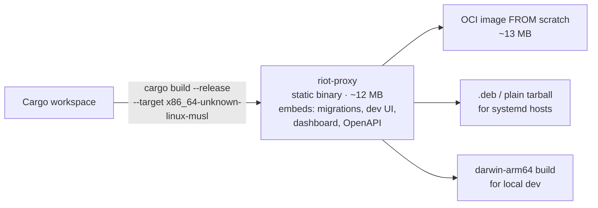
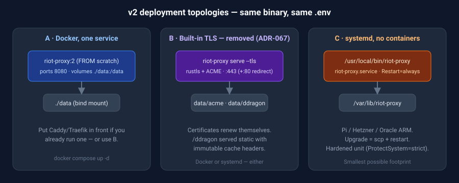

# 07 — Deployment

The deploy story is the point of v2. Every path below is "one artefact, one directory of state".

## The artefact



Everything the service needs at runtime except `.env` and the data directory is inside the binary: `include_str!` for the two HTML pages, `sqlx::migrate!` for schema, `utoipa` for the OpenAPI document, `rustls` + `webpki-roots` so there is not even a CA bundle to mount.

**Build identity (ADM-03).** `build.rs` embeds the commit (`GIT_SHA` from the environment, else `git rev-parse HEAD`, else `unknown`; 12 characters), `rustc --version` and the build time (`SOURCE_DATE_EPOCH` when set). `GET /v1/admin/info` reports them with the uptime, feature switches and every configuration variable in effect (secrets `[REDACTED]`, `RIOT_API_KEY` left out). The CI, edge and release workflows set `GIT_SHA` from `github.sha` and check the built binary carries it. `Dockerfile`'s context has no `.git`, so pass it: `docker build --build-arg GIT_SHA=$(git rev-parse HEAD) .`, or `GIT_SHA=$(git rev-parse HEAD) docker compose up --build`. `--version` still prints only `riot-proxy <version>`.

## Option A — Docker, single service

`Dockerfile`:

```dockerfile
# syntax=docker/dockerfile:1
FROM rust:1-alpine AS build
RUN apk add --no-cache musl-dev
WORKDIR /src
COPY Cargo.toml Cargo.lock ./
RUN mkdir src && echo 'fn main(){}' > src/main.rs && cargo build --release && rm -rf src
COPY . .
RUN touch src/main.rs && cargo build --release

FROM scratch
COPY --from=build /src/target/release/riot-proxy /riot-proxy
VOLUME /data
EXPOSE 8080
ENV DATA_DIR=/data
HEALTHCHECK --interval=30s --timeout=3s CMD ["/riot-proxy", "healthcheck"]
ENTRYPOINT ["/riot-proxy"]
CMD ["serve"]
```

(`healthcheck` is a subcommand that GETs `/healthz` — a scratch image has no `curl`.)

`docker-compose.yml` — the whole thing:

```yaml
services:
  riot-proxy:
    image: ghcr.io/ninjagoldfinch/riot-proxy:2
    restart: unless-stopped
    env_file: .env
    ports: ["8080:8080"]
    volumes: ["./data:/data"]
```

That replaces `docker-compose.yml` **and** `docker-compose.prod.yml` from v1. Dev and prod differ only by `.env`.

## Option B — TLS built in (removed)

Built in P8-03 and removed before 2.0.0 (ADR-067). The proxy is never the public edge: it serves plain HTTP to services on the same host or a private network. Where HTTPS is needed, put Caddy (or nginx) in front of `:8080`; the v1 `Caddyfile` works unchanged.

Data Dragon is served from `$DATA_DIR/ddragon` by `tower-http::ServeDir` with `Cache-Control: public, max-age=31536000, immutable` (a year since SITE-07, ADR-119; the v1 Caddyfile set a week).

Images are mirrored on first request (DEV-05, ADR-076). `GET /ddragon/<version>/img/<kind>/<file>` is served from `$DATA_DIR/ddragon/<version>/img/<kind>/` when the file is there. On a miss it is fetched once from Data Dragon's `/cdn/<version>/img/<kind>/<file>`, written to disk and served.
- `kind` is `champion`, `profileicon`, `item` or `spell`.
- The patch must already be mirrored.
- `file` must be an `image.full` listed in that patch's `champion`, `profileicon`, `item` or `summoner` JSON. Anything else is a bare 404 with no fetch.
- Rune icons (DEV-14, ADR-086) are at `GET /ddragon/<version>/img/perk-images/…`, the path being a style's or rune's `icon` in that patch's `runesReforged` JSON. Data Dragon keeps them unversioned at `/cdn/img/perk-images/…`; the mirror keeps them per patch all the same, at `$DATA_DIR/ddragon/<version>/img/perk-images/…`.
- A Riot 404 is a 404. A non-PNG or failed fetch is a 502, and nothing is kept.

## Option C — systemd, no containers

```ini
# /etc/systemd/system/riot-proxy.service
[Unit]
Description=riot-proxy
After=network-online.target

[Service]
User=riot-proxy
EnvironmentFile=/etc/riot-proxy/env
ExecStart=/usr/local/bin/riot-proxy serve
WorkingDirectory=/var/lib/riot-proxy
Restart=always
RestartSec=2
# hardening
ProtectSystem=strict
ReadWritePaths=/var/lib/riot-proxy
PrivateTmp=yes
NoNewPrivileges=yes

[Install]
WantedBy=multi-user.target
```

`scp` the binary, `systemctl restart`. Upgrades are a file copy.

## Option D — PaaS

| Platform | Notes |
|---|---|
| Fly.io | `fly launch` with the scratch image; one `[mounts]` volume for `/data`; `min_machines_running = 1`. Fits the free-ish tier's 256 MB machine with room to spare |
| Railway / Render | Persistent disk at `/data`; single service |
| Hetzner CX22 / Oracle free ARM | Option C. Build `aarch64-unknown-linux-musl` for ARM |
| Raspberry Pi / home server | Same — the whole reason for the small footprint |

Anything with a persistent disk works; anything without one (Cloud Run scale-to-zero, Lambda) does not, because the limiter and archive need local state and Riot's limits are per-key so cold-starting many instances would be actively harmful.

## Configuration

Same variable names as v1 where the concept survives; removed variables are listed so `.env` files can be ported mechanically.

| Variable | Default | Change from v1 |
|---|---|---|
| `RIOT_API_KEY` | — | required |
| `RIOT_USER_AGENT` | `riot-proxy/2.0 (+…)` | |
| `DATA_DIR` | `./data` | **new** — SQLite, ddragon, backups all live here |
| `DATABASE_URL` | `sqlite://$DATA_DIR/riot-proxy.db` | now optional; `postgres://` needs the `postgres` feature |
| `PORT` / `HOST` | `8080` / `0.0.0.0` | |
| `TRUST_PROXY` | `false` | **new** — v1 always trusted `X-Forwarded-For` (ADR-068) |
| `ADMIN_CORS_ORIGINS` | empty | **new** — exact origins allowed to call `/v1/admin/*`, `/v1/ws`, `/healthz` and `/readyz` from a browser; empty sends no CORS headers, `*` is refused (ADM-07, ADR-151) |
| `ROLE` | `all` | **new** — `api` / `worker` only with Postgres |
| `JOB_CONCURRENCY` | `8` | **new** — also `--job-concurrency`; see §Sizing for small hosts |
| `JOB_KIND_LIMITS` | `aggregate:analytics=1,archive:offload=1` | **new** — `kind=n,…`, the most jobs of a kind running at once, for kinds that don't call Riot; `none` for no caps (OPS-06, ADR-134) |
| `JOB_YIELD_BUDGET_MS` | `1000` | **new** — how long a job's fetch waits for the rate limiter before the job re-queues itself and frees its worker (SCH-01, ADR-089); `0`–`900000` |
| `LOG_FORMAT` | `json` (tty → `pretty`) | |
| `ENV` | `development` | replaces `NODE_ENV`; `production` refuses `AUTH_DISABLED` and always turns `DEV_UI` off (ADR-071) |
| `REDIS_URL` | — | **removed** |
| `SF_LOCK_MS` | — | **removed** (no cross-process single-flight) |
| `DDRAGON_DIR` | `$DATA_DIR/ddragon` | now derived |
| `ARCHIVE_TIMELINES` | `true` | v1 defaulted to `false`. Archive jobs, ladder crawls included, now fetch each match's timeline unless it is `false` (ADR-098) |
| `RANK_LOOKUP_LIMIT` | `50000` | **new** — players one `ranks:lookup` run looks up, most archived games first; `0` turns the lookups off (ADR-111) |
| `RANK_LOOKUP_RECHECK_S` | `604800` (7 days) | **new** — a player looked up this recently is left off the next run's list (ADR-111) |
| `TIER_LATE_STAMP_DAYS` | `14` | **new** — a rank the ladder or a league lookup returns places that player's `UNKNOWN` tier stamps on matches that ended within this many days; a known tier is never changed; `0` places none (ADR-127) |
| `LOOKUP_BACKFILL_LIMIT` | `4294967295` (`u32::MAX`) | v1 capped it at 10000; now the walk ends where the player's history does (ADR-081) |
| `BULK_IDLE_CEILING` / `BULK_IDLE_AFTER_S` | `0.95` / `30` | **new** — bulk's share of a bucket on a region with no interactive request in the last `BULK_IDLE_AFTER_S` seconds. At least `BULK_USAGE_CEILING` (which it follows when unset and lower) and below 1 (ADR-126) |
| `BACKUP_KEEP` | `14` | **new** — daily `VACUUM INTO` backups kept in `$DATA_DIR/backups`; `0` takes none. A backup is skipped, with a warning, when the disk has under 1.2 × the database's size free (DSK-02, ADR-136) |
| `ARCHIVE_OBJECT_URL` | unset | **new** — where packed bodies go: `s3://<bucket>`, or `file:///<dir>` outside production; unset keeps every body in SQLite (design/12, OBJ-01, ADR-162) |
| `ARCHIVE_OBJECT_ENDPOINT` | unset | **new** — `https://host[:port]`, required with `s3://`; a host starting with `<bucket>.` is addressed virtual-hosted style, any other path style; `http://` refused in production |
| `ARCHIVE_OBJECT_REGION` | `auto` | **new** — signing region, passed through |
| `ARCHIVE_OBJECT_ACCESS_KEY` / `ARCHIVE_OBJECT_SECRET_KEY` | unset | **new** — both or neither; production refuses a URL without them; `[REDACTED]` in `/v1/admin/info`, never logged |
| `ARCHIVE_OBJECT_CONCURRENCY` | `16` | **new** — ranged GETs at once when a batch of offloaded bodies is read; `1`–`256` |
| `ARCHIVE_BODY_LOCAL_DAYS` | `14` | **new** — how long SQLite keeps its own copy of a body already in the bucket, from when its match was archived (a timeline goes by its match); `0`–`365`, `0` frees every packed body (design/12, OBJ-03, ADR-164) |
| `ARCHIVE_PACK_TARGET_BYTES` | `67108864` | **new** — a pack closes at this many bytes of bodies, and a kind reaching it queues `archive:offload`; 1 MiB–1 GiB |
| `ARCHIVE_OFFLOAD_PACE_MS` | `50` | **new** — pause between offload turns; `0`–`60000` |
| `AGGREGATE_DELTA_S` | `60` | **new** — seconds between `aggregate:delta` runs, which count newly archived matches in short transactions; with it on a completed crawl and `ranks:lookup` of a stamped ladder queue the delta instead of a rebuild, and boot queues one full rebuild per configured ladder not yet stamped. `0`–`86400`; `0` is off and everything is as before (THR-03, ADR-182) |
| `AGGREGATE_DELTA_TARGET_MS` | `100` | **new** — the statement time a delta batch aims for; each batch is sized from the last one's. `20`–`1000` |
| `AGGREGATE_DELTA_BATCH` | `500` | **new** — the most matches in one delta batch (the first after a restart is 50, none under 5). `5`–`5000` |
| `BOOTSTRAP_ADMIN_KEY` | — | printed on first `serve`, no separate migrate step |
| everything else (`CACHE_TTL_OVERRIDES`, `NEG_TTL_*`, `CLIENT_WAIT_BUDGET_MS`, `BULK_USAGE_CEILING`, `STALE_WHILE_REVALIDATE`, `METRICS_*`, `TRACK_POLL_*`, `TRACK_CATCHUP_LIMIT`, `LADDER_*`, `FACTS_REEXTRACT_BATCH`, `AGGREGATE_PATCH_LIMIT`, `AGGREGATE_INTERVAL_S`, `ADMIN_IP_ALLOWLIST`, `AUTH_DISABLED`, `DEV_UI`, `DOCS_UI`, `DASHBOARD_UI`, `LOG_LEVEL`) | as v1 | unchanged |

## First run

```bash
cp .env.example .env    # set RIOT_API_KEY
./riot-proxy serve
# ── logs ──
# migrated riot-proxy.db (0000_init … 0003_ladder)
# bootstrap admin key (shown once): rpx_…
# listening on http://0.0.0.0:8080  docs=/docs dev=/dev dashboard=/dashboard
```

No Docker, no Redis, no Postgres, no `npm run migrate`. Mint a consumer key with `./riot-proxy key create --name my-website`.

## Sizing

| Deployment | vCPU | RAM | Disk |
|---|---|---|---|
| Tracked players only, no crawl | 1 shared | 256 MB | 1 GB |
| Master+ crawls, one platform | 1 | 512 MB | 5 GB |
| Emerald-floor crawl, timelines on | 2 | 1–2 GB | 50+ GB → consider Postgres |

**Workers on a small host.** Each worker runs one job, and the jobs that don't wait on Riot (analytics rebuilds, `builds:extract`, `facts:reextract`) keep a core busy, and they and every job that stores a match take turns on SQLite's single write lock. On a 2-vCPU host, 8 workers left the CPU about 1 % idle with CPU pressure near 48 % (PSI `some avg60`), and four rebuilds started together alongside archiving hadn't finished after 7 minutes where one alone takes about 30 s (OPS-06). With readers always active, the WAL never checkpointed and kept growing. For 2 vCPU set `JOB_CONCURRENCY=2` and keep the default `JOB_KIND_LIMITS=aggregate:analytics=1,archive:offload=1`. Rebuilds for several ladders then run one after another, each about as fast as on its own. Fewer workers don't lower the API's own throughput: requests are served outside the job pool.

The binary's own RSS is dominated by the SQLite page cache (`cache_size`, 64 MB default) plus L1 (`moka` weight-bounded, `CACHE_L1_MAX_MB`, default 128). Both are tunable down to run in ~50 MB total on a Pi.

## Backups & restore

- **Automatic:** `maintenance` runs `VACUUM INTO "$DATA_DIR/backups/riot-proxy-<date>.db"` daily, keeps `BACKUP_KEEP` (14). This is a consistent snapshot taken while the service runs. It is a full copy of the file, so on a box whose disk cannot hold the database twice set `BACKUP_KEEP=0` and copy off-box by hand instead. The step skips itself, with a warning, when the disk has less than 1.2 × the database's size free, and a copy that fails is removed and logged; neither stops the day's trims, sweep and checkpoint (ADR-136).
- **Manual:** `./riot-proxy backup /path/out.db` (same statement) — or `sqlite3 riot-proxy.db ".backup out.db"`.
- **Restore:** stop the service, replace the file, start. There is nothing else to restore; the L1 cache and job heap rebuild themselves and the limiter defaults to conservative on a stale checkpoint.
- **Off-box:** `rclone`/`restic` the `backups/` directory; it is plain files.
- **Status (ADM-06):** `GET /v1/admin/backups` lists the backups (name, size, time, from the directory without opening a file), `BACKUP_KEEP`, the free space beside them and what the last `maintenance` run since the process started did, or its error. `POST /v1/admin/maintenance/run` queues the job now under the tick's dedupe key (202); it backs up only if today's (UTC) backup is missing.
- **Production (ADR-142):** a systemd timer on `ngf-prod-syd1` runs `rclone copy` of `backups/` to R2 every 6 hours, checks the copy and keeps one backup locally; R2 expires backups after 14 days. design/12 §As executed has the details.
- **Archive bucket (OBJ-04, ADR-165):** with `ARCHIVE_OBJECT_URL` set, offloaded bodies are not in these backups; they are in the bucket and its hourly R2 replica (`deploy/riot-proxy-replica.{service,timer}`). The map of where each body is (`body_packs`, `body_locations`) is in the backups, in a daily snapshot under the bucket's `index/`, and in every pack. After restoring a backup, `riot-proxy packs reindex --since <newest pack_id in it>` adds the packs written since; `riot-proxy packs restore-index` rebuilds the map from the newest readable snapshot without any backup. `deploy/README.md` has the commands, the bucket's lifecycle rules and the quarterly restore drill.

## Reclaiming space

SQLite never gives pages back to the operating system on its own: a delete puts them on the free list (`sqlite_freelist_bytes`, `dbFreelistPages`), where later writes reuse them. So a purge or a dropped table stops the file growing but does not shrink it. `auto_vacuum` is off and stays off: turning it on needs a full `VACUUM` first and makes every later delete do more I/O.

To shrink the file, copy it. `riot-proxy backup <out>` is `VACUUM INTO`, which writes a compact copy while the service runs; it needs free space of about the live data's size (the file minus its free list). Then swap the copy in:

```bash
riot-proxy backup /var/lib/riot-proxy/data/riot-proxy.compact.db   # while serving; wait for it to return
cd /var/lib/riot-proxy/data
head -c 16 riot-proxy.compact.db | grep -q 'SQLite format 3' || echo "STOP: not a finished copy"
systemctl stop riot-proxy
sqlite3 riot-proxy.db "PRAGMA wal_checkpoint(TRUNCATE);"            # fold the WAL in; never delete a non-empty one
mv riot-proxy.db riot-proxy.old.db
[ ! -s riot-proxy.db-wal ] && rm -f riot-proxy.db-wal riot-proxy.db-shm
mv riot-proxy.compact.db riot-proxy.db
systemctl start riot-proxy                                          # check /readyz and /v1/admin/stats
rm riot-proxy.old.db                                                # once the next backup has run
```

The copy is finished only when the command returns and the file starts with the SQLite header: a `VACUUM INTO` copy still being written has a blank first page (seen on production, 2026-10-14), so a copy swapped in early is not a database. A `-wal` file left after the stop holds committed writes; fold it in, never delete it. deploy/README.md has the production version with every check.

Writes between the copy and the stop are lost, so do it in a quiet moment (crawls off). After the object-storage offload (design/12 step 10) this is the one-off reclaim of the freed bodies; `deploy/README.md` §Reclaiming the file after the offload has the production commands. Prefer this over a plain `VACUUM`, which needs a temporary copy *and* a rollback journal, about twice the live data, and holds the writer for the whole copy.

Where the bytes are, per table and index, is one query on the box (the `sqlite3` CLI has `dbstat`; the binary's SQLite does not):

```bash
sqlite3 -readonly riot-proxy.db "SELECT name, SUM(pgsize)/1048576 AS mib FROM dbstat GROUP BY name ORDER BY mib DESC LIMIT 30;"
```

## Observability

- `/metrics` — Prometheus, **same metric names as v1** so `ops/grafana/riot-proxy-dashboard.json` and `ops/prometheus-alerts.yml` import unchanged. Add `jobs_pending{kind}`, `limiter_bulk_waiters`, `sqlite_wal_bytes`; and, for the disk, `sqlite_db_bytes`, `sqlite_freelist_bytes`, `data_dir_free_bytes` (DSK-01, ADR-135), sampled with the metrics history. `GET /v1/admin/stats` shows the same readings with the page geometry.
- `/healthz` — process up. `/readyz` — SQLite writable and limiter restored; it also reports the SQLite readers, total and idle, without failing on 0 idle (ADR-113). While the writer runs a write, `/readyz` does not queue its probe behind it: `sqlite` is true while the write makes progress (SQLite's progress handler, or the writer thread's CPU clock during a sort) and false once it has made none for 5 s, and `writerBusy`, `writerBusyMs`, `writerQueued` report the writer (WR-02, ADR-180).
- Logs — `tracing` JSON to stdout; every request carries `request_id`, `consumer`, `x_cache`, `upstream_ms`.
- `/dashboard` — the operator page (design/13): `/v1/admin/*` JSON and the `metrics` + `firehose` topics.

**Admin paths behind the tunnel.** The tunnel publishes the proxy as `api.ninjagoldfinch.lol` with path `*`, so `/metrics` (no auth), `/dashboard` and `/v1/admin/*` are reachable there; only the admin key guards the last two. `ADMIN_IP_ALLOWLIST` cannot narrow them: with `TRUST_PROXY=false` every request comes from cloudflared at 127.0.0.1, so it is left empty. ADM-01 (done 2026-10-14) serves them on `admin.ninjagoldfinch.lol` behind Cloudflare Access (One-time PIN, owner only) and blocks them on `api.` with a WAF rule, which also blocks `/docs` there (design/12 §Admin hostname behind Access, ADR-144). Leave `ADMIN_IP_ALLOWLIST` unset: with `TRUST_PROXY=true` the proxy sees each client's own address, so an allowlist of `127.0.0.1` refuses every admin call through the tunnel. Prometheus on `ngf-mon-syd1` is planned to scrape `/metrics` over WireGuard, not through the tunnel.

The alerts that matter are unchanged: any 401/403 from Riot, any `application`-typed 429, cache hit ratio < 70 %.

## Upgrade procedure

1. Pull new image / copy new binary.
2. Restart. Migrations apply on boot; the limiter checkpoint is restored; L1 warms from L2.
3. Done. Downtime is the restart time, under a second.

Downgrade: migrations are forward-only. Restore yesterday's backup if a migration is bad — which is why the backup runs *before* the daily maintenance's other steps, and why you should take a manual one before a major upgrade.


