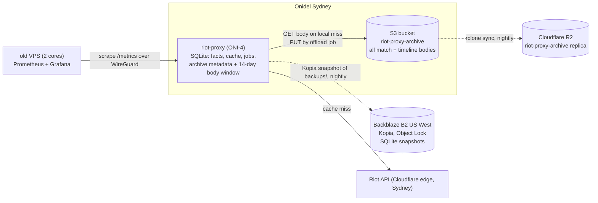

# 12 — Raw bodies in object storage, and the move to Onidel

Status: **proposal, 2026-10-13.** Nothing here is built. Task ids `OBJ-nn` are
reserved below; ADR numbers are allocated when each PR lands (DSK-01..07 hold
135–141).

## Why

The VPS database is 20 GB and the disk reached 97% on 2026-10-13. The DSK
series (DSK-01..07) compacts the derived tables and the job queue, which is
worth roughly 1.5–2 GB. It does not touch the bulk of the file: `matches.body_zstd`
and `timelines.body_zstd`, the zstd-compressed Riot payloads. Those grow by
about 12 KB per match and 60–80 KB per timeline, and the crawl still has
1.19 M matches queued, with TL-02's timeline backfill behind them. Left in
SQLite, the file heads for 100 GB and more, every nightly `VACUUM INTO` copies
all of it, and every plan size is decided by raw bytes the proxy reads rarely.

The bodies are immutable and written once. That is what object storage is for.
Moving them out leaves SQLite holding only facts, analytics, cache, jobs and
the archive's metadata: a few GB that fits in RAM, backs up in seconds, and
makes the VPS plan a choice about RAM and cores rather than disk.

The hosting move is the other half. OVHcloud Sydney has no stock, the current
box is 2 cores and 3.7 GB, and the research of 2026-10-13 (overseas vs Sydney,
sixteen countries) found nothing cheaper than Sydney for this workload once
Hetzner's 2026 repricing is counted. The owner has chosen Onidel Sydney.

## Goals

- Raw match and timeline bodies live in an S3-compatible bucket in the same
  data centre as the proxy; SQLite keeps their metadata and a short local
  window of recent bodies.
- No change to any HTTP response, header, metric name or `ApiError` code.
- The archive never fails a request: a bucket outage degrades to a Riot fetch,
  exactly as a failing SQLite archive does today (`SqliteArchive`, ADR in 04).
- Resumable, paced, idempotent offload of the 20 GB already on disk, with
  byte-level verification before any local copy is dropped.
- A migration runbook for the host move with minutes of downtime, not hours,
  and a rollback at every step.

## Non-goals

- Off-box backups of the SQLite file. That is the Kopia-to-Backblaze plan
  (report of 2026-10-13, its own task); this document only shrinks what it
  backs up.
- Serving raw bodies to the public from the bucket. Every read still goes
  through the proxy.
- Writing bodies to two stores from the app. The replica is an ops job.
- Postgres. design/07 §Sizing said "50+ GB → consider Postgres"; this is the
  cheaper answer to the same growth.

## Topology after the move



Three copies of raw data (Onidel bucket, triple-replicated; R2; and, until the
drop step, the old SQLite file). Two copies of SQLite (local `backups/`, B2).
The old box keeps no Riot key and no database.

## Storage layout

### Bucket

One bucket, `riot-proxy-archive`, private, versioning off (objects are
immutable; a re-PUT writes identical bytes). Keys:

```
matches/<platform>/<match_id>.zst      e.g. matches/OC1/OC1_123456789.zst
timelines/<platform>/<match_id>.zst
```

`<platform>` is the match id's prefix, so a listing by platform is a prefix
listing. The object is `body_zstd` byte for byte: the same zstd frame SQLite
holds today, so the offload is a copy, not a re-encode, and
`sha256(object) == sha256(body_zstd)` is the verification. Metadata:
`Content-Type: application/json`, `Content-Encoding: zstd`, and
`x-amz-meta-sha256` with the hex digest. No dictionary (THR-06d would add a
`dict_id` to the key suffix if it ever lands; old objects stay readable).

Platform sits before match id so that a per-platform purge or audit is one
prefix walk. Riot match ids are unique across platforms, so there is no
collision either way.

### SQLite

Migration `V00NN__bodies_offloaded.sql` (`ALTER TABLE … ADD COLUMN`, cheap on
20 GB, same pattern as V0019):

```sql
ALTER TABLE matches   ADD COLUMN body_sha256  BLOB;     -- 32 bytes; NULL until computed
ALTER TABLE matches   ADD COLUMN offloaded_at INTEGER;  -- unix ms; NULL = body is local
ALTER TABLE timelines ADD COLUMN body_sha256  BLOB;
ALTER TABLE timelines ADD COLUMN offloaded_at INTEGER;
CREATE INDEX matches_offload   ON matches(offloaded_at) WHERE offloaded_at IS NULL;
CREATE INDEX timelines_offload ON timelines(offloaded_at) WHERE offloaded_at IS NULL;
```

`body_zstd` stays `NOT NULL`. An offloaded row holds the **empty blob** `X''`,
which the schema allows and which no real body can be (a zstd frame is at
least nine bytes). `offloaded_at IS NOT NULL` is the truth; the empty blob is
what frees the pages. Rebuilding the table without the column is deferred to
OBJ-05, when the column is near-empty and the rebuild is cheap; rebuilding a
20 GB table first would need 20 GB of spare disk the VPS does not have.

Freed pages go to the free list. DSK-01's `sqlite_freelist_bytes` shows them;
design/07 §Reclaiming space (`VACUUM INTO` and swap) returns them to the
file system, once, after the offload has finished.

## Read and write paths

Every raw read already goes through `archive::matches::{get, get_many,
get_timeline}`; every write through `put` and `put_timeline` (`archive/mod.rs`
is the only caller of the writes; `routes/players.rs`, `jobs/analytics.rs` and
`jobs/names.rs` call `get_many`). Nothing outside `src/archive` changes.

**Write.** Unchanged. `put` stores the body in SQLite as today and now also
stores `body_sha256`. New matches are therefore local for a window and never
depend on the bucket being up. No S3 call on the request path.

**Read.** `get`: if `body_zstd` is non-empty, return it (today's path). If it
is empty and `offloaded_at` is set, GET the object, check the sha256, return
it. A miss, a checksum mismatch or a store error logs a warning and returns
`None`, so the fetcher goes to Riot (ADR: a failing archive never fails a
request). `get_many` splits ids into local and offloaded, fetches the
offloaded set with bounded concurrency (`ARCHIVE_OBJECT_CONCURRENCY`, default
16) and merges. A body read back from the bucket is not re-written to SQLite.

The 14-day local window (`ARCHIVE_BODY_LOCAL_DAYS`) exists for the hot path:
`routes/players.rs` reads a player's recent matches, which are almost always
inside the window, so the player page's latency does not change. Analytics
re-extraction and the names job read old bodies in batches, where 1–3 ms per
object in the same data centre, 16 at a time, is well under their current pace
(`FACTS_REEXTRACT_BATCH` with a 50 ms pause).

**Client.** The `object_store` crate (Apache), `aws` feature: S3-compatible
with a custom endpoint and path-style addressing, retries and timeouts
built in, and `LocalFileSystem` and `InMemory` back ends so every test runs
without a network. New dependency; needs the owner's nod per the P0 rule.
Static musl build: it uses `reqwest` with rustls, same as the proxy.

## Offload job

`archive:offload`, one job kind, bulk lane, priority 30 000 (beside
`facts:reextract`), queued hourly by the tick while any eligible row remains
and once at boot. One turn:

1. Select up to `ARCHIVE_OFFLOAD_BATCH` (default 200) rows from `matches`, then
   `timelines`, where `offloaded_at IS NULL` and `archived_at < now −
   ARCHIVE_BODY_LOCAL_DAYS` (timelines use their match's `archived_at`),
   oldest first.
2. For each, compute the sha256 if `body_sha256` is NULL, PUT the object with
   the metadata above (a re-PUT of an existing key is harmless), then HEAD it
   and compare `x-amz-meta-sha256` and the content length.
3. One write transaction: `UPDATE … SET body_zstd = X'', body_sha256 = ?,
   offloaded_at = ? WHERE match_id = ? AND offloaded_at IS NULL` for the
   verified rows only.
4. Pause `ARCHIVE_OFFLOAD_PACE_MS` (default 50), take another turn while rows
   remain, then finish; the hourly tick re-queues.

A store error ends the turn with the job `failed` and the scheduler's normal
retry; nothing is marked offloaded that was not verified. The job is
idempotent and resumable without a cursor, as `reextract` is.

Progress is visible as `archive_offload_pending{kind="match"|"timeline"}`
gauges, `archive_offload_bytes_total`, and `offloadedMatches` /
`offloadedTimelines` on `GET /v1/admin/stats`. The dashboard's archive card
shows local vs offloaded counts.

Setting `ARCHIVE_BODY_LOCAL_DAYS=0` offloads everything eligible immediately,
which is what the first run on the new host uses for the 20 GB backlog.

With no bucket configured (`ARCHIVE_OBJECT_URL` unset), the job kind is not
registered and the proxy behaves exactly as today. That is also the rollback.

## Replica and backups

**R2 replica of the bucket.** An ops job, not app code: `rclone sync` from
the Onidel bucket to an R2 bucket of the same name, nightly, from the VPS,
`--max-age 48h --no-traverse` so a run lists only the source's recent objects
and does not walk a million keys on R2; a weekly full `sync` catches anything
missed. R2's charge is storage (about US$0.015/GB-month, 10 GB free) and
writes (about US$4.50 per million); reads and egress are free. Set R2's
location hint to Oceania if the dashboard offers it. The replica is for the
day Onidel's account or bucket is gone; the proxy never reads it. Restoring
means pointing `ARCHIVE_OBJECT_URL` at it, nothing else.

**SQLite backups.** Out of scope here beyond the effect: after the offload the
nightly `VACUUM INTO` is a few GB, DSK-02's free-space guard stops the skip,
and the Kopia snapshot to B2 holds the whole database plus `/etc/riot-proxy/env`.
The raw bodies are not in those snapshots; they are in the bucket and R2.

**Restore drill.** Quarterly: restore the latest B2 snapshot to a scratch
directory, start a proxy against it with `ARCHIVE_OBJECT_URL` pointing at R2,
read one old match through `/v1/match/{id}` and confirm `X-Cache: ARCHIVE`.

## Configuration

| Variable | Default | Notes |
|---|---|---|
| `ARCHIVE_OBJECT_URL` | unset | `s3://riot-proxy-archive`; unset = bodies stay in SQLite, no offload job |
| `ARCHIVE_OBJECT_ENDPOINT` | unset | `https://s3.ap-southeast-2.onidel.cloud`; required with the URL |
| `ARCHIVE_OBJECT_REGION` | `auto` | passed through; Onidel and R2 accept any |
| `ARCHIVE_OBJECT_ACCESS_KEY` / `ARCHIVE_OBJECT_SECRET_KEY` | unset | in `/etc/riot-proxy/env`, 0600; never logged; `Config` redacts them like the Riot key |
| `ARCHIVE_BODY_LOCAL_DAYS` | `14` | 0–365; bodies younger than this stay in SQLite |
| `ARCHIVE_OFFLOAD_BATCH` | `200` | rows per turn |
| `ARCHIVE_OFFLOAD_PACE_MS` | `50` | pause between turns |
| `ARCHIVE_OBJECT_CONCURRENCY` | `16` | parallel GETs in `get_many` |

`ENV=production` refuses a URL without credentials. Boot logs the endpoint and
bucket, never the keys.

## Sizing and cost

Per row: match about 12 KB zstd, timeline 60–80 KB, facts about 1 KB per
participant (DSK-05 trims that). For the backlog of 1.19 M matches:

| Where | Matches only | With timelines |
|---|---|---|
| Bucket | ~15 GB | ~100 GB |
| SQLite after offload (14-day window, facts, analytics, cache, jobs) | ~4–6 GB | ~5–7 GB |

Monthly, AUD, Onidel console prices of 2026-10-13:

| Item | Cost |
|---|---|
| ONI-4, 6 vCPU / 12 GB / 120 GB NVMe / 6 TB | 42.52 |
| Onidel Object Storage, 1 TB allocation (the knowledge base mentions a 250 GB plan; confirm) | 7.16 (or ~1.80) |
| R2 replica, ~100 GB | ~2.30 (US$1.50) |
| B2 snapshots, ~60 GB | ~0.55 (US$0.35) |
| Old VPS as metrics host | whatever it costs today |

ONI-4 rather than ONI-3 for the 12 GB RAM: the whole SQLite file sits in page
cache, which is what makes the analytics rebuilds and ladder queries fast.
Disk is no longer the deciding factor. ONI-5 is not needed.

The proxy's request rate is pinned by the personal key (100 per 2 minutes),
so bandwidth allowances and core counts above this are irrelevant; RAM and
NVMe consistency are what the database feels. Check in the first hour on the
new box that Onidel's replicated storage commits fast enough: a timed batch
of inserts against a scratch database, compared with the old box, or `fio`
with `--rw=randwrite --bs=4k --fsync=1`.

## Tasks

One task, one branch, one PR, as always. Every task ships tests. OBJ-01 to
OBJ-03 land before the offload runs on the VPS; OBJ-04 and OBJ-05 follow it.
The host move (runbook below) needs no code and can happen first.

| Id | Task | Files | Tests | Done when |
|---|---|---|---|---|
| OBJ-01 | **Object store client and config.** `archive::objects`: a thin wrapper over `object_store` with `put(key, bytes, sha256)`, `head(key)`, `get(key)` checking the sha256, and `key_for(kind, match_id)`. Config rows above; `Config` redacts the keys; production refuses a URL without credentials. `object_store` added to `Cargo.toml` (owner approves the dependency). | `src/archive/objects.rs`, `src/config.rs`, `.env.example`, `Cargo.toml`, design/07 config table | unit over `InMemory`: put then get round-trips; a tampered object fails the digest; key layout; config validation and redaction | `cargo test`; the musl build still links |
| OBJ-02 | **Reads fall through to the bucket.** Migration `V00NN` above. `matches::get`, `get_many`, `get_timeline` read the object when `offloaded_at` is set; `put`/`put_timeline` store `body_sha256`. `get_many` bounded concurrency. The archive's `Stats` gains local vs offloaded counts and bytes; `/v1/admin/stats` and the dashboard show them. | `src/archive/matches.rs`, `src/archive/mod.rs`, `src/db/migrations/V00NN__bodies_offloaded.sql`, `src/stats.rs`, `src/routes/admin.rs`, `src/ui/dashboard.html`, design/04 | unit: an offloaded row reads from the store; a missing object returns `None` and warns; a digest mismatch returns `None`; `get_many` mixes local and offloaded ids; the migration on a seeded v-previous file. Integration: `/v1/match/{id}` on an offloaded match answers `X-Cache: ARCHIVE` with the same body and headers as before; a player page over offloaded matches is byte-identical; the OpenAPI snapshot | all existing archive, analytics and players tests pass unchanged |
| OBJ-03 | **The offload job.** `archive:offload` as specified; gauges and counters; registered only with a URL; `ARCHIVE_BODY_LOCAL_DAYS=0` for the backlog. Add it to design/06's job catalogue and the kind cap of OPS-06. | `src/jobs/offload.rs`, `src/jobs/{mod,scheduler}.rs`, `src/metrics.rs`, `src/cli/serve.rs`, `tests/offload.rs`, design/06, metrics.md | unit (paused time): rows inside the window are not selected; a verified batch is emptied and stamped in one transaction; a store that fails on the third PUT stamps the first two only and the job fails; a re-run after a crash does not re-upload stamped rows; `X''` bodies are never returned as a body. Integration over `LocalFileSystem`: 50 seeded matches offload end to end and read back; the gauges | on the dev VM, the archive offloads to a local-filesystem "bucket" and every match still reads |
| OBJ-04 | **Reclaim and runbook.** `riot-proxy reclaim` (or document the `VACUUM INTO` + swap from DSK-01 if that suffices), design/07 §Backups gains the rclone replica unit and timer under `deploy/`, and the restore drill. | `deploy/riot-proxy-replica.{service,timer}`, `deploy/README.md`, design/07 | the unit files parse (`systemd-analyze verify` in CI if available); a shell test runs the rclone command with `--dry-run` against two local directories | the VPS's `sqlite_db_bytes` is under 8 GB and `sqlite_freelist_bytes` near zero |
| OBJ-05 | **Drop `body_zstd`.** When every row is offloaded (`archive_offload_pending` is 0 for a week): migration rebuilds `matches` and `timelines` without `body_zstd` and `body_size` moves to `matches` metadata only if still read; `ARCHIVE_BODY_LOCAL_DAYS` becomes the size of a small local body cache table instead. Decide then whether the window is still wanted; if not, drop it and the flag. | `src/db/migrations/V00NN__drop_bodies.sql`, `src/archive/matches.rs`, design/04 | the migration refuses to run while any `offloaded_at IS NULL`; a seeded file rebuilds and reads | the VPS restarts on the new schema in under a minute |

## Migration runbook

Everything below is run by the owner. The dev container cannot reach the VPS
or Onidel. Steps 1–8 move the host and need no new code. Steps 9–12 need
OBJ-01..03 released. `old` is the current VPS, `new` is the ONI-4.

### 0. Before anything, on `old`

```
sudo ss -ltnp | grep -E ':80 |:443 |:3000 |:8080 '   # what listens, and on which address
systemctl is-active riot-proxy ninjagoldfinch-lol cloudflared
systemctl cat cloudflared | grep -o -- '--token' | head -1   # prints the flag only, never the token
sudo ls /etc/cloudflared/ 2>/dev/null
sudo grep -E '^(HOST|PORT|PROXY_URL)=' /etc/ninjagoldfinch-lol/env /etc/riot-proxy/env
sudo cat /etc/systemd/system/riot-proxy.service
sudo ls -la /etc/riot-proxy/ /var/lib/riot-proxy/data/
sqlite3 -readonly /var/lib/riot-proxy/data/riot-proxy.db \
  "select 'matches', count(*), sum(length(body_zstd))/1e9 from matches
   union all select 'timelines', count(*), sum(length(body_zstd))/1e9 from timelines
   union all select 'jobs pending', count(*), 0 from jobs where state='pending';"
sqlite3 -readonly /var/lib/riot-proxy/data/riot-proxy.db \
  "select name, sum(pgsize)/1e9 as gb from dbstat group by name order by gb desc limit 8;"
```

Record the numbers in PROGRESS.md; they size the bucket and the first offload.
If `dbstat` is unavailable, skip that query.

The same server runs the site (ninjagoldfinch.lol, ADR-038 in that repo):
`ninjagoldfinch-lol.service` running `node build` on `127.0.0.1:3000`, and
`cloudflared` as a system service routing the site's hostname to it. The
tunnel is outbound-only, so no DNS record points at the server's IP and
there is no DNS change in this move: whichever box runs the tunnel's
connector serves the site. The `--token` check tells you how cloudflared was
installed: a token in the unit file (`cloudflared service install <token>`),
or a config file and credentials JSON under `/etc/cloudflared/`. Either way
those files are secrets; they are copied below without being printed.

### 1. Provision

- Onidel: ONI-4, Sydney, Ubuntu 26.04 LTS, your SSH key, hourly billing.
  Enable the IPv6 /64. Create the object storage bucket `riot-proxy-archive`
  in Sydney and an access key scoped to it. Note the endpoint
  (`s3.ap-southeast-2.onidel.cloud` per their knowledge base; confirm in the
  console).
- Cloudflare: an R2 bucket `riot-proxy-archive` with an API token limited to
  that bucket. Location hint Oceania if offered.
- Onidel firewall group and `ufw` on `new`: inbound 22 only. The tunnel needs
  no inbound port. Ports 3000 and 8080 must not be reachable from outside:
  the site binds `127.0.0.1`, and the proxy's `HOST` defaults to `0.0.0.0`,
  so set `HOST=127.0.0.1` in its env unless the metrics box will scrape it
  over WireGuard (then bind the WireGuard address in step 11).
- `unattended-upgrades`, timezone UTC, `chrony` (the old box's clock lagged a
  day; check `timedatectl` on both). VPC off: one server.

### 2. Storage check on `new` (first hour, before copying anything)

```
sudo apt-get install -y fio sqlite3
fio --name=fsync --rw=randwrite --bs=4k --size=512m --fsync=1 --numjobs=1 --runtime=30 --time_based --directory=/var/tmp
```

Compare `fsync` latency and write IOPS with the same command on `old`. If
`new` is slower on fsync by more than about 2x, stop and talk to Onidel
support (or pick BinaryLane); the proxy commits once per archived match.

### 3. Install the proxy on `new`

```
sudo useradd --system --home /var/lib/riot-proxy --shell /usr/sbin/nologin riot-proxy
sudo mkdir -p /var/lib/riot-proxy/data /etc/riot-proxy
sudo chown -R riot-proxy:riot-proxy /var/lib/riot-proxy
# from old, same binary version (as ubuntu; `ssh -A` into new so your key reaches old)
scp ubuntu@old:/usr/local/bin/riot-proxy ubuntu@old:/etc/systemd/system/riot-proxy.service /tmp/
sudo install -m 0755 /tmp/riot-proxy /usr/local/bin/
sudo install -m 0644 /tmp/riot-proxy.service /etc/systemd/system/
# the env file is root-only on old: stream it through sudo on both ends
ssh ubuntu@old 'sudo -n cat /etc/riot-proxy/env' | sudo sh -c 'umask 077; cat > /etc/riot-proxy/env'
sudo test -s /etc/riot-proxy/env && echo "env copied"
sudo systemctl daemon-reload
```

Do not start it yet. The env file is never displayed: it streams from `sudo
cat` on `old` into a root-only file on `new`, and systemd reads it as root
before dropping to `riot-proxy`. `sudo -n` fails instead of prompting if
`old` wants a sudo password; in that case run the `cat` on `old` into a
0600 file in your home, `scp` that, and delete it on both ends.

Every `ssh`/`scp`/`rsync` to `old` here runs as you, not through plain
`sudo`: `sudo` drops your SSH agent. The rsyncs below run as root with
`--preserve-env=SSH_AUTH_SOCK` so they keep it.

### 3b. Install the site and the tunnel on `new`, stopped

Per the site's README and ADR-038:

```
sudo apt-get install -y nodejs git && sudo corepack enable    # Ubuntu 26.04's Node is new enough
sudo useradd --system --create-home --home /opt/ninjagoldfinch-lol-home --shell /usr/sbin/nologin ninjagoldfinch-lol
```

- **Deploy key.** Generate a new read-only key on `new` for the
  `ninjagoldfinch-lol` user and add its public half to the private repo's
  Deploy keys on GitHub. Do not copy `old`'s key; it is revoked in step 11.
- **Checkout and build** as in the README: clone to `/opt/ninjagoldfinch-lol`,
  `pnpm install --frozen-lockfile`, `env ORIGIN=https://ninjagoldfinch.lol pnpm build`.
- **Settings and unit,** streamed like the proxy's, never displayed:

```
ssh ubuntu@old 'sudo -n cat /etc/ninjagoldfinch-lol/env' | sudo sh -c 'mkdir -p /etc/ninjagoldfinch-lol; umask 077; cat > /etc/ninjagoldfinch-lol/env'
scp ubuntu@old:/etc/systemd/system/ninjagoldfinch-lol.service /tmp/ && sudo install -m 0644 /tmp/ninjagoldfinch-lol.service /etc/systemd/system/
```

  `PROXY_URL` stays `http://127.0.0.1:8080`, the proxy is on the same box.
- **cloudflared** from Cloudflare's apt repository, then the tunnel's
  credentials from `old`. Token install: stream the unit file
  (`ssh ubuntu@old 'sudo -n cat /etc/systemd/system/cloudflared.service' | sudo sh -c 'umask 077; cat > /etc/systemd/system/cloudflared.service'`,
  then `sudo chmod 0644` it). Config install: stream `/etc/cloudflared/` as a
  tar (`ssh ubuntu@old 'sudo -n tar -C /etc -cf - cloudflared' | sudo tar -C /etc -xf -`)
  and install the service. Then `sudo systemctl daemon-reload`.
- Do **not** enable or start `cloudflared` or the site yet. Two connectors on
  one tunnel are load-balanced by Cloudflare, so a site on `new` talking to an
  empty proxy would serve half the visitors.

### 4. Bulk copy while `old` keeps serving

```
# on new (logged in with ssh -A)
sudo --preserve-env=SSH_AUTH_SOCK rsync -a --inplace --partial --info=progress2 \
  ubuntu@old:/var/lib/riot-proxy/data/ /var/lib/riot-proxy/data/
sudo chown -R riot-proxy:riot-proxy /var/lib/riot-proxy/data
```

This is the long transfer (20 GB), taken while the file is live and therefore
inconsistent. That is fine: it is only a seed for the delta in step 6.
`--inplace` lets the second pass rewrite changed blocks without a second 20 GB
of scratch space. The `ddragon/` mirror and `backups/` come along; delete the
placeholder files in `backups/` on `new` if they exist.

### 5. Optional, recommended: purge the stale queue first

If DSK-03 has shipped, on `old`: `DELETE /v1/admin/jobs?kind=archive:match&state=pending&minPriority=20000`
drops the 1.19 M `fetchTimeline: false` rows (the next crawl re-queues what
it needs, and TL-02 backfills timelines). The jobs table shrinks by a few
hundred MB and the new box starts with a clean queue. Without DSK-03, leave
it; the queue migrates as it is.

### 6. Cut over (the downtime window, a few minutes)

```
# old
sudo systemctl stop cloudflared ninjagoldfinch-lol riot-proxy
sudo -u riot-proxy sqlite3 /var/lib/riot-proxy/data/riot-proxy.db "PRAGMA wal_checkpoint(TRUNCATE);"
# new
sudo --preserve-env=SSH_AUTH_SOCK rsync -a --inplace --partial --delete --info=progress2 \
  ubuntu@old:/var/lib/riot-proxy/data/ /var/lib/riot-proxy/data/
sudo chown -R riot-proxy:riot-proxy /var/lib/riot-proxy/data
sudo -u riot-proxy sqlite3 -readonly /var/lib/riot-proxy/data/riot-proxy.db "PRAGMA integrity_check;"   # must print ok
sudo systemctl enable --now riot-proxy
curl -s localhost:8080/healthz; curl -s localhost:8080/readyz
sudo systemctl enable --now ninjagoldfinch-lol
curl -s localhost:3000/healthz
sudo systemctl enable --now cloudflared                         # the site is live from here
```

The second rsync moves only the blocks that changed since step 4. Do not
start the proxy on both boxes: the limiter state is per key and two
instances would share one Riot budget blind. No DNS change: the tunnel's
connector moved, and Cloudflare's dashboard shows it under Zero Trust,
Networks, Tunnels, with `new`'s address. Watch `journalctl -u riot-proxy -f`
for the first crawl tick and the `jobs_pending` gauge resuming. Downtime for
the site is the length of the second rsync.

### 7. Verify

- `/metrics` from the old Grafana dashboard: `riot_requests_total` moving,
  `limiter` buckets filling, no 429s.
- A player page, a match page and a champion page on https://ninjagoldfinch.lol;
  `curl -sI localhost:8080/...` on `new` shows `X-Cache` and `X-Request-Id`
  as before.
- `sqlite_db_bytes` and `data_dir_free_bytes` (DSK-01) on the new disk.
- Leave `old` stopped but intact for seven days. Rollback is stopping the
  three services on `new` and starting them on `old`; anything archived on
  `new` in between is lost to the rollback, which is acceptable for an
  archive that re-fetches.

### 8. Backups and replica units

- Kopia to B2 per the backup plan: `/etc/riot-proxy/backup-env` (0600), the
  service and timer, a first snapshot, a restore drill.
- `rclone` with two remotes (`onidel:` S3 endpoint above, `r2:` with the R2
  token) in `/etc/riot-proxy/rclone.conf` (0600), and the OBJ-04 timer. Until
  OBJ-04 exists, a cron line is fine:
  `17 3 * * * rclone sync onidel:riot-proxy-archive r2:riot-proxy-archive --max-age 48h --no-traverse --transfers 16`

### 9. Offload the backlog (after OBJ-01..03 are released)

Add to `/etc/riot-proxy/env`:

```
ARCHIVE_OBJECT_URL=s3://riot-proxy-archive
ARCHIVE_OBJECT_ENDPOINT=https://s3.ap-southeast-2.onidel.cloud
ARCHIVE_OBJECT_ACCESS_KEY=…
ARCHIVE_OBJECT_SECRET_KEY=…
ARCHIVE_BODY_LOCAL_DAYS=0
```

Restart, watch `archive_offload_pending` fall. At 200 rows per turn and 50 ms
pacing, 1.2 M objects take about ten hours; the limiter is untouched because
no Riot call is involved. Spot-check: pick ten old match ids,
`GET /v1/match/{id}` each, expect `X-Cache: ARCHIVE` and the same body as
`old` returns for the same id (`old` can be started briefly on a different
port with `PORT=8081` and the limiter disabled by a dev key, or just compare
the sha256 recorded in the row).

Then set `ARCHIVE_BODY_LOCAL_DAYS=14` and restart.

### 10. Reclaim the file

Once pending is 0: DSK-01's §Reclaiming space (`VACUUM INTO` a new file during
a stop, swap, start). Expect `sqlite_db_bytes` to drop from 20 GB to under
6 GB. The nightly `VACUUM INTO` now takes seconds and DSK-02's guard no longer
skips.

### 11. Retire `old`

- `sudo shred -u /etc/riot-proxy/env /etc/ninjagoldfinch-lol/env`,
  `rm -rf /var/lib/riot-proxy /opt/ninjagoldfinch-lol`, remove the three units
  and `/etc/cloudflared/`, `apt remove cloudflared`.
- Delete `old`'s deploy key from the site repo's Deploy keys on GitHub.
- Install Prometheus, Grafana and node_exporter; WireGuard between the two
  boxes; scrape `new`'s `/metrics` over the tunnel only. Import
  `ops/grafana/riot-proxy-dashboard.json` and `ops/prometheus-alerts.yml`.
- The old box never holds a Riot key again.

### 12. Close out

- PROGRESS.md: the step-0 numbers, the dates, the ONI plan chosen.
- DECISIONS.md: one ADR for the host (Onidel Sydney over BinaryLane, Hetzner
  and the overseas options, with the one-line reasons), one per OBJ task as
  they land.
- Memory note `vps.md`: new host, paths, endpoint names.

## Rollback

| After step | How |
|---|---|
| 6, cut-over | stop `cloudflared`, the site and the proxy on `new`, start them on `old`; lose what `new` archived meanwhile |
| 9, offload | unset `ARCHIVE_OBJECT_URL`: offloaded rows read `None` and re-fetch from Riot on demand; the bucket keeps everything; re-setting the URL restores reads. The local bodies are gone from SQLite once stamped, by design |
| 10, reclaim | the pre-swap file is kept until the next nightly backup verifies |
| 11, retire | none; the key and data are gone from `old` on purpose |

## Open questions for the owner

1. **Primary bucket: Onidel Sydney or R2?** This design reads from Onidel (same
   data centre, 1–3 ms) and replicates to R2. Reading from R2 directly would
   save the A$7.16 allocation but adds a Cloudflare round trip to every
   out-of-window read; the player page is protected by the 14-day window
   either way. Recommendation: Onidel primary, R2 replica.
2. **Window length.** 14 days covers most player-page reads. Ladder analytics
   read everything anyway. 7 or 30 are fine; 0 after OBJ-05 if the local
   cache table replaces it.
3. **Dependency.** `object_store` (Apache). Alternative: `rust-s3`. The
   former's local and in-memory back ends are why it is proposed.
4. **Purge before move (step 5)?** Depends on DSK-03 landing first.
5. **Do the DSK migrations before or after the move?** After, on the faster
   box: DSK-06 and DSK-07 rebuild tables and want RAM and NVMe. The move
   itself needs no code.
