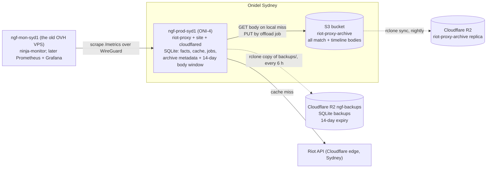

# 12 — Raw bodies in object storage, and the move to Onidel

Status, 2026-10-13: **the host move is done** (HOST-01, ADR-142; see §As
executed). **The object storage half is designed, not built.** The owner
answered §Open questions on 2026-10-13: Onidel Sydney is the primary bucket
(250 GB, upgradable), R2 the replica, a 14-day local window, the
`object_store` crate, and bodies **packed** many to an object rather than one
object each (ADR-146). Tasks OBJ-01..06 are in §Tasks and
docs/IMPLEMENTATION.md; each gets its own ADR as it lands.

## Why

The VPS database is 20 GB and the disk reached 97% on 2026-10-13. The DSK
series (DSK-01..07) compacts the derived tables and the job queue, which is
worth roughly 1.5–2 GB. It does not touch the bulk of the file: `matches.body_zstd`
and `timelines.body_zstd`, the zstd-compressed Riot payloads. Those grow by
about 12 KB per match and 60–80 KB per timeline, and the crawl still has
1.19 M matches queued, with TL-02's timeline backfill behind them. Left in
SQLite, the file heads for 100 GB and more, every nightly `VACUUM INTO` copies
all of it, and every plan size is decided by raw bytes the proxy reads rarely.

The bodies are immutable and written once. That is what object storage is for.
Moving them out leaves SQLite holding only facts, analytics, cache, jobs and
the archive's metadata: a few GB that fits in RAM, backs up in seconds, and
makes the VPS plan a choice about RAM and cores rather than disk.

The hosting move is the other half. OVHcloud Sydney has no stock, the current
box is 2 cores and 3.7 GB, and the research of 2026-10-13 (overseas vs Sydney,
sixteen countries) found nothing cheaper than Sydney for this workload once
Hetzner's 2026 repricing is counted. Production moved to Onidel Sydney on
2026-10-13.

## Goals

- Raw match and timeline bodies live in an S3-compatible bucket in the same
  data centre as the proxy, packed thousands to an object; SQLite keeps their
  metadata, where each body sits in which pack, and a short local window of
  recent bodies.
- No change to any HTTP response, header, metric name or `ApiError` code.
- The archive never fails a request: a bucket outage degrades to a Riot fetch,
  exactly as a failing SQLite archive does today (`SqliteArchive`, ADR in 04).
- Resumable, paced, idempotent offload of the 20 GB already on disk, with
  byte-level verification before any local copy is dropped.
- A migration runbook for the host move with minutes of downtime, not hours,
  and a rollback at every step.

## Non-goals

- Off-box backups of the SQLite file. Production already has them (an
  `rclone` timer to R2, §As executed); this document only shrinks what they
  copy.
- Serving raw bodies to the public from the bucket. Every read still goes
  through the proxy.
- Writing bodies to two stores from the app. The replica is an ops job.
- Postgres. design/07 §Sizing said "50+ GB → consider Postgres"; this is the
  cheaper answer to the same growth.

## Topology after the move



Three copies of raw data (Onidel bucket, triple-replicated; R2; and, until the
drop step, the old SQLite file). Two copies of SQLite (one local backup, R2
`ngf-backups`). The old box keeps no Riot key and no database.

## Storage layout

### Why packs, not one object per body

One object per body was the first draft. Onidel caps a bucket at **3 million
objects** by default (knowledge base, read 2026-10-13); at two objects per
match the archive passes that within months (460 k today, 20–40 k more a day
at the crawl's pace). Packing also makes every whole-bucket operation cheap:
the R2 replica's writes are billed per object (about US$4.50 per million), a
`rclone sync` or a later move to another provider copies a few hundred
objects instead of millions, and a listing fits in one page. It does not
change the bytes moved: ingress is free on both stores and a read fetches
only its body's byte range (an HTTP `Range` GET), so egress is the same as
one object per body.

The cost is an index (SQLite records which pack and which byte range holds
each body) and a compaction step when bodies are deleted (OBJ-06). Bodies
are immutable and deletions are rare, so both stay small.

### Bucket

One bucket, `riot-proxy-archive`, private, versioning off (packs are
immutable; a pack is never rewritten in place, only replaced by a new one).
Keys:

```
packs/matches/<yyyy>/<mm>/<pack_id>.pack     e.g. packs/matches/2026/10/01JABCDEF….pack
packs/timelines/<yyyy>/<mm>/<pack_id>.pack
```

`<pack_id>` is a ULID (creation time first, so a listing is in write order);
year and month are the pack's creation time, so a prefix walk can audit or
replicate one month.

**Matches and timelines go in separate packs.** They are read separately:
`facts:reextract`, the names job and the player page read match bodies only;
`builds:extract` and the timeline route read timelines only. A pack of one
kind keeps a bulk read dense (a batch of matches is not interleaved with
62 KB timelines it doesn't want, so merged ranges waste nothing), and lets
the two be treated differently later: a retention rule that drops old
timelines deletes whole packs instead of compacting every one. The rare
reader that wants both makes two ranged GETs.

**Inside a pack, bodies are sorted by match id.** The bulk jobs walk the
archive `ORDER BY match_id`, and a match id is its platform then Riot's
sequence number, so neighbouring ids are usually in the same pack and one
merged ranged GET serves a whole batch. Packs are not partitioned into fixed
id ranges: the crawl archives old ids long after newer ones (backfills, new
ladder players), so a fixed range would never close. Each pack covers the
ids that were eligible together, and `body_locations` finds any id wherever
it landed.

### Pack format

A pack holds one kind of body. It is the bodies back to back in match-id
order, then an index of them, then a fixed 16-byte trailer:

```
[body 0][body 1] … [body n-1][index][index length: u64 LE][magic "RPXPACK1"]
```

- Each body is `body_zstd` byte for byte: the same zstd frame SQLite holds
  today, so packing is a copy, not a re-encode.
- The index is zstd-compressed JSON lines, one per body:
  `{"kind":"match"|"timeline","matchId":…,"offset":…,"len":…,"sha256":…}`.
  It makes a pack self-describing: if SQLite's index is ever lost, reading
  every pack's trailer and index (two ranged GETs each) rebuilds it.
- The object's metadata carries `x-amz-meta-sha256` (of the whole object),
  `x-amz-meta-bodies` and `Content-Type: application/octet-stream`.

A pack closes at `ARCHIVE_PACK_TARGET_BYTES` (default 64 MiB, about 1,000
timelines or 6,000 matches). A smaller pack is written only for bodies that
have reached the end of the local window unpacked, so freeing them is never
held up (§Offload job). At
64 MiB the 16 GB on disk today is about 40 match packs and 210 timeline packs,
and the archive's growth adds a handful a day: years of headroom under 3 M
objects.

### SQLite

Migration `V00NN__body_packs.sql` (new tables and `ALTER TABLE … ADD COLUMN`,
cheap on 20 GB, same pattern as V0019):

```sql
CREATE TABLE body_packs (
  pack_id    TEXT PRIMARY KEY,                -- ULID; object key derives from it
  kind       TEXT NOT NULL,                   -- match | timeline; the key needs it
  bytes      INTEGER NOT NULL,                -- object size
  bodies     INTEGER NOT NULL,
  live_bytes INTEGER NOT NULL,                -- bytes of bodies still referenced
  sha256     BLOB NOT NULL,
  created_at INTEGER NOT NULL
);
CREATE TABLE body_locations (                  -- where each offloaded body is
  match_id TEXT NOT NULL,
  kind     TEXT NOT NULL,                      -- match | timeline
  pack_id  TEXT NOT NULL REFERENCES body_packs(pack_id),
  offset   INTEGER NOT NULL,
  len      INTEGER NOT NULL,
  sha256   BLOB NOT NULL,
  PRIMARY KEY (match_id, kind)
) WITHOUT ROWID;
CREATE INDEX body_locations_pack ON body_locations(pack_id);
ALTER TABLE matches   ADD COLUMN packed_at    INTEGER;  -- unix ms; set once the body is in a verified pack
ALTER TABLE matches   ADD COLUMN offloaded_at INTEGER;  -- unix ms; set once the local copy is freed
ALTER TABLE timelines ADD COLUMN packed_at    INTEGER;
ALTER TABLE timelines ADD COLUMN offloaded_at INTEGER;
CREATE INDEX matches_to_pack   ON matches(archived_at, packed_at) WHERE packed_at IS NULL;
CREATE INDEX matches_to_free   ON matches(archived_at, packed_at, offloaded_at)
  WHERE packed_at IS NOT NULL AND offloaded_at IS NULL;
CREATE INDEX timelines_to_pack ON timelines(match_id, packed_at) WHERE packed_at IS NULL;
CREATE INDEX timelines_to_free ON timelines(match_id, packed_at, offloaded_at)
  WHERE packed_at IS NOT NULL AND offloaded_at IS NULL;
```

As built (V0023, OBJ-02, ADR-163): `body_packs` keeps the pack's `kind`, so
its key can still be derived after its last body is deleted (OBJ-06). Each
partial index ends with its state columns. The `WHERE` already implies them,
but SQLite checks a query's terms against the row unless the index holds the
columns, and in a row they sit after the body, so a state count would read
every body. With them, the dashboard's counts read the indexes alone (a test
checks the query plans).

A body moves through three states: **local** (`packed_at` NULL), **packed**
(in the bucket and still in SQLite, `packed_at` set), and **offloaded** (in the
bucket only, `offloaded_at` set). Packing happens within hours of archiving;
freeing happens at the end of the 14-day window.

`body_locations` is the log of where each match id is: one row per packed
body, about 60 bytes, so a million matches with timelines cost about 120 MB.

`body_zstd` stays `NOT NULL`. An offloaded row holds the **empty blob** `X''`,
which the schema allows and which no real body can be (a zstd frame is at
least nine bytes). `offloaded_at IS NOT NULL` with a `body_locations` row is
the truth for a freed body; the empty blob is what frees the pages. Rebuilding the tables
without the column is deferred to OBJ-05, when the column is near-empty and
the rebuild is cheap.

Freed pages go to the free list. DSK-01's `sqlite_freelist_bytes` shows them;
design/07 §Reclaiming space (`VACUUM INTO` and swap) returns them to the
file system, once, after the offload has finished.

## Read and write paths

Every raw read already goes through `archive::matches::{get, get_many,
get_timeline}`; every write through `put` and `put_timeline` (`archive/mod.rs`
is the only caller of the writes; `routes/players.rs`, `jobs/analytics.rs` and
`jobs/names.rs` call `get_many`). Nothing outside `src/archive` changes.

**Write.** Unchanged. `put` stores the body in SQLite as today. New matches
never depend on the bucket being up, and there is no S3 call on the request
path; the offload job packs them in the background within hours.

**Read.** `get`: if `body_zstd` is non-empty, return it (today's path, which
also covers packed bodies still inside the window). If it
is empty and `offloaded_at` is set, look up `body_locations`, GET that byte
range of the pack, check the body's sha256, return it. A missing location, a
store error or a checksum mismatch logs a warning and returns `None`, so the
fetcher goes to Riot (a failing archive never fails a request). `get_many`
splits ids into local and offloaded, groups the offloaded ones by pack,
merges ranges in the same pack that are close together (`object_store`'s
`get_ranges` does this) and fetches packs with bounded concurrency
(`ARCHIVE_OBJECT_CONCURRENCY`, default 16). A body read back from the bucket
is not re-written to SQLite.

As built (OBJ-02): the bucket is attached to the database handle at boot
(`Db::attach_objects`), since its locations are only meaningful with that
database, so every caller of `get_many` reads offloaded bodies with no change.
A read logs one warning per pack, not per body, when a pack read fails. A
match or timeline archived again after it was offloaded (a fallback to Riot)
is local again: `offloaded_at` is cleared and its location, still valid,
stays. `archive::offload` holds the two steps OBJ-03's job drives:
`write_pack` (build, upload, HEAD-verify, record in one transaction; a store
without metadata is read back and hashed) and `free` (packed and located rows
only).

The 14-day local window (`ARCHIVE_BODY_LOCAL_DAYS`) is a read cache, not a
delay before the bucket: every body is in the bucket within hours, and the
window only decides how long SQLite keeps its own copy. It exists for the hot
path: `routes/players.rs` reads a player's recent matches, which are almost
always inside the window, so the player page's latency does not change.
Fourteen days also matches League's two-week patch cycle, so the current
patch's matches, which the analytics and build pages read most, stay local
(owner, 2026-10-13). Analytics
re-extraction and the names job read old bodies in batches; a pack holds
bodies in archive order, so a batch of old matches mostly falls in a few
packs and costs a few ranged GETs at 1–3 ms each in the same data centre.

**Client.** The `object_store` crate (Apache), `aws` feature: S3-compatible
with a custom endpoint, ranged GETs, multipart PUT, retries and timeouts
built in, and `LocalFileSystem` and `InMemory` back ends so every test runs
without a network. New dependency, approved by the owner 2026-10-13. Static
musl build: it uses `reqwest` with rustls, same as the proxy.

## Offload job

`archive:offload`, one job kind, bulk lane, priority 30 000 (beside
`facts:reextract`). It is queued **when a pack is full**, not on a timer
(owner, 2026-10-13): the archive keeps a running total of unpacked bytes per
kind (an in-memory counter, seeded at boot from the `*_to_pack` indexes and
raised by every `put`), and when a kind's total reaches
`ARCHIVE_PACK_TARGET_BYTES` it queues the job (deduplicated, so at most one is
pending). That is a few times a day at the crawl's pace and costs one
addition per archived body. The job is also queued once at boot and once a
day after `maintenance`: the boot run catches a counter lost to a restart,
and the daily run frees bodies that left the window and packs a partial pack
whose bodies are already past it. **Uploading
and freeing are separate steps** (owner, 2026-10-13): a body goes to the
bucket as soon as a full pack of its kind is ready, and its local copy is
freed only when it leaves the 14-day window. A run does both:

**Pack.** One turn builds one pack of one kind, matches first, then timelines:

1. Select unpacked rows of that kind (`packed_at IS NULL`), oldest
   `archived_at` first, until the bodies reach `ARCHIVE_PACK_TARGET_BYTES`.
   If they don't reach it, write a pack only when some of them are already
   older than the window (so freeing them isn't held up); otherwise stop and
   wait for the next run. Matches fill a pack in under a day and timelines in
   a few hours at the crawl's pace, so packs are full-sized and a body is in
   the bucket as soon as its pack fills, and in R2 within the hour after.
2. Sort them by match id and build the pack in memory (64 MiB is nothing on
   a 12 GB host): bodies, index, trailer; sha256 of each body and of the
   whole object.
3. PUT it (multipart above 8 MiB) with the metadata above, then HEAD it and
   compare the size and `x-amz-meta-sha256`.
4. One write transaction: insert the `body_packs` row and every
   `body_locations` row, and set `packed_at` on each body. The local copies
   stay.
5. Pause `ARCHIVE_OFFLOAD_PACE_MS` (default 50) and take another turn while a
   pack is due; the run ends when no kind has a full pack left.

**Free.** Then, in batches of a few thousand rows per transaction:
`UPDATE … SET body_zstd = X'', offloaded_at = ? WHERE packed_at IS NOT NULL
AND offloaded_at IS NULL` for bodies whose match was archived more than
`ARCHIVE_BODY_LOCAL_DAYS` ago. No store call is involved: the pack was
verified when it was written, so this step cannot fail halfway.

A store error ends the turn with the job `failed` and the scheduler's normal
retry; nothing is marked packed that was not verified, and nothing is freed
that is not packed. A crash between the PUT and the transaction leaves an
**orphan pack**: an object no `body_packs` row names. It is harmless (the
rows are still unpacked and the next turn packs them again into a new pack),
and OBJ-06's sweep deletes orphans older than a day. The job is idempotent
and resumable without a cursor, as `reextract` is. A queue that fires while
a run is in progress is absorbed by the deduplication; the run itself loops
until nothing is due.

**Deleting bodies.** A deletion (a `dev reset`, a future retention rule)
deletes the `body_locations` row and subtracts its `len` from the pack's
`live_bytes`. The pack is untouched. OBJ-06's compaction rewrites any pack
under half live into a new pack of its live bodies, repoints their
locations in one transaction, then deletes the old object; a pack with no
live bodies is just deleted.

Progress is visible as `archive_offload_pending{kind="match"|"timeline",
step="pack"|"free"}` gauges, `archive_offload_bytes_total`, `archive_packs` and
`packedMatches` / `offloadedMatches` / `packedTimelines` / `offloadedTimelines` / `packs` on
`GET /v1/admin/stats`. The dashboard's archive card shows local vs
offloaded counts.

The first run packs the 16 GB backlog (all of it is unpacked) and frees
everything older than 14 days. `ARCHIVE_BODY_LOCAL_DAYS=0` frees every packed
body at once, for when disk is short.

With no bucket configured (`ARCHIVE_OBJECT_URL` unset), the job kind is not
registered and the proxy behaves exactly as today. That is also the rollback.

## Replica and backups

**R2 replica of the bucket.** An ops job, not app code: `rclone sync` from
the Onidel bucket to an R2 bucket of the same name, **hourly**, from the VPS
(owner, 2026-10-13). The offload empties a body from SQLite as soon as its
pack is verified on Onidel, so the replica's interval is how long a new pack
has a single provider; an hour bounds that. With packs the bucket holds
hundreds of objects and gains a handful a day, so a full `sync` every hour
lists one page and copies little, and it also carries compaction's
deletions. R2's charge is storage (about US$0.015/GB-month, 10 GB free) and
writes (about US$4.50 per million); reads and egress are free. Set R2's
location hint to Oceania if the dashboard offers it. The replica is for the
day Onidel's account or bucket is gone; the proxy never reads it. Restoring
means pointing `ARCHIVE_OBJECT_URL` at it, nothing else.

**Index snapshots in the bucket.** The map of where every body is
(`body_locations`) lives in SQLite, and each pack carries the index of its
own bodies. Rebuilding the map from the packs alone means reading every
pack's trailer and index: two small GETs a pack, minutes even at thousands of
packs, but the owner asked that a lost or corrupt database (and a lost
backup) not depend on it (2026-10-13). So the map is also kept in the bucket:

```
index/locations-<yyyy-mm-dd>.jsonl.zst     one line per body_locations row
index/packs-<yyyy-mm-dd>.jsonl.zst         one line per body_packs row
```

`archive:index-snapshot` (OBJ-04) writes both once a day, after
`maintenance`: a read transaction streams the two tables into zstd-compressed
JSON lines (about 30–40 MB per million matches with timelines), PUTs them,
and records the newest `pack_id` it covered in the object's metadata
(`x-amz-meta-last-pack`). They replicate to R2 with the packs. A bucket
lifecycle rule on `index/` expires snapshots after 14 days, so a corrupt one
is never the only copy.

On R2, as a safety net in case the hourly sync stops: a lifecycle rule on
`index/` expiring after **21 days** (longer than Onidel's 14, so it never
removes a snapshot the sync still mirrors) and the bucket's
abort-incomplete-multipart rule at 1 day. **No expiry rule on `packs/`**, on
either provider: packs are kept forever, and only compaction deletes one.

Recovery is then the newest snapshot (one GET) plus `packs reindex --since
<last-pack>`, which reads only the packs written after it: ULIDs sort by time,
so that is a listing and a few packs, not all of them. With neither the
database nor a snapshot, `packs reindex` over every pack still works.

**SQLite backups.** Out of scope here beyond the effect: after the offload the
nightly `VACUUM INTO` is a few GB instead of 22, and the existing `rclone`
timer copies it to R2 `ngf-backups` in seconds instead of ten minutes. The
raw bodies are not in those backups; they are in the bucket and its replica.

**Restore drill.** Quarterly: download the latest backup from `ngf-backups` to a scratch
directory, start a proxy against it with `ARCHIVE_OBJECT_URL` pointing at R2,
read one old match through `/v1/match/{id}` and confirm `X-Cache: ARCHIVE`.
Then empty `body_locations` in the scratch copy, run `packs restore-index`
(newest snapshot plus `reindex --since`) and confirm the table matches the
backup's row for row.

## Configuration

| Variable | Default | Notes |
|---|---|---|
| `ARCHIVE_OBJECT_URL` | unset | `s3://riot-proxy-archive`; unset = bodies stay in SQLite, no offload job. `file:///<dir>` uses a directory as the bucket (development, tests; refused in production, and it keeps no object metadata) |
| `ARCHIVE_OBJECT_ENDPOINT` | unset | `https://s3.ap-southeast-2.onidel.cloud`; required with an `s3://` URL. A host that starts with `<bucket>.` (`https://riot-proxy-archive.s3.ap-southeast-2.onidel.cloud`, the form Onidel documents) is addressed virtual-hosted style; any other host gets `/<bucket>` appended (path style, which R2 accepts). `http://` only outside production |
| `ARCHIVE_OBJECT_REGION` | `auto` | passed through; Onidel and R2 accept any |
| `ARCHIVE_OBJECT_ACCESS_KEY` / `ARCHIVE_OBJECT_SECRET_KEY` | unset | in `/etc/riot-proxy/env`, 0600; never logged; `Config` redacts them like the Riot key |
| `ARCHIVE_BODY_LOCAL_DAYS` | `14` | 0–365; how long SQLite keeps its own copy of a body that is already in the bucket (a read cache; packing does not wait for it) |
| `ARCHIVE_PACK_TARGET_BYTES` | `67108864` | 64 MiB; a pack closes at this size (1 MiB–1 GiB) |
| `ARCHIVE_OFFLOAD_PACE_MS` | `50` | pause between turns |
| `ARCHIVE_OBJECT_CONCURRENCY` | `16` | parallel ranged GETs in `get_many`; 1–256 |
| `ARCHIVE_COMPACT_BELOW` | `0.5` | OBJ-06: a pack whose live share falls under this is rewritten |

`ENV=production` refuses a URL without credentials (both keys, or neither
outside production). Keys without a URL are accepted and do nothing, so they
can go into `/etc/riot-proxy/env` before the bucket exists. Boot logs the
endpoint and bucket, never the keys. A ranged read that comes back shorter
than asked (HTTP clamps a range past the end of an object) is an error, never
a short body (OBJ-01, ADR-162).

## Sizing and cost

Measured on the VPS on 2026-10-13 (step 0): 230,715 matches hold 2.46 GB of
bodies (10.7 KB each) and 216,475 timelines hold 13.50 GB (62.3 KB each), so
16 GB of the 20 GB file is raw bodies. 1,126,303 jobs were pending. Facts are
about 1 KB per participant (DSK-05 trims that). For a backlog of about 1.1 M
matches:

| Where | Matches only | With timelines |
|---|---|---|
| Bucket | ~15 GB | ~100 GB |
| SQLite after offload (14-day window, facts, analytics, cache, jobs) | ~4–6 GB | ~5–7 GB |

Monthly, AUD, Onidel console prices of 2026-10-13:

| Item | Cost |
|---|---|
| ONI-4, 6 vCPU / 12 GB / 120 GB NVMe / 6 TB | 42.52 |
| Onidel Object Storage, 250 GB (A$0.0072/GB-month, billed annually: A$21.60 a year; upgradable, not downgradable; 3 M objects; egress free to 3× the allocation) | 1.80 |
| R2 replica, ~100 GB | ~2.30 (US$1.50) |
| R2 `ngf-backups`, 14 daily SQLite backups (~22 GB each today) | ~4.50 (US$3), falling to well under 1 after the offload |
| `ngf-mon-syd1` (the old OVH VPS) as the monitoring host | unchanged |

ONI-4 rather than ONI-3 for the 12 GB RAM: the whole SQLite file sits in page
cache, which is what makes the analytics rebuilds and ladder queries fast.
Disk is no longer the deciding factor. ONI-5 is not needed.

The proxy's request rate is pinned by the personal key (100 per 2 minutes),
so bandwidth allowances and core counts above this are irrelevant; RAM and
NVMe consistency are what the database feels. Check in the first hour on the
new box that Onidel's replicated storage commits fast enough: a timed batch
of inserts against a scratch database, compared with the old box, or `fio`
with `--rw=randwrite --bs=4k --fsync=1`.

## Tasks

One task, one branch, one PR, as always. Every task ships tests. OBJ-01 to
OBJ-03 land before the offload runs on the VPS; OBJ-04 to OBJ-06 follow it.

| Id | Task | Files | Tests | Done when |
|---|---|---|---|---|
| OBJ-01 | **Object store client and config.** `archive::objects`: a thin wrapper over `object_store` with `put(key, bytes)` (multipart above 8 MiB), `head(key)`, `get_range(key, range)`, `get_ranges(key, ranges)`, `list(prefix)` and `delete(key)`. Config rows above; `Config` redacts the keys; production refuses a URL without credentials. `object_store` added to `Cargo.toml`. | `src/archive/objects.rs`, `src/config.rs`, `.env.example`, `Cargo.toml`, design/07 config table | unit over `InMemory`: put then ranged get round-trips; several ranges in one call; head gives size and metadata; config validation and redaction | `cargo test`; the musl build still links under the size cap |
| OBJ-02 | **Pack format and reads.** `archive::pack`: a writer (bodies, index, trailer, digests) and a reader (trailer → index → bodies) independent of any store. Migration `V00NN` above. `matches::get`, `get_many`, `get_timeline` read an offloaded body by its location. The archive's `Stats` gains local vs offloaded counts, bytes and packs; `/v1/admin/stats` and the dashboard show them. | `src/archive/pack.rs`, `src/archive/matches.rs`, `src/archive/mod.rs`, `src/db/migrations/V00NN__body_packs.sql`, `src/stats.rs`, `src/routes/admin.rs`, `src/ui/admin.html`, design/04 | unit: a pack round-trips through writer and reader; a truncated or wrong-magic pack is refused; the index alone rebuilds every location; an offloaded row reads from its range; a missing location, a store error and a digest mismatch return `None` and warn; `get_many` mixes local and offloaded ids across packs; the migration on a seeded previous version. Integration: `/v1/match/{id}` on an offloaded match answers `X-Cache: ARCHIVE` with the same body and headers as before; a player page over offloaded matches is byte-identical; the OpenAPI snapshot | all existing archive, analytics and players tests pass unchanged |
| OBJ-03 | **The offload job.** `archive:offload` as specified; gauges and counters; registered only with a URL; packs new bodies within hours and frees local copies past the window. Add it to design/06's job catalogue and OPS-06's kind caps (one at a time). | `src/jobs/offload.rs`, `src/jobs/{mod,scheduler,kinds}.rs`, `src/metrics.rs`, `src/cli/serve.rs`, `tests/offload.rs`, design/06, metrics.md | unit (paused time): archiving bodies past the target queues one offload job, below it none, and a second full pack while one is pending queues no duplicate; the counter is seeded from the database at boot; new bodies are packed once a full pack is ready, without waiting for the window; less than a pack waits unless some of it has left the window; a pack holds one kind, its bodies in match-id order; a verified pack's rows are located and marked packed in one transaction and keep their local copy; bodies inside the window are never freed, packed bodies past it are, and unpacked bodies never are; a store that fails the PUT marks nothing and the job fails; a crash after the PUT leaves the rows unpacked and the next turn writes a new pack; a packed, unfreed body still reads locally; `X''` bodies are never returned as a body. Integration over `LocalFileSystem`: 500 seeded matches with timelines offload end to end into several packs and read back | on the dev VM, the archive offloads to a local-filesystem "bucket" and every match still reads |
| OBJ-04 | **Reclaim, replica and index recovery.** Document the `VACUUM INTO` + swap from DSK-01 for the one-off reclaim; the hourly R2 replica unit and timer under `deploy/`; the bucket setup in `deploy/README.md` (Onidel `index/` expiry 14 days; R2 `index/` expiry 21 days and multipart abort 1 day; no rule on `packs/`; an R2 token scoped to this bucket); `archive:index-snapshot` (daily, `index/` objects as in §Replica and backups); `riot-proxy packs reindex [--since <pack_id>]` and `packs restore-index`; the restore drill. | `deploy/riot-proxy-replica.{service,timer}`, `deploy/README.md`, `src/jobs/index_snapshot.rs`, `src/cli/packs.rs`, design/06, design/07 | the unit files parse (`systemd-analyze verify` in CI if available); a shell test runs the rclone command with `--dry-run` against two local directories; over `LocalFileSystem`: a snapshot round-trips both tables exactly; `reindex` rebuilds an emptied `body_locations` exactly; `restore-index` from a snapshot plus two newer packs rebuilds it exactly and reads only those two packs; a corrupt newest snapshot falls back to the one before | the VPS's `sqlite_db_bytes` is under 8 GB and `sqlite_freelist_bytes` near zero |
| OBJ-05 | **Drop `body_zstd`.** When every row outside the window is offloaded and the owner decides the local copy is no longer wanted: migration rebuilds `matches` and `timelines` without `body_zstd`; `ARCHIVE_BODY_LOCAL_DAYS` becomes the size of a small local body cache instead. Decide then whether the window is still wanted. | `src/db/migrations/V00NN__drop_bodies.sql`, `src/archive/matches.rs`, design/04 | the migration refuses to run while any `offloaded_at IS NULL`; a seeded file rebuilds and reads | the VPS restarts on the new schema in under a minute |
| OBJ-06 | **Deletes, compaction and orphans.** Deleting an offloaded body drops its location and lowers `live_bytes`; `archive:compact` (daily) rewrites packs under `ARCHIVE_COMPACT_BELOW` live, repoints locations in one transaction, then deletes the old object; it also deletes empty packs and orphan objects older than a day. | `src/jobs/compact.rs`, `src/archive/pack.rs`, `src/archive/matches.rs`, `tests/compact.rs`, design/06 | unit: a deletion lowers `live_bytes` only; a half-dead pack is rewritten and every live body still reads; a crash between the new PUT and the transaction leaves the old pack authoritative; an orphan younger than a day survives, older is deleted; an empty pack is deleted without a rewrite | a `dev reset` on the dev VM leaves no pack and no orphan behind |

## Migration runbook

Everything below is run by the owner. The dev container cannot reach the VPS
or Onidel. Steps 1–8 move the host and need no new code. Steps 9–12 need
OBJ-01..03 released. `old` is the current VPS, `new` is the ONI-4.

### 0. Before anything, on `old`

```
sudo ss -ltnp | grep -E ':80 |:443 |:3000 |:8080 '   # what listens, and on which address
systemctl is-active riot-proxy ninjagoldfinch-lol cloudflared
systemctl cat cloudflared | grep -o -- '--token' | head -1   # prints the flag only, never the token
sudo ls /etc/cloudflared/ 2>/dev/null
sudo grep -E '^(HOST|PORT|PROXY_URL)=' /etc/ninjagoldfinch-lol/env /etc/riot-proxy/env
sudo cat /etc/systemd/system/riot-proxy.service
sudo ls -la /etc/riot-proxy/ /var/lib/riot-proxy/data/
sqlite3 -readonly /var/lib/riot-proxy/data/riot-proxy.db \
  "select 'matches', count(*), sum(length(body_zstd))/1e9 from matches
   union all select 'timelines', count(*), sum(length(body_zstd))/1e9 from timelines
   union all select 'jobs pending', count(*), 0 from jobs where state='pending';"
sqlite3 -readonly /var/lib/riot-proxy/data/riot-proxy.db \
  "select name, sum(pgsize)/1e9 as gb from dbstat group by name order by gb desc limit 8;"
```

Record the numbers in PROGRESS.md; they size the bucket and the first offload.
If `dbstat` is unavailable, skip that query.

The same server runs the site (ninjagoldfinch.lol, ADR-038 in that repo):
`ninjagoldfinch-lol.service` running `node build` on `127.0.0.1:3000`, and
`cloudflared` as a system service routing the site's hostname to it. The
tunnel is outbound-only, so no DNS record points at the server's IP and
there is no DNS change in this move: whichever box runs the tunnel's
connector serves the site. The `--token` check tells you how cloudflared was
installed: a token in the unit file (`cloudflared service install <token>`),
or a config file and credentials JSON under `/etc/cloudflared/`. Either way
those files are secrets; they are copied below without being printed.

### 1. Provision

- Onidel: ONI-4, Sydney, Ubuntu 26.04 LTS, your SSH key, hourly billing.
  Enable the IPv6 /64. Create the object storage bucket `riot-proxy-archive`
  in Sydney and an access key scoped to it. Note the endpoint
  (`s3.ap-southeast-2.onidel.cloud` per their knowledge base; confirm in the
  console).
- Cloudflare: an R2 bucket `riot-proxy-archive` with an API token limited to
  that bucket. Location hint Oceania if offered.
- Onidel firewall group and `ufw` on `new`: inbound 22 only. The tunnel needs
  no inbound port. Ports 3000 and 8080 must not be reachable from outside:
  the site binds `127.0.0.1`, and the proxy's `HOST` defaults to `0.0.0.0`,
  so set `HOST=127.0.0.1` in its env unless the metrics box will scrape it
  over WireGuard (then bind the WireGuard address in step 11).
- `unattended-upgrades`, timezone UTC, `chrony` (the old box's clock lagged a
  day; check `timedatectl` on both). VPC off: one server.

### 2. Storage check on `new` (first hour, before copying anything)

```
sudo apt-get install -y fio sqlite3
fio --name=fsync --rw=randwrite --bs=4k --size=512m --fsync=1 --numjobs=1 --runtime=30 --time_based --directory=/var/tmp
```

Compare `fsync` latency and write IOPS with the same command on `old`. If
`new` is slower on fsync by more than about 2x, stop and talk to Onidel
support (or pick BinaryLane); the proxy commits once per archived match.

### 3. Install the proxy on `new`

**Onidel blocks outbound SSH by default** (seen 2026-10-13: `nc` to the old
VPS and to github.com on 22 timed out, 443 worked). It is a per-server toggle
in the panel, "Block Outgoing SSH"; turn it off, keep "Block Outgoing RDP" on.
With it still on, `new` cannot pull, so `old` pushes: the owner connects to `old`
with `ssh -A` and the new box's key in the agent, `chown`s
`/var/lib/riot-proxy/data` on `new` to the login user for the copy, and
runs the `scp`, the env stream (into a 0600 file in the user's home, then
`sudo install` and `shred` on `new`) and both `rsync`s from `old` with
`ninja@new:` as the target. The data directory goes back to `riot-proxy`
just before the proxy starts in step 6. The commands below are the pull
form, for once the toggle is off.


```
sudo useradd --system --home /var/lib/riot-proxy --shell /usr/sbin/nologin riot-proxy
sudo mkdir -p /var/lib/riot-proxy/data /etc/riot-proxy
sudo chown -R riot-proxy:riot-proxy /var/lib/riot-proxy
# from old, same binary version (as ubuntu; `ssh -A` into new so your key reaches old)
scp ubuntu@old:/usr/local/bin/riot-proxy ubuntu@old:/etc/systemd/system/riot-proxy.service /tmp/
sudo install -m 0755 /tmp/riot-proxy /usr/local/bin/
sudo install -m 0644 /tmp/riot-proxy.service /etc/systemd/system/
# the env file is root-only on old: stream it through sudo on both ends
ssh ubuntu@old 'sudo -n cat /etc/riot-proxy/env' | sudo sh -c 'umask 077; cat > /etc/riot-proxy/env'
sudo test -s /etc/riot-proxy/env && echo "env copied"
sudo systemctl daemon-reload
```

Do not start it yet. The env file is never displayed: it streams from `sudo
cat` on `old` into a root-only file on `new`, and systemd reads it as root
before dropping to `riot-proxy`. `sudo -n` fails instead of prompting if
`old` wants a sudo password; in that case run the `cat` on `old` into a
0600 file in your home, `scp` that, and delete it on both ends.

Every `ssh`/`scp`/`rsync` to `old` here runs as you, not through plain
`sudo`: `sudo` drops your SSH agent. The rsyncs below run as root with
`--preserve-env=SSH_AUTH_SOCK` so they keep it.

### 3b. Install the site and the tunnel on `new`, stopped

Per the site's README and ADR-038:

```
sudo apt-get install -y nodejs git && sudo corepack enable    # Ubuntu 26.04's Node is new enough
sudo useradd --system --create-home --home /opt/ninjagoldfinch-lol-home --shell /usr/sbin/nologin ninjagoldfinch-lol
```

- **Deploy key.** Generate a new read-only key on `new` for the
  `ninjagoldfinch-lol` user and add its public half to the private repo's
  Deploy keys on GitHub. Do not copy `old`'s key; it is revoked in step 11.
- **Checkout and build** as in the README: clone to `/opt/ninjagoldfinch-lol`,
  `pnpm install --frozen-lockfile`, `env ORIGIN=https://ninjagoldfinch.lol pnpm build`.
- **Settings and unit,** streamed like the proxy's, never displayed:

```
ssh ubuntu@old 'sudo -n cat /etc/ninjagoldfinch-lol/env' | sudo sh -c 'mkdir -p /etc/ninjagoldfinch-lol; umask 077; cat > /etc/ninjagoldfinch-lol/env'
scp ubuntu@old:/etc/systemd/system/ninjagoldfinch-lol.service /tmp/ && sudo install -m 0644 /tmp/ninjagoldfinch-lol.service /etc/systemd/system/
```

  `PROXY_URL` stays `http://127.0.0.1:8080`, the proxy is on the same box.
- **cloudflared** from Cloudflare's apt repository, then the tunnel's
  credentials from `old`. On the VPS (step 0, 2026-10-13) the unit passes a token and
  `/etc/cloudflared/` holds a `token` file, so copy both. Token install: stream the unit file
  (`ssh ubuntu@old 'sudo -n cat /etc/systemd/system/cloudflared.service' | sudo sh -c 'umask 077; cat > /etc/systemd/system/cloudflared.service'`,
  then `sudo chmod 0644` it). Config install: stream `/etc/cloudflared/` as a
  tar (`ssh ubuntu@old 'sudo -n tar -C /etc -cf - cloudflared' | sudo tar -C /etc -xf -`)
  and install the service. Then `sudo systemctl daemon-reload`.
- Do **not** enable or start `cloudflared` or the site yet. Two connectors on
  one tunnel are load-balanced by Cloudflare, so a site on `new` talking to an
  empty proxy would serve half the visitors.

### 4. Bulk copy while `old` keeps serving

```
# on new (logged in with ssh -A)
sudo --preserve-env=SSH_AUTH_SOCK rsync -a --inplace --partial --info=progress2 \
  ubuntu@old:/var/lib/riot-proxy/data/ /var/lib/riot-proxy/data/
sudo chown -R riot-proxy:riot-proxy /var/lib/riot-proxy/data
```

This is the long transfer (20 GB), taken while the file is live and therefore
inconsistent. That is fine: it is only a seed for the delta in step 6.
`--inplace` lets the second pass rewrite changed blocks without a second 20 GB
of scratch space. The `ddragon/` mirror and `backups/` come along; delete the
placeholder files in `backups/` on `new` if they exist.

### 5. Optional, recommended: purge the stale queue first

If DSK-03 has shipped, on `old`: `DELETE /v1/admin/jobs?kind=archive:match&state=pending&minPriority=20000`
drops the 1.19 M `fetchTimeline: false` rows (the next crawl re-queues what
it needs, and TL-02 backfills timelines). The jobs table shrinks by a few
hundred MB and the new box starts with a clean queue. Without DSK-03, leave
it; the queue migrates as it is.

### 6. Cut over (the downtime window, a few minutes)

```
# old
sudo systemctl stop cloudflared ninjagoldfinch-lol riot-proxy
sudo -u riot-proxy sqlite3 /var/lib/riot-proxy/data/riot-proxy.db "PRAGMA wal_checkpoint(TRUNCATE);"
# new
sudo --preserve-env=SSH_AUTH_SOCK rsync -a --inplace --partial --delete --info=progress2 \
  ubuntu@old:/var/lib/riot-proxy/data/ /var/lib/riot-proxy/data/
sudo chown -R riot-proxy:riot-proxy /var/lib/riot-proxy/data
sudo -u riot-proxy sqlite3 -readonly /var/lib/riot-proxy/data/riot-proxy.db "PRAGMA integrity_check;"   # must print ok
sudo systemctl enable --now riot-proxy
curl -s localhost:8080/healthz; curl -s localhost:8080/readyz
sudo systemctl enable --now ninjagoldfinch-lol
curl -s localhost:3000/healthz
sudo systemctl enable --now cloudflared                         # the site is live from here
```

The second rsync moves only the blocks that changed since step 4. Do not
start the proxy on both boxes: the limiter state is per key and two
instances would share one Riot budget blind. No DNS change: the tunnel's
connector moved, and Cloudflare's dashboard shows it under Zero Trust,
Networks, Tunnels, with `new`'s address. Watch `journalctl -u riot-proxy -f`
for the first crawl tick and the `jobs_pending` gauge resuming. Downtime for
the site is the length of the second rsync.

### 7. Verify

- `/metrics` from the old Grafana dashboard: `riot_requests_total` moving,
  `limiter` buckets filling, no 429s.
- A player page, a match page and a champion page on https://ninjagoldfinch.lol;
  `curl -sI localhost:8080/...` on `new` shows `X-Cache` and `X-Request-Id`
  as before.
- `sqlite_db_bytes` and `data_dir_free_bytes` (DSK-01) on the new disk.
- Leave `old` stopped but intact for seven days. Rollback is stopping the
  three services on `new` and starting them on `old`; anything archived on
  `new` in between is lost to the rollback, which is acceptable for an
  archive that re-fetches.

### 8. Backups and replica units

- SQLite backups: as executed, the old box's hand-made `riot-proxy-offsite`
  timer moved across unchanged in shape (§As executed, Backups). The Kopia to
  Backblaze plan considered on 2026-10-13 was not used.
- Once OBJ-04 lands: `rclone` with two remotes (`onidel:` S3 endpoint above, `r2:` with an R2
  token scoped to `riot-proxy-archive` only) in `/etc/riot-proxy/rclone.conf` (0600), and the
  OBJ-04 timer (hourly). Until OBJ-04 exists, a cron line is fine:
  `17 * * * * rclone sync onidel:riot-proxy-archive r2:riot-proxy-archive --transfers 16`
- Bucket lifecycle rules, set by hand in each console when the bucket is created:

  | Bucket | Prefix | Rule |
  |---|---|---|
  | Onidel `riot-proxy-archive` | `index/` | expire after 14 days |
  | R2 `riot-proxy-archive` | `index/` | expire after 21 days (safety net if the sync stops) |
  | R2 `riot-proxy-archive` | whole bucket | abort incomplete multipart uploads after 1 day |
  | both | `packs/` | **none**: packs are kept forever; only compaction (OBJ-06) deletes one |

### 9. Offload the backlog (after OBJ-01..03 are released)

Add to `/etc/riot-proxy/env`:

```
ARCHIVE_OBJECT_URL=s3://riot-proxy-archive
ARCHIVE_OBJECT_ENDPOINT=https://s3.ap-southeast-2.onidel.cloud
ARCHIVE_OBJECT_ACCESS_KEY=…
ARCHIVE_OBJECT_SECRET_KEY=…
```

Restart, watch `archive_offload_pending{step="pack"}` fall, then
`{step="free"}`. A turn reads about 64 MiB from
SQLite and PUTs one pack; at Onidel's ~10 MB/s cold random reads the 16 GB
backlog (about 250 packs) takes roughly half an hour to a few hours. The limiter is untouched because no Riot call is
involved. Spot-check: pick ten old match ids,
`GET /v1/match/{id}` each, expect `X-Cache: ARCHIVE` and the same body as
`old` returns for the same id (`old` can be started briefly on a different
port with `PORT=8081` and the limiter disabled by a dev key, or just compare
the sha256 recorded in the row).

Bodies archived in the last 14 days stay local, already packed.

### 10. Reclaim the file

Once pending is 0: DSK-01's §Reclaiming space (`VACUUM INTO` a new file during
a stop, swap, start). Expect `sqlite_db_bytes` to drop from 20 GB to under
6 GB. The nightly `VACUUM INTO` now takes seconds and DSK-02's guard no longer
skips.

### 11. Retire `old`

- `sudo shred -u /etc/riot-proxy/env /etc/ninjagoldfinch-lol/env`,
  `rm -rf /var/lib/riot-proxy /opt/ninjagoldfinch-lol`, remove the three units
  and `/etc/cloudflared/`, `apt remove cloudflared`.
- Delete `old`'s deploy key from the site repo's Deploy keys on GitHub.
- Install Prometheus, Grafana and node_exporter; WireGuard between the two
  boxes; scrape `new`'s `/metrics` over the tunnel only. Import
  `ops/grafana/riot-proxy-dashboard.json` and `ops/prometheus-alerts.yml`.
- The old box never holds a Riot key again.

### 12. Close out

Done for the move in HOST-01: PROGRESS.md (§HOST), ADR-142 for the host, and
§As executed below. Each OBJ task gets its own ADR as it lands.

## As executed (2026-10-13)

Steps 0–8, 11 and 12 ran on 2026-10-13 between about 00:50 and 02:30 UTC.
Steps 9 and 10 wait for OBJ-01..03. What differed from the plan:

**Host.** ONI-4 in Sydney, Ubuntu 26.04 LTS, monthly billing (a new
account's A$25 on-demand limit ruled out hourly for this plan). Hostname
`ngf-prod-syd1`; login user `ninja` with key-only SSH, root login off, `ufw`
allowing 22 only. The SSH key lives in 1Password; the owner's
`~/.ssh/config` names it by its `.pub` file with `IdentitiesOnly yes`.

**Storage check (step 2).** `fio` with an fsync per 4 KiB write: about
3 ms median and 9 ms p99 per fsync, 326 synced writes a second. That is
replicated network storage, slower than local NVMe and fine for this
workload (WAL with `synchronous=NORMAL`, under one archived match a second).
Cold random reads run at about 10 MB/s; the 12 GB of RAM covers that once
the page cache is warm (10 GB of it was cache an hour after the move).

**Outbound SSH is blocked by default.** Onidel's per-server toggle "Block
Outgoing SSH" is on for a new server, so `new` could not reach `old` or
GitHub on port 22. The owner turned it off (the RDP block stays on). The
binary, unit, env file and the 22.9 GB seed were pushed from `old` instead,
into a data directory temporarily owned by the login user.

**Copies.** The seed `rsync` took 9 min 57 s at about 37 MB/s. The final
`rsync` after the stop and `wal_checkpoint(TRUNCATE)` took 29 s. The
`quick_check` read at about 10 MB/s cold, so it was cut short during the
window (the source was healthy, stopped with its WAL flushed, and `rsync`
checksums every file) and run afterwards at idle I/O priority: `ok`. The
site was down for a few minutes.

**The site and the tunnel (step 3b).** The site checkout was built at the
commit `old` ran, with a new read-only deploy key. Ubuntu 26.04's
`node-corepack` (0.24) cannot load pnpm 12, so pnpm 12.10.1 comes from
`npm install -g`, as on `old`. `cloudflared` comes from Cloudflare's apt
repository and reads `--token-file /etc/cloudflared/token`. Cloudflare showed
the one connector moving to `ngf-prod-syd1`; no DNS changed. The proxy and
the site listen on `127.0.0.1` only.

**Backups.** `old` already had an off-box job that was not in this
repository: `riot-proxy-offsite.timer` every 6 hours runs
`rclone copy` of `$DATA_DIR/backups` to R2, then `rclone check --one-way`,
then deletes all but the newest local backups. It moved to `new` with these
changes:

- bucket `ngf-backups`, prefix `riot-proxy/`, with an R2 lifecycle rule
  deleting objects after 14 days and the bucket's multipart-abort rule at
  1 day; the old bucket is deleted and the API token is scoped to the new
  bucket only;
- one local backup kept instead of three (`tail -n +2`), since the disk
  holds the 22 GB database and one 22 GB copy;
- `no_head = true` in the rclone remote: Ubuntu's rclone 1.60.1 sends
  `HEAD …?versionId=` after each upload, which R2 answers with 501, so every
  upload failed once and passed on the retry.

Zero-byte placeholder backups that had kept `maintenance` from copying a
full database on the old 38 GB disk came across in the seed; they were
removed. The first backup taken on `new` was 21.6 GB (the previous one, on
2026-10-12, was 10.6 GB) and is in R2, checked by `rclone check`. The
production binary predates `BACKUP_KEEP` (DSK-02, ADR-136); once a release
with it is deployed, set `BACKUP_KEEP=1` to match the offsite job's prune.

**Monitoring.** `ninja-monitor` runs on both boxes, each posting to its own
Discord webhook. On `ngf-prod-syd1` it watches `riot-proxy`,
`ninjagoldfinch-lol` and `cloudflared` with per-service memory limits
(2 GiB, 1 GiB, 512 MiB), "down" after 30 s repeating every 30 min, host
memory below 15 %, disk above 70 % and 85 %, and host CPU above 90 % for
20 min. Its API, like the proxy's dashboard, is reached over SSH local
forwards.

**The old box.** The owner wiped it the same day instead of keeping it a
week, once the backup was in R2: services, units, secrets, data, the site
checkout, `cloudflared`, Node and `rclone` are gone, and so is its deploy
key. It is now `ngf-mon-syd1`: login user `ninja`, `ubuntu` locked, key-only
SSH, `ninja-monitor` watching the host. It is to become the monitoring host.

**Not yet done.** Prometheus and Grafana on `ngf-mon-syd1` (step 11), a
dead-man's switch across the boxes (the owner plans three monitoring boxes),
and a newer `rclone`.

## Admin hostname behind Access (ADM-01, owner runbook)

Status: **not yet executed.** Replace this line with the date and anything that differed once it has run.

Why (design/13 §Reach, ADR-144): the tunnel publishes the proxy as
`api.ninjagoldfinch.lol` with path `*`, so `/metrics` (no auth), `/dashboard`
and `/v1/admin/*` are public there, and `ADMIN_IP_ALLOWLIST` cannot help
because every request reaches the proxy from cloudflared at `127.0.0.1`
(`TRUST_PROXY=false`). The admin surface moves to its own hostname behind
Cloudflare Access; `api.` keeps only what consumers use. No code changes and
no restart of the proxy.

The tunnel is token-installed (step 3b), so its routes live in the Cloudflare
dashboard, not in a file on the box.

1. **Route.** Zero Trust → Networks → Tunnels & Mesh (older dashboards:
   Networks → Tunnels) → the production tunnel → its published application
   routes (older: Public hostnames) → Add: subdomain `admin`, domain
   `ninjagoldfinch.lol`, service type `HTTP`, URL `127.0.0.1:8080`, path
   empty. The DNS record is created with it. Leave "Enforce Access JWT
   validation" off: the Access application does not exist yet, and the proxy
   does not read the JWT (ADM-18 would). The production tunnel is the one
   already routing `api.ninjagoldfinch.lol` and `ninjagoldfinch.lol`, its one
   connector on `ngf-prod-syd1`; the repository does not record its name. On
   the box, its id is in the token (this prints only the id, not the secret):

   ```
   sudo cat /etc/cloudflared/token | base64 -d | jq -r .t
   ```
2. **Access application.** Zero Trust → Access controls (older: Access) →
   Applications → Add → Self-hosted: domain `admin.ninjagoldfinch.lol`, session 24 h, login method
   One-time PIN only. One policy: action Allow, include Emails = the owner's
   email. Nothing else is allowed in.
3. **Block the admin paths on `api.`.** Security → WAF → Custom rules on the
   `ninjagoldfinch.lol` zone → Create, action Block:

   ```
   (http.host eq "api.ninjagoldfinch.lol" and (
     http.request.uri.path eq "/metrics"
     or starts_with(http.request.uri.path, "/dashboard")
     or starts_with(http.request.uri.path, "/dev")
     or starts_with(http.request.uri.path, "/v1/admin")))
   ```

   `/v1/ws` stays open on `api.`: consumers use its read topics, and its admin
   topics (`metrics`, `firehose`, `ladder`) already need an admin key at the
   handshake. `/healthz`, `/readyz` and `/docs` (when enabled) stay open.
4. **Leave `ADMIN_IP_ALLOWLIST` empty.** Behind the tunnel it would see only
   `127.0.0.1`; Access is the network gate now.
5. **Check** from a machine outside Cloudflare Access:

   ```
   curl -s -o /dev/null -w '%{http_code}\n' https://api.ninjagoldfinch.lol/metrics          # 403
   curl -s -o /dev/null -w '%{http_code}\n' https://api.ninjagoldfinch.lol/v1/admin/stats   # 403
   curl -s -o /dev/null -w '%{http_code}\n' https://api.ninjagoldfinch.lol/healthz          # 200
   curl -s -o /dev/null -w '%{http_code}\n' https://admin.ninjagoldfinch.lol/dashboard      # 302 to the Access login
   ```

   Then open `https://admin.ninjagoldfinch.lol/dashboard` in a browser: Access
   asks for the email and PIN, the page renders, and the admin key works.
   The site keeps working: it calls the proxy over loopback (`PROXY_URL`), not
   through `api.`.
6. **Record** the date here, tick ADM-01 in PROGRESS.md, and note in design/07
   §Observability that the paths are blocked.

Rollback: delete the WAF rule; the `admin.` route and Access app can stay.

## Rollback

| After step | How |
|---|---|
| 6, cut-over | stop `cloudflared`, the site and the proxy on `new`, start them on `old`; lose what `new` archived meanwhile |
| 9, offload | unset `ARCHIVE_OBJECT_URL`: offloaded rows read `None` and re-fetch from Riot on demand; the bucket keeps everything; re-setting the URL restores reads. The local bodies are gone from SQLite once stamped, by design |
| 10, reclaim | the pre-swap file is kept until the next nightly backup verifies |
| 11, retire | none; the key and data are gone from `old` on purpose |

## Owner answers (2026-10-13)

1. **Primary bucket:** Onidel Sydney, 250 GB billed annually (A$21.60 a
   year; Onidel offers no monthly term). It upgrades later; it cannot be
   downgraded. R2 holds the replica.
2. **Window length:** 14 days.
3. **Dependency:** `object_store`.
4. **Purge the stale queue first:** done. v2.2.0 brought DSK-03's purge, and
   1,112,033 pending crawl jobs were deleted on production.
5. **DSK migrations before or after the move:** after. V0019 and V0020 ran on
   `ngf-prod-syd1` with v2.2.0, V0021 with v2.3.0.
6. **One object per body or packs:** packs (ADR-146). Onidel's default cap is
   3 M objects per bucket, which one object per body passes within months;
   packs also keep the replica and any later move to hundreds of objects.

Still open, with a default the tasks assume unless the owner says otherwise:

- **Layout:** matches and timelines in separate packs, bodies sorted by
  match id inside each (owner, 2026-10-13).
- **Upload and free separately:** bodies are packed and uploaded as soon as
  a pack of their kind is full (the archive queues the job then; boot and a
  daily run are the safety net); the 14-day window only decides when the local copy is freed. Fourteen
  days matches the patch cycle (owner, 2026-10-13).
- **Recovery:** the R2 replica runs hourly, and the location map is
  snapshotted to `index/` daily so a lost database never needs every pack
  re-read (owner, 2026-10-13).
- **Pack size:** 64 MiB. Smaller packs mean cheaper compaction; larger ones
  mean fewer objects. Anything from 16 to 256 MiB works.
- **Names:** service `ngf-objects-syd1`, bucket `riot-proxy-archive` on both
  Onidel and R2.
