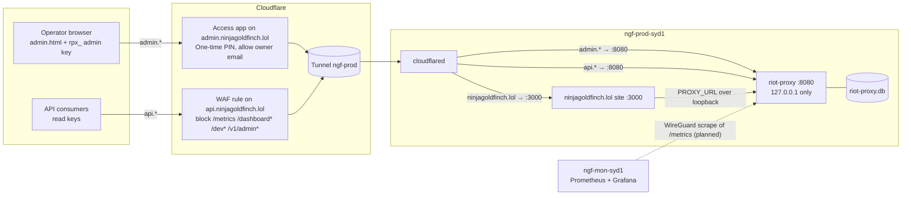
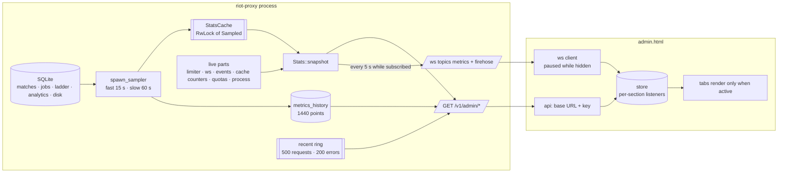
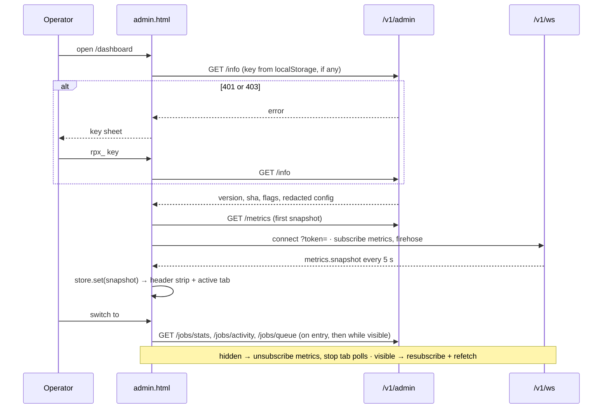
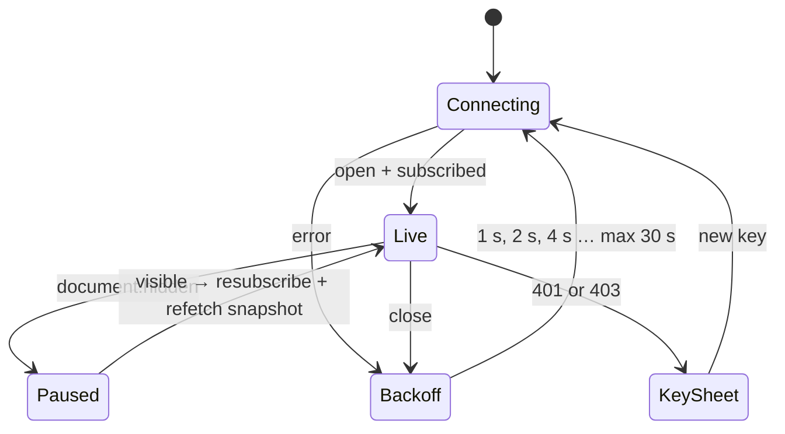
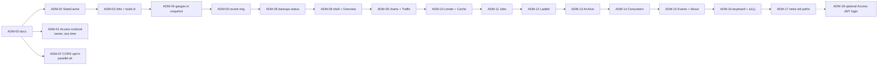

# 13 — Admin dashboard (`/dashboard`)

| | |
|---|---|
| **Status** | Proposed (owner request 2026-10-13, task ADM-00, ADR-144) |
| **Date** | 2026-10-13 |
| **Replaces** | v1's dashboard ported verbatim (P7-06, ADR-038) |

The operator page: what the proxy is doing now, and the buttons to act on it. It is rebuilt in the ADM series (IMPLEMENTATION.md §Post-release — ADM). Grafana on `ngf-mon-syd1` stays the history view; this page is the "now and act" view, and `ops/grafana/riot-proxy-dashboard.json` keeps importing unchanged.

## Why

- **The server does the slow part.** Every `GET /v1/admin/metrics`, and every 5 s `metrics` tick while anyone watches, runs `COUNT(*) FROM matches` and a `GROUP BY kind` over the whole `jobs` table (`src/stats.rs`; 1.1 M rows on production).
- **The page polls while nobody looks.** Four endpoints refresh on timers, including when the tab is hidden.
- **It shows little of what the proxy knows.** No disk, backups, traffic, errors, consumers' quota use or build. The disk reached 97 % on 2026-10-13 (DSK) and nothing on the page said so.
- **It is cramped and dated.** About 2,500 lines of v1 markup in a single scroll of top tabs.

## Principles

- **API-first.** The page is a static file that reads `/v1/admin/*` JSON and the `/v1/ws` `metrics` and `firehose` topics. Nothing is server-rendered except the `<!-- pagebar -->` marker that `routes/ui.rs::render` replaces.
- **One embedded file, no build.** `src/ui/admin.html`, inline CSS and one `<script type="module">`, embedded with `include_str!`. No framework, no CDN, no other origin (`tests/ui.rs` greps for `http://`, `https://`, `<script src`, `<link `). Size budget 160 KB, enforced by a test.
- **Only the active tab renders and polls.** Nothing polls while `document.hidden`; the `metrics` subscription is dropped while hidden and taken again on return.
- **Cheap snapshots.** Aggregates that scan tables are sampled in the background (ADM-02); a request or WS tick reads the cache.
- **Additive JSON.** `/v1/admin/metrics`, `/metrics/history` and `/stats` only gain keys; `tests/dashboard.rs` pins the old ones. Prometheus names are unchanged.
- **Every write asks first.** Retry, cancel, purge, crawl, recompute, revoke: each goes through one `confirmAction()`.

## Gating

- `DASHBOARD_UI` (default `true`) mounts `/dashboard`, in production too, as today.
- The page itself is public markup; every call it makes needs an admin key (`rpx_…`), kept in this browser's `localStorage` (`rp.dashboard.key`). A 401 or 403 opens the key sheet.
- On production the page and the admin API are reached only through `admin.ninjagoldfinch.lol`, behind Cloudflare Access (§Reach). Two gates: the Access cookie, then the admin key.

## Reach

Owner decision 2026-10-13: same origin, behind Access, over a page hosted elsewhere.

- **API-first: yes, and it already is.** The page keeps one base URL setting (`rp.admin.base`, default `location.origin`) and the key from `localStorage`, with no server templating.
- **A separate service: no.** The file costs about 100 KB inside a 16.6 MB binary and is served from memory. A second host would add a deploy pipeline, version skew between page and API, CORS (deferred twice, ADR-011 and ADR-014) and an admin key sent cross-origin. "No frameworks" is about the file, not where it lives; a separate static host would invite a build step that ADR-071 and ADR-080 forbid.
- **Where.** The tunnel already publishes the proxy as `api.ninjagoldfinch.lol`. A second published route, `admin.ninjagoldfinch.lol → http://127.0.0.1:8080`, gets a Cloudflare Access self-hosted application with One-time PIN login allowing only the owner's email. Access is the login system; the proxy stores no passwords and has no session code. ADM-18 (optional) may later let the proxy trust the Access JWT so the key need not be typed.
- **A finding fixed with it.** The tunnel's `api.` route has path `*`, so `/metrics` (no auth), `/dashboard` and `/v1/admin/*` are reachable on `api.` today, and `ADMIN_IP_ALLOWLIST` cannot help: with `TRUST_PROXY=false` every request comes from cloudflared at 127.0.0.1. A WAF rule blocks those paths on `api.`; they are served only on `admin.`. Runbook: design/12 §Admin hostname behind Access (ADM-01).
- **Portability kept.** ADM-07 adds an opt-in `ADMIN_CORS_ORIGINS` (off by default; ADR-151): the listed origins get CORS on `/v1/admin/*`, `/v1/ws`, `/healthz` and `/readyz`, preflights answered without a key, and nothing else changes. If the page later moves to another origin, set that origin there and publish the same `admin.html`; nothing in the page changes. In that split the admin API on `api.` is key-only, because Access cookies are per hostname. Not written as a runbook.



## What the page talks to

All under the base URL, with `Authorization: Bearer <admin key>` (the WebSocket takes `?token=`). "Today" routes exist on main; the others arrive with their task.

| Call | Used by | Since |
|---|---|---|
| `GET /readyz` | header strip, About | today |
| `GET /v1/admin/info` (build, uptime, flags, redacted config) | header strip, key probe, About | ADM-03 |
| `GET /v1/admin/metrics` (snapshot) | first paint; then the `metrics` topic | today, gains sections in ADM-02, 04, 05 |
| `GET /v1/admin/metrics/history` | charts, once per tab entry | today, gains totals in ADM-04 |
| `GET /v1/admin/stats` | Archive & Storage | today (DSK-01) |
| `GET /v1/admin/recent?kind=requests\|errors` | Overview errors, Traffic | ADM-05 |
| `GET /v1/admin/limits/{scope}` | Limiter, on expand | today |
| `GET /v1/admin/debug/cache`, `POST /v1/admin/cache/purge` | Cache | today |
| `GET /v1/admin/jobs/stats`, `/jobs/activity`, `/jobs/queue`, `/jobs`, `/jobs/{id}/activity` | Jobs | today |
| `POST /v1/admin/jobs/{id}/retry`, `DELETE /v1/admin/jobs/{id}`, `DELETE /v1/admin/jobs?…&dryRun` | Jobs | today (bulk purge DSK-03) |
| `GET /v1/admin/ladder/options`, `/ladder/crawls`, `/ladder/crawls/{id}`; `POST /ladder/crawl`; `DELETE /ladder/crawls/{id}` | Ladder | today |
| `GET /v1/admin/backups`, `POST /v1/admin/maintenance/run` | Archive & Storage, header strip | ADM-06 |
| `POST /v1/admin/analytics/recompute`, `/analytics/reextract`, `/ddragon/sync`, `/timelines/backfill` | Archive & Storage | today |
| `GET/POST /v1/admin/consumers`, `DELETE /consumers/{id}`, `POST /consumers/{id}/revoke-cache` | Consumers & Players | today |
| `GET/POST /v1/admin/tracked-players`, `DELETE /tracked-players/{puuid}` | Consumers & Players | today |
| `/v1/ws` topics `metrics` + `firehose` (both admin) | store, Events, badges | today |

## Data flow

After ADM-02..06 the expensive aggregates are sampled; a snapshot reads the cache plus a few live in-memory parts.



### Sampling (ADM-02)

`spawn_sampler` (`src/stats.rs`) replaces the per-request reads:

| Set | What | When | Feeds |
|---|---|---|---|
| fast | totals (matches, players, consumers), queues by state and kind, ladder crawls, analytics runs and top champions | at boot, then every 15 s; again with each history point | snapshot `totals`, `queues`, `ladder`, `analytics`; the history point |
| slow | timelines count and the archive's byte sums, disk usage and its gauges | at boot, then with each history point (`METRICS_HISTORY_INTERVAL_S`, 60 s) | `GET /v1/admin/stats` timelines count, bytes and disk; the snapshot's `disk` from ADM-04 |

A snapshot reads both sets and computes live only the limiter, WebSocket counts, event counts, cache counters, flows and the process. `/v1/admin/stats` keeps its match and player counts live (index counts that callers poll for progress). `sampledAt {fast, slow}` (unix ms) on the snapshot and on `/v1/admin/stats` tells the page how old the sampled parts are; before the first sample the parts are read live and carry the request's time. The job counts read only the `jobs_state_kind` index (V0022): on 1.19 M rows, about 240 ms instead of 950 ms, once per 15 s in the background instead of once per request.

### Runtime gauges (ADM-04)

Sections the snapshot gained for the new tabs, all computed per snapshot from memory except where noted:

| Key | What | Source |
|---|---|---|
| `cacheStore` | `l1Entries`, `l1Bytes`, `l1MaxBytes`, `l2Rows` (slow sample), `l2Dropped` | moka's counts after a `run_pending_tasks`; the L2 writer's dropped count (`cache_l2_dropped_total`) |
| `gates` | `bulkUsageCeiling`, `bulkIdleCeiling`, `bulkIdleAfterS`, `clientWaitBudgetMs`, `blockedScopes[{scope, forMs}]`, `blockedMethods[{scope, method, forMs}]` | config; `Limiter::bulk_blocked` (design/05 §Priorities) |
| `limiter[].interactiveWaiters` | interactive requests queued on the scope | `Limiter::interactive_waiters` |
| `inflight` | Riot calls in flight, each shared by every waiting request | the fetcher's single-flight |
| `quotas[{consumer, limit, used, resetSecs}]` | every consumer metered since the start, busiest first; `consumer` is the id | `Quotas::usage`, read-only |
| `sqlite` | `readers`, `readersFree` | the read pool |
| `disk` | `dbBytes`, `walBytes`, `freelistBytes`, `freeBytes`, `totalBytes` | the slow sample (DSK-01's readings) |

History points gain `disk`, `requests` and `upstream` (`proxy_requests_total` and `proxy_upstream_requests_total` summed since the start; a rate is the difference between points, and a drop marks a restart). Points stored before ADM-04 read them as null.

### Recent requests and errors (ADM-05)

`GET /v1/admin/recent?kind=requests|errors&limit=` reads two in-memory rings, newest first: the last 500 answered requests (`at`, `method`, `route`, `path` cut to 200 characters, `status`, `cache`, `latencyMs`, `consumer` name, `requestId`) and the last 200 error envelopes (`at`, `code`, `status`, `message`, `requestId`). `app::record_request` and `ApiError::into_response` push them; the auth layer tags the response with the consumer's name. Probes (`/healthz`, `/readyz`), `/metrics` and the page's polling (`/v1/admin/metrics`, `/v1/admin/recent`) are not recorded. A restart empties both. No body, header, query string or key is kept.

The snapshot gains `requests` (`route|status|cache` → count) and `upstream` (`region|method|status` → count), the two request counters by label since the start; `|` separates because routes hold `:`. The Traffic tab draws its by-route table from `requests` and its p50/p95 per route from the ring.

## Boot and tab switch



## Connection state



## Layout

Three layouts were considered. **A, a sidebar console, is the pick**; ADM-08 builds it.

### A at 1280 px

```
┌──────────────────────────────────────────────────────────────────────────────────────────┐
│ riot-proxy  Dashboard · Dev explorer · Showcase · API docs · Metrics        v2.3.0 · prod │ page bar (server)
├──────────────┬───────────────────────────────────────────────────────────────────────────┤
│ ● live · 2 s │ ● ready   limiter ok   scope 5f3a9c1e   disk 44 % · 51 GB free   backup 7 h│ status strip
│              │ 41567bd · up 3 d 4 h                                      [/ search]  [☾] │
│ Overview     ├───────────────────────────────────────────────────────────────────────────┤
│ Traffic      │ ┌───────────┐ ┌───────────┐ ┌───────────┐ ┌───────────┐ ┌───────────┐    │
│ Limiter      │ │Archived   │ │Jobs       │ │Cache hit  │ │Upstream   │ │Process    │    │ stat tiles
│ Cache        │ │230.7K     │ │1.13M      │ │94.1 %     │ │0.79 /s    │ │412 MB RSS │    │ value + delta
│ Jobs    (12) │ │+1.2K · 24h│ │3 run 12 ✕ │ │▃▅▆▆▇▇▇▇   │ │p95 212 ms │ │6/6 readers│    │ + sparkline
│ Ladder   ●   │ └───────────┘ └───────────┘ └───────────┘ └───────────┘ └───────────┘    │
│ Archive      │ ┌ Archive growth · 24 h ──────────┐ ┌ Queue backlog · 24 h ───────────┐  │
│ Consumers    │ │              ╱‾‾‾‾‾  230,715 ─● │ │ ‾‾‾‾‾‾‾‾╲                        │  │ one path per series
│ Events  (3)  │ │  ╱‾‾‾‾‾‾‾‾‾‾                    │ │          ╲________   1.13M ─●    │  │ crosshair on hover
│ About        │ │ 00:00    06:00    12:00    now  │ │ 00:00    06:00    12:00    now   │  │
│              │ └─────────────────────────────────┘ └──────────────────────────────────┘  │
│              │ ┌ Cache hit ratio · 24 h ─────────┐ ┌ Disk free · 24 h   ⚠ 85 % line ──┐  │
│ ──────────── │ │ …                               │ │ …                                 │  │
│ base: origin │ └─────────────────────────────────┘ └──────────────────────────────────┘  │
│ key: rpx_…a3 │ ┌ Recent errors (3) ─────────────────────────────────────── Traffic → ┐  │
│ [sign out]   │ │ 12:04:11  502 UPSTREAM_ERROR  GET /v1/lol/matches/…   req 01J9…     │  │
└──────────────┴───────────────────────────────────────────────────────────────────────────┘
```

Rail badges are live from the snapshot and firehose: failed-job count, a dot while a crawl runs, unseen events. The rail collapses to a horizontally scrolling tab strip at 820 px and a bottom bar at 390 px.

### A — Jobs tab

```
│ Jobs                                        live ● 1 s  [pause]              [purge…] │
│ ┌ queues ──────────────────────────────────────────────────────────────────────────┐ │
│ │ queue        running   ready   delayed  failed 24 h  done 1 h                     │ │
│ │ archive          3     1.13M       0          12        4,210  ▇▇▇▇▇▇▇▇▇▇▇▇░░░░   │ │
│ │ ladder           1        14       2           0           38  ▇░░░░░░░░░░░░░░░   │ │
│ │ analytics        0         0       1           0            2                     │ │
│ │ maintenance      0         0       1           0            0  next 03:00         │ │
│ └──────────────────────────────────────────────────────────────────────────────────┘ │
│ ┌ workers 4 / 8 ───────────────────────────┐ ┌ up next ──────────────────────────┐   │
│ │ w1  archive:match  OC1_123…  fetch 1.2 s │ │ archive:match   ×1.13M   p 20005  │   │
│ │ w2  archive:match  OC1_124…  write       │ │ lookup:rank     ×14      p 101    │   │
│ │ w3  ladder:crawl   kr/solo   page 37/120 │ │ timelines:catch ×92k     p 100    │   │
│ │ w4  idle                                 │ └───────────────────────────────────┘   │
│ └──────────────────────────────────────────┘                                         │
│ ┌ failed (12) ───────────────────────────────────────────────────── [retry all] ──┐ │
│ │ 12:01  archive:match  OC1_1245…   UPSTREAM 503 after 3 tries    [retry] [cancel] │ │
│ │ ▸ 11:58  lookup:rank   puuid 7f…   RIOT_404                      [retry] [cancel] │ │
│ └──────────────────────────────────────────────────────────────────────────────────┘ │
│ purge: kind [archive:match ▾] state [pending ▾] min priority [20000]  [dry run]       │
│        → 1,126,303 rows match                              [delete 1,126,303 rows]    │ confirm()
```

### A — Limiter scope card

```
│ ┌ oc1 · platform    frozen —    waiters 0    bulk gate open ───────────────────────┐ │
│ │ app   20 / 1 s   ████████░░░░░░░░░░░░   8 / 20     100 / 120 s  ███████████░░░ 61 │ │ meter: used/limit as text
│ │ method                                 window        used / limit                 │ │
│ │ match-v5 by-puuid        ████████░░░░  10 s       1,400 / 2,000                   │ │
│ │ league-v4 entries        ██░░░░░░░░░░  10 s          50 /   500                   │ │
│ │ ▸ 6 more methods                                                                  │ │
│ └───────────────────────────────────────────────────────────────────────────────────┘ │
```

### A at 390 px

```
┌────────────────────────┐
│ riot-proxy     v2.3.0  │
│ ● ready   disk 44 %    │
│ backup 7 h   up 3 d    │
├────────────────────────┤
│ Archived       230.7K  │
│ Jobs pending   1.13M ▲ │
│ Cache hit      94.1 %  │
│ Upstream      0.79 /s  │
├────────────────────────┤
│ Archive growth · 24 h  │
│   ╱‾‾‾‾‾‾‾‾‾‾          │
├────────────────────────┤
│ ⌂  ⇅  ◔  ▦  ⚙  ▲  ⋯   │ bottom bar: Overview Traffic Limiter Cache Jobs Ladder more
└────────────────────────┘
```

### A — key sheet

```
┌ Admin key ──────────────────────────────────────────┐
│ This page reads /v1/admin/* and the admin WebSocket │
│ topics. The key is stored only in this browser.     │
│ [ rpx_•••••••••••••••••••••••••••• ]     [Connect]  │
│ API base  https://admin.ninjagoldfinch.lol  [change]│
└─────────────────────────────────────────────────────┘
```

### Rejected

- **B, top tabs (today's shape, refreshed).** Ten sections wrap into two rows under 1100 px and the badges get lost in the wrap; the owner called this layout "ugly, lot of the data is repeated" in the request behind ADR-091.
- **C, one scrolling wall with a jump bar.** Every section renders and polls at once, the opposite of the performance goal, and deep links become scroll positions.

### Why A

- Ten sections need a vertical list; a rail keeps every destination visible at 1280 and 820 and carries live badges (failed jobs, running crawl, unseen events), which is the "at a glance" job.
- The header stays for health only (ready, limiter, disk, backup age, version); the rail's foot holds connection state, base URL and key, so settings never crowd the data.
- Only the active tab renders and polls, so A costs what one tab costs.
- It collapses cleanly: tab strip at 820 px, bottom bar at 390 px, both tested in Chromium.


## Visual tokens

Validated with the dataviz palette script; both modes pass.

| Role | Dark | Light |
|---|---|---|
| Page / panel surface | `#0d0f13` / `#151920` | `#f6f7f9` / `#ffffff` |
| Primary / secondary / muted ink | `#ffffff` / `#c3c2b7` / `#898781` | `#0b0b0b` / `#52514e` / `#6b6a66` (ADM-08: `#898781` is 3.4:1 on the light page, under AA) |
| Hairline grid / border | `#2c2c2a` / `rgba(255,255,255,.10)` | `#e1e0d9` / `rgba(11,11,11,.10)` |
| Series 1..6 (fixed order) | `#3987e5 #d95926 #199e70 #c98500 #d55181 #9085e9` | `#2a78d6 #eb6834 #1baf7a #eda100 #e87ba4 #4a3aa7` |
| Status good / warning / serious / critical | `#0ca30c #fab219 #ec835a #d03b3b` (icon + label always) | `#0b8a0b #a86f00 #c2521b #d03b3b` (ADM-08: the dark steps fall to 1.8–3.4:1 on white; these are ≥ 3:1) |
| Type | `system-ui` 13 px; `tabular-nums` in tables and axes only | |
| Marks | lines 2 px, area wash 10 %, bars ≤24 px with a 2 px surface gap, meters show `used / limit` as text | |


`tests/admin_ui.mjs` reads both token blocks from the page and asserts every ink on every surface is ≥ 4.5:1 and every status colour ≥ 3:1, in both themes.

## Shell (ADM-08)

`src/ui/admin.html` replaces v1's `dashboard.html` at `/dashboard`.

- **Boot.** The probe is `GET /v1/admin/info`, with the key from `localStorage` `rp.dashboard.key` when there is one. 200 starts the page (so `AUTH_DISABLED` needs no key and `/dashboard/config.json` is unused); 401 or 403 opens the key sheet, which also sets the API base (`rp.admin.base`, default `location.origin`). Sign out forgets the key.
- **One store.** `store.set(section, value)` fans out to that section's listeners: `info`, `snapshot`, `rates` (request and Riot-call rates from consecutive snapshots), `ready`, `backups`, `event`. Only the active tab renders; the health strip and rail always do.
- **Data.** On start and on every return to a visible tab: `/v1/admin/metrics`, `/readyz`, `/v1/admin/backups`. Then the socket: `metrics` + `firehose`, with backoff 1, 2, 4 … 30 s, a 4401/4403 close or an `UNAUTHORIZED`/`FORBIDDEN` frame opening the key sheet. While `document.hidden` the page unsubscribes `metrics` (the server then builds no snapshots for it) and its tab stops; the only timer is a 1 s clock for ages and uptime.
- **Health strip.** Ready (`/readyz`), limiter (frozen scopes, else bulk-held scopes), disk (`snapshot.disk`, warning at 85 % used, critical at 95 %), backup age (`/backups`, warning after 36 h, serious with none), key scope, and version · commit · env · uptime (`/info`). Each status is an icon and words.
- **Overview tiles.** Archived matches (and the gain since the page opened), jobs pending (running, failed in 24 h), cache hit ratio (hit + neg + stale over all reads, the `CacheHitRatioLow` rule), requests and Riot calls per second, disk free, process RSS and SQLite readers.
- **Shared pieces.** `table()` (sortable headers with `aria-sort`, a row cap with "showing n of m"), `confirmAction()` (every write), `toast()` (an `aria-live` region), and the pure helpers block tested in node. `window.rpAdmin` exposes them to the jsdom tests and the console.
- **Theme.** Dark by default, light when the system prefers it, a saved choice (`rp.admin.theme`) over both.
- **Serving.** `ETag` (SHA-256 of the rendered page) and `Cache-Control: no-cache`: a reload is a 304. Budget 160 KB, tested.
- **Tests.** `tests/dom/admin-shell.test.mjs` (jsdom against `fake-admin.mjs`, through `admin-harness.mjs`), `tests/dom/admin.browser.test.mjs` (Chromium at 1280, 820 and 390 px in both themes: no sideways scroll, nothing wider than its box, every tab reachable), `tests/admin_ui.mjs` (helpers and token contrast), `tests/ui.rs` (self-contained, budget, ETag).

## Overview charts and Traffic (ADM-09)

- **Chart helper.** `chart({title, series, format, yMin, yMax})` draws inline SVG: one `<path>` per series (at most 600 points, bucket means; a gap stays a gap), a 10 % wash under a single series, three recessive grid lines, the top and bottom values and four time ticks as HTML text, a crosshair readout on pointer or arrow keys (Home, End, Escape), a description in `aria-label`, a legend from two series up, and a Table toggle listing every point (newest 200 shown). The latest value is read from every point, not the drawing. No dual axis: request and Riot-call rates are two charts.
- **Overview.** `GET /v1/admin/metrics/history` once per entry; each snapshot is the live end of the series and is kept as a point once it is an interval newer than the last. Six charts: archived matches, jobs pending, cache hit ratio and Riot calls per interval (rates and ratios between neighbouring points, a counter drop read as a restart), disk free (0 to the disk's size; points from before ADM-04 have none and draw as a gap), requests per second. Recent errors: the last 10 from `/recent?kind=errors` on entry, again when a snapshot counts new 4xx or 5xx.
- **Traffic.** By route from `snapshot.requests`: requests, 2xx, 4xx, 5xx, the cache hit share of cacheable reads, and p50/p95 latency from the recent ring. Riot calls from `snapshot.upstream` by region, method and status. Recent requests from `/recent?kind=requests&limit=500`, on entry and every 5 s while the tab is open and visible (a `setTimeout` chain stopped on leaving or hiding), filtered by text, status class and cache state; status sits next to the time so it stays on a phone screen, and a 4xx or 5xx carries an icon.
- **Tests.** `tests/dom/admin-overview.test.mjs`, `admin-traffic.test.mjs`, the browser test's overview and traffic views, and the helpers (`percentile`, `downsample`, `historyPointOf`, `seriesOf`, `routeRows`, `upstreamRows`) in `tests/admin_ui.mjs`.

## Limiter and Cache (ADM-10)

- **Meters.** `meter(label, used, limit)` is a `role="meter"` row: the label, a track whose fill carries severity (the accent under 80 %, warning to 95 %, critical above, with an icon from 80 %), and `used / limit` as text. The track is the accent at 16 %, a lighter step of the same hue.
- **Limiter.** A summary (scopes, frozen, holding bulk work, interactive waiting, the bulk ceilings and the client wait budget), then a card per scope from `snapshot.limiter`: frozen first, then held by the bulk gate (`gates.blockedScopes`), then the fullest. Each card: its state (frozen with a countdown, bulk held with a countdown, or open), waiters, app windows, the four fullest method buckets with the rest folded, a held method flagged, and "Live usage", which reads `/v1/admin/limits/{scope}` each time it opens. Countdowns run on the 1 s clock from the snapshot's time, with no refetch. Folds stay open across snapshots. The rail's Limiter badge counts frozen scopes.
- **Cache.** Tiles for memory entries, memory used (a meter in bytes), persisted rows, dropped writes (flagged when any) and reads since start; the 24 h hit ratio from history; a probe of `/v1/admin/debug/cache`; and a purge that is counted first (`POST /v1/admin/cache/purge` with `dryRun`, ADM-10) and then confirmed, reporting how many entries went. Editing the pattern after a count disarms the purge.

## Jobs (ADM-11)

The Jobs tab folds in `/dev/jobs` (design/10 §Jobs page), which stays until ADM-17.

- **Overview** (`#jobs`): queues from `snapshot.queues` (running, ready, delayed, failed in 24 h, done in the last hour), so no fetch; workers and the jobs finished here from `/jobs/activity` every second; up next from `/jobs/queue?limit=100` every 5 s, running and next grouped by kind and platform as ADR-093 set out (a group says how many, what they cover, when, the highest try; its tooltip the priority range); failed jobs from `/jobs?state=failed` every 5 s, each with Retry; counts by kind from `/jobs/stats` every 15 s. The rail's Jobs badge counts failed jobs in 24 h.
- **Bulk purge** (DSK-03's route): kind, state and minimum priority; Delete stays disabled until a dry run (`dryRun=true`) for those exact parameters has counted the rows, and its confirm names the count. Editing a parameter disarms it.
- **A job** (`#jobs/<id>`, opened from any worker, row or group of one): state, the "now" line, facts, payload, and the timeline of its latest run read with `?after=<nextSeq>` each second, appended, with a follow toggle; a new attempt restarts the timeline. Retry for a failed job, Cancel for a pending one, each after `confirmAction()`. A missing job says so.
- **Polling** is one `setTimeout` chain at 1 s while the tab is open, visible and *live* is ticked; it stops when hidden, unticked or left.

## Ladder (ADM-12)

The v1 page's Ladder tab (ADR-087, ADR-091), moved into layout A.

- **Running crawls** come from `snapshot.ladder.running` (or the crawl list before the first snapshot). Each is a card: ladder, floor, phase, age, Cancel; one `progressbar` per stage with its numbers and pace; totals (players with any apex-cap note, match ids, matches queued, failures); and folded under *details* the counters, legs in flight, the crawl's own running, next and failed jobs (one row each, not grouped), how much of the queue is ahead, and the platform's match downloads. A new card fills in at once. Open folds and a scrolled leg list survive refreshes.
- **Past crawls** from `/ladder/crawls?limit=50`, ten shown with *show n more*; a row opens its detail under it at `#ladder/<id>` (read once, it is final). Under 1000 px the history keeps only ladder, status and finish time, so an opened run stays on screen.
- **Start a crawl** from `/ladder/options` (platforms, queues, tiers and this deployment's defaults; the form is open only while nothing runs, until the operator folds it). **Analytics recompute** in its own fold, with the last runs' steps, rows and games from the snapshot and the newest patch's most played champions. Start, Cancel and Recompute each ask first.
- **Refresh:** every 5 s while open and visible: running crawls' activity, the crawl list every 30 s, and at once on a `crawl.phase` or `ladder.crawl.completed` frame (ADR-058). The rail's Ladder badge counts running crawls.

## Archive & Storage (ADM-13)

- **Tiles:** archived matches and timelines, stored bytes against raw (the zstd ratio), players, the database file (free pages, WAL) and disk free, from `/v1/admin/stats` and the snapshot's `disk`.
- **The data disk** as one stacked bar, split into live pages, free pages, WAL, other files and free space, each named with its size in a legend and in the bar's `aria-label`. At 85 % used a warning line, at 95 % a critical one, each with an icon and words; the health strip says the same.
- **Backups** from `/v1/admin/backups`: the files with size and age, a newest backup older than 36 h flagged ("a night was missed"), `BACKUP_KEEP=0` said in words, the last maintenance run (written, skipped or failed backup; what was trimmed), and *Run maintenance now* (confirm, then `POST /v1/admin/maintenance/run`).
- **Timeline backfill** from `/v1/admin/timelines/backfill`: a meter of ranked matches with a timeline, what is left and what Riot does not have, and what is left per region.
- **Analytics:** the last runs and the newest patch's most played champions (shared with the Ladder tab), with Recompute (the newest run's ladder), Re-extract facts, Sync Data Dragon and Fill player names, each after a confirm, each reported in a toast.
- **Refresh:** on entry and every 60 s while open and visible (the bytes are sampled every minute anyway); the disk follows the snapshot.

Status icons outside the health strip (tile labels, note lines) now carry their level's colour too: the rule matches any element with `data-level` whose direct child is the icon.

## Consumers & Players (ADM-14)

- **Consumers** from `/v1/admin/consumers`: active ones first, scopes, quota use this minute as a meter (`snapshot.quotas`, by consumer id), created, and Revoke for active ones (confirm). Revoking the key this page uses makes its next call a 401, which opens the key sheet.
- **Create** (name, `read`/`admin`, requests a minute; confirm): the response's key is shown once in a warning box with Copy and Done. It is never put in the store, `localStorage`, a toast or a log; Done removes it from the page.
- **Re-check a key** (`/consumers/{id}/revoke-cache`, which takes the key's SHA-256): paste the key or its hash; a key is hashed in the page with `crypto.subtle` and only the hash is sent; the field is cleared.
- **Tracked players** from `/v1/admin/tracked-players?tracked=true` (ADM-14 added the filter: unfiltered, the route returns every player a crawl found, 41 K on production): name or PUUID, platform, last match, history state, Untrack (confirm). *Track* takes a platform (suggested from `/ladder/options`) and a Riot ID (`name#tag`) or a PUUID (confirm).

## Events and About (ADM-15)

- **Events.** Every frame from the socket goes into a ring of the newest 2,000, on any tab. The list shows them newest first, filtered by name (a chip per event in `src/events.rs`, each with its count; `metrics.snapshot` off by default, since one arrives every 5 s) and by text anywhere in the frame; a row opens into the frame's JSON, and stays open as newer frames push it down. Drawing is batched every 250 ms. *Pause* stops all writes to the list and counts what arrives ("Resume (n while paused)"); resuming draws them. *Clear* empties the ring. While the tab is elsewhere the rail's Events badge counts new frames other than snapshots; opening the tab clears it.
- **About.** `/v1/admin/info` as a page: version, commit, compiler, build time, start time and uptime, environment, role, workers, key scope; the feature switches on or off with an icon; `/readyz`; links to `/metrics` and, when enabled, `/docs`; and the configuration in effect, searchable by name or value, with secrets as the server redacted them and `RIOT_API_KEY` absent (ADM-03).

The rail lists only the tabs that exist; each later task adds its own. Until ADM-12 there is no Ladder tab: `/dev/jobs`, `/v1/admin/ladder/*` and the firehose cover it.

## Chart rules

One `<path>` per series; a legend for two or more series; a crosshair tooltip; a table toggle on every chart; never a dual axis (request rate and upstream rate are two small multiples); status colours never reused as series.

## Page map

Each tab's task fills its row and adds a section below.

| Hash | Tab | Feeds | Task | Status |
|---|---|---|---|---|
| `#overview` | Overview: stat tiles, 24 h charts, recent errors | snapshot, history, `/recent` | ADM-08, ADM-09 | built |
| `#traffic` | Traffic: by route, upstream, live recent requests | snapshot, `/recent` | ADM-09 | built |
| `#limiter` | Limiter: a card per scope | snapshot, `/limits/{scope}` | ADM-10 | built |
| `#cache` | Cache: L1/L2, ratios, probe, purge | snapshot, history, `/debug/cache`, `/cache/purge` | ADM-10 | built |
| `#jobs`, `#jobs/<id>` | Jobs (folds in `/dev/jobs`) | snapshot, `/jobs/*` | ADM-11 | built |
| `#ladder`, `#ladder/<id>` | Ladder | snapshot, `/ladder/*`, `crawl.phase` frames | ADM-12 | built |
| `#archive` | Archive & Storage: counts, disk, backups, actions | snapshot, `/stats`, `/backups`, `/timelines/backfill` | ADM-13 | built |
| `#consumers` | Consumers & Players | `/consumers`, `/tracked-players?tracked=true`, snapshot quotas | ADM-14 | built |
| `#events` | Events: firehose ring | `firehose` topic | ADM-15 | built |
| `#about` | About: build, flags, redacted config | `/info`, `/readyz` | ADM-15 | built |
| — | Keyboard, palette, accessibility | — | ADM-16 | planned |

Between ADM-08 and ADM-12 the new page has no Ladder tab; `/dev/jobs`, `/v1/admin/ladder/*` and the firehose cover the gap. `/dev/jobs` and `/dashboard/config.json` go in ADM-17.

## Task order


