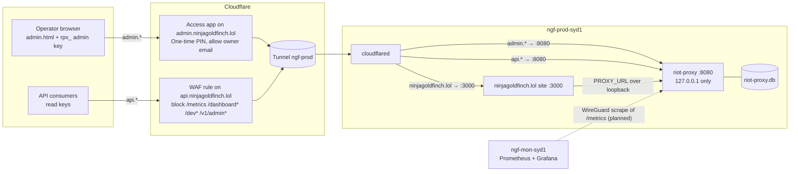
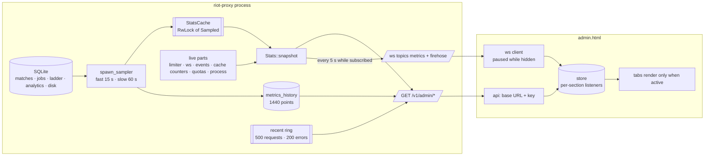
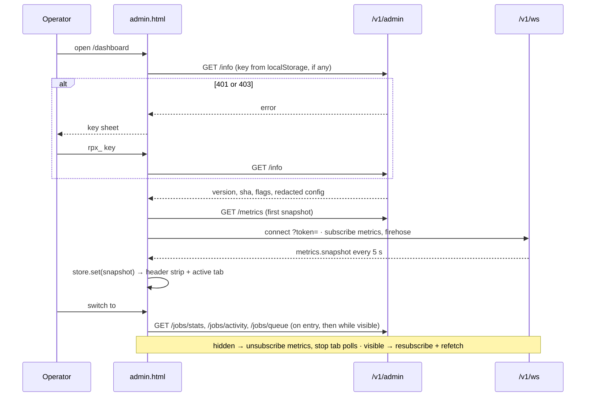
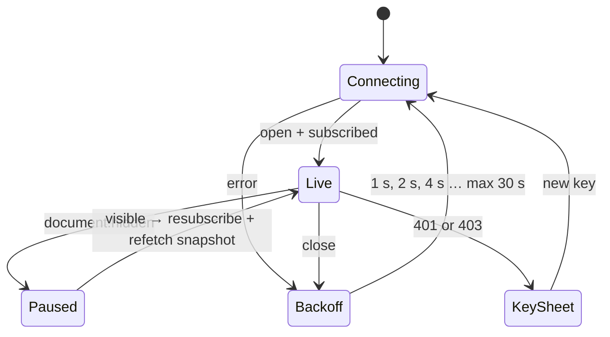
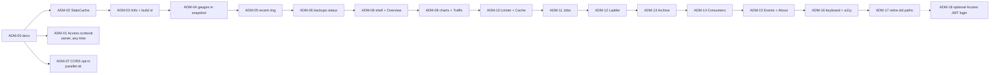

# 13 — Admin dashboard (`/dashboard`)

| | |
|---|---|
| **Status** | Proposed (owner request 2026-10-13, task ADM-00, ADR-144) |
| **Date** | 2026-10-13 |
| **Replaces** | v1's dashboard ported verbatim (P7-06, ADR-038) |

The operator page: what the proxy is doing now, and the buttons to act on it. It is rebuilt in the ADM series (IMPLEMENTATION.md §Post-release — ADM). Grafana on `ngf-mon-syd1` stays the history view; this page is the "now and act" view, and `ops/grafana/riot-proxy-dashboard.json` keeps importing unchanged.

## Why

- **The server does the slow part.** Every `GET /v1/admin/metrics`, and every 5 s `metrics` tick while anyone watches, runs `COUNT(*) FROM matches` and a `GROUP BY kind` over the whole `jobs` table (`src/stats.rs`; 1.1 M rows on production).
- **The page polls while nobody looks.** Four endpoints refresh on timers, including when the tab is hidden.
- **It shows little of what the proxy knows.** No disk, backups, traffic, errors, consumers' quota use or build. The disk reached 97 % on 2026-10-13 (DSK) and nothing on the page said so.
- **It is cramped and dated.** About 2,500 lines of v1 markup in a single scroll of top tabs.

## Principles

- **API-first.** The page is a static file that reads `/v1/admin/*` JSON and the `/v1/ws` `metrics` and `firehose` topics. Nothing is server-rendered except the `<!-- pagebar -->` marker that `routes/ui.rs::render` replaces.
- **One embedded file, no build.** `src/ui/admin.html`, inline CSS and one `<script type="module">`, embedded with `include_str!`. No framework, no CDN, no other origin (`tests/ui.rs` greps for `http://`, `https://`, `<script src`, `<link `). Size budget 160 KB, enforced by a test.
- **Only the active tab renders and polls.** Nothing polls while `document.hidden`; the `metrics` subscription is dropped while hidden and taken again on return.
- **Cheap snapshots.** Aggregates that scan tables are sampled in the background (ADM-02); a request or WS tick reads the cache.
- **Additive JSON.** `/v1/admin/metrics`, `/metrics/history` and `/stats` only gain keys; `tests/dashboard.rs` pins the old ones. Prometheus names are unchanged.
- **Every write asks first.** Retry, cancel, purge, crawl, recompute, revoke: each goes through one `confirmAction()`.

## Gating

- `DASHBOARD_UI` (default `true`) mounts `/dashboard`, in production too, as today.
- The page itself is public markup; every call it makes needs an admin key (`rpx_…`), kept in this browser's `localStorage` (`rp.dashboard.key`). A 401 or 403 opens the key sheet.
- On production the page and the admin API are reached only through `admin.ninjagoldfinch.lol`, behind Cloudflare Access (§Reach). Two gates: the Access cookie, then the admin key.

## Reach

Owner decision 2026-10-13: same origin, behind Access, over a page hosted elsewhere.

- **API-first: yes, and it already is.** The page keeps one base URL setting (`rp.admin.base`, default `location.origin`) and the key from `localStorage`, with no server templating.
- **A separate service: no.** The file costs about 100 KB inside a 16.6 MB binary and is served from memory. A second host would add a deploy pipeline, version skew between page and API, CORS (deferred twice, ADR-011 and ADR-014) and an admin key sent cross-origin. "No frameworks" is about the file, not where it lives; a separate static host would invite a build step that ADR-071 and ADR-080 forbid.
- **Where.** The tunnel already publishes the proxy as `api.ninjagoldfinch.lol`. A second published route, `admin.ninjagoldfinch.lol → http://127.0.0.1:8080`, gets a Cloudflare Access self-hosted application with One-time PIN login allowing only the owner's email. Access is the login system; the proxy stores no passwords and has no session code. ADM-18 (optional) may later let the proxy trust the Access JWT so the key need not be typed.
- **A finding fixed with it.** The tunnel's `api.` route has path `*`, so `/metrics` (no auth), `/dashboard` and `/v1/admin/*` are reachable on `api.` today, and `ADMIN_IP_ALLOWLIST` cannot help: with `TRUST_PROXY=false` every request comes from cloudflared at 127.0.0.1. A WAF rule blocks those paths on `api.`; they are served only on `admin.`. Runbook: design/12 §Admin hostname behind Access (ADM-01).
- **Portability kept.** ADM-07 adds an opt-in `ADMIN_CORS_ORIGINS` (off by default). If the page later moves to another origin, set that origin there and publish the same `admin.html`; nothing in the page changes. In that split the admin API on `api.` is key-only, because Access cookies are per hostname. Not written as a runbook.



## What the page talks to

All under the base URL, with `Authorization: Bearer <admin key>` (the WebSocket takes `?token=`). "Today" routes exist on main; the others arrive with their task.

| Call | Used by | Since |
|---|---|---|
| `GET /readyz` | header strip, About | today |
| `GET /v1/admin/info` (build, uptime, flags, redacted config) | header strip, key probe, About | ADM-03 |
| `GET /v1/admin/metrics` (snapshot) | first paint; then the `metrics` topic | today, gains sections in ADM-02, 04, 05 |
| `GET /v1/admin/metrics/history` | charts, once per tab entry | today, gains totals in ADM-04 |
| `GET /v1/admin/stats` | Archive & Storage | today (DSK-01) |
| `GET /v1/admin/recent?kind=requests\|errors` | Overview errors, Traffic | ADM-05 |
| `GET /v1/admin/limits/{scope}` | Limiter, on expand | today |
| `GET /v1/admin/debug/cache`, `POST /v1/admin/cache/purge` | Cache | today |
| `GET /v1/admin/jobs/stats`, `/jobs/activity`, `/jobs/queue`, `/jobs`, `/jobs/{id}/activity` | Jobs | today |
| `POST /v1/admin/jobs/{id}/retry`, `DELETE /v1/admin/jobs/{id}`, `DELETE /v1/admin/jobs?…&dryRun` | Jobs | today (bulk purge DSK-03) |
| `GET /v1/admin/ladder/options`, `/ladder/crawls`, `/ladder/crawls/{id}`; `POST /ladder/crawl`; `DELETE /ladder/crawls/{id}` | Ladder | today |
| `GET /v1/admin/backups`, `POST /v1/admin/maintenance/run` | Archive & Storage, header strip | ADM-06 |
| `POST /v1/admin/analytics/recompute`, `/analytics/reextract`, `/ddragon/sync`, `/timelines/backfill` | Archive & Storage | today |
| `GET/POST /v1/admin/consumers`, `DELETE /consumers/{id}`, `POST /consumers/{id}/revoke-cache` | Consumers & Players | today |
| `GET/POST /v1/admin/tracked-players`, `DELETE /tracked-players/{puuid}` | Consumers & Players | today |
| `/v1/ws` topics `metrics` + `firehose` (both admin) | store, Events, badges | today |

## Data flow

After ADM-02..06 the expensive aggregates are sampled; a snapshot reads the cache plus a few live in-memory parts.



### Sampling (ADM-02)

`spawn_sampler` (`src/stats.rs`) replaces the per-request reads:

| Set | What | When | Feeds |
|---|---|---|---|
| fast | totals (matches, players, consumers), queues by state and kind, ladder crawls, analytics runs and top champions | at boot, then every 15 s; again with each history point | snapshot `totals`, `queues`, `ladder`, `analytics`; the history point |
| slow | timelines count and the archive's byte sums, disk usage and its gauges | at boot, then with each history point (`METRICS_HISTORY_INTERVAL_S`, 60 s) | `GET /v1/admin/stats` timelines count, bytes and disk; the snapshot's `disk` from ADM-04 |

A snapshot reads both sets and computes live only the limiter, WebSocket counts, event counts, cache counters, flows and the process. `/v1/admin/stats` keeps its match and player counts live (index counts that callers poll for progress). `sampledAt {fast, slow}` (unix ms) on the snapshot and on `/v1/admin/stats` tells the page how old the sampled parts are; before the first sample the parts are read live and carry the request's time. The job counts read only the `jobs_state_kind` index (V0022): on 1.19 M rows, about 240 ms instead of 950 ms, once per 15 s in the background instead of once per request.

### Runtime gauges (ADM-04)

Sections the snapshot gained for the new tabs, all computed per snapshot from memory except where noted:

| Key | What | Source |
|---|---|---|
| `cacheStore` | `l1Entries`, `l1Bytes`, `l1MaxBytes`, `l2Rows` (slow sample), `l2Dropped` | moka's counts after a `run_pending_tasks`; the L2 writer's dropped count (`cache_l2_dropped_total`) |
| `gates` | `bulkUsageCeiling`, `bulkIdleCeiling`, `bulkIdleAfterS`, `clientWaitBudgetMs`, `blockedScopes[{scope, forMs}]`, `blockedMethods[{scope, method, forMs}]` | config; `Limiter::bulk_blocked` (design/05 §Priorities) |
| `limiter[].interactiveWaiters` | interactive requests queued on the scope | `Limiter::interactive_waiters` |
| `inflight` | Riot calls in flight, each shared by every waiting request | the fetcher's single-flight |
| `quotas[{consumer, limit, used, resetSecs}]` | every consumer metered since the start, busiest first; `consumer` is the id | `Quotas::usage`, read-only |
| `sqlite` | `readers`, `readersFree` | the read pool |
| `disk` | `dbBytes`, `walBytes`, `freelistBytes`, `freeBytes`, `totalBytes` | the slow sample (DSK-01's readings) |

History points gain `disk`, `requests` and `upstream` (`proxy_requests_total` and `proxy_upstream_requests_total` summed since the start; a rate is the difference between points, and a drop marks a restart). Points stored before ADM-04 read them as null.

## Boot and tab switch



## Connection state



## Layout

Three layouts were considered. **A, a sidebar console, is the pick**; ADM-08 builds it.

### A at 1280 px

```
┌──────────────────────────────────────────────────────────────────────────────────────────┐
│ riot-proxy  Dashboard · Dev explorer · Showcase · API docs · Metrics        v2.3.0 · prod │ page bar (server)
├──────────────┬───────────────────────────────────────────────────────────────────────────┤
│ ● live · 2 s │ ● ready   limiter ok   scope 5f3a9c1e   disk 44 % · 51 GB free   backup 7 h│ status strip
│              │ 41567bd · up 3 d 4 h                                      [/ search]  [☾] │
│ Overview     ├───────────────────────────────────────────────────────────────────────────┤
│ Traffic      │ ┌───────────┐ ┌───────────┐ ┌───────────┐ ┌───────────┐ ┌───────────┐    │
│ Limiter      │ │Archived   │ │Jobs       │ │Cache hit  │ │Upstream   │ │Process    │    │ stat tiles
│ Cache        │ │230.7K     │ │1.13M      │ │94.1 %     │ │0.79 /s    │ │412 MB RSS │    │ value + delta
│ Jobs    (12) │ │+1.2K · 24h│ │3 run 12 ✕ │ │▃▅▆▆▇▇▇▇   │ │p95 212 ms │ │6/6 readers│    │ + sparkline
│ Ladder   ●   │ └───────────┘ └───────────┘ └───────────┘ └───────────┘ └───────────┘    │
│ Archive      │ ┌ Archive growth · 24 h ──────────┐ ┌ Queue backlog · 24 h ───────────┐  │
│ Consumers    │ │              ╱‾‾‾‾‾  230,715 ─● │ │ ‾‾‾‾‾‾‾‾╲                        │  │ one path per series
│ Events  (3)  │ │  ╱‾‾‾‾‾‾‾‾‾‾                    │ │          ╲________   1.13M ─●    │  │ crosshair on hover
│ About        │ │ 00:00    06:00    12:00    now  │ │ 00:00    06:00    12:00    now   │  │
│              │ └─────────────────────────────────┘ └──────────────────────────────────┘  │
│              │ ┌ Cache hit ratio · 24 h ─────────┐ ┌ Disk free · 24 h   ⚠ 85 % line ──┐  │
│ ──────────── │ │ …                               │ │ …                                 │  │
│ base: origin │ └─────────────────────────────────┘ └──────────────────────────────────┘  │
│ key: rpx_…a3 │ ┌ Recent errors (3) ─────────────────────────────────────── Traffic → ┐  │
│ [sign out]   │ │ 12:04:11  502 UPSTREAM_ERROR  GET /v1/lol/matches/…   req 01J9…     │  │
└──────────────┴───────────────────────────────────────────────────────────────────────────┘
```

Rail badges are live from the snapshot and firehose: failed-job count, a dot while a crawl runs, unseen events. The rail collapses to a horizontally scrolling tab strip at 820 px and a bottom bar at 390 px.

### A — Jobs tab

```
│ Jobs                                        live ● 1 s  [pause]              [purge…] │
│ ┌ queues ──────────────────────────────────────────────────────────────────────────┐ │
│ │ queue        running   ready   delayed  failed 24 h  done 1 h                     │ │
│ │ archive          3     1.13M       0          12        4,210  ▇▇▇▇▇▇▇▇▇▇▇▇░░░░   │ │
│ │ ladder           1        14       2           0           38  ▇░░░░░░░░░░░░░░░   │ │
│ │ analytics        0         0       1           0            2                     │ │
│ │ maintenance      0         0       1           0            0  next 03:00         │ │
│ └──────────────────────────────────────────────────────────────────────────────────┘ │
│ ┌ workers 4 / 8 ───────────────────────────┐ ┌ up next ──────────────────────────┐   │
│ │ w1  archive:match  OC1_123…  fetch 1.2 s │ │ archive:match   ×1.13M   p 20005  │   │
│ │ w2  archive:match  OC1_124…  write       │ │ lookup:rank     ×14      p 101    │   │
│ │ w3  ladder:crawl   kr/solo   page 37/120 │ │ timelines:catch ×92k     p 100    │   │
│ │ w4  idle                                 │ └───────────────────────────────────┘   │
│ └──────────────────────────────────────────┘                                         │
│ ┌ failed (12) ───────────────────────────────────────────────────── [retry all] ──┐ │
│ │ 12:01  archive:match  OC1_1245…   UPSTREAM 503 after 3 tries    [retry] [cancel] │ │
│ │ ▸ 11:58  lookup:rank   puuid 7f…   RIOT_404                      [retry] [cancel] │ │
│ └──────────────────────────────────────────────────────────────────────────────────┘ │
│ purge: kind [archive:match ▾] state [pending ▾] min priority [20000]  [dry run]       │
│        → 1,126,303 rows match                              [delete 1,126,303 rows]    │ confirm()
```

### A — Limiter scope card

```
│ ┌ oc1 · platform    frozen —    waiters 0    bulk gate open ───────────────────────┐ │
│ │ app   20 / 1 s   ████████░░░░░░░░░░░░   8 / 20     100 / 120 s  ███████████░░░ 61 │ │ meter: used/limit as text
│ │ method                                 window        used / limit                 │ │
│ │ match-v5 by-puuid        ████████░░░░  10 s       1,400 / 2,000                   │ │
│ │ league-v4 entries        ██░░░░░░░░░░  10 s          50 /   500                   │ │
│ │ ▸ 6 more methods                                                                  │ │
│ └───────────────────────────────────────────────────────────────────────────────────┘ │
```

### A at 390 px

```
┌────────────────────────┐
│ riot-proxy     v2.3.0  │
│ ● ready   disk 44 %    │
│ backup 7 h   up 3 d    │
├────────────────────────┤
│ Archived       230.7K  │
│ Jobs pending   1.13M ▲ │
│ Cache hit      94.1 %  │
│ Upstream      0.79 /s  │
├────────────────────────┤
│ Archive growth · 24 h  │
│   ╱‾‾‾‾‾‾‾‾‾‾          │
├────────────────────────┤
│ ⌂  ⇅  ◔  ▦  ⚙  ▲  ⋯   │ bottom bar: Overview Traffic Limiter Cache Jobs Ladder more
└────────────────────────┘
```

### A — key sheet

```
┌ Admin key ──────────────────────────────────────────┐
│ This page reads /v1/admin/* and the admin WebSocket │
│ topics. The key is stored only in this browser.     │
│ [ rpx_•••••••••••••••••••••••••••• ]     [Connect]  │
│ API base  https://admin.ninjagoldfinch.lol  [change]│
└─────────────────────────────────────────────────────┘
```

### Rejected

- **B, top tabs (today's shape, refreshed).** Ten sections wrap into two rows under 1100 px and the badges get lost in the wrap; the owner called this layout "ugly, lot of the data is repeated" in the request behind ADR-091.
- **C, one scrolling wall with a jump bar.** Every section renders and polls at once, the opposite of the performance goal, and deep links become scroll positions.

### Why A

- Ten sections need a vertical list; a rail keeps every destination visible at 1280 and 820 and carries live badges (failed jobs, running crawl, unseen events), which is the "at a glance" job.
- The header stays for health only (ready, limiter, disk, backup age, version); the rail's foot holds connection state, base URL and key, so settings never crowd the data.
- Only the active tab renders and polls, so A costs what one tab costs.
- It collapses cleanly: tab strip at 820 px, bottom bar at 390 px, both tested in Chromium.


## Visual tokens

Validated with the dataviz palette script; both modes pass.

| Role | Dark | Light |
|---|---|---|
| Page / panel surface | `#0d0f13` / `#151920` | `#f6f7f9` / `#ffffff` |
| Primary / secondary / muted ink | `#ffffff` / `#c3c2b7` / `#898781` | `#0b0b0b` / `#52514e` / `#898781` |
| Hairline grid / border | `#2c2c2a` / `rgba(255,255,255,.10)` | `#e1e0d9` / `rgba(11,11,11,.10)` |
| Series 1..6 (fixed order) | `#3987e5 #d95926 #199e70 #c98500 #d55181 #9085e9` | `#2a78d6 #eb6834 #1baf7a #eda100 #e87ba4 #4a3aa7` |
| Status good / warning / serious / critical | `#0ca30c #fab219 #ec835a #d03b3b` (icon + label always) | same |
| Type | `system-ui` 13 px; `tabular-nums` in tables and axes only | |
| Marks | lines 2 px, area wash 10 %, bars ≤24 px with a 2 px surface gap, meters show `used / limit` as text | |


## Chart rules

One `<path>` per series; a legend for two or more series; a crosshair tooltip; a table toggle on every chart; never a dual axis (request rate and upstream rate are two small multiples); status colours never reused as series.

## Page map

Each tab's task fills its row and adds a section below.

| Hash | Tab | Feeds | Task | Status |
|---|---|---|---|---|
| `#overview` | Overview: stat tiles, 24 h charts, recent errors | snapshot, history, `/recent` | ADM-08, ADM-09 | planned |
| `#traffic` | Traffic: by route, upstream, live recent requests | snapshot, `/recent` | ADM-09 | planned |
| `#limiter` | Limiter: a card per scope | snapshot, `/limits/{scope}` | ADM-10 | planned |
| `#cache` | Cache: L1/L2, ratios, probe, purge | snapshot, `/debug/cache`, `/cache/purge` | ADM-10 | planned |
| `#jobs`, `#jobs/<id>` | Jobs (folds in `/dev/jobs`) | `/jobs/*` | ADM-11 | planned |
| `#ladder`, `#ladder/<id>` | Ladder | `/ladder/*`, `crawl.phase` frames | ADM-12 | planned |
| `#archive` | Archive & Storage: counts, disk, backups, actions | `/stats`, `/backups` | ADM-13 | planned |
| `#consumers` | Consumers & Players | `/consumers`, `/tracked-players`, snapshot quotas | ADM-14 | planned |
| `#events` | Events: firehose ring | `firehose` topic | ADM-15 | planned |
| `#about` | About: build, flags, redacted config | `/info`, `/readyz` | ADM-15 | planned |
| — | Keyboard, palette, accessibility | — | ADM-16 | planned |

Between ADM-08 and ADM-12 the new page has no Ladder tab; `/dev/jobs`, `/v1/admin/ladder/*` and the firehose cover the gap. `/dev/jobs` and `/dashboard/config.json` go in ADM-17.

## Task order


