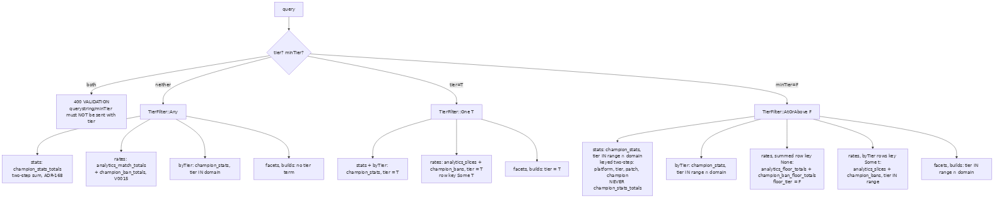
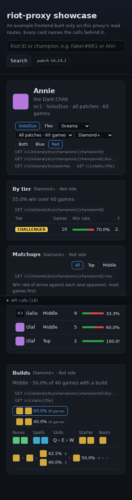
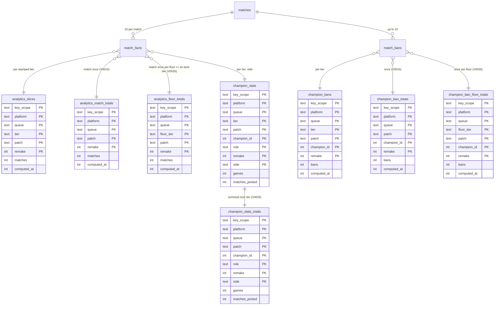
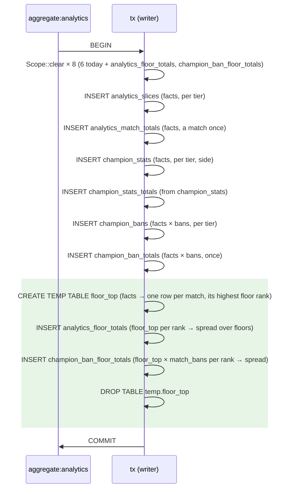
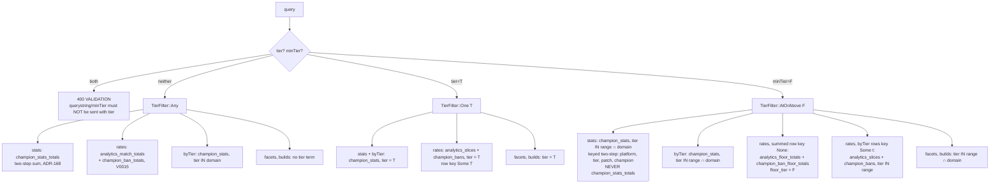

# FLT-03 plan — tier ranges (`minTier`) on the analytics routes

Written 2026-10-15 against `origin/main` **721bf59** (b1fe7be + #215, a dashboard-only change). Every `file:line` is at 721bf59. Every number below was produced in this session; the scripts are listed in §13. Nothing under `src/`, `docs/` or `tests/` was edited before approval.

**Preflight.**
- `git fetch origin main` → 721bf59.
- Open PRs: only #216 (`PROGRESS.md`, one line, the FLT-02 tick). It touches the line next to FLT-03's, so whichever merges second rebases; the conflict is append-only.
- Latest migration on `origin/main` is `V0025__champion_stats_totals.sql`, so this task's is **V0026**. Latest ADR is 169, so this task's is **ADR-170**.
- Neither V0026+ nor ADR-170+ appears on any of the 40 most recently pushed remote branches (scanned with `git show <branch>:docs/DECISIONS.md` and `git ls-tree`).


**Implementation record (2026-10-15, after approval).**
- **Owner answers.** `/patches` takes no `minTier`. The ranges are listed Master+, Diamond+, Emerald+. The main checkout's `target/` was deleted. One PR.
- **Code against the plan.** Everything in §2–§8 landed as written:
  - V0026 is the §2 draft byte for byte.
  - `insert_floors` is §3's shape D.
  - `TierFilter`, `TierKey::Floor`, `rates()` and the cache key are as in §4 and §7.
- **Deviations from §10 (tests).** In each case the plan was updated, not the code:
  1. The route tests' fixture is not §5's. In §5 both games have a Grandmaster player, because the remake's Jayce and Syndra are the ranked game's players, so no floor differs from the every-tier total. A deliberately broken `rates()` that always read the V0015 totals passed the first draft of `tier_ranges_count_a_match_once_on_every_route`. The fixture now has Nidalee at `CHALLENGER` and the remake's other players at `EMERALD`, so `minTier=CHALLENGER&remakes=include` is 1 match against the total's 2. The broken `rates()` now fails.
  2. `a_range_row_takes_its_rates_from_the_floor` (a unit test in routes) was dropped. `Rates` didn't change, so the swap lives in the async `rates()`, which the route test covers with the mutation above.
  3. FLT-02's `tier_and_side_slice_every_route_and_add_up_to_the_total` keeps its own two-tier fixture.
- **Mutation checks, all caught:**
  - spreading a match only onto its own floor → `a_match_counts_once…` fails;
  - `stats_source` sending a range to the totals → `range_reads_sum…` and `range_reads_never…` fail;
  - `rates()` ignoring the floor → the route test fails.
- **Verification:**
  - `cargo fmt`; `cargo clippy --all-targets --all-features -D warnings`: clean.
  - `cargo test --no-fail-fast`: 919 passed, 0 failed.
  - `just ui-test` (`CI=1`, Chromium at 1280/820/390): 164 passed.
  - musl: see the PR.
- **Rendered:** `docs/flt/FLT-03/schema.png`, `rebuild.png`, `read-path.png`.

  
  
- **Screenshots of the real page** at Diamond+ · Red: `docs/flt/FLT-03/diamond-red-page-{1280,390}.png` and `diamond-red-header-{1280,390}.png` (820 px measured, not committed). The §8 measurements are unchanged on the real page: tool rows 1/1/3, select 113 px, no sideways scroll.
- **Hand count against a real response** (§5 fixture, this branch): `champions?patch=all&minTier=DIAMOND` gives Syndra (134) `pickRate: 1`. That is 1 pick over the `DIAMOND+` floor's 1 match, where `analytics_slices` holds `MASTER` 1 + `GRANDMASTER` 1 = 2.

---

## 1. The overcount, worked

The match in the brief: five players stamped `DIAMOND`, three `MASTER`, two `UNKNOWN`. Annie (1) is played by one `DIAMOND` player and Olaf (2) is banned. I ran `rebuild_champions`' six statements exactly as written (`src/archive/analytics.rs:146-218`), plus the two proposed in §3, on a database migrated to V0025 (`/tmp/flt03/worked.py`). The output:

| table | rows for KR_1 |
|---|---|
| `analytics_slices` | `DIAMOND` 1, `MASTER` 1, `UNKNOWN` 1 (the sum over tiers is **3**) |
| `analytics_match_totals` (V0015) | 1 |
| `analytics_floor_totals` (new) | `IRON+` 1, `BRONZE+` 1, `SILVER+` 1, `GOLD+` 1, `PLATINUM+` 1, `EMERALD+` 1, `DIAMOND+` 1, `MASTER+` 1, `GRANDMASTER+` 0, `CHALLENGER+` 0 |
| `champion_bans`, Olaf | `DIAMOND` 1, `MASTER` 1, `UNKNOWN` 1 |
| `champion_ban_totals`, Olaf | 1 |
| `champion_ban_floor_totals`, Olaf (new) | `IRON+` … `MASTER+` 1 each; `GRANDMASTER+` and `CHALLENGER+` 0 |
| `champion_stats.matches_picked`, Annie | `DIAMOND` 1 |

"0" means no row: the read's `coalesce(sum(…), 0)` turns a missing floor into 0, and `enrich` then omits the rate (`src/routes/analytics.rs:630`, `.filter(|m| *m > 0)`).

Rates for KR_1 alone:

| query | Annie picks | matches | pickRate | Olaf bans | banRate |
|---|---|---|---|---|---|
| `tier=DIAMOND` | 1 | 1 (slice) | **1.0** | 1 | 1.0 |
| `minTier=DIAMOND`, floor total | 1 | 1 (`DIAMOND+`) | **1.0** | 1 | 1.0 |
| `minTier=DIAMOND`, slices summed (wrong) | 1 | 2 | 0.5 | 2 | 1.0 |
| `minTier=MASTER`, floor total | 0 | 1 (`MASTER+`) | **0.0** | 1 | 1.0 |
| no tier (V0015 totals) | 1 | 1 | **1.0** | 1 | 1.0 |

The same tables after adding **KR_2**: ten `DIAMOND` players, no Annie, no Olaf ban. This is where summing goes wrong in both directions:

| query | picks | matches | pickRate | bans | banRate |
|---|---|---|---|---|---|
| `tier=DIAMOND` | 1 | 2 | 0.5 | 1 | 0.5 |
| `minTier=DIAMOND`, floor | 1 | 2 | **0.5** | 1 | **0.5** |
| `minTier=DIAMOND`, slices summed (wrong) | 1 | 3 | 0.3333 | 2 | 0.6667 |
| `minTier=MASTER`, floor | 0 | 1 | 0.0 | 1 | 1.0 |
| no tier | 1 | 2 | 0.5 | 1 | 0.5 |

Then **KR_3**: all ten players `UNKNOWN`, Annie picked, Olaf banned. It appears in no floor: every floor row stays as it was. It does appear in the V0015 totals (3 matches; Annie 2/3, Olaf 2/3). A match whose players are all `UNKNOWN` (or unstamped) counts toward "no tier" but toward **no** range.

---

## 2. Schema



`src/db/migrations/V0026__floor_totals.sql`, in full. This is the draft I ran in §9, verbatim:

```sql
-- FLT-03 (ADR-170): the pick- and ban-rate denominators of a tier range
-- (`minTier`). `analytics_slices` and `champion_bans` count a match once in
-- each tier it had a player in, so their sums over a range overcount, as
-- their sums over every tier did before V0015 (ADR-123). These count a match
-- once per floor: in every floor at or below its highest stamped tier.
-- UNKNOWN is no floor and raises none, so a match whose players are all
-- UNKNOWN is in no floor's total. floor_tier sits before patch, as tier does
-- in analytics_slices, so a read (one floor, by equality) seeks through
-- patch. Filled by rebuild_champions in its transaction from the same facts.
CREATE TABLE analytics_floor_totals (
  key_scope TEXT NOT NULL, platform TEXT NOT NULL, queue TEXT NOT NULL,
  floor_tier TEXT NOT NULL,                          -- IRON … CHALLENGER: this tier and every one above
  patch TEXT NOT NULL, remake INTEGER NOT NULL,
  matches INTEGER NOT NULL,                          -- distinct matches with a player at or above floor_tier
  computed_at INTEGER NOT NULL,
  PRIMARY KEY (key_scope, platform, queue, floor_tier, patch, remake)
) WITHOUT ROWID;

CREATE TABLE champion_ban_floor_totals (
  key_scope TEXT NOT NULL, platform TEXT NOT NULL, queue TEXT NOT NULL,
  floor_tier TEXT NOT NULL, patch TEXT NOT NULL, champion_id INTEGER NOT NULL, remake INTEGER NOT NULL,
  bans INTEGER NOT NULL,                             -- distinct matches of the floor it was banned in
  computed_at INTEGER NOT NULL,
  PRIMARY KEY (key_scope, platform, queue, floor_tier, patch, champion_id, remake)
) WITHOUT ROWID;

-- Backfill every slice already aggregated, as rebuild_champions would count
-- it now (V0015's pattern): platform from the match id, queue from its queue
-- id, only matches archived by the slice's recompute (whose time is kept), a
-- fact counted as ladder_facts counts it (stamped, team 100 or 200). The tier
-- is the fact's stamp (V0019, DSK-04). Each match is reduced to its highest
-- floor once (v26_top); counts are taken per highest floor and only then
-- spread over the floors at or below it, so the big GROUP BY sorts per match
-- and champion, not per floor (5x faster on the synthetic archive, ADR-170).
CREATE TEMP TABLE v26_top AS
WITH floors(rank, tier) AS (VALUES (0, 'IRON'), (1, 'BRONZE'), (2, 'SILVER'), (3, 'GOLD'), (4, 'PLATINUM'),
       (5, 'EMERALD'), (6, 'DIAMOND'), (7, 'MASTER'), (8, 'GRANDMASTER'), (9, 'CHALLENGER')),
s AS (
  SELECT key_scope, platform, queue, patch, remake, max(computed_at) AS computed_at
    FROM analytics_slices GROUP BY key_scope, platform, queue, patch, remake
),
f AS (
  SELECT f.key_scope, lower(substr(m.match_id, 1, instr(m.match_id, '_') - 1)) AS platform,
    CASE m.queue_id WHEN 420 THEN 'RANKED_SOLO_5x5' WHEN 440 THEN 'RANKED_FLEX_SR' END AS queue,
    m.patch, coalesce(m.remake, 0) AS remake, m.match_id, m.archived_at, max(fl.rank) AS rank
    FROM match_facts f JOIN matches m ON m.match_id = f.match_id JOIN floors fl ON fl.tier = f.tier
   WHERE m.queue_id IN (420, 440) AND m.patch IS NOT NULL AND f.team_id IN (100, 200)
   GROUP BY f.key_scope, m.match_id
)
SELECT f.key_scope, f.platform, f.queue, f.patch, f.remake, f.match_id, f.rank, s.computed_at
  FROM f JOIN s ON s.key_scope = f.key_scope AND s.platform = f.platform AND s.queue = f.queue
   AND s.patch = f.patch AND s.remake = f.remake AND f.archived_at <= s.computed_at;

WITH floors(rank, tier) AS (VALUES (0, 'IRON'), (1, 'BRONZE'), (2, 'SILVER'), (3, 'GOLD'), (4, 'PLATINUM'),
       (5, 'EMERALD'), (6, 'DIAMOND'), (7, 'MASTER'), (8, 'GRANDMASTER'), (9, 'CHALLENGER')),
g AS MATERIALIZED (
  SELECT key_scope, platform, queue, patch, remake, rank, computed_at, count(*) AS n
    FROM temp.v26_top GROUP BY key_scope, platform, queue, patch, remake, rank
)
INSERT INTO analytics_floor_totals (key_scope, platform, queue, floor_tier, patch, remake, matches, computed_at)
SELECT g.key_scope, g.platform, g.queue, fl.tier, g.patch, g.remake, sum(g.n), max(g.computed_at)
  FROM g JOIN floors fl ON fl.rank <= g.rank
 GROUP BY g.key_scope, g.platform, g.queue, fl.tier, g.patch, g.remake;

WITH floors(rank, tier) AS (VALUES (0, 'IRON'), (1, 'BRONZE'), (2, 'SILVER'), (3, 'GOLD'), (4, 'PLATINUM'),
       (5, 'EMERALD'), (6, 'DIAMOND'), (7, 'MASTER'), (8, 'GRANDMASTER'), (9, 'CHALLENGER')),
g AS MATERIALIZED (
  SELECT t.key_scope, t.platform, t.queue, t.patch, b.champion_id, t.remake, t.rank, t.computed_at,
    count(DISTINCT t.match_id) AS n
    FROM temp.v26_top t JOIN match_bans b ON b.match_id = t.match_id
   GROUP BY t.key_scope, t.platform, t.queue, t.patch, b.champion_id, t.remake, t.rank
)
INSERT INTO champion_ban_floor_totals (key_scope, platform, queue, floor_tier, patch, champion_id, remake, bans, computed_at)
SELECT g.key_scope, g.platform, g.queue, fl.tier, g.patch, g.champion_id, g.remake, sum(g.n), max(g.computed_at)
  FROM g JOIN floors fl ON fl.rank <= g.rank
 GROUP BY g.key_scope, g.platform, g.queue, fl.tier, g.patch, g.champion_id, g.remake;

DROP TABLE temp.v26_top;
```

Why it is correct:
- **One match, one rank.** A match has a single highest rank, so per-rank counts are disjoint, and summing them over `rank >= floor` is exact. `count(DISTINCT t.match_id)` within one rank also drops a champion banned by both teams, as ADR-123 requires.
- **Where `tier` comes from.** V0019 added `match_facts.tier` and filled it from `match_tiers` (`V0019__tier_on_facts.sql:10-13`). It is `NULL` until `tiers:backfill` stamps the match. Joining `floors` drops `NULL` and `UNKNOWN`, as `ladder_facts` does with `f.tier IS NOT NULL` (`src/archive/analytics.rs:123`) together with the floor list.

---

## 3. Rebuild

`rebuild_champions` (`src/archive/analytics.rs:133`) gets two more tables in its clear list (`:136-145`). Two more inserts follow the `champion_ban_totals` insert (`:210-218`), before the commit (`:219`). They read through a temp table that holds each match's highest floor once.



The SQL, with `?1`–`?6` as `Scope::insert` binds them (`src/archive/analytics.rs:81-94`). `{FLOORS}` is built once from `riot::ladder::tiers()` (`src/riot/ladder.rs:28`) as `floors(rank, tier) AS (VALUES (0, 'IRON'), …, (9, 'CHALLENGER'))`. Those are code constants, not caller text: the same exception ADR-130 makes for `Side`. `{facts}` is `ladder_facts("JOIN floors fl ON fl.tier = f.tier")` (`:117`).

```sql
CREATE TEMP TABLE floor_top AS WITH {FLOORS}
SELECT m.match_id, m.patch, coalesce(m.remake, 0) AS remake, max(fl.rank) AS rank, ?6 AS computed_at
  {facts} GROUP BY m.match_id;

WITH {FLOORS}, g AS MATERIALIZED (SELECT patch, remake, rank, count(*) AS n FROM temp.floor_top GROUP BY patch, remake, rank)
INSERT INTO analytics_floor_totals (key_scope, platform, queue, floor_tier, patch, remake, matches, computed_at)
SELECT ?1, ?2, ?3, fl.tier, g.patch, g.remake, sum(g.n), ?6 FROM g JOIN floors fl ON fl.rank <= g.rank
 GROUP BY fl.tier, g.patch, g.remake;

WITH {FLOORS}, g AS MATERIALIZED (
  SELECT t.patch, b.champion_id, t.remake, t.rank, count(DISTINCT t.match_id) AS n
    FROM temp.floor_top t JOIN match_bans b ON b.match_id = t.match_id GROUP BY t.patch, b.champion_id, t.remake, t.rank)
INSERT INTO champion_ban_floor_totals (key_scope, platform, queue, floor_tier, patch, champion_id, remake, bans, computed_at)
SELECT ?1, ?2, ?3, fl.tier, g.patch, g.champion_id, g.remake, sum(g.n), ?6 FROM g JOIN floors fl ON fl.rank <= g.rank
 GROUP BY fl.tier, g.patch, g.champion_id, g.remake;

DROP TABLE temp.floor_top;
```

`?6 AS computed_at` makes the temp table's statement take all six of `Scope::insert`'s parameters, so the helper is reused unchanged.

The temp table lives in the writer connection's temp schema, under `temp_store=MEMORY` (`src/db/mod.rs:29`). Temp DDL is transactional, so a failed step rolls it back with everything else.

The brief asked for "one insert that joins a small floor list rather than ten inserts" and to "measure both if unsure". I measured four shapes on the facts-backed synthetic archive (600,000 facts, 4 ladders, every patch; existing six inserts = **36.2 s**). All four give rows identical to each other and to the backfill (`EXCEPT` both ways: 0 rows).

| shape | added time | share of the step |
|---|---|---|
| A: two inserts, each `GROUP BY floor` over facts × floors | 17.5 s | +48 % |
| C: two inserts, each its own `MATERIALIZED` per-rank CTE | 8.4 s | +23 % |
| **D: temp table once, per-rank, then spread (chosen)** | **4.7 s** | **+13 %** |

A loses because its `GROUP BY` sorts 1.69 M expanded rows (3.8 s alone at 200 k facts). Grouping per rank first sorts about 26 k rows.

**A partial-patch rebuild (ADR-094)** leaves other patches' floor rows alone. `Scope::clear` deletes only `?5`'s patches (`:68-77`), and `ladder_facts` reads only those patches (`:124`), exactly as for the V0015 totals. Rows for older patches come from V0026's backfill. Test: `a_partial_rebuild_leaves_other_patches_floor_rows_alone`.

**Other lists that name the analytics tables** gain both tables:
- the `/dev` reset (`src/routes/dev.rs:55-70`);
- the table list in `src/db/tests.rs:100-130`;
- the migration history counts, `src/db/tests.rs:223`, `:891` and `:895` (25 → 26).

---

## 4. Read path



The plumbing:

- **`Read.tier` becomes a `TierFilter`** (replacing `Option<String>`, `src/archive/analytics.rs:476`):
  ```rust
  pub enum TierFilter { Any, One(String), AtOrAbove(&'static str) }
  ```
  `AtOrAbove` holds the `&'static str` that `query_one_of` returns, from `tiers()`. `Read::slice` (`:563`) and `src/stats.rs:708` write `TierFilter::Any`.

- **`TierKey` gains `Floor`** (`:619`), and two new `Keys` are added: `FLOOR_TOTALS { tier: Floor, champion: false }` and `BAN_FLOOR_TOTALS { tier: Floor, champion: true }`. The tier arm of `Filter::new` (`:715-719`) becomes:

  | table `TierKey` | `Any` | `One(t)` | `AtOrAbove(f)` |
  |---|---|---|---|
  | `None` (totals) | no term | no term (as today) | never reached; asserted in a test |
  | `BeforePatch` (slices, stats, bans) | `tier IN (domain)` | `tier = ?` | `tier IN (range ∩ domain)` |
  | `AfterPatch` (facets, builds) | no term | `tier = ?` | `tier IN (range ∩ domain)` |
  | `Floor` (new tables) | `0` (no rows) | `0` (no rows) | `floor_tier = ?` |

  `range` is `tiers_at_or_above(f)` (`src/riot/ladder.rs:40`). `Filter::one_of` (`:750`) already writes a set, so the range is a new caller, not new machinery. An empty intersection writes `IN ()`, which matches nothing, as today.

- **`stats_source`** (`:687`) returns `champion_stats` when `by_tier || !matches!(r.tier, TierFilter::Any)`. Its comment says a range must never reach the totals, which have no tier column. Test: `range_reads_never_read_the_stats_totals`.
- **`stats`** (`:793`): `by_tier = matches!(r.tier, TierFilter::One(_))`, so a range gives one summed row with `tier: None`.
- **`stat_rows`'s two-step sum** (`:817-829`): when the source is `champion_stats`, the inner query groups by `platform, tier, patch, champion_id`, which is its key order. Measured on the copy: 121 ms, against 190 ms when grouping `platform, patch, champion_id`, which needs a temp B-tree.
- **`stats_by_tier`** (`:800`, `byTier`) under a range returns only the range's tiers. Each of those rows still divides by its own tier's slice.
- **`rates()`** (`src/routes/analytics.rs:694`): under `AtOrAbove` it reads `floor_totals` and `ban_floor_totals` (two new reads beside `match_totals`/`ban_totals`, `src/archive/analytics.rs:905-934`) in place of the V0015 totals. **`Rates::new` (`:606`) and `enrich` (`:625`) do not change**: the floor's totals go under the `None` key. So under `minTier=DIAMOND`, the summed row (`tier: None`) divides by the `DIAMOND` floor, and a `byTier` row for `MASTER` divides by `MASTER`'s slice, because the slices read is restricted to the range.
- **Which reads change their SQL.** Only `stat_rows` (the inner `GROUP BY`) and the two new reads. `slices`, `bans`, `facet`, `builds`, `build_totals`, `top_role` and `build_parts` inherit the range from `Filter`. `patches` is unchanged (§12, Q1).

---

## 5. Requests and responses

Fixture (`tests/analytics.rs` `seed_with`, `:99`): FLT-02's alternation, even participants `MASTER` and odd `GRANDMASTER` (`:1405-1414`), with **Braum (index 4) and Neeko (index 9) at `EMERALD`**, the third tier the brief asks for. The remake's players are `GRANDMASTER`; `seed_builds` is as in `:1021`.

I ran this on today's server: the 2.6.0 debug build, with a fake Riot serving the two fixture bodies. Neither ladder could place Braum or Neeko, so they could still be added to the fixture in code. The run gives:
- slices `EMERALD` 1, `GRANDMASTER` 1 (+1 remake), `MASTER` 1;
- V0026's backfill on a copy gives floor rows `IRON+` … `GRANDMASTER+` = 1 (and 1 for remakes), with no `CHALLENGER+` row;
- the rebuild SQL of §3 gives the same rows.

**How the bodies below were made.** They are the observed `tier=MASTER` and `tier=GRANDMASTER` bodies from that run, combined as the design says:
- every champion is in exactly one tier, so its summed row is its tier row with `tier: null`;
- `share` is over the range's 8 games;
- `pickRate` = picks / the `DIAMOND+` floor (1 match). Summing the slices would have given 0.5;
- `minTier` is placed after `tier`.

**The ETags** are computed with the server's own recipe. I checked that recipe first: it reproduced all eight observed tags (four routes, with and without `tier=GRANDMASTER`). The new material is the proposed layout: marker `tier-side-range`, with `minTier` after `tier`. `championName` is absent because the fake has no Data Dragon (version `~` in the tag).

These are **expected** bodies. After implementation, each gets an **Observed** block from a real `curl -i`.

`GET /v1/lol/analytics/champions?patch=all&minTier=DIAMOND` → 200, `ETag: W/"P7OhxHc67FuJYVM1oRxsTOpHnyDyK-IIuK8GenURjes"`, `X-Cache: MISS`
```json
{"platform":null,"queue":"RANKED_SOLO_5x5","tier":null,"minTier":"DIAMOND","side":null,"patch":"all","role":null,"computedAt":"2026-10-14T18:32:38.013Z","totalGames":8,"champions":[
  {"championId":34,"tier":null,"patch":"all","games":1,"wins":0,"winRate":0,"share":0.125,"pickRate":1,"banRate":0,"avgKda":1.6667,"avgDamage":13112,"avgVision":29,"csPerMin":6.956,"goldPerMin":340.6302},
  {"championId":76,"tier":null,"patch":"all","games":1,"wins":0,"winRate":0,"share":0.125,"pickRate":1,"banRate":0,"avgKda":4.5,"avgDamage":19547,"avgVision":67,"csPerMin":6.2426,"goldPerMin":484.2093},
  {"championId":126,"tier":null,"patch":"all","games":1,"wins":1,"winRate":1,"share":0.125,"pickRate":1,"banRate":0,"avgKda":3.5,"avgDamage":20834,"avgVision":49,"csPerMin":9.5244,"goldPerMin":524.4471},
  {"championId":134,"tier":null,"patch":"all","games":1,"wins":1,"winRate":1,"share":0.125,"pickRate":1,"banRate":0,"avgKda":3.6667,"avgDamage":36696,"avgVision":33,"csPerMin":7.3484,"goldPerMin":476.5755},
  {"championId":157,"tier":null,"patch":"all","games":1,"wins":0,"winRate":0,"share":0.125,"pickRate":1,"banRate":0,"avgKda":1.2222,"avgDamage":18693,"avgVision":22,"csPerMin":6.956,"goldPerMin":421.0345},
  {"championId":236,"tier":null,"patch":"all","games":1,"wins":0,"winRate":0,"share":0.125,"pickRate":1,"banRate":0,"avgKda":1.6667,"avgDamage":24759,"avgVision":15,"csPerMin":7.9548,"goldPerMin":546.9917},
  {"championId":246,"tier":null,"patch":"all","games":1,"wins":1,"winRate":1,"share":0.125,"pickRate":1,"banRate":0,"avgKda":2.8,"avgDamage":21335,"avgVision":38,"csPerMin":7.6694,"goldPerMin":491.9144},
  {"championId":429,"tier":null,"patch":"all","games":1,"wins":1,"winRate":1,"share":0.125,"pickRate":1,"banRate":0,"avgKda":1.6667,"avgDamage":26845,"avgVision":31,"csPerMin":7.2771,"goldPerMin":491.0226}]}
```

**Observed** (2026-10-15, branch `feat/FLT-03-tier-ranges`, `curl -i 'http://127.0.0.1:18802/v1/lol/analytics/champions?patch=all&minTier=DIAMOND'`): `200 OK`, `ETag: W/"0ptMrFpwFYB_w8Dna35h00sBe5A4J-VD1RgViZFWDOc"`, `X-Cache: MISS`; the same request again: `X-Cache: HIT`, same tag. Body equal to the expected one above, byte for byte apart from `computedAt` (another run, so another stamp and tag; `/tmp/flt03/compare.py` rebuilds both from this run's per-tier bodies and matches body and tag):
```json
{"platform":null,"queue":"RANKED_SOLO_5x5","tier":null,"minTier":"DIAMOND","side":null,"patch":"all","role":null,"computedAt":"2026-10-14T19:16:39.238Z","totalGames":8,"champions":[
  {"championId":34,"tier":null,"patch":"all","games":1,"wins":0,"winRate":0,"share":0.125,"pickRate":1,"banRate":0,"avgKda":1.6667,"avgDamage":13112,"avgVision":29,"csPerMin":6.956,"goldPerMin":340.6302},
  {"championId":76,"tier":null,"patch":"all","games":1,"wins":0,"winRate":0,"share":0.125,"pickRate":1,"banRate":0,"avgKda":4.5,"avgDamage":19547,"avgVision":67,"csPerMin":6.2426,"goldPerMin":484.2093},
  {"championId":126,"tier":null,"patch":"all","games":1,"wins":1,"winRate":1,"share":0.125,"pickRate":1,"banRate":0,"avgKda":3.5,"avgDamage":20834,"avgVision":49,"csPerMin":9.5244,"goldPerMin":524.4471},
  {"championId":134,"tier":null,"patch":"all","games":1,"wins":1,"winRate":1,"share":0.125,"pickRate":1,"banRate":0,"avgKda":3.6667,"avgDamage":36696,"avgVision":33,"csPerMin":7.3484,"goldPerMin":476.5755},
  {"championId":157,"tier":null,"patch":"all","games":1,"wins":0,"winRate":0,"share":0.125,"pickRate":1,"banRate":0,"avgKda":1.2222,"avgDamage":18693,"avgVision":22,"csPerMin":6.956,"goldPerMin":421.0345},
  {"championId":236,"tier":null,"patch":"all","games":1,"wins":0,"winRate":0,"share":0.125,"pickRate":1,"banRate":0,"avgKda":1.6667,"avgDamage":24759,"avgVision":15,"csPerMin":7.9548,"goldPerMin":546.9917},
  {"championId":246,"tier":null,"patch":"all","games":1,"wins":1,"winRate":1,"share":0.125,"pickRate":1,"banRate":0,"avgKda":2.8,"avgDamage":21335,"avgVision":38,"csPerMin":7.6694,"goldPerMin":491.9144},
  {"championId":429,"tier":null,"patch":"all","games":1,"wins":1,"winRate":1,"share":0.125,"pickRate":1,"banRate":0,"avgKda":1.6667,"avgDamage":26845,"avgVision":31,"csPerMin":7.2771,"goldPerMin":491.0226}]}
```
Without `minTier`, the same call returns 10 rows (`totalGames` 10, Braum 201 and Neeko 518 included, `share` 0.1), observed with `ETag: W/"8B4_alxX3jm9DOhmNrGOujI6OQ63G85SxXBxQaIbK14"` today.

`GET /v1/lol/analytics/champions/134?patch=all&minTier=DIAMOND` → 200, `ETag: W/"VxsVgj8fpRo7zVHfCQDqRlva3h6Bfabs58IXzUI_K2M"`
```json
{"championId":134,"platform":null,"queue":"RANKED_SOLO_5x5","tier":null,"minTier":"DIAMOND","side":null,"patch":"all","role":null,"computedAt":"2026-10-14T18:32:38.013Z","sectionsComputedAt":{"stats":"2026-10-14T18:32:38.013Z","matchups":"2026-10-14T18:32:38.015Z","items":"2026-10-14T18:32:38.017Z","runes":"2026-10-14T18:32:38.017Z","spells":"2026-10-14T18:32:38.017Z"},"totalGames":1,
 "stats":[{"championId":134,"tier":null,"patch":"all","games":1,"wins":1,"winRate":1,"share":1,"pickRate":1,"banRate":0,"avgKda":3.6667,"avgDamage":36696,"avgVision":33,"csPerMin":7.3484,"goldPerMin":476.5755}],
 "byTier":[{"championId":134,"tier":"GRANDMASTER","patch":"all","games":1,"wins":1,"winRate":1,"share":1,"pickRate":1,"banRate":0,"avgKda":3.6667,"avgDamage":36696,"avgVision":33,"csPerMin":7.3484,"goldPerMin":476.5755}],
 "matchups":[{"role":"MIDDLE","opponentId":157,"games":1,"wins":1,"winRate":1}],
 "items":[{"itemId":1058,"games":1,"wins":1,"winRate":1},{"itemId":1082,"games":1,"wins":1,"winRate":1},{"itemId":2503,"games":1,"wins":1,"winRate":1},{"itemId":3137,"games":1,"wins":1,"winRate":1},{"itemId":3170,"games":1,"wins":1,"winRate":1},{"itemId":4629,"games":1,"wins":1,"winRate":1}],"runes":[{"keystoneId":8229,"subStyleId":8000,"games":1,"wins":1,"winRate":1}],"spells":[{"spellA":4,"spellB":12,"games":1,"wins":1,"winRate":1}]}
```

**Observed** (2026-10-15, branch `feat/FLT-03-tier-ranges`, `curl -i 'http://127.0.0.1:18802/v1/lol/analytics/champions/134?patch=all&minTier=DIAMOND'`): `200 OK`, `ETag: W/"RdfsrWK2NHW0e72C8pArorsKQsGF9fPOTwroQH0rNfs"`, `X-Cache: MISS`. Body equal to the expected one above, byte for byte apart from `computedAt` (another run, so another stamp and tag; `/tmp/flt03/compare.py` rebuilds both from this run's per-tier bodies and matches body and tag):
```json
{"championId":134,"platform":null,"queue":"RANKED_SOLO_5x5","tier":null,"minTier":"DIAMOND","side":null,"patch":"all","role":null,"computedAt":"2026-10-14T19:16:39.238Z","sectionsComputedAt":{"stats":"2026-10-14T19:16:39.238Z","matchups":"2026-10-14T19:16:39.243Z","items":"2026-10-14T19:16:39.244Z","runes":"2026-10-14T19:16:39.244Z","spells":"2026-10-14T19:16:39.244Z"},"totalGames":1,
 "stats":[{"championId":134,"tier":null,"patch":"all","games":1,"wins":1,"winRate":1,"share":1,"pickRate":1,"banRate":0,"avgKda":3.6667,"avgDamage":36696,"avgVision":33,"csPerMin":7.3484,"goldPerMin":476.5755}],
 "byTier":[{"championId":134,"tier":"GRANDMASTER","patch":"all","games":1,"wins":1,"winRate":1,"share":1,"pickRate":1,"banRate":0,"avgKda":3.6667,"avgDamage":36696,"avgVision":33,"csPerMin":7.3484,"goldPerMin":476.5755}],
 "matchups":[{"role":"MIDDLE","opponentId":157,"games":1,"wins":1,"winRate":1}],
 "items":[{"itemId":1058,"games":1,"wins":1,"winRate":1},{"itemId":1082,"games":1,"wins":1,"winRate":1},{"itemId":2503,"games":1,"wins":1,"winRate":1},{"itemId":3137,"games":1,"wins":1,"winRate":1},{"itemId":3170,"games":1,"wins":1,"winRate":1},{"itemId":4629,"games":1,"wins":1,"winRate":1}],"runes":[{"keystoneId":8229,"subStyleId":8000,"games":1,"wins":1,"winRate":1}],"spells":[{"spellA":4,"spellB":12,"games":1,"wins":1,"winRate":1}]}
```

`GET /v1/lol/analytics/champions/134/matchups?patch=all&minTier=DIAMOND` → 200, `ETag: W/"49ERaj3xIRrxmGqaE9Ljag3eC4MqQ-Ain3zLVbFYhMQ"`
```json
{"championId":134,"platform":null,"queue":"RANKED_SOLO_5x5","tier":null,"minTier":"DIAMOND","side":null,"patch":"all","role":null,"computedAt":"2026-10-14T18:32:38.015Z",
 "matchups":[{"role":"MIDDLE","opponentId":157,"games":1,"wins":1,"winRate":1}]}
```

**Observed** (2026-10-15, branch `feat/FLT-03-tier-ranges`, `curl -i 'http://127.0.0.1:18802/v1/lol/analytics/champions/134/matchups?patch=all&minTier=DIAMOND'`): `200 OK`, `ETag: W/"WGl1oXll9iW1gSsRlrIfcGJSpSFqV_Kc-e7bP_0YpVo"`, `X-Cache: MISS`. Body equal to the expected one above, byte for byte apart from `computedAt` (another run, so another stamp and tag; `/tmp/flt03/compare.py` rebuilds both from this run's per-tier bodies and matches body and tag):
```json
{"championId":134,"platform":null,"queue":"RANKED_SOLO_5x5","tier":null,"minTier":"DIAMOND","side":null,"patch":"all","role":null,"computedAt":"2026-10-14T19:16:39.243Z",
 "matchups":[{"role":"MIDDLE","opponentId":157,"games":1,"wins":1,"winRate":1}]}
```

`GET /v1/lol/analytics/champions/134/builds?patch=all&role=MIDDLE&minTier=DIAMOND` → 200, `ETag: W/"5PqZsMH72vGlCxhX0aReJv8Luhe05GBY7-wbZMoNemw"`
```json
{"championId":134,"platform":null,"queue":"RANKED_SOLO_5x5","tier":null,"minTier":"DIAMOND","side":null,"patch":"all","role":"MIDDLE","computedAt":"2026-10-14T18:32:38.017Z","totalGames":1,
 "builds":[{"core":[6655,3157],"games":1,"wins":1,"winRate":1,"pickRate":1,"next":[[{"itemId":3089,"games":1,"winRate":1}],[{"itemId":4645,"games":1,"winRate":1}],[]],"starter":[{"items":[1056,2003,2003],"games":1,"winRate":1}],"boots":[{"itemId":3020,"games":1,"winRate":1}],"skillOrder":[{"order":"QEW","games":1,"winRate":1}],"runes":[{"keystoneId":8229,"subStyleId":8000,"games":1,"winRate":1}],"spells":[{"spellA":4,"spellB":12,"games":1,"winRate":1}]}]}
```

**Observed** (2026-10-15, branch `feat/FLT-03-tier-ranges`, `curl -i 'http://127.0.0.1:18802/v1/lol/analytics/champions/134/builds?patch=all&role=MIDDLE&minTier=DIAMOND'`): `200 OK`, `ETag: W/"D3PfvLlr1O9KBdk_ZxKBUEK3x_WnwqICl9DlQ1Z4bfo"`, `X-Cache: MISS`. Body equal to the expected one above, byte for byte apart from `computedAt` (another run, so another stamp and tag; `/tmp/flt03/compare.py` rebuilds both from this run's per-tier bodies and matches body and tag):
```json
{"championId":134,"platform":null,"queue":"RANKED_SOLO_5x5","tier":null,"minTier":"DIAMOND","side":null,"patch":"all","role":"MIDDLE","computedAt":"2026-10-14T19:16:39.244Z","totalGames":1,
 "builds":[{"core":[6655,3157],"games":1,"wins":1,"winRate":1,"pickRate":1,"next":[[{"itemId":3089,"games":1,"winRate":1}],[{"itemId":4645,"games":1,"winRate":1}],[]],"starter":[{
 "items":[1056,2003,2003],"games":1,"winRate":1}],"boots":[{"itemId":3020,"games":1,"winRate":1}],"skillOrder":[{"order":"QEW","games":1,"winRate":1}],"runes":[{"keystoneId":8229,"subStyleId":8000,"games":1,"winRate":1}],"spells":[{"spellA":4,"spellB":12,"games":1,"winRate":1}]}]}
```

`GET /v1/lol/analytics/patches?championId=134&minTier=DIAMOND`: **unchanged** (recommendation, §12 Q1). Today's server already answers it 200 with the plain body, because an unknown parameter is ignored. I observed this: `patches?tier=MASTER` → 200 `X-Cache: HIT`, sharing the plain entry.
```json
{"platform":null,"queue":"RANKED_SOLO_5x5","championId":134,"side":null,"patches":[{"patch":"16.19","games":1,"computedAt":"2026-10-14T18:32:38.013Z"}]}
```

**Observed**: `patches?championId=134&minTier=DIAMOND` → `200 OK`, `ETag: W/"9B-_S6sLczctzkdy6_1FpKNQ0GwbT1GS2xPZfDd1-kg"`, `X-Cache: MISS`; then `patches?championId=134` → `200 OK`, `ETag: W/"9B-_S6sLczctzkdy6_1FpKNQ0GwbT1GS2xPZfDd1-kg"`, `X-Cache: HIT`: one cache entry, one tag, the parameter ignored.
```json
{"platform":null,"queue":"RANKED_SOLO_5x5","championId":134,"side":null,"patches":[{"patch":"16.19","games":1,"computedAt":"2026-10-14T19:16:39.238Z"}]}
```

**The 400s.** The shape is observed today for `tier=gold` and `side=green` (`VALIDATION`, the `X-Request-Id` echoed as `requestId`, no `X-Cache`, never cached):
```json
GET …/champions?tier=MASTER&minTier=DIAMOND  → 400 {"error":{"code":"VALIDATION","message":"querystring/minTier must NOT be sent with tier","requestId":"…"}}
GET …/champions?minTier=UNKNOWN             → 400 {"error":{"code":"VALIDATION","message":"querystring/minTier must be equal to one of the allowed values","requestId":"…"}}
GET …/champions?minTier=gold                → 400 {"error":{"code":"VALIDATION","message":"querystring/minTier must be equal to one of the allowed values","requestId":"…"}}
```
Today (observed) `champions?tier=MASTER&minTier=DIAMOND` is a 200 that ignores `minTier`.

**Observed** (no `X-Cache`, never cached):
```json
GET …/champions?tier=MASTER&minTier=DIAMOND → 400 {"error":{"code":"VALIDATION","message":"querystring/minTier must NOT be sent with tier","requestId":"01M4XXH7WQ2Q9K96AFA1TMCKP4"}}
GET …/champions?minTier=UNKNOWN → 400 {"error":{"code":"VALIDATION","message":"querystring/minTier must be equal to one of the allowed values","requestId":"01M4XXH7XWBXXBD5XERAFVT6G9"}}
GET …/champions?minTier=gold → 400 {"error":{"code":"VALIDATION","message":"querystring/minTier must be equal to one of the allowed values","requestId":"01M4XXH7YZAZTNRSHE4ZM1JQH4"}}
```

---

## 6. Validation

`common()` (`src/routes/analytics.rs:456`) validates in v1's property order: platform, queue, `tier`, patch, role, `minGames`, `limit`, `remakes`, `side` (`:462-477`). `minTier` goes immediately after `tier`, and the conflict check after `minTier`.

| `tier` | `minTier` | status | message |
|---|---|---|---|
| — | — | 200 | every tier summed (V0015 denominators) |
| `MASTER` / `UNKNOWN` | — | 200 | that tier |
| — | `IRON` … `CHALLENGER` | 200 | that tier and above; `UNKNOWN` never included |
| `gold` (any invalid) | — / any | 400 | `querystring/tier must be equal to one of the allowed values` (tier is checked first) |
| — / valid | `UNKNOWN`, `gold`, `Diamond`, empty | 400 | `querystring/minTier must be equal to one of the allowed values` |
| valid (incl. `UNKNOWN`) | valid | 400 | `querystring/minTier must NOT be sent with tier` |
| any | any, with `queue=X` | 400 | queue's message (queue is checked before both) |
| — | `DIAMOND`, with `side=green` | 400 | side's message (side is checked last) |
| on `/patches` | anything | 200 | ignored, as `tier` is (recommendation) |

All 400s are `VALIDATION` (`validate::invalid`, `src/http/validate.rs:21`). None names a platform or region, so none becomes `BAD_REGION`. Valid floors come from `query_one_of("minTier", …, &tiers().collect())` (`:99`), with `UNKNOWN` left out, unlike `tier`'s list (`src/routes/analytics.rs:463-466`).

---

## 7. Cache keys

`Request::key` (`src/routes/analytics.rs:830`) writes `route|scope|championId|platform|queue|tier|side|patch|role|minGames|limit|remakes` from `Common::parts` (`:731`). `minTier` goes after `tier`. With the run's key scope `d63166ad`:

| call | key |
|---|---|
| site: `champions?queue=RANKED_SOLO_5x5&patch=all&minGames=0&limit=500` | `champions\|d63166ad\|~\|~\|RANKED_SOLO_5x5\|~\|~\|~\|all\|~\|0\|500\|exclude` |
| + `&minTier=DIAMOND` | `champions\|d63166ad\|~\|~\|RANKED_SOLO_5x5\|~\|DIAMOND\|~\|all\|~\|0\|500\|exclude` |
| + `&tier=DIAMOND` | `champions\|d63166ad\|~\|~\|RANKED_SOLO_5x5\|DIAMOND\|~\|~\|all\|~\|0\|500\|exclude` |

The second and third keys differ only in position, which is why `minTier` has its own part rather than sharing `tier`'s. Every existing key gains one `~`. That is harmless: the cache lives in memory and restarts empty. `the_cache_key_names_everything_that_shapes_the_answer` (`:1736`) updates its two literals.

**The warm list** (`src/routes/analytics/cache.rs:181-187`) is unchanged. Neither the site nor the showcase home sends `minTier`.

---

## 8. Showcase

Rendered with `playwright-core` and the cached headless shell (`~/.cache/ms-playwright/chromium_headless_shell-1248`; `/opt/pw-browsers` does not exist on this box). I used the browser suite's harness: the fake API and real PNGs at Data Dragon's sizes. The page is a **scratch copy** of `showcase.html` with the three-line change below; the repository is untouched. Screenshots:
- `docs/flt/FLT-03/diamond-red-header-1280.png`, `diamond-red-header-390.png`, `diamond-red-page-390.png` (the committed copies are of the real page, which renders the same);
- the same views before the change: `before-header-1280.png`, `before-header-390.png`.

Measured in the page:

| width | tool rows before | after | tier select width before → after | page scrolls sideways |
|---|---|---|---|---|
| 1280 | 1 | 1 | 113 → 113 px | no |
| 820 | 1 | 1 | 113 → 113 px | no |
| 390 | 3 | 3 | 113 → 113 px | no |

The 390 px tool row **already wraps to three rows today**, and the change adds none: "Grandmaster" is still the widest option.

Header at 1280 px (rendered: `docs/flt/FLT-03/diamond-red-header-1280.png`):
```
[Annie]  Annie                     [Solo/Duo][Flex][Oceania ▾][All patches · 60 games ▾][Diamond+ ▾][Both][Blue][Red]
         the Dark Child
         oc1 · Solo/Duo · all patches · 60 games
```
At 390 px (`diamond-red-header-390.png`):
```
[Solo/Duo][Flex][Oceania ▾]
[All patches · 60 games ▾][Diamond+ ▾]
[Both][Blue][Red]
```

**Picker options, in order:** All tiers · **Master+ · Diamond+ · Emerald+** · Challenger · Grandmaster · Master · Diamond · Emerald · Platinum · Gold · Silver · Bronze · Iron · Unknown. The ranges are highest first, as the single tiers are. The brief lists them Emerald+, Diamond+, Master+, so this is a question for you (§12 Q6).

**State and labels.** `ch.tier` holds `''`, a tier (`MASTER`), or a floor with a `+` (`DIAMOND+`):
```js
const TIER_RANGES = ['MASTER+', 'DIAMOND+', 'EMERALD+'];
const tierLabel = (t) => (t.endsWith('+') ? `${titleCase(t.slice(0, -1))}+` : titleCase(t));
const withSlice = (q) => { if (ch.tier.endsWith('+')) q.set('minTier', ch.tier.slice(0, -1)); else if (ch.tier) q.set('tier', ch.tier); if (ch.side) q.set('side', ch.side); return q; };
```
`sliceLabel` (`src/ui/showcase.html:1348`) uses `tierLabel`.

**At *Diamond+ · Red*** the three cards read `Diamond+ · Red side` (observed in the render). *By tier* shows only Challenger, because the fake's `byTier` is filtered to the range. The calls, observed in the render after picking Diamond+ and then Red:
```
/v1/lol/analytics/champions/1?queue=RANKED_SOLO_5x5&patch=all&limit=10&platform=oc1&minTier=DIAMOND&side=red
/v1/lol/analytics/champions/1/builds?queue=RANKED_SOLO_5x5&patch=all&platform=oc1&minTier=DIAMOND&side=red
/v1/lol/analytics/champions/1/matchups?queue=RANKED_SOLO_5x5&patch=all&limit=200&platform=oc1&minTier=DIAMOND&side=red
/v1/lol/analytics/patches?queue=RANKED_SOLO_5x5&platform=oc1&championId=1      (no slice, as today: patchList, :876)
```

**Docs and tests.** design/11's FLT-02 row (`docs/design/11-showcase.md:53`) gains the ranges, and the page-map row's call list gains `minTier`. `tests/dom/fake-api.mjs` filters the detail's `byTier` to a requested range (`:167-171`).

---

## 9. Sizes and timings

**A contradiction with the brief.** `scripts/perf-synthetic.py` fills only the aggregate tables (`:56-91`): it has no `matches`, `match_facts` or `match_bans`, so neither the rebuild nor V0026's backfill can run on it. I therefore used two synthetic databases:
- **Facts-backed archive** (`/tmp/flt03/facts.py`, seed 1), for the rebuild and the backfill. Platforms KR and OC1, both queues, 8 patches, bodies of 10.7 KB (production's mean, 230,715 matches = 2.46 GB). Each match has a base tier from Emerald to Challenger; each player is ±1 tier from it, or `UNKNOWN` with p = 0.25. Tables are migrated through V0025 and the app's pragmas are applied (`src/db/mod.rs:24-35`).
- **The PERF copy** (ADR-166/168, seed 1, V0025 applied), for the reads, with floor rows added: every floor of each of the 64 slice keys, and 171 champions per floor.

All timings use Python's SQLite 3.46.1 (and pysqlite3's 3.51.1 for reads) on this container.

**Rows and bytes** (facts-backed archive):

| facts | `analytics_match_totals` | `analytics_floor_totals` | `champion_ban_totals` | `champion_ban_floor_totals` | floor bans bytes | `champion_bans` bytes |
|---|---|---|---|---|---|---|
| 200,000 | 64 | 628 | 7,054 | 68,338 (9.7×) | 3.50 MiB | 2.23 MiB |
| 600,000 | 64 | 637 | 8,730 | 83,602 (9.6×) | 4.27 MiB | 2.79 MiB |

The rows are bounded by key combinations, not by facts: at most ladders × patches × 2 remake values × 10 floors (× 171 champions for bans). On the PERF copy's 64 slice keys that bound is 640 and 109,440 rows; I added those for the read timings.

**V0026's backfill** (V0026 as in §2; backfill == rebuild, `EXCEPT` both ways empty in every run):

| facts | V0026 | V0015's own backfill, same db |
|---|---|---|
| 200,000 | **1.36 s** (first draft, not per-rank: 7.1 s) | 1.32 s |
| 600,000 | **3.70 s** | — |

**One rebuild, every patch, 4 ladders** (D, chosen):

| facts | existing six inserts | new | share |
|---|---|---|---|
| 200,000 | 11.1 s | 1.5 s | +14 % |
| 600,000 | 36.2 s | 4.7 s | +13 % |

**Reads on the PERF copy (the site's slice: no platform, `patch=all`).** "Cold" is a fresh connection's first read with the domain query; "warm" is the mean of three more. Same rows for every range form.

| read | 3.46 cold / warm | 3.46 `ANALYZE` | 3.51 cold / warm | 3.51 `ANALYZE` |
|---|---|---|---|---|
| no tier (`champion_stats_totals`, ADR-168) | 49.5 / 43.0 | 51.3 / 48.1 | 40.5 / 39.9 | 40.6 / 40.5 |
| `tier=EMERALD` | 43.0 / 39.2 | 40.6 / 37.9 | 34.5 / 33.9 | 34.4 / 34.2 |
| `minTier=EMERALD`, inner `GROUP BY platform, patch, champion` | 244 / 227 | 243 / 234 | 196 / 190 | 192 / 193 |
| **`minTier=EMERALD`, inner `GROUP BY platform, tier, patch, champion` (chosen)** | **158 / 141** | **154 / 139** | **121 / 122** | **120 / 132** |
| `minTier=EMERALD`, flat | 188 / 172 | 189 / 175 | 157 / 155 | 145 / 155 |
| rates: V0015 totals | 2.6 / 1.8 | 2.6 / 1.9 | 2.7 / 1.9 | 2.5 / 1.8 |
| rates: floor totals | 2.6 / 1.9 | 2.7 / 2.0 | 2.5 / 2.0 | 2.5 / 2.0 |
| champion 1, `minTier=EMERALD` (stats / byTier) | — | — | 2.7 / 1.2, 2.6 / 1.4 | 2.1 / 1.2, 2.2 / 1.4 |

The plans:
- range: `SEARCH champion_stats USING PRIMARY KEY (key_scope=? AND platform=? AND queue=? AND tier=? AND patch=?)` with no temp B-tree;
- floor matches: `… (key_scope=? AND platform=? AND queue=? AND floor_tier=? AND patch=? AND remake=?)`;
- floor bans: `… floor_tier=? AND patch=?)` with a temp B-tree for `GROUP BY champion_id`, as `champion_ban_totals` has.

**A range over the whole list is about 3× the tierless read** (121 vs 40 ms). `minTier=EMERALD` covers 5 of the copy's 6 tiers, so it sums about 5/6 of `champion_stats`, which PERF-02 avoids for the tierless read. The site does not send `minTier`. A champion page's range read is 2–3 ms. A repeat comes from memory (ADR-169). §11 has a finding on this.

**Production** (230,715 matches ≈ 2.3 M facts; 8 ladders; ADR-168's V0025 ran in 3 s there against 1.4–1.9 s here, so roughly 1.6–2× slower):
- **Backfill at the next release's first start:** about 0.6 s per 100 k facts here → **~14 s here, ~25–30 s on production**. That is one-off, in the boot migration, like V0015.
- **Rebuild:** **+13 %** on `rebuild_champions`, about +4–5 s per ladder here at 2.3 M facts.
- **Rows:** `champion_ban_floor_totals` ≈ 10 × `champion_ban_totals`, at about 54 B a row, and `analytics_floor_totals` ≈ 10 × `analytics_match_totals`. For 8 ladders × N patches that is at most 8 × N × 2 × 10 × 171 rows: **under 0.3 MiB per patch, so well under 1 % of the 475 MB**. A count on production would firm this up (final message).

---

## 10. Test matrix

`src/archive/analytics/tests.rs`:
- `a_match_counts_once_in_each_floor_at_or_below_its_best_player`. Fixture: KR_7, two `MASTER` and two `GRANDMASTER` players (beside `seed`, like `BOTH_SIDES`), and KR_8, all `UNKNOWN`.
  - Assert `analytics_floor_totals` at 14.18: `MASTER` 1 and `GRANDMASTER` 1 for KR_7, `CHALLENGER` absent, and the slices summed over `MASTER+` = 2.
  - KR_8 is in no floor and in the V0015 total.
  - Olaf, banned by both teams in KR_7, has `bans` 1 in `MASTER+`.
- `range_reads_sum_the_named_tiers`: for every per-participant read (`stats`, `stats_by_tier`, `facet` × 4, `builds`, `build_totals`, `build_parts`, `top_role`), `AtOrAbove("DIAMOND")` equals the sum of the `One(t)` reads over `DIAMOND`, `MASTER`, `GRANDMASTER`, `CHALLENGER`, on `seed` + `BOTH_SIDES`.
- `range_reads_never_read_the_stats_totals`: with `champion_stats_totals` emptied, a range read is unchanged; with `champion_stats` emptied it is empty. `stats_source(&AtOrAbove, false).0 == "champion_stats"`.
- `every_read_seeks_on_its_key`, extended (`:1519`):
  - a third read `range` with `tier: AtOrAbove("DIAMOND")` on every table;
  - the two new tables with `FLOOR_TOTALS`/`BAN_FLOOR_TOTALS`. Their line must contain `floor_tier=?` and reach `patch=?`;
  - `champion_stats`' range plan must not contain `TEMP B-TREE FOR GROUP BY` in `stat_rows`' inner query.
- `a_partial_rebuild_leaves_other_patches_floor_rows_alone` (the V0025 test's shape, `:1708`).
- `the_floor_list_is_riots_tiers`: the `FLOORS` SQL's names and ranks equal `tiers().enumerate()`.

`src/db/tests.rs`:
- `v0026_backfills_the_floors_of_every_aggregated_slice`, seeded at version 25 (`:1304`'s template):
  - one match in each of the ten tiers plus `UNKNOWN` and an unstamped fact;
  - a match archived after the slice's `computed_at`;
  - a remake, flex, another platform, a double ban.
  
  Then it rebuilds, and checks that `EXCEPT` both ways against the backfill is empty, the tables are `WITHOUT ROWID`, and `v26_top` is gone.
- Counts 25 → 26 (`:223`, `:891`, `:895`); the table list (`:100-130`).

`tests/analytics.rs`:
- `tier_ranges_count_a_match_once_on_every_route`, on the §5 fixture:
  - On every route, `minTier=DIAMOND`'s games equal `tier=MASTER` + `tier=GRANDMASTER` and exclude Braum and Neeko (`totalGames` 8 vs 10).
  - Every `pickRate` ≤ 1, and Syndra's (134) equals the hand count: 1 pick / 1 match (summing the slices would give 0.5).
  - At `minTier=GRANDMASTER`, Yasuo (157) is absent and Syndra is 1/1.
  - With `remakes=include`, the `GRANDMASTER+` floor is 2 matches.
  - `byTier` under `minTier=DIAMOND` is `[GRANDMASTER]` for 134, its rate over its own slice.
  - Each body has `minTier: "DIAMOND"` and `tier: null`; without it, `minTier: null`.
  - `minTier` changes every ETag except `patches`'.
- `tier_and_min_tier_are_validated_on_every_route`: the §6 table's 400 rows on champions, detail, matchups and builds. `patches` ignores `minTier` (200, same ETag).
- `tier_and_side_slice_every_route_and_add_up_to_the_total` (`:1399`) keeps passing; its fixture moves to the shared three-tier seeding, and the MASTER+GRANDMASTER sum becomes EMERALD+MASTER+GRANDMASTER.
- Cache: `a_range_and_a_tier_are_separate_entries`: `minTier=DIAMOND`, `tier=DIAMOND` and neither are three `MISS`es, then three `HIT`s, all with distinct tags.
- `src/routes/analytics.rs` unit tests:
  - `the_cache_key_names_everything_that_shapes_the_answer` gets the new literals;
  - `a_range_row_takes_its_rates_from_the_floor`: `Rates` built with the floor under `None`; summed row 1/1, `MASTER` row 1/its slice.

OpenAPI snapshot: `minTier` on four routes and `minTier` on four response schemas.

`tests/dom/showcase.test.mjs`:
- `the tier picker offers ranges above the tiers, and Diamond+ sends minTier=DIAMOND (FLT-03)`, beside `:785`:
  - the options are as in §8;
  - picking `DIAMOND+` makes the three calls with `minTier=DIAMOND` and no `tier`, and the labels read `Diamond+ · both sides`, then `Diamond+ · Red side` after Red;
  - *By tier* lists only the range's tiers;
  - picking `MASTER` afterwards sends `tier=MASTER` and no `minTier`.
- The FLT-02 test's `options[1]` assertion (`:789`) becomes `MASTER+`.
- The Chromium suite at 1280/820/390 is unchanged and must pass (`just ui-test`).

---

## 11. FLT-04 fit, findings, contradictions

**FLT-04.**
- `opponentId` becomes `Read.opponent_id: Option<i64>`.
- `Keys` gains `opponent: bool`, true only for FLT-04's `champion_matchup_builds`/`_parts`. Those tables are keyed `(…, patch, champion_id, role, opponent_id, remake, core, tier, side)`, so they are `TierKey::AfterPatch`: a range is the same `tier IN (range ∩ domain)` term with no new code, and `Filter::new` adds `opponent_id = ?` after the champion.
- Builds' `pickRate` divides by `build_totals`, a per-participant sum over the same filtered table, so it needs no floor table and never touches `Rates`.
- `TierFilter` passes through unchanged, so `opponentId` with `tier`, `minTier` or `side` composes with no rewrite.

**Findings** (out of scope; proposed ids):
- **PERF-04: the rebuild's facts scan isn't by platform.** `ON_PLATFORM` (`src/archive/analytics.rs:110`) can't seek, so each ladder's rebuild reads every platform's facts. Every statement pays for this, the new ones included.
- **PERF-05: a range over the whole champions list is about 3× the tierless read** (§9, 121 vs 40 ms). Only if the site ever offers ranges on its list: warm them, or add a floor-summed stats table.
- **A range excludes unsplit rows.** On the facet tables, rows V0017 left unsplit (`tier = ''`) are excluded by a range, as by a single `tier`. `analytics_unsplit` should be empty since FLT-01's rebuild.
- **Disk: 1.7 GB free.** The main checkout's `target/` is 18 GB, which leaves 1.7 GB on the disk (95 %). Building this task needs it gone, or a shared `target-shared`. Deleting a build cache needs your OK.

**Where the brief and the code disagree:**
1. The handoff's line numbers are off in places: `Common` is at `:434` (brief ~395), `STATS_SHAPE` at `:404` (~392) and `Rates::new` at `:606` (~555). The others match.
2. "Summing them over a range overcounts matches, and a pick rate could exceed 1." The overcount makes a pick rate **too low** (0.5 instead of 1, 0.3333 instead of 0.5, §1), and a ban rate can come out too high or too low (0.6667 instead of 0.5). Above 1 only happens through the multi-role double count, which is clamped (`:646`). The acceptance check "≤ 1" therefore can't catch the overcount; the hand count can.
3. "Estimate both tables there [the synthetic copy]": it has no facts (§9). I measured on a facts-backed synthetic archive instead.
4. "The OpenAPI doc must say so where the other v2 parameters do": no analytics parameter is marked v2 in the snapshot (`tier`, `side`, `patch=all`). I propose describing `minTier` like `side`, with no marker.
5. "Check the picker doesn't wrap the header's tool row at 390 px": that row already wraps to three rows at 390 px. The picker adds no row (§8).
6. `origin/main` is 721bf59, not b1fe7be (#215 merged). The open PRs are #216 only.
7. Today, a one-tier read on a `TierKey::None` table silently drops the tier (`src/archive/analytics.rs:716`). The new `TierKey::Floor` arm refuses everything but a floor, so the new reads can't fall into the same trap.

---

## 12. Answers to the brief's open questions (§5)

1. **`patches` and `minTier`: no**, as ADR-130 decided for `tier`. Its games label the picker, and the champion page's patch list stays the champion's every game (`patchList` sends no slice, `src/ui/showcase.html:876`). It also keeps `/patches` on `champion_stats_totals`. Like `tier`, the parameter is ignored, not refused: an unknown query parameter is ignored on every route (observed). Recorded in ADR-170. **Your call**: the spec row says "every analytics route".
2. **`STATS_SHAPE` changes** to `tier-side-range`. Every body except `patches` gains `minTier`. Adding the `minTier` part already moves every tag (the site call's goes from `W/"8B4_…"` to `W/"SK2UIaz8…"` on the same rows, computed), but the marker states the reason, as ADR-130's did. After the deploy, each client revalidates once with a 200.
3. **`Rates`**: the floor's totals go under the `None` key when the read is a range (§4). `Rates::new` and `enrich` don't change. `byTier` under a range holds the range's tiers only, each over its own slice.
4. **`Read`: the `TierFilter` enum** (`Any | One(String) | AtOrAbove(&'static str)`), so "both set" can't be represented. `Common` holds the same enum, and the bodies' `tier`/`minTier` and the key's two parts are read from it.
5. **Floor-table key: `(key_scope, platform, queue, floor_tier, patch[, champion_id], remake)`**, with `floor_tier` stored as the **tier name**. Reads look up one floor by equality, so the name seeks as well as a rank would (the plan in §9), and names keep the DDL and the dashboard readable. Only the rebuild needs ranks, and it gets them from the `VALUES` list.
6. **Showcase:** `ch.tier = 'DIAMOND+'`, mapped by `withSlice` to `minTier=DIAMOND`. The label reads `Diamond+ · Red side`. Ranges are listed highest first (Master+, Diamond+, Emerald+); **your call** if you want the brief's Emerald+-first order.
7. **No `UNKNOWN`-aware helper is needed.** `tiers()` already excludes `UNKNOWN`. The floor list is a `VALUES` list written from `tiers()` in code (and literally in V0026). `json_each` of a bound array would need a seventh parameter in `Scope::insert`, which binds exactly six (`:81-94`).

**Also for you:**
- **(a)** The conflict message `querystring/minTier must NOT be sent with tier` is in ajv's capital-NOT style, like `must NOT have more than`. Change it if you prefer other wording.
- **(b)** Diff size estimate: about 850 lines. Roughly 450 are tests, 80 docs, 70 the migration, 250 Rust; the showcase part is about 40 lines including its test. Splitting the showcase out would save little, so I propose one PR.
- **(c)** May I delete the main checkout's `target/` (18 GB) before building?

---

## 13. Scratch scripts (in `/tmp/flt03`, not in the repo)

| script | what it does |
|---|---|
| `facts.py` | builds the facts-backed archive, times the six existing and two new inserts, checks backfill == rebuild |
| `V0026_draft.sql` | §2's migration |
| `variants.py`, `bf2.py`, `c.py`, `d.py` | the rebuild and backfill shapes of §3/§9 |
| `reads.py`, `champ.py` | §9's reads on the PERF copy |
| `worked.py` | §1 |
| `live/` | the 2.6.0 server, the fake Riot and the observed bodies of §5 |
| `expect.py` | the expected bodies and ETags, after reproducing the eight observed tags |
| `mock/tests/dom/mock.mjs` | §8's renders |

Once approved, the plan is kept true to the code as each step lands, and every expected block in §5/§6 gets an **Observed** block.
