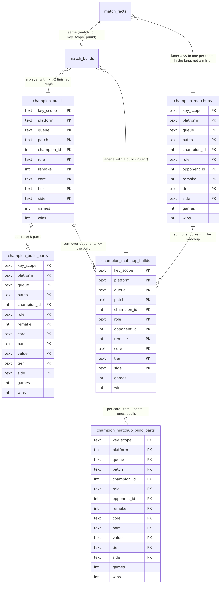
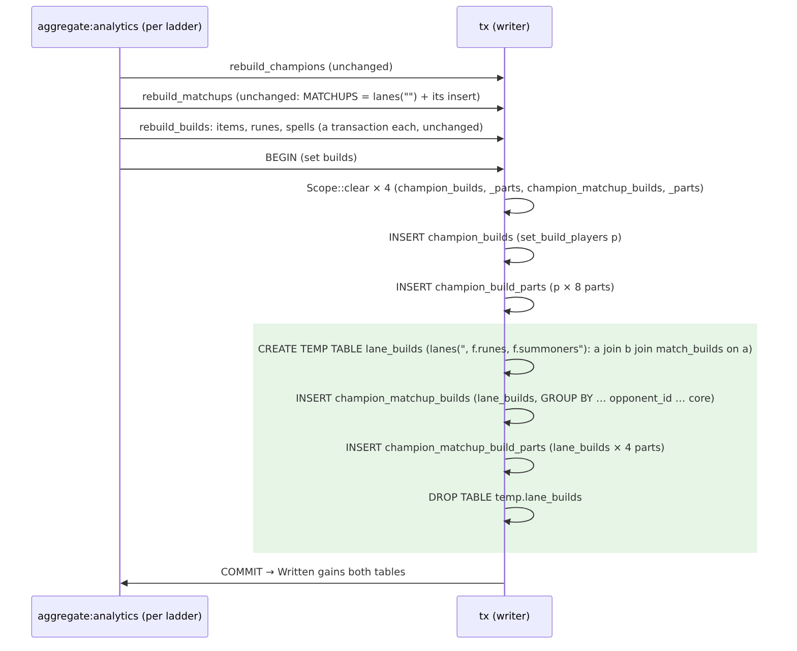
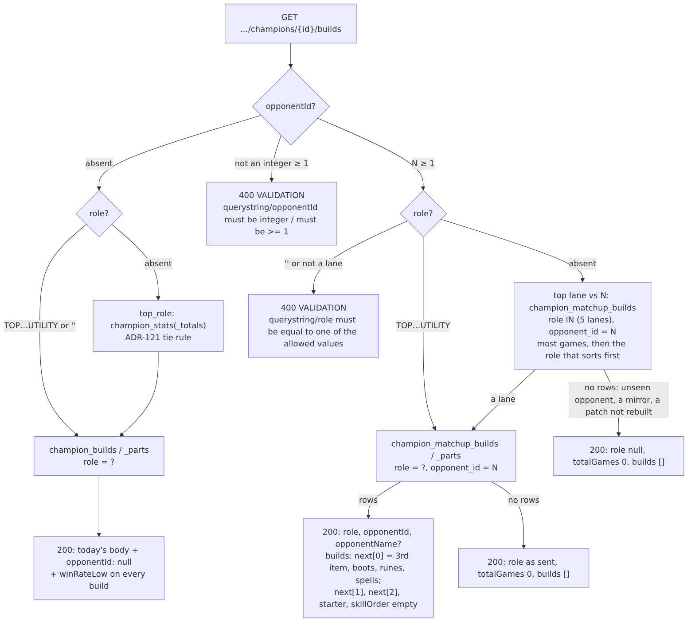
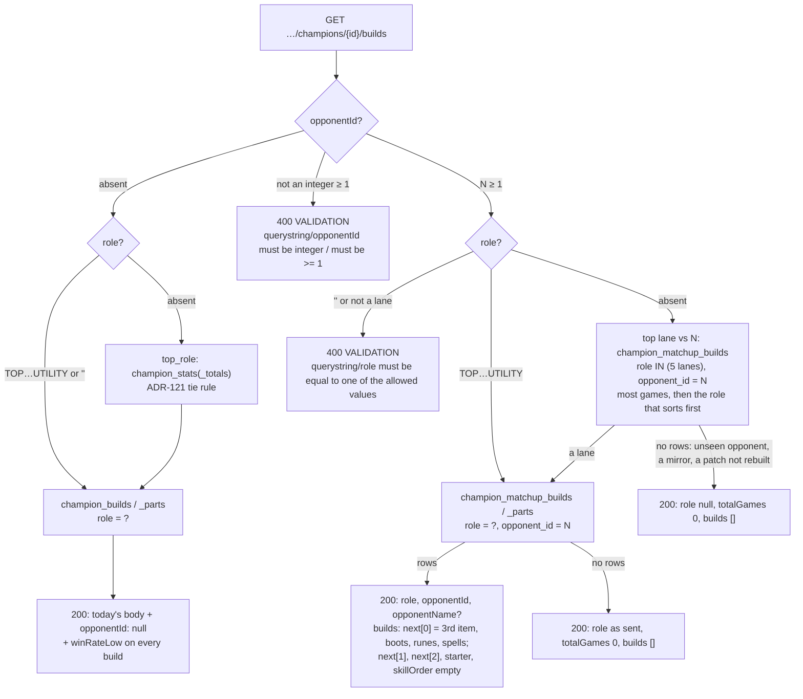
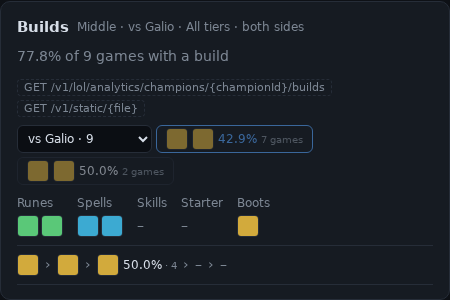
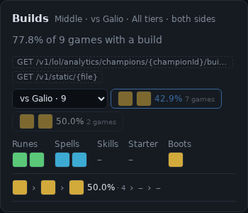
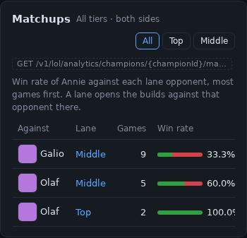
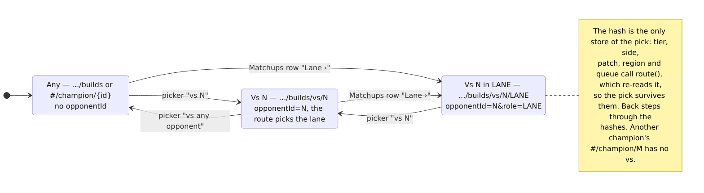

# FLT-04 plan: builds against a lane opponent (`opponentId`)

Written 2026-10-18 against `origin/main` **e4a98df** (FLT-03 #217 and the PROGRESS ticks #216, on top of v2.6.0). Every `file:line` is at e4a98df. Every number below was produced in this session; the scripts are listed in §13. Nothing under `src/`, `tests/` or `docs/` outside `docs/flt/` was edited before approval.

**Preflight.**
- `git fetch origin main` gives e4a98df. There are no open PRs.
- The latest migration is `V0026__floor_totals.sql`, so this task's is **V0027**. The latest ADR is ADR-170, so this task's is **ADR-171**.
- MU-01 has not started, so `winRateLow` and its helper come with this task (§12, Q5).
- Branch `feat/FLT-04-opponent-builds` is in its own worktree (`../rp-flt04`), cut from e4a98df.

**Implementation record** (2026-10-19, branch `feat/FLT-04-opponent-builds`).

*Owner answers.* Q3 (size): **accept**, lever (a), after the production count (§8). The rest of the plan was approved as written, so Q1/Q2/Q4–Q9 follow §12's recommendations: no backfill, an empty list for a mirror or an unseen opponent, `winRateLow` on every build (0/0 = 0), one `ChampionBuildEntry`, `opponentId` in `BuildsQuery`, marker `tier-side-range-opponent`, the showcase split into FLT-05.

*Deviations from the plan.*
- The lane pair is `fn one_on_one(join)`, not a `const`: the matchup builds add their `match_builds` join between the lane join and the `WHERE`, as `ladder_facts(join)` does.
- `Keys` has nine constants, not eleven, so nine got `opponent: false`. `Keys` also derives `PartialEq` for the `build_source` test.
- `a_shared_lane_or_a_mirror_has_no_matchup_build` puts its match under `KR_9` (`KR_6` is `BOTH_SIDES`'), with the mirror in the JUNGLE (champion 8 on both teams), since its TOP is E against D.
- `the_top_lane_against_an_opponent_is_its_own` gives champion 1 one TOP and one BOTTOM game against 7, so the tie rule is tested too (BOTTOM sorts first).
- `a_partial_rebuild_leaves_other_patches_matchup_builds_alone` adds a 14.17 lane (`KR_12`), since the fixture's 14.17 game has no opponent.
- `tests/analytics.rs` adds Anivia's build with its own `seed_anivia_build` instead of extending `seed_builds`, so the other tests' fixtures don't change.
- The validation test also checks `opponentId=abc&role=` (the role is reported: mutation 9).

*Mutation checks* (`/home/dev/flt04/mut/run.py`; each applied alone, then reverted): all nine fail a test, none by a compile error.

| # | mutation | caught by |
|---|---|---|
| 1 | the join without `mb.key_scope = ?1` | `matchup_builds_match_the_hand_computed_fixture` |
| 2 | dropping `b.n = 1`; then `a.n = 1` | `a_shared_lane_or_a_mirror_has_no_matchup_build` (both) |
| 3 | dropping `a.champion_id <> b.champion_id` | `a_shared_lane_or_a_mirror_has_no_matchup_build` |
| 4 | `Filter` ignoring `opponent_id` | `tests/analytics.rs` opponent tests |
| 5 | `build_source` always the set builds | `opponent_reads_never_read_the_set_builds` |
| 6 | `top_lane` replaced by `top_role` in the route | `builds_against_an_opponent` (Jayce against Anivia names TOP) |
| 7 | Wilson's `−` as `+` | `win_rate_low_is_the_wilson_lower_bound` |
| 8 | the cache key without the opponent | `two_opponents_are_two_entries` |
| 9 | `opponentId` validated before `role` | `opponent_id_is_validated` |

*Verification.* `cargo fmt --check` clean; `cargo clippy --all-targets -- -D warnings` clean; `cargo test --no-fail-fast`: 44 test binaries, all `ok`. Expected snapshot changes: `analytics_champion_builds` gains `winRateLow` and `opponentId: null`; the OpenAPI document gains `opponentId` (query and body), `opponentName` and `winRateLow`. The acceptance suite's list of the tables a recompute reports (`acceptance/phase7-ladder.test.ts`) gains the two new tables, as `tests/analytics.rs`' list does; the plan had missed it, and CI's `acceptance` job caught it.

*Observed* (2026-10-19, the branch's debug server on a fake Riot serving the two fixture bodies, FLT-03's tiers, `seed_builds` plus Anivia; `/home/dev/flt04/live/`, `curl -i` saved in `obs/`). Every §5 body is equal byte for byte to the expected one at this run's `computedAt` (`2026-10-18T15:47:18.038Z`), and every tag to the recipe's for that stamp (`live/compare.py`, 7 of 7). The three empty bodies have no stamp, so their tags are the plan's exactly:

| §5 | request | status | `ETag` | `X-Cache` |
|---|---|---|---|---|
| 1 | `134/builds?patch=all&role=MIDDLE` | 200 | `W/"a1a_sYKnKokfm5gMtrmdGyW97Yi7TzMgiQ9hkbVOwls"` | MISS |
| 2 | `…&opponentId=157&role=MIDDLE` | 200 | `W/"P6d7GaoomtMYZ_uTnPWkpb4CW-5VJIq9mS_hyKXTzoA"` | MISS, then HIT with the same tag |
| 3 | `…&opponentId=157` | 200, `role: "MIDDLE"` | `W/"G0w5HcCjKCgDaQC-4pSr5XddE_td_ggJqS9vF2SL0Qo"` | MISS |
| 4 | `…&opponentId=157&minTier=DIAMOND&side=blue` | 200, empty | `W/"9h7LKtF47ZQ_bfGem0IeRaTBgqYnHDaont2ZJ6pQr_4"` (= expected) | MISS |
| 4 | `…&opponentId=157&minTier=DIAMOND&side=red` | 200, the build | `W/"R7OQKSIfnJmDllnfNk-62omjDhtIUZgZBbvb42eMWiY"` | MISS |
| 5 | `…&opponentId=1` | 200, empty | `W/"GsrzU7iMa0XSH0VtupCCuItQ6EHTKl1yLD46E9bO2w8"` (= expected) | MISS |
| 5 | `…&opponentId=134` | 200, empty | `W/"c4CNx_T8rtUdat-uXmVEQtDhBx01aVaty5U11k0psF8"` (= expected) | MISS |

Body 2, observed:
```json
{"championId":134,"platform":null,"queue":"RANKED_SOLO_5x5","tier":null,"minTier":null,"side":null,"patch":"all","role":"MIDDLE","opponentId":157,"computedAt":"2026-10-18T15:47:18.038Z","totalGames":1,"builds":[{"core":[6655,3157],"games":1,"wins":1,"winRate":1,"winRateLow":0.2065,"pickRate":1,"next":[[{"itemId":3089,"games":1,"winRate":1}],[],[]],"starter":[],"boots":[{"itemId":3020,"games":1,"winRate":1}],"skillOrder":[],"runes":[{"keystoneId":8229,"subStyleId":8000,"games":1,"winRate":1}],"spells":[{"spellA":4,"spellB":12,"games":1,"winRate":1}]}]}
```
The 400s (§5.6), observed: `opponentId=157&role=` and `&role=SUPPORT` → `querystring/role must be equal to one of the allowed values`; `opponentId=abc` → `querystring/opponentId must be integer`; `opponentId=0` → `querystring/opponentId must be >= 1`; each `VALIDATION` with the request id, no `X-Cache`. `role=` without an opponent → 200 as before. A matchup with a build on one side only: `34/builds?patch=all&opponentId=126` → Anivia's `[6653,3020]` in TOP, 0/1, `winRateLow` 0; `126/builds?patch=all&opponentId=34` → 200, `role: null`, empty (Jayce finished one item). The live table counts: 3 `champion_matchup_builds` rows, 11 parts.

*Not done here.* The acceptance check on the dev VM (Viego jungle against one opponent, games ≤ that matchup's) needs the build deployed there; renders of the real page are FLT-05's. It was done on production instead, below.

**Production check (v2.7.0, 2026-10-19 NZT; the box's clock read 2026-10-18).** Deployed on `ngf-prod-syd1` instead of the dev VM. V0026 and V0027 applied at the first start in one transaction; the schema is at 27. An oc1 recompute from the dashboard filled `champion_matchup_builds` with 656,652 oc1 `RANKED_SOLO_5x5` rows (disk 89 → 90 GB used). The other ladders fill as their crawls end.
- Viego (234) on oc1, every patch, tier, side, lane and remake group: no group of builds against an opponent has more games than that matchup (`over_matchup` = 0, nor a build group without its matchup row).
- Viego jungle, ranked games, every patch, the five opponents with the most games:

| opponent | matchup games | builds' games |
|---|---|---|
| Lee Sin (64) | 500 | 466 |
| Graves (104) | 490 | 466 |
| Talon (91) | 301 | 280 |
| Jarvan IV (59) | 259 | 244 |
| Kha'Zix (121) | 258 | 246 |

The builds cover 93–96 % of the matchup games; the rest had fewer than two finished items, so no build.

**The recommendation in one paragraph.** Two new `WITHOUT ROWID` tables are keyed like `champion_matchups` up to the opponent and like `champion_builds` after it: `(…, patch, champion_id, role, opponent_id, remake, core[, part, value], tier, side)`. They are filled in `rebuild_builds`' set-build transaction from a temp table, which joins one-on-one laners (`MATCHUPS`' lane CTE) to their `match_builds` row. There is no backfill. The builds route keeps its body and gains `opponentId`/`opponentName`, plus `winRateLow` on every build. With `opponentId`, only `next[0]`, `boots`, `runes` and `spells` are filled. `opponentId` lives in a builds-only `BuildsQuery`, at the end of the cache key. `STATS_SHAPE` becomes `tier-side-range-opponent`. The showcase keeps the pick in the hash (`#/champion/{id}/builds/vs/{opponentId}[/{LANE}]`). The diff is about 1,100 lines (≈ 890 + ≈ 205), so **the showcase becomes FLT-05** (§10). **Size (§8, Q3) is settled: accepted.** Counted on production (2026-10-18), the two tables come to ~1.3–1.45 GiB, about 3× today's 475 MB of analytics tables. Their rows are close to one per laned player-game, and that is because of the key, not the parts. The owner accepted the disk room over the levers in §12.

---

## 1. The lane rule, worked

`/home/dev/flt04/worked.py` migrates an in-memory database to V0026 and builds one match by hand. It then runs `MATCHUPS` (`src/archive/analytics.rs:307-324`), the `champion_builds` insert (`:408-419`, with `set_build_players` `:458-473`) and the proposed statements (§3), all verbatim, bound as `Scope::insert` binds them (`:82-95`).

**KR_1** (16.19 solo, every player `MASTER`, blue wins):

| team | position | champion | finished items (`match_builds.items`) | lane head count |
|---|---|---|---|---|
| 100 blue | TOP | Darius (122) | 3078, 3053 | 1 |
| 200 red | TOP | Darius (122) | 6631, 3053 | 1, a **mirror** |
| 100 | JUNGLE | Lee Sin (64) | 6692, 3071, 3742 | 1 |
| 200 | JUNGLE | Viego (234) | 6672, 3153 | 1 |
| 100 | MIDDLE | Ahri (103) | 6655 (**one item**) | 1 |
| 200 | MIDDLE | Syndra (134) | 6655, 3157, 3089 | 1 |
| 100 | BOTTOM | Jinx (222) | 6672, 3031 | **2** (Jinx and Thresh) |
| 100 | BOTTOM | Thresh (412) | none | **2**: a **shared lane** |
| 200 | BOTTOM | Kai'Sa (145) | 6672, 3115 | 1, but its opponent lane has 2 |
| 200 | UTILITY | Nautilus (111) | 3190 (one item) | 1, no blue `UTILITY` |

Rows written (observed):

| table | rows |
|---|---|
| `champion_matchups` | Lee Sin v Viego JUNGLE 1/1 · Viego v Lee Sin 1/0 · Ahri v Syndra MIDDLE 1/1 · Syndra v Ahri 1/0. No row for TOP (a mirror), BOTTOM (blue's lane has two players, so neither side has a one-on-one), or Nautilus (no opponent) |
| `champion_builds` | Darius `[3078,3053]` 1/1 and `[6631,3053]` 1/0 · Lee Sin `[6692,3071]` 1/1 · Viego `[6672,3153]` 1/0 · Syndra `[6655,3157]` 1/0 · Jinx `[6672,3031]` 1/1 · Kai'Sa `[6672,3115]` 1/0. Ahri, Thresh and Nautilus have fewer than two finished items |
| **`champion_matchup_builds`** (new) | Lee Sin v Viego `[6692,3071]` 1/1 · Viego v Lee Sin `[6672,3153]` 1/0 · Syndra v Ahri `[6655,3157]` 1/0 |
| **`champion_matchup_build_parts`** (new) | Lee Sin: item3 3742, boots 3047, runes 8010:8400, spells 4:11 · Syndra: item3 3089, boots, runes, spells · Viego: boots, runes, spells (no 3rd item, so no `item3` row; ADR-120's "a part with nothing to count is left out") |

- **Ahri has a matchup but no build**: she counts in `champion_matchups` and not in the new tables.
- **Jinx, Kai'Sa and both Dariuses have a build but no one-on-one lane**: they count in `champion_builds` and not in the new tables.

**Then a series.** In KR_2…KR_12 Viego plays jungle against Lee Sin. Nine of those games build 6672 › 3153 (7 wins); with KR_1's loss that core is **7/10**. Two build 3153 › 6672 (1 win). In KR_13 Viego plays against Graves (104) with 6672 › 3153 and wins. Observed:

```
Viego matchups: [(64, 12, 8), (104, 1, 1)]                       -- opponent, games, wins
Viego set builds (every opponent): [('[6672,3153]', 11, 8), ('[3153,6672]', 2, 1)]
Viego v Lee Sin JUNGLE: totalGames 12
  core [6672,3153]: 7/10, winRate 0.7, pickRate 0.8333, winRateLow 0.3968
  core [3153,6672]: 1/2,  winRate 0.5, pickRate 0.1667, winRateLow 0.0945
top lane vs Lee Sin: JUNGLE (12)
```

By hand:
- `totalGames` = 10 + 2 = 12. That is Viego's games against Lee Sin in the jungle that had a build, ADR-121's definition narrowed to one opponent.
- `pickRate` = 10/12 = 0.8333 and 2/12 = 0.1667; together they sum to 1.
- The opponent sums never exceed the set build: core 6672 › 3153 is 10 against Lee Sin plus 1 against Graves, which equals `champion_builds`' 11.
- The core sums never exceed the matchup: 10 + 2 = 12, which equals `champion_matchups`' 12, because every one of those games had a build.

**`winRateLow` for 7/10** (Wilson lower bound, z = 1.96; p = 0.7, n = 10, z² = 3.8416):

    (p + z²/2n − z·√(p(1−p)/n + z²/4n²)) / (1 + z²/n)
  = (0.7 + 0.19208 − 1.96·√(0.021 + 0.009604)) / 1.38416
  = (0.89208 − 0.34288) / 1.38416 = 0.54920 / 1.38416 = 0.3968

The same formula gives 1/1 = 0.2065, 2/2 = 0.3424, 100/200 = 0.4314, 0/3 = 0 and 1/2 = 0.0945. The first two are the brief's; the next three are MU-01's test values. **0/0 = 0** (§12, Q5).

---

## 2. Schema



`src/db/migrations/V0027__matchup_builds.sql`, in full (the DDL `/home/dev/flt04/sql.py` ran in every measurement):

```sql
-- FLT-04 (ADR-171): set builds against one lane opponent. A row is a laner's
-- build (match_builds, two or more finished items) in a lane held by one
-- player per team, the opponent another champion: champion_matchups' rule
-- (ADR-101, ADR-129), so a shared lane and a mirror give none. Keyed as
-- champion_matchups up to the opponent and as champion_builds after it, tier
-- and side last (ADR-129), so a read for one champion, lane and opponent seeks
-- through the remake. Only the 3rd item, boots, runes and spells are kept as
-- parts, to hold the rows down. Filled by rebuild_builds in the set builds'
-- transaction; not backfilled: the next rebuild fills the patches it covers.
CREATE TABLE champion_matchup_builds (
  key_scope TEXT NOT NULL, platform TEXT NOT NULL, queue TEXT NOT NULL, patch TEXT NOT NULL,
  champion_id INTEGER NOT NULL, role TEXT NOT NULL,  -- a lane: TOP … UTILITY, never ''
  opponent_id INTEGER NOT NULL,                      -- the other team's laner, never champion_id
  remake INTEGER NOT NULL,
  core TEXT NOT NULL,                                -- JSON: the first two finished items, "[a,b]"
  tier TEXT NOT NULL, side TEXT NOT NULL,            -- champion_id's player's
  games INTEGER NOT NULL, wins INTEGER NOT NULL, computed_at INTEGER NOT NULL,
  PRIMARY KEY (key_scope, platform, queue, patch, champion_id, role, opponent_id, remake, core, tier, side)
) WITHOUT ROWID;

CREATE TABLE champion_matchup_build_parts (
  key_scope TEXT NOT NULL, platform TEXT NOT NULL, queue TEXT NOT NULL, patch TEXT NOT NULL,
  champion_id INTEGER NOT NULL, role TEXT NOT NULL, opponent_id INTEGER NOT NULL, remake INTEGER NOT NULL,
  core TEXT NOT NULL,
  part TEXT NOT NULL,   -- item3 | boots | runes | spells
  value TEXT NOT NULL,  -- an item id; "keystone:subStyle"; "a:b" with a <= b
  tier TEXT NOT NULL, side TEXT NOT NULL,
  games INTEGER NOT NULL, wins INTEGER NOT NULL, computed_at INTEGER NOT NULL,
  PRIMARY KEY (key_scope, platform, queue, patch, champion_id, role, opponent_id, remake, core, part, value, tier, side)
) WITHOUT ROWID;
```

**Why each key column sits where it does.** The spec's listing (`…, queue, tier, side, patch, …`) is not the order: ADR-129 put tier and side last so that every read keeps its prefix.

| column | why there |
|---|---|
| `key_scope, platform, queue` | every read names them. An open platform is an `IN` over the slice's platforms (ADR-167) |
| `patch` | named, or an `IN` over the slice's patches (`patch=all`), so the seek continues past it |
| `champion_id` | the path's champion, always named |
| `role` | named, or (only for the top-lane read) an `IN` over the five lanes, a code constant (§4). So the seek continues to the opponent either way |
| `opponent_id` | always named on these tables (`Keys.opponent`, §4) |
| `remake` | `remake = 0` unless `remakes=include`, as on every table. Measured: the seek reaches it (§8) |
| `core` | what the read groups by. Rows come out in core order, so the `GROUP BY core` of `builds` needs no sort beyond the final `ORDER BY sum(games)` |
| `part, value` | as in `champion_build_parts`, so `build_parts` reads one core's parts contiguously |
| `tier, side` | last, as ADR-129 put them. A tier, a range or a side is a filter on the rows already sought (`TierKey::AfterPatch` and `FACETS`' side term, `:722-735`, `:796-801`) |

**Why not `opponent_id` before `role`.** That order would seek with role open and no `IN`. But it would break the correspondence with `champion_matchups`' key, which the tests and the "≤ the matchup" check join on. The `IN` over five lanes costs nothing measurable (§8: 1.3–3.6 ms either way). It is also the shape PAIR-01's `(…, champion_id, role, ally_id, ally_role, …)` takes (§11).

**No backfill** (Q2). V0027 creates two empty tables. Unlike V0015 and V0026 these are per-participant rows, and re-deriving them in SQL would mean copying the rebuild into the migration (the reason ADR-129 gave against it for V0017). Production runs `AGGREGATE_PATCH_LIMIT=0` (`/etc/riot-proxy/env`, confirmed 2026-10-18), as does the dev VM (ADR-129), so their first rebuild after the deploy fills every patch. Until then, and on any patch a limited rebuild hasn't reached, the route answers what it answers today before any recompute (BLD-03): **200, `totalGames: 0`, `builds: []`**, and `role: null` when no role was sent. That is acceptable because it is the documented empty case, the showcase already renders it (§7), and *Recompute now* fills it within one rebuild. Listing every ladder in `analytics_unsplit` to force a full rebuild was considered and not proposed: it costs nothing on production (already full), and for a limited deployment it would rebuild every step over every patch to fill two tables.

---

## 3. Rebuild



**Where.** In `rebuild_builds`' last transaction (`src/archive/analytics.rs:404-455`), after `champion_build_parts`, as the spec asks.
- The clear list (`:405`) gains both tables.
- `Written` (`:130`) gains `("champion_matchup_builds", n)` and `("champion_matchup_build_parts", n)`. They feed the `proxy_aggregate_rows{table}` gauge and the `analytics.updated` payload's `tables`, which gain two label values and keys. No metric name changes.

**The lane CTE is factored, not restated.** `MATCHUPS` becomes `lanes("")` plus its insert, and the new statement uses `lanes(", f.runes, f.summoners")`. Widening `MATCHUPS`' own lane with those two columns cost it **+30 %** (4.2 → 5.5 s on the copy, §8), so it keeps its exact SQL. `fn lanes(extra: &str) -> String` follows `set_build_players`' shape (`:458`); `the_matchups_plan_reaches_the_opponent_by_key` (tests `:1075`) calls `matchups()`.

The SQL, with `?1`–`?6` as `Scope::insert` binds them (key scope, platform, queue, queue id, patches, computed_at). `{lanes}` is `MATCHUPS`' CTE (`:307-315`) with `f.runes, f.summoners` added to its select list:

```sql
CREATE TEMP TABLE lane_builds AS {lanes}
SELECT a.patch, a.champion_id, a.position AS role, b.champion_id AS opponent_id, a.remake, a.tier,
  CASE a.team_id WHEN 100 THEN 'blue' ELSE 'red' END AS side, a.win,
  json_array(json_extract(mb.items, '$[0]'), json_extract(mb.items, '$[1]')) AS core,
  mb.items, mb.starter, mb.boots, mb.skill_order, a.runes, a.summoners, ?6 AS computed_at
  FROM lane a
  JOIN lane b ON b.match_id = a.match_id AND b.position = a.position AND b.team_id <> a.team_id
  JOIN match_builds mb ON mb.match_id = a.match_id AND mb.key_scope = ?1 AND mb.puuid = a.puuid
 WHERE a.n = 1 AND b.n = 1 AND a.champion_id <> b.champion_id AND a.team_id IN (100, 200)
   AND a.tier IS NOT NULL AND json_array_length(mb.items) >= 2;

INSERT INTO champion_matchup_builds (key_scope, platform, queue, patch, champion_id, role, opponent_id,
  remake, core, tier, side, games, wins, computed_at)
SELECT ?1, ?2, ?3, patch, champion_id, role, opponent_id, remake, core, tier, side, count(*), sum(win), ?6
  FROM temp.lane_builds GROUP BY patch, champion_id, role, opponent_id, remake, core, tier, side;

WITH k (part) AS (VALUES ('item3'), ('boots'), ('runes'), ('spells')),
v AS (SELECT p.patch, p.champion_id, p.role, p.opponent_id, p.remake, p.core, p.tier, p.side, p.win, k.part,
        {PART_VALUE} AS value FROM temp.lane_builds p CROSS JOIN k)
INSERT INTO champion_matchup_build_parts (key_scope, platform, queue, patch, champion_id, role, opponent_id,
  remake, core, part, value, tier, side, games, wins, computed_at)
SELECT ?1, ?2, ?3, patch, champion_id, role, opponent_id, remake, core, part, value, tier, side, count(*), sum(win), ?6
  FROM v WHERE value IS NOT NULL
 GROUP BY patch, champion_id, role, opponent_id, remake, core, part, value, tier, side;

DROP TABLE temp.lane_builds;
```

- **`{PART_VALUE}`** is the `CASE k.part …` of `champion_build_parts` (`:428-440`), moved into one `const` that both inserts use. The temp table carries the same columns as `p` (`starter` and `skill_order` included), so the `CASE` is shared verbatim and the four-part list is the only difference.
- **The join includes `key_scope`** (`mb.key_scope = ?1`). The brief says "join on `(match_id, puuid)`", but `match_builds`' key is `(match_id, key_scope, puuid)` and ADR-120 requires that a row extracted under another scope never joins. The fixture's `('KR_1', 'other', 'C', …)` row (tests `:243`) catches the omission.
- **Same population as both parents.** `a` passes `MATCHUPS`' filters (`a.n = 1 AND b.n = 1`, not a mirror, team 100/200, stamped) and `set_build_players`' (`json_array_length(items) >= 2`). Every row is therefore inside one `champion_matchups` row and one `champion_builds` row. Checked on the copy: 0 rows above either (§8).
- **`?6 AS computed_at`** gives the temp statement six parameters, so `Scope::insert` is reused unchanged (FLT-03's trick, ADR-170).
- **Temp table vs restating the CTE.** Measured on the copy (§8): the temp table takes 11.2 s and the two-CTE form 19.0 s (Python's 3.46), with identical rows (`EXCEPT` both ways: 0). The temp table is 34 MiB for the largest ladder here (210,489 rows, 171 B each) and lives under `temp_store=MEMORY` (`src/db/mod.rs:29`). On production that is roughly 230–390 MiB at peak for the largest ladder (scaled by the counted players, §8), against 8–12 GB of RAM. Temp DDL is transactional, so a failed step rolls it back.
- **A partial rebuild** (ADR-094) touches only `?5`'s patches. `Scope::clear` deletes only those (`:69-79`), and the lane CTE reads only those (`:313`).
- **Other lists that name the analytics tables** gain both: the `/dev` reset (`src/routes/dev.rs:62-63`), `src/db/tests.rs:118-119`, and the migration counts (`src/db/tests.rs:225`, `:893`, `:897`: 26 → 27).

---

## 4. Read path





The plumbing (`src/archive/analytics.rs`):
- **`Read` gains `opponent_id: Option<i64>`** (`:571`). Its constructors get `opponent_id: None`: `Read::slice`, `Common::read` (`src/routes/analytics.rs:753`) and `src/stats.rs:703`. The others use `..`.
- **`Keys` gains `opponent: bool`**, false on the nine existing constants (`:737-801`). A new `MATCHUP_BUILDS` has `TierKey::AfterPatch`, side, role, champion and opponent. `Filter::new` (`:826`) adds two terms, both only where `k.opponent`:
  - `opponent_id = ?` after the champion;
  - an open role becomes `role IN ('TOP', 'JUNGLE', 'MIDDLE', 'BOTTOM', 'UTILITY')`. `LANES` is a `pub const` here; `LANE_POSITIONS` (`src/routes/analytics.rs:56`) becomes an alias of it. These are code constants written as bound values (`one_of`), like the slice's values.
- **`build_source(r) -> (builds table, parts table, Keys)`** is the only way to reach the new tables, as `stats_source` is for the totals (`:807`). It returns the new tables when `r.opponent_id` is set, else `champion_builds`/`_parts` with `FACETS`. `builds` (`:1205`), `build_totals` (`:1235`) and `build_parts` (`:1287`) call it, so their SQL is unchanged apart from the table name. No other read takes an opponent. A test empties `champion_builds` and checks that an opponent read is unchanged (`opponent_reads_never_read_the_set_builds`).
- **`top_lane(db, r)`** is new and mirrors `top_role` (`:1253`) on `champion_matchup_builds`: `GROUP BY role ORDER BY sum(games) DESC, role LIMIT 1`. ADR-121's tie rule is "a lane over the roleless rows, then the role that sorts first", and every row here is a lane, so only the second half applies. It reads the new table, not `champion_matchups`, so the resolved lane is one that has builds whenever any lane does.
- **Ranges and sides need no new code.** `tier`, `minTier` and `side` go through `TierKey::AfterPatch` and the side term exactly as on `champion_builds`.

The route (`src/routes/analytics.rs`):
- **`Request::Builds(i64, BuildsQuery)`** (`:837-843`), with `struct BuildsQuery { common: Common, opponent_id: Option<i64> }`. `Common` stays shared and unchanged.
- **Parsing** (`:865-868`):
  1. `id()`, as today.
  2. If the query *has* an `opponentId` key, `common` is called with `&LANE_POSITIONS` instead of `&TEAM_POSITIONS`. A non-lane `role` (including `''`) then gets the matchups route's message, `querystring/role must be equal to one of the allowed values`, in v1's property order.
  3. After `side`, `validate::int_query("opponentId", …, 1, i64::MAX)` gives `must be integer` / `must be >= 1`.

  So `opponentId=abc&role=` reports the role (checked first); that is v1's order rule.
- **`builds_doc`** (`:1445-1528`):
  - With an opponent, the read gets `opponent_id`, and an absent role resolves through `top_lane` rather than `top_role`.
  - Names are looked up for `[id, opponent]` in one `champion_names` call.
  - `opponentId == championId` needs no special case: mirrors are never written, so it is the unseen-opponent branch (Q4).
- **`build_entry`** (`:1332`) is unchanged except for `win_rate_low` (Q5, Q6). The four kinds a matchup build has fill the same fields, and the others come out as empty lists, because no `item4`, `item5`, `starter` or `skill_order` rows exist.

---

## 5. Requests and responses

**Fixture**: `tests/analytics.rs` `seed_with` (`:99`) under FLT-03's tiers.
- Yasuo (157) is blue `MIDDLE` `MASTER` and loses; Syndra (134) is red `MIDDLE` `GRANDMASTER` and wins.
- `seed_builds` (`:1021`) gives both a build; Jayce (126) has one finished item.
- Runes and spells from the body: Syndra 8229:8000 and 4:12; Yasuo 8008:8400 and 3:4.

**How these were made.** The bodies are FLT-03's **Observed** builds body for 134 (its §5), changed as this plan says: `opponentId` after `role`; `winRateLow` after `winRate`; with an opponent, `next[1]`, `next[2]`, `starter` and `skillOrder` emptied. `/home/dev/flt04/examples.py` computes the tags with the server's recipe (`etag`, `:564`), after first reproducing FLT-03's observed tag `W/"D3PfvLlr1O9KBdk_ZxKBUEK3x_WnwqICl9DlQ1Z4bfo"` byte for byte. They use the proposed material and FLT-03's run's `computedAt` (`2026-10-14T19:16:39.244Z`), with version `~` because the fake has no Data Dragon. These are **expected** blocks; each gets an **Observed** `curl -i` block once implemented.

The tag material, in order (the proposal; today's is the same without the marker change and the opponent part):

    builds | tier-side-range-opponent | computedAt | version | platform | queue | tier | minTier | side | patch | championId | opponentId | role as sent | role resolved | minGames | limit | remakes

**1. No `opponentId`: today's body plus two fields.** `GET /v1/lol/analytics/champions/134/builds?patch=all&role=MIDDLE` → 200, `ETag: W/"SKtrMqB_Veaxtg67T8OtRZS0v-lbWQbPRaxUva8oilA"` (today's tag for the same rows: `W/"TTmV4tRGkDi6VYjm1HaSo-tRRdIoTi4-Mt_VgW7Atq8"`)
```json
{"championId":134,"platform":null,"queue":"RANKED_SOLO_5x5","tier":null,"minTier":null,"side":null,"patch":"all","role":"MIDDLE","opponentId":null,"computedAt":"2026-10-14T19:16:39.244Z","totalGames":1,"builds":[{"core":[6655,3157],"games":1,"wins":1,"winRate":1,"winRateLow":0.2065,"pickRate":1,"next":[[{"itemId":3089,"games":1,"winRate":1}],[{"itemId":4645,"games":1,"winRate":1}],[]],"starter":[{"items":[1056,2003,2003],"games":1,"winRate":1}],"boots":[{"itemId":3020,"games":1,"winRate":1}],"skillOrder":[{"order":"QEW","games":1,"winRate":1}],"runes":[{"keystoneId":8229,"subStyleId":8000,"games":1,"winRate":1}],"spells":[{"spellA":4,"spellB":12,"games":1,"winRate":1}]}]}
```

**2. With `opponentId` and `role=MIDDLE`.** `…/134/builds?patch=all&opponentId=157&role=MIDDLE` → 200, `ETag: W/"y22nF1MsF1XKXU4HojTVmL_WeQYz5lu13RvhHHPr5eU"`
```json
{"championId":134,"platform":null,"queue":"RANKED_SOLO_5x5","tier":null,"minTier":null,"side":null,"patch":"all","role":"MIDDLE","opponentId":157,"computedAt":"2026-10-14T19:16:39.244Z","totalGames":1,"builds":[{"core":[6655,3157],"games":1,"wins":1,"winRate":1,"winRateLow":0.2065,"pickRate":1,"next":[[{"itemId":3089,"games":1,"winRate":1}],[],[]],"starter":[],"boots":[{"itemId":3020,"games":1,"winRate":1}],"skillOrder":[],"runes":[{"keystoneId":8229,"subStyleId":8000,"games":1,"winRate":1}],"spells":[{"spellA":4,"spellB":12,"games":1,"winRate":1}]}]}
```
With Data Dragon mirrored, `championName` and `opponentName` ("Syndra", "Yasuo") follow their ids, as `championName` does today. The fake has no Data Dragon, so both are absent here, as in FLT-03's bodies.

**3. With `opponentId` and no `role`: the lane resolved.** `…/134/builds?patch=all&opponentId=157` → 200, `role: "MIDDLE"`, the same body as 2. `ETag: W/"v2SaIOs0qYB50Tgx2QEzCalOx5XQoQzEtPIXH1SFsL4"`: the tag differs from 2's because the role *as sent* is a part, as ADR-121 hashes it today.

**4. `opponentId` with `minTier=DIAMOND&side=blue`.** Syndra was red, so the slice is empty: `…/134/builds?patch=all&opponentId=157&minTier=DIAMOND&side=blue` → 200, `ETag: W/"9h7LKtF47ZQ_bfGem0IeRaTBgqYnHDaont2ZJ6pQr_4"`
```json
{"championId":134,"platform":null,"queue":"RANKED_SOLO_5x5","tier":null,"minTier":"DIAMOND","side":"blue","patch":"all","role":null,"opponentId":157,"computedAt":null,"totalGames":0,"builds":[]}
```
The same with `side=red` → 200, `role: "MIDDLE"` and 2's build, `ETag: W/"9S3b5oEFYjzxONF2oI3SlPVCKW5R-Z22LXfKBoYMlNc"`. Syndra is `GRANDMASTER`, inside `DIAMOND+`.

**5. An unseen opponent, and a mirror.** `…/134/builds?patch=all&opponentId=1` (Annie, not in the match) → 200, `ETag: W/"GsrzU7iMa0XSH0VtupCCuItQ6EHTKl1yLD46E9bO2w8"`
```json
{"championId":134,"platform":null,"queue":"RANKED_SOLO_5x5","tier":null,"minTier":null,"side":null,"patch":"all","role":null,"opponentId":1,"computedAt":null,"totalGames":0,"builds":[]}
```
`…/134/builds?patch=all&opponentId=134` (Syndra against Syndra) → 200 with the same shape (`opponentId: 134`), `ETag: W/"c4CNx_T8rtUdat-uXmVEQtDhBx01aVaty5U11k0psF8"`.

**6. The 400s** (`VALIDATION`; the `X-Request-Id` echoed as `requestId`; no `X-Cache`; never cached; the shape FLT-03 observed):
```
GET …/134/builds?opponentId=157&role=          → 400 {"error":{"code":"VALIDATION","message":"querystring/role must be equal to one of the allowed values","requestId":"…"}}
GET …/134/builds?opponentId=157&role=SUPPORT   → 400 (the same message; SUPPORT is no Riot position)
GET …/134/builds?opponentId=abc                → 400 {"error":{"code":"VALIDATION","message":"querystring/opponentId must be integer","requestId":"…"}}
GET …/134/builds?opponentId=0                  → 400 {"error":{"code":"VALIDATION","message":"querystring/opponentId must be >= 1","requestId":"…"}}
GET …/134/builds?role=                         → 200 as today (no opponentId: the roleless rows)
```

---

## 6. Cache keys

`Request::key` (`src/routes/analytics.rs:886`) writes `route|scope|championId|` and then `Common::parts` (`:786`). For builds, `opponentId` is appended **last**, after `remakes`. It is a builds-only part, so the other four routes' keys don't move. With FLT-03's run's key scope `d63166ad`:

| call | key |
|---|---|
| `134/builds?patch=all&role=MIDDLE` | `builds\|d63166ad\|134\|~\|RANKED_SOLO_5x5\|~\|~\|~\|all\|MIDDLE\|~\|3\|exclude\|~` |
| `+ &opponentId=157` | `builds\|d63166ad\|134\|~\|RANKED_SOLO_5x5\|~\|~\|~\|all\|MIDDLE\|~\|3\|exclude\|157` |
| `134/builds?patch=all&opponentId=157` (no role) | `builds\|d63166ad\|134\|~\|RANKED_SOLO_5x5\|~\|~\|~\|all\|~\|~\|3\|exclude\|157` |
| `134/builds?patch=all&opponentId=1` | `builds\|d63166ad\|134\|~\|RANKED_SOLO_5x5\|~\|~\|~\|all\|~\|~\|3\|exclude\|1` |
| showcase, `1/builds?queue=…&patch=all&platform=oc1&opponentId=3` | `builds\|d63166ad\|1\|oc1\|RANKED_SOLO_5x5\|~\|~\|~\|all\|~\|~\|3\|exclude\|3` |

- Two opponents are two entries. `the_cache_key_names_everything_that_shapes_the_answer` (`:1804`) gains the builds literal with and without an opponent.
- Every builds key gains one `|~`, which is harmless: the cache lives in memory and restarts empty.
- **The warm list** (`src/routes/analytics/cache.rs:240`) is unchanged: neither the site nor the showcase home calls builds.

---

## 7. Showcase (FLT-05, §10)

Rendered with `playwright-core` and the cached headless shell (`/opt/pw-browsers` does not exist on this box), on the browser suite's harness: the fake API and real PNGs at Data Dragon's sizes. The page is a **scratch copy** of `showcase.html` (`/home/dev/flt04/mock`, +55 changed lines); the repository is untouched. The fake answers `opponentId` (Galio 3 in MIDDLE: two builds of 7 and 2 games; Olaf 2 in MIDDLE and TOP; anyone else empty).

**Builds card at 1280 px**: today (`FLT-04/before-builds-1280.png`), then *vs Galio* with both builds dimmed (`FLT-04/vs-galio-builds-1280.png`):

 

**At 390 px** (`FLT-04/vs-galio-builds-390.png`, the whole page `FLT-04/vs-galio-page-390.png`):



**Matchups at 390 px**: the lane is the link (`FLT-04/matchups-390.png`; today `FLT-04/before-matchups-390.png`):



ASCII, 1280 px (the card sits in the right column):
```
Builds  Middle · vs Galio · All tiers · both sides
77.8% of 9 games with a build
[GET /v1/lol/analytics/champions/{championId}/builds] [GET /v1/static/{file}]
[vs Galio · 9         ▾] [▣▣ 42.9% 7 games]          ← dimmed: "… · fewer than 10 games"
[▣▣ 50.0% 2 games]                                     ← dimmed
Runes  Spells  Skills  Starter  Boots
▣▣     ▣▣      –       –        ▣
▣ › ▣ › ▣ 50.0% · 4 › – › –
```
At 390 px the rows are the same, with the source chips truncated, as today.

**Measured in the page** (`/home/dev/flt04/renders/mock.jsonl`, `before.jsonl`):

| width | header tool rows (FLT-03 rule 1/1/3) | Builds header rows, before → after | build-tab rows, before → after | picker width | page scrolls sideways |
|---|---|---|---|---|---|
| 1280 | 1 → 1 | 3 → 3 | 1 → **2** | 135 px | no |
| 820 | 1 → 1 | 3 → 3 | 1 → 1 | 135 px | no |
| 390 | 3 → 3 | 3 → 3 | 2 → 2 | 135 px | no |

At 1280 px the card is in the narrow right column, so the picker plus two tabs takes a second line. I tried the picker in the card header instead, where the Matchups card keeps its lane tabs. The header then wrapped to 2–3 rows and saved nothing, so the picker leads the tab row.

**The design.**
- **The pick lives in the hash, and only there.**
  - `#/champion/{id}/builds/vs/{opponentId}` is a *vs* pick; the route picks the lane.
  - `#/champion/{id}/builds/vs/{opponentId}/{LANE}` is a Matchups row's link, which sends `role=LANE` too.
  - `parseRoute` (`src/ui/showcase.html:324`) gives `{ id, focus: 'builds', vs, lane }`.

  Because tier, side, patch, region and queue all call `route()`, which re-reads the same hash, the pick survives them with no extra state. The back button steps through the hashes (measured: link → back restores *vs Galio*). Another champion's `#/champion/M` has no `vs`. A `/builds/vs/…` hash keeps SITE-10's scroll-once rule: the picker sets `ch.scrolled` to the new hash before it assigns it, so picking doesn't scroll the page.

  
- **Load order.** `loadMatchups` starts only after the builds call has returned (`:1398`), so the Builds card *always* renders before `ch.matchups` exists, not just sometimes. Its picker first shows only *vs any opponent* (plus the picked one). `loadMatchups` re-renders the Builds card when the list arrives (`if (ch.builds && $('#cBuild [data-vs]')) renderBuilds()`). Another opponent keeps `ch.matchups`, so the picker stays filled while the page reloads; another champion clears it.
- **Options.** *vs any opponent*, then each opponent in `ch.matchups`, games summed over its lanes, most games first: `vs Galio · 9`, `vs Olaf · 7`.
- **An opponent missing from the slice's matchups** (another tier picked, or a stale link) stays in the list without a count (`vs Kai'Sa`). The route answers an empty list, and the card says `No builds against Kai'Sa in this slice yet.` (`FLT-04/unseen-builds-390.png`). The card doesn't fall back to the detail's per-item lists: those aren't against that opponent.
- **Card header**: `Middle · vs Galio · Diamond+ · both sides`. The role moves from the share line into the slice label, and the share line keeps `77.8% of 9 games with a build`.
- **Dimming.** A build tab under 10 games gets `class="small"` (`opacity: .55`, no new colour) and the title `… · fewer than 10 games`, MU-01's wording, so the two tasks agree. `SMALL_SAMPLE = 10` is one constant. It applies with and without an opponent; the brief's "builds under 10 games are dimmed" doesn't limit it to opponent builds.
- **`winRateLow` is not displayed** (Q8): the dimming carries the warning, and the tab has no room at 390 px. Your call.
- **Matchups row.** The *Lane* cell becomes the link, `#/champion/{id}/builds/vs/{opp}/{LANE}`, titled `Annie's builds against Galio in Middle`. I first rendered a new "builds" column. At 390 px it fell off the right edge of the table, which already clips `100.0%` today (`before-matchups-390.png`). A trailing ` ›` cost 8 px more, so the link is just the lane's text. The card's note gains `A lane opens the builds against that opponent there.`
- **The calls observed in the render** (1280 px; the same at 820 and 390):
  ```
  …/champions/1/builds?queue=RANKED_SOLO_5x5&patch=all&platform=oc1                                  (any)
  …/champions/1/builds?queue=RANKED_SOLO_5x5&patch=all&platform=oc1&opponentId=3                     (vs Galio)
  …/champions/1/builds?queue=RANKED_SOLO_5x5&patch=all&platform=oc1&opponentId=2&role=TOP            (Olaf's TOP row)
  …/champions/1/builds?queue=RANKED_SOLO_5x5&patch=all&platform=oc1&opponentId=3                     (back)
  …/champions/1/builds?queue=RANKED_SOLO_5x5&patch=all&platform=oc1&minTier=DIAMOND&opponentId=3     (then Diamond+)
  ```

---

## 8. Sizes and timings

**What I measured on, and why it isn't the brief's archive.** The brief points at FLT-03's facts-backed synthetic archive. That archive has no `match_builds`, and it picks champions uniformly, so every champion meets every opponent in every lane. That is the worst case for a table keyed by opponent, and not a useful estimate. This box has a better source: `/home/dev/bld05/archive.db`, a copy of the dev VM's archive (27,424 match bodies and 27,411 timelines, OC1-heavy, 49 patches) made for BLD-05.
- `/home/dev/flt04/load` pushes it through the project's **own** code: `archive::matches::put` (facts, bans, stamp) and `archive::builds::extract`/`write` with item.json 16.20.1, into a database migrated to V0026 by `Db::open`.
- That gives 25,166 ranked-solo matches, 282,104 facts and 239,852 players with two or more finished items.
- The copy has no ladder, so every stamp is `UNKNOWN`. A second copy gets FLT-03's synthetic tier mix: a match base from Emerald to Challenger, each player within one tier, a quarter `UNKNOWN`. That one is the realistic case, because tiers split rows.

**Rows and bytes** (`measure.py`, every ladder and patch):

| table | rows, all `UNKNOWN` | rows, tiered | MiB, tiered | B/row |
|---|---|---|---|---|
| `champion_matchups` | 171,376 | 227,489 | 15.7 | 73 |
| `champion_builds` | 89,877 | 145,145 | 11.5 | 83 |
| `champion_build_parts` | 696,659 | 993,904 | 93.5 | 99 |
| **`champion_matchup_builds`** | 189,664 | **209,024** | **17.0** | 85 |
| **`champion_matchup_build_parts`** | 720,030 | **767,910** | **72.9** | 100 |

- Parts by kind (tiered): boots 202,600, item3 143,357, runes 211,513, spells 210,440.
- **Numerators** (tiered): no opponent sum above its set build (0 rows), no core sum above its matchup (0 rows), and no row without a parent build (0).
  - 216,147 of the 216,150 laned set-build games have a one-on-one lane, so shared lanes are almost absent in ranked.
  - 190,475 of the 195,372 matchup rows with builds have builds for every game (their sum equals the matchup).
- **The rows are close to one per player-game.** 209,024 rows for 216,147 laned build games is 0.97 rows per game, and the parts are 3.55 rows per game. Keying the parts without `core` gives 742,157 rows instead of 767,910 (−3 %), so the core isn't the cause. The key (patch × champion × lane × opponent × core × tier × side) simply has more combinations than there are games.

**How they grow** (a random sample of the matches, rows counted without writing; tiered):

| share of matches | `champion_builds` | `_parts` | `champion_matchup_builds` | `_parts` |
|---|---|---|---|---|
| 12.5 % | 24,204 | 151,662 | 26,753 | 97,207 |
| 25 % | 45,389 | 290,201 | 53,387 | 194,233 |
| 50 % | 82,505 | 543,888 | 106,153 | 387,643 |
| 100 % | 145,145 | 993,904 | 209,024 | 767,910 |

Over 8× the matches, the existing build tables grow 6.0× and 6.6× (exponents 0.86 and 0.90). The new ones grow 7.8× and 7.9× (**0.99, linear**), so they gain on `champion_build_parts` by about N^0.09. With every stamp `UNKNOWN` the new parts table is already the larger (720,030 vs 696,659); tiered, at these exponents, the two meet at about 17× this archive.

**One rebuild, every patch and ladder, bundled SQLite 3.51.3** (`flt04-time`, which calls the project's own `rebuild_champions`/`_matchups`/`_builds`, then the §3 statements; tiered copy, two runs):

| step | run 0 | run 1 |
|---|---|---|
| `rebuild_champions` | 23.4 s | 23.9 s |
| `rebuild_matchups` | 4.2 s | 4.2 s |
| `rebuild_builds` (items, runes, spells, set builds) | 28.3 s | 29.9 s |
| **new statements** (temp 3.7, builds 0.5, parts 2.9) | **7.2 s** | **7.7 s** |
| new / `rebuild_builds` | +25 % | +26 % |
| new / the whole rebuild | **+13 %** | **+13 %** |

In Python's 3.46: temp table 11.2 s against restating the CTE 19.0 s (same rows), and `MATCHUPS` with the widened lane 4.2 → 5.5 s, which is why it keeps its own lane.

**Reads, one champion vs one opponent** (`reads.py`, tiered copy, Python 3.46; the route's four reads: top lane, builds, totals and parts; cold is a fresh connection):

| pair | slice | cold / warm, no stats | cold / warm, `ANALYZE` |
|---|---|---|---|
| most played: 81 v 145 BOTTOM, 344 games | none | 3.6 / 2.6 ms | 3.3 / 2.4 ms |
| | `tier=MASTER` | 2.7 / 2.0 | 2.4 / 1.7 |
| | `DIAMOND+` and `side=blue` | 3.0 / 2.3 | 2.7 / 2.0 |
| median: 8 v 238 (lane resolved to MIDDLE) | none | 2.4 / 1.6 | 2.1 / 1.4 |

The plan for both tables, role open (an `IN` over the lanes) or set, with or without statistics:

    SEARCH champion_matchup_builds USING PRIMARY KEY (key_scope=? AND platform=? AND queue=? AND patch=? AND champion_id=? AND role=? AND opponent_id=? AND remake=?)

**Production** (230,715 matches, ~2.3 M facts, 216,475 timelines, 8 ladders):
- **Counted on production** (2026-10-18, `prod-count.sql`, read-only, `AGGREGATE_PATCH_LIMIT=0` so every patch): **4,019,071** laned build players and **3,008,892** `champion_matchup_builds` rows, 0.75 rows per player.
  - The estimate from this archive was 1.6–1.9 M players and 1.4–1.8 M rows (8.6 players per ranked match with a timeline, over the 230,715 matches counted earlier). The archive has grown since, and the rows per player fell faster than the 0.85–0.95 assumed.
- **Bytes**: at 91 and 106 B (production's key scope is 8 characters against `k1`'s 2), the rows are **~260 MiB**. The parts, at 3.4–4 per row (3.67 here), are 10–12 M rows, **~1.0–1.2 GiB**. Together **≈ 1.3–1.45 GiB**, against today's analytics tables at ≈ 475 MB and a file of ~20 GB (DSK alert). **Accepted by the owner** (Q3, §12).
- **Rebuild**: +13 % of the whole rebuild (+25–29 % of the builds step). The dashboard's step durations give the seconds on production.
- **Memory**: the temp table is ~230–390 MiB at peak for the largest ladder.
- **Reads**: a few ms; a repeat comes from memory (ADR-169).
- The count's query (`/home/dev/flt04/prod-count.sql`) reproduced the rebuild's count here (216,147 / 209,024, in 2.0 s) before it was run on production.

---

## 9. Test matrix

`src/archive/analytics/tests.rs`:
- **`matchup_builds_match_the_hand_computed_fixture`**. Fixture `seed` (`:54`), where A (1, MIDDLE) has builds in KR_1/KR_2/KR_3 against C/B (2) and B has one in KR_2. Exact rows:
  - `1 v 2 MIDDLE [6655,3157]`: 2/1, and 1/1 for the remake;
  - `2 v 1 MIDDLE [3157,4645]`: 1/1;
  - C (one finished item) none; D (TOP, no opponent) none; C's `other` key scope row none;
  - parts: A's `item3 3089` once (KR_1), `boots 3020`/`3047`, the runes `8112:8300` and spells `4:14`, as `champion_build_parts` holds them for those games;
  - `Written` names both tables with their counts.
- **`a_shared_lane_or_a_mirror_has_no_matchup_build`**. KR_6 as in `a_lane_two_players_of_a_team_share_has_no_matchup` (`:739`), every player given a two-item build, plus a mirror TOP (champion 5 on both teams). The shared MIDDLE and the mirror give none, and E's TOP against D gives one.
- **`opponent_sums_never_exceed_the_set_builds_and_equal_them_in_one_on_one_games`**:
  - on `seed` + `BOTH_SIDES` + the shared lane: for every (champion, role, core, tier, side, patch, remake), the sum over opponents ≤ `champion_builds.games`, and for every (champion, role, opponent, …) the sum over cores ≤ `champion_matchups.games`;
  - on `seed` alone, where every laned build is one-on-one: both sides are equal (the brief's second clause).
- **`every_read_seeks_on_its_key`** (`:1519`) adds both tables with `MATCHUP_BUILDS`, with two reads:
  - `vs` (open slice, champion 1, opponent 2, role open);
  - `one` + `opponent_id: Some(2)`.

  Each line must reach `opponent_id=?`, with and without `ANALYZE`. With statistics the existing test only requires `platform, queue`; I'll keep that tolerance and add the stronger check without statistics.
- **`opponent_reads_never_read_the_set_builds`**: with `champion_builds`/`_parts` emptied, an opponent read is unchanged; with the new tables emptied, it is empty. `build_source` names the tables.
- **`the_top_lane_against_an_opponent_is_its_own`**: champion 1 plays MIDDLE 3× against champion 2 and TOP 1× against 7, so `top_role` is MIDDLE and `top_lane(vs 7)` is TOP. A tie goes to the lane that sorts first.
- **`a_partial_rebuild_leaves_other_patches_matchup_builds_alone`**: the V0025/V0026 tests' shape (`:1734`, `:2271`).
- **`range_reads_sum_the_named_tiers`** (`:2116`) adds the opponent reads: `AtOrAbove("DIAMOND")` equals the sum of the `One(t)` reads.

`src/routes/analytics.rs` unit tests:
- **`win_rate_low_is_the_wilson_lower_bound`**: 7/10 = 0.3968, 1/1 = 0.2065, 2/2 = 0.3424, 100/200 = 0.4314, 0/3 = 0, 0/0 = 0 (±1e-4), and it never exceeds `winRate`.
- **`the_cache_key_names_everything_that_shapes_the_answer`** (`:1804`) gains the builds literals with and without `opponentId`.

`src/db/tests.rs`: the table list and counts (26 → 27), and **`v0027_creates_the_matchup_build_tables`** (both `WITHOUT ROWID`, empty, the key as above).

`tests/analytics.rs`:
- **`builds_against_an_opponent`** (seed_with FLT-03's tiers, plus `seed_builds` extended with Anivia (34) a two-item build, so Jayce (126, one item) has a matchup but no build). It checks the §5 bodies field by field:
  - `opponentId=157&role=MIDDLE`;
  - no role → `role: "MIDDLE"`;
  - `tier=GRANDMASTER` → the build; `tier=MASTER` → empty;
  - `minTier=DIAMOND` → the build;
  - `side=red` → the build; `side=blue` → empty;
  - `patch=all` and `patch=16.19` equal;
  - `remakes=include` adds nothing: the remake's players have no position, so no lane;
  - `GET …/champions/34/builds?opponentId=126` has Anivia's build (TOP), and `…/126/builds?opponentId=34` is empty (Jayce has one finished item): a matchup without a build;
  - `next[1]`, `next[2]`, `starter`, `skillOrder` empty;
  - `winRateLow` on every build, with and without an opponent;
  - games ≤ the matchups route's games for that opponent (the acceptance check, on the fixture).
- **`opponent_id_is_validated`**: the five §5.6 lines (status, code, message), with `role=` without an opponent still 200.
- **`an_unseen_opponent_or_a_mirror_is_an_empty_list`**: `opponentId=1` and `=134` → 200, `builds: []`, `role: null`, `totalGames: 0`.
- **`two_opponents_are_two_entries`**: 157, 1 and no opponent are three `MISS`es, then three `HIT`s, with three distinct tags. `If-None-Match` with 157's tag on the no-opponent call → 200.
- The existing builds snapshots and `tier_and_side_slice_every_route_and_add_up_to_the_total` take the new fields (`opponentId: null`, `winRateLow`) and the marker. Those are expected changes, listed in the PR.
- The OpenAPI snapshot: `opponentId` on the builds route, `opponentId`/`opponentName` on `ChampionBuildsResponse`, `winRateLow` on `ChampionBuildEntry`.

**Mutation checks I'll run**, each of which must fail a test:
1. The join without `mb.key_scope = ?1` (fixture's `other` row).
2. Dropping `b.n = 1`, then `a.n = 1` (shared lane).
3. Dropping `a.champion_id <> b.champion_id` (mirror).
4. `Filter` ignoring `opponent_id` (route: two opponents differ; seek test).
5. `build_source` always returning `champion_builds` (`opponent_reads_never…`).
6. `top_lane` replaced by `top_role` (`the_top_lane…`).
7. Wilson's `−` as `+` (unit).
8. The cache key without the opponent (`two_opponents…`: the second call would `HIT`).
9. `opponentId` validated before `role` (`opponent_id_is_validated`'s `opponentId=abc&role=` case).

FLT-05 (jsdom `tests/dom/showcase.test.mjs`, Chromium `showcase.browser.test.mjs`):
- the picker fills when the matchups arrive and sends `opponentId`;
- a Lane link sends `opponentId` and `role` and the card names `Top · vs Olaf · …`;
- back restores the previous pick; the pick survives *Diamond+* and *Red*;
- an opponent outside the list shows the empty line;
- a tab under 10 games has `.small` and the title;
- the Chromium layout at 1280/820/390 with no sideways scroll.

`tests/ui.rs` checks that doc and page agree. `tests/dom/fake-api.mjs` answers `opponentId` as the mock's does.

---

## 10. Line estimate and the split

| part | lines |
|---|---|
| V0027 | 30 |
| `src/archive/analytics.rs`: `lanes()`, `PART_VALUE`, the temp table and two inserts, `Keys.opponent` × 12 consts, `MATCHUP_BUILDS`, `Filter`, `Read.opponent_id`, `build_source`, `top_lane` | 150 |
| `src/routes/analytics.rs`: `BuildsQuery`, parse, key, `win_rate_low`, two body fields, `builds_doc`, OpenAPI text, marker, plus its unit tests | 110 |
| `dev.rs`, `stats.rs`, `db/tests.rs` lists and counts | 15 |
| `src/archive/analytics/tests.rs` | 230 |
| `tests/analytics.rs` | 220 |
| snapshots (OpenAPI, route bodies) | 60 |
| docs: design/04, design/11 (route notes only), ADR-171, PROGRESS | 75 |
| **FLT-04** | **≈ 890** |
| FLT-05: `showcase.html` (the mock: +55), `fake-api.mjs` 25, jsdom 90, browser 20, design/11 15, PROGRESS 1 | **≈ 205** |

**Split: yes.** The spec's 600-line rule triggers on FLT-04 alone, and the showcase is the part it allows to move. Splitting lets FLT-04's tables and route be checked on the dev VM before any UI depends on them.

FLT-04 still touches design/11: the *Builds — notes for a frontend* section gains how to ask for opponent builds and which parts come back, plus one line saying the page doesn't send `opponentId` yet (FLT-05). `tests/ui.rs` checks routes, not parameters, so it passes. FLT-05 gets its own PROGRESS line and branch (`feat/FLT-05-vs-picker`), cut from `origin/main` after FLT-04 merges, with this plan's §7 as its spec.

---

## 11. PAIR and MU fit

PAIR-01's `champion_pairs` is keyed `(…, patch, champion_id, role, ally_id, ally_role, remake, tier, side)`: a second champion right after `role`, then `remake`, tier and side last. That is the order chosen here, so `Keys.opponent` generalises without a rewrite. PAIR-01 can rename it to a `second: Option<&'static str>` naming the column (`opponent_id` / `ally_id`), and `Read.opponent_id` to `second_id`, or add `ally` beside it. The role-open `IN` over the lanes applies unchanged. PAIR-02's route takes `BuildsQuery`'s shape (`PairingsQuery { common, ally_role }`), and `win_rate_low` sits beside `rate()` in `src/routes/analytics.rs`, the module where MU-01's `matchup()` (`:700`) and a pairings route live. MU-01 then adds `winRateLow` to `ChampionMatchupEntry` with one call, and its `SMALL_SAMPLE`/"fewer than 10 games" matches FLT-05's.

---

## 12. Answers to the brief's §5, and where the brief and the code differ

1. **Key order**: `(…, patch, champion_id, role, opponent_id, remake, core[, part, value], tier, side)`, proven by the plan line in §8 and kept by `every_read_seeks_on_its_key` (§9).
2. **No backfill.** A patch not yet rebuilt answers 200 with an empty list (§2).
3. **Rows**: §8. **Is the four-part limit enough? Decided: accept the size (a).** The limit takes the parts from 8 per build to 4 (about 3.55 rows per player against `champion_build_parts`' 4.6 here), but the tables are close to per-participant, so they grow with the archive. Production counted ~1.3–1.45 GiB (§8). The levers considered, smallest change first:
   - (a) **accept**: the disk has room (Onidel, 115 GB), but backups and the R2 copy grow by the same amount;
   - (b) **two parts** (`item3` and `boots`, which a build tab shows most), about −55 % of the parts rows, so ~0.35–0.45 GiB;
   - (c) **a games floor** on the parts, for example only cores with ≥ 2 games against that opponent. It would drop most rows, but it breaks THR-03's additivity and isn't in the spec, so I'm only raising it;
   - (d) **only the newest N patches** for these two tables, whatever `AGGREGATE_PATCH_LIMIT` is;
   - (e) **run the count query first** (final message), and choose with production's number.

   (e) was done (§8). The count is above 1 GiB, but the owner chose **(a)**: the disk room is fine and the backups grow by an acceptable amount.
4. **`opponentId == championId` → 200, empty list.** Mirrors are excluded by construction, so it is the answer to a well-formed question, and the branch is the unseen-opponent one with no special case. A 400 would make the API refuse a query whose true answer is "no games".
5. **`winRateLow` on every build**, with and without `opponentId`, as ADR-130 adds a field everywhere. **0/0 = 0**: no evidence gives the lowest bound, consistent with `rate()`'s 0 for 0 games. A build can't have 0 games anyway, but the helper defines it. Its home is `fn win_rate_low(wins, games)` beside `rate()` in `src/routes/analytics.rs`, rounded with `round4` like `winRate`.
6. **The same `ChampionBuildEntry`**, with empty lists for `next[1]`, `next[2]`, `starter` and `skillOrder`. One schema is simpler for a client than two; the showcase already renders an empty part as `–`; and the OpenAPI description of `opponentId` and of `next` says which parts are present.
7. **`opponentId` lives in `BuildsQuery`**, last in the cache key. **`STATS_SHAPE` becomes `tier-side-range-opponent`**. The new opponent part already moves every builds tag, but the marker records why, as ADR-130 and ADR-170 did. It also moves the other three routes' tags once (a 200 instead of a 304 after the deploy, when the in-memory cache is empty anyway). The other option is a builds-only marker part, at the cost of a second constant.
8. **Showcase**: the hash holds the pick (§7). A picked opponent not in the slice's matchups stays in the picker without a count, and the card says so. Displaying `winRateLow` on the tabs: proposed **no** (your call).
9. **Split: yes**, FLT-04 ≈ 890 lines, FLT-05 ≈ 205 (§10).

**Where the brief and the code disagree:**
1. "Join on `(match_id, puuid)` of the laner `a`": `match_builds` is keyed by `key_scope` too, and the join needs it (§3).
2. "The Builds card **may** render before the matchups call returns": it **always** does. `loadMatchups` starts after the builds call (`src/ui/showcase.html:1398`).
3. "Measure on the facts-backed synthetic archive": it has no `match_builds`, and its uniform champion picks are the worst case for an opponent key. I measured on the dev VM archive copy instead (§8).
4. Line numbers: `renderBuilds` is at `:1435` (brief ~1432), `loadMatchups` at `:1458`, the matchup rows at `:1479` (~1474), and the `Request` enum at `:837`. The rest match.
5. The spec's key listing (`…, queue, tier, side, patch, …`) contradicts ADR-129's "tier and side last" and the seek. I followed ADR-129.

**Findings** (out of scope; proposed ids):
- **PERF-06: share the lane set between `rebuild_matchups` and the matchup builds.** Both compute the same window over every fact; the temp table here is 3.7 s of the 7.2 s. Moving the matchup builds into `rebuild_matchups`' transaction, or keeping the lane set for the step after, would save most of it. The spec puts them with `champion_builds`, so not here.
- **The Matchups table clips its last column at 390 px** today (`100.0%` in `before-matchups-390.png`). It scrolls inside its container, but nothing shows that it does. Suggested as a SITE task.
- PERF-04 (FLT-03's: the rebuild's facts scan isn't by platform) applies to the new statement too.

---

## 13. Scratch scripts (in `/home/dev/flt04`, not in the repo)

| path | what it does |
|---|---|
| `load/` (`flt04-load`) | loads `/home/dev/bld05/archive.db` through `archive::matches::put` and `archive::builds::extract`/`write` into `dev.db` (V0026) |
| `load/src/bin/flt04-time.rs` | one rebuild of every ladder and patch through the project's steps, then `shape_t.sql`, on the bundled SQLite |
| `sql.py` | the SQL under test: today's statements verbatim and §2/§3's DDL and inserts (shape T, shape C) |
| `measure.py` | rows, bytes, numerator checks, growth samples, shape T vs C (`dev.db`; `tiers` makes `dev-tiers.db`) |
| `reads.py` | §8's reads and plans |
| `worked.py`, `worked.out` | §1 |
| `examples.py`, `examples.out` | §5/§6: bodies, tags (recipe checked against FLT-03's observed tag), keys |
| `prod-count.sql` | the read-only production count |
| `mmd/` | the four diagrams' sources and PNGs (`@mermaid-js/mermaid-cli@11`, the cached headless shell) |
| `mock/`, `renders/` | §7's scratch page, fake API, `mock.mjs`, the renders and their measurements |

Once approved, the plan is kept true to the code as each step lands, and every expected block in §5 gets an **Observed** block.
