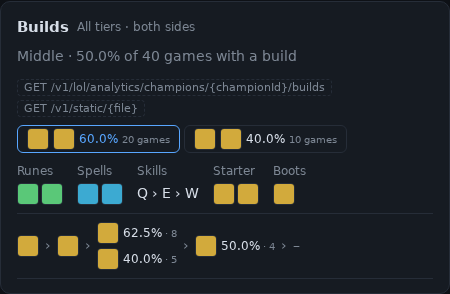
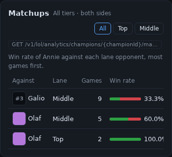
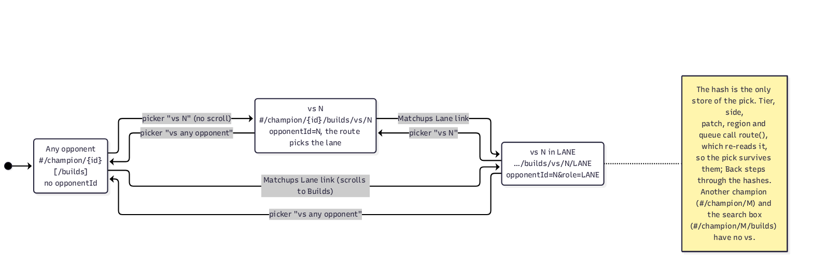
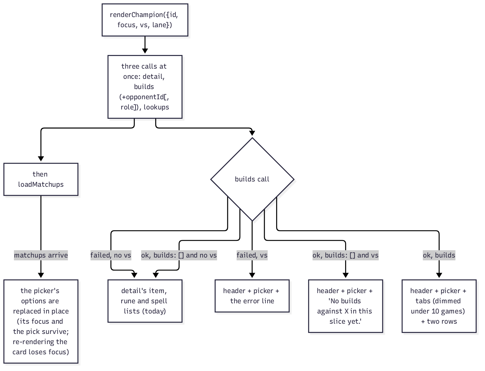
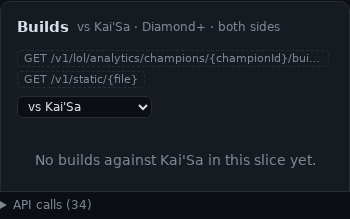
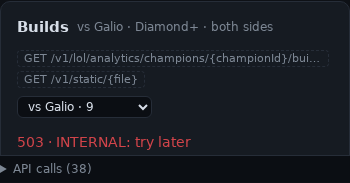
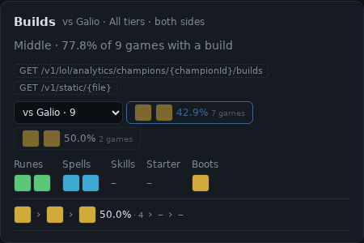
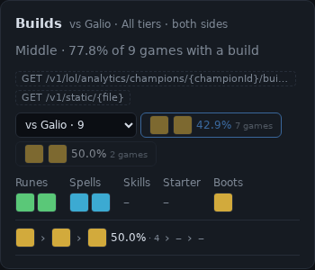
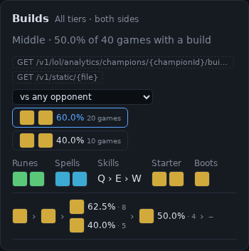
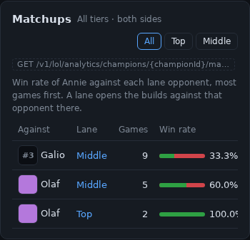

# FLT-05 plan: the *vs* picker on the champion page

Written 2026-10-19 against `origin/main` **e4a98df**. Every `file:line` below is at e4a98df. Every number was produced in this session, on a scratch copy of the page; the scripts are listed in §10. Nothing under `src/`, `tests/` or `docs/` outside `docs/flt/` was edited before approval.

**Preflight.**
- FLT-05 is the showcase half of FLT-04, split off by FLT-04's plan (§10 there). Its spec is FLT-04's plan §7 and the IMPLEMENTATION.md row that #218 adds.
- **It depends on #218** (FLT-04: the `opponentId` route), which is open and green. This branch, `feat/FLT-05-vs-picker` (worktree `../rp-flt05`), holds only this plan for now. Implementation starts once #218 is merged and `origin/main` is merged into this branch. No stacked PR.
- The latest ADR on `main` is ADR-170 and #218 takes ADR-171, so this task's is **ADR-172**. There is no migration.
- No route changes: the page only calls the existing `/v1/lol/analytics/champions/{championId}/builds` with `opponentId` and `role`. `tests/ui.rs`' coverage check is about routes, so it is unaffected.

**The recommendation in one paragraph.**
- **The picker.** The Builds card gains a picker, *vs any opponent* / *vs Galio · 9* / *vs Olaf · 7*. It leads the row of build tabs and is filled from the Matchups card's list: each opponent once, its games summed over lanes, most games first.
- **The links.** Each Matchups row's *Lane* cell becomes a link to the builds against that opponent in that lane.
- **The hash.** The pick lives only in the hash, `#/champion/{id}/builds/vs/{opponentId}[/{LANE}]`. Tier, side, patch, region and queue therefore keep it, and Back steps through picks.
- **Opponent states.** Against an opponent, the card never falls back to the detail's per-item lists, because those aren't against anyone. It says *No builds against Kai'Sa in this slice yet.*, or shows the error, and either way keeps the picker so the user can step back.
- **Dimming.** A build under 10 games is dimmed and its title says *fewer than 10 games*, with or without an opponent. `SMALL_SAMPLE` becomes a shared constant that MU-01 will reuse.
- **Size and checks.** The diff is about 240 lines of code and tests, plus about 30 of docs. A prototype of exactly this change passes every existing page suite unchanged. Ten new and extended tests pass on it, and ten mutations each fail one of them.

---

## 1. Today

The Builds card (`src/ui/showcase.html:1435-1456`) shows up to three build tabs for the champion's most-played role, over every opponent. The Matchups card (`:1471-1484`) lists each lane opponent with games and win rate. Nothing connects the two.

 

---

## 2. The design

### 2.1 State: the hash, and only the hash



| hash | builds call | header |
|---|---|---|
| `#/champion/1` or `#/champion/1/builds` | `…/1/builds?queue&patch[&platform][&tier\|minTier][&side]` (today) | `All tiers · both sides` · `Middle · 50.0% of 40 games with a build` (today) |
| `#/champion/1/builds/vs/3` | today's `+ &opponentId=3` | `vs Galio · All tiers · both sides` · `Middle · 77.8% of 9 games with a build` (the route named the lane) |
| `#/champion/1/builds/vs/2/TOP` | today's `+ &opponentId=2&role=TOP` | `vs Olaf · All tiers · both sides` · `Top · 100.0% of 2 games with a build` |

- **Parsing** (`parseRoute`, `:324`). `vs` must be a positive integer; otherwise the hash is the plain `/builds` view. A lane that isn't one of `ROLES` (`:551`) is dropped, leaving the route to pick it. `#/champion/1/vs/3` (no `/builds`) is the plain champion view.
- **Everything else re-reads the hash.** Tier, side, patch, region and queue all call `route()` (`:1486`), so the pick survives them with no extra state. Another champion's link (`#/champion/M`) and the search box (`#/champion/M/builds`) carry no `vs`, so they drop it.
- **Scrolling** (SITE-10's once-per-hash rule, `:1362-1366`):
  - Picking from the picker marks the new hash as already scrolled before assigning it, so the page stays put. Measured: `scrollY` stays 0 at all three widths.
  - A Matchups link is a new hash, so it brings the Builds card into view. That is wanted, since the Matchups card sits below the Builds card at 820 and 390 px.
  - Back to an earlier `/vs/` hash brings the Builds card into view again, because it is a hash other than the last one scrolled to (checked in jsdom: `scrolled` is `['cBuild', 'cBuild']` after link, then Back). The user is already at that card after following a link, so the page barely moves: at 390 px `scrollY` went from 369 to 401, the page's bottom.

### 2.2 The Builds card



| state | what the card shows |
|---|---|
| no `vs`, builds | today's card, the picker leading the tabs |
| no `vs`, no builds or the call failed | today's fallback: the detail's item, rune and spell lists (no picker: nothing to narrow) |
| `vs`, builds | header `vs X · slice`, the lane in the share line, the picker, the tabs (dimmed under 10 games), the two rows. Only the 3rd item, boots, runes and spells are filled (FLT-04); the others show `–` as an empty part does today |
| `vs`, `builds: []` | header, the lane if the route named one, the picker, then `No builds against X yet.`, `… in this slice yet.` (a tier or side picked) or `… on patch 16.19.` |
| `vs`, the call failed | header, the picker, the error line (`503 · INTERNAL: try later`). The rest of the page still renders |

- **The picker's options** come from `vsChoices(matchups, picked, name)`, a new pure helper. Each opponent appears once, its games summed over lanes, most games first, ties by name. A picked opponent missing from the list (another slice, or a stale link) goes last without a count: `vs Kai'Sa`. Before the matchups arrive the picker holds *vs any opponent* and the pick.
- **The matchups fill the picker in place.** `loadMatchups` (`:1458`) replaces the `<select>`'s options rather than re-rendering the card, so a picker the user has focused keeps its focus and its value. I measured both ways in Chromium: in place keeps `document.activeElement`, a re-render loses it. FLT-04's mock re-rendered, and a test now catches that (§5).
- **Names.** `champName(id)` falls back from Data Dragon to the `opponentName` the matchups or builds route sent, then to `#id`. A server whose `champion.json` isn't mirrored still names the pick, as the Matchups card already does (`:1479`).
- **Dimming.** `x.games < SMALL_SAMPLE` adds `class="small"` (`opacity: .55`, no new colour) and ` · fewer than 10 games` to the tab's title, which today holds the core items' names. MU-01 will dim matchup rows with the same constant and wording.

### 2.3 The Matchups card

The *Lane* cell becomes `<a href="#/champion/{id}/builds/vs/{opp}/{LANE}" title="Annie's builds against Olaf in Top">Top</a>`. The card's note gains *A lane opens the builds against that opponent there.* FLT-04's plan tried a separate column, which fell off the right edge at 390 px; the table already clips its last column there today (`before-matchups-390.png`).


### 2.4 What changed from FLT-04's §7

| §7 said | now | why |
|---|---|---|
| the lane moves into the slice label (`Middle · vs Galio · …`) | the slice label gains `vs Galio · `; the lane stays in the share line | today's headers and the FLT-02/FLT-03 tests (`#cBuild header .slice` = `All tiers · both sides`) stay as they are without an opponent |
| `loadMatchups` re-renders the card | it replaces the picker's options | keeps focus (measured) |
| a failed call against an opponent: not covered | the error and the picker | otherwise the fallback lists, which aren't against the opponent, would show with no way back but Back |
| names from Data Dragon | then the routes' `opponentName` | the fake has no Galio in `champion.json`. Adding Galio would have changed the search box's datalist test, and the fallback is right anyway |
| a pure `parseRoute` change with a new `LANES` | reuses `ROLES` (`:551`) | it is the same list |

---

## 3. The change, file by file

**`src/ui/showcase.html`** (+56 −13, the full diff is `/home/dev/flt05/prototype-showcase.html.diff`):

| where (e4a98df) | change |
|---|---|
| CSS `:160` | `.card .tools.builds button.small { opacity: .55; }` |
| `parseRoute` `:323-327` | the `/builds/vs/{id}[/{LANE}]` form (§2.1) |
| pure helpers, after `roleList` `:552` | `vsChoices(matchups, picked, name)` and `SMALL_SAMPLE = 10`, exported to `tests/showcase.mjs` |
| `ch` `:1340` | `vs`, `lane`, `matchups`, `buildsFailed` |
| `renderChampion` `:1357-1359` | takes `{ id, focus, vs, lane }`. Another champion clears `matchups`; another pick resets the tab |
| builds query `:1389-1391` | `opponentId` and, from a link, `role` |
| `:1399-1400` | keeps the failed response; against an opponent, a failed detail call still draws the Builds card |
| `:1418` | `|| ch.vs`: against an opponent, never the fallback lists |
| before `renderBuilds` `:1434` | `champName`, `vsOptions`, `vsSelect` |
| `renderBuilds` `:1435-1456` | the vs header, the failed and empty states, the picker before the tabs, the dimming |
| `loadMatchups` `:1467-1468` | fills the picker in place |
| `renderMatchups` `:1476-1480` | the note and the *Lane* link |
| change handler `:1520` | `data-vs`: set the hash, marked scrolled first |

**`tests/dom/fake-api.mjs`** (+16): the builds call answers `opponentId`:
- Galio (3) in MIDDLE: two builds of 7 and 2 games, both under 10;
- Olaf (2) in MIDDLE and TOP;
- anyone else: an empty list, with the role as sent;
- `buildsFail` still fails the call, with or without an opponent.

---

## 4. Renders and measurements

Rendered with `playwright-core` and the cached headless shell, on the browser suite's harness (the fake API, real-size PNGs). The page is a **scratch copy** of `showcase.html` with §3 applied (`/home/dev/flt05/mock`); the repository is untouched. Measured in the page (`/home/dev/flt05/renders/*.jsonl`).

**vs Galio at 1280 px and 390 px** (both builds dimmed):

 

**No builds against Kai'Sa** (picked, not in the list), and **the call failed** (390 px):

 

**The widest real option**, *vs Nunu & Willump · 1,234*, makes the picker 198 px instead of 135:


| width | header tool rows | Builds header rows | build-tab rows, today → vs any → longest name | picker | page scrolls sideways |
|---|---|---|---|---|---|
| 1280 | 1 → 1 | 3 → 3 | 1 → **2** → 2 | 135 px (198) | no |
| 820 | 1 → 1 | 3 → 3 | 1 → 1 → 1 | 135 px (198) | no |
| 390 | 3 → 3 | 3 → 3 | 2 → 2 → **3** | 135 px (198) | no |

At 1280 px the Builds card sits in the narrow right column, so the picker plus two tabs takes a second line, as FLT-04's plan measured. FLT-04 tried the picker in the card header, and the header wrapped to 2–3 rows. Q1 asks about this.

**The calls observed** (1280 px; the same at 820 and 390):
```
…/1/builds?queue=RANKED_SOLO_5x5&patch=all&platform=oc1                                   any
…/1/builds?queue=RANKED_SOLO_5x5&patch=all&platform=oc1&opponentId=3                      picker: vs Galio
…/1/builds?queue=RANKED_SOLO_5x5&patch=all&platform=oc1&opponentId=2&role=TOP             Matchups: Olaf, Top
…/1/builds?queue=RANKED_SOLO_5x5&patch=all&platform=oc1&opponentId=3                      Back
…/1/builds?queue=RANKED_SOLO_5x5&patch=all&platform=oc1&minTier=DIAMOND&opponentId=3      then Diamond+
…/1/builds?queue=RANKED_SOLO_5x5&patch=all&platform=oc1&minTier=DIAMOND                   picker: vs any opponent
…/1/builds?queue=RANKED_SOLO_5x5&patch=all&platform=oc1&minTier=DIAMOND&opponentId=145    #/champion/1/builds/vs/145
```

The whole page at 390 px, vs Galio: `FLT-05/vs-galio-page-390.png`.

---

## 5. Tests

All of these were written and run against the prototype (`/home/dev/flt05/check`, a copy of the repo's page and tests with §3 applied).

**The existing suites, unchanged, pass on the prototype:** `tests/showcase.mjs` 51/51, `tests/dom/showcase.test.mjs` 55/55, `showcase.browser.test.mjs` 17/17 (`CI=1`, Chromium).

**New and extended** (all pass: 52, 63 and 21):

`tests/showcase.mjs`:
- **`vs hashes and the vs picker choices (FLT-05)`**:
  - `parseRoute` with and without a lane, and a lane that isn't one;
  - four bad forms that fall back to `/builds`, and `/vs/` without `/builds`;
  - `vsChoices` sums lanes, breaks ties by name, doesn't repeat a listed pick, puts an unlisted pick last without a count, and handles no list yet;
  - `SMALL_SAMPLE` is 10.

`tests/dom/showcase.test.mjs` (the harness gains `hold: RegExp` and `release()`, three lines: a matching call waits, so a test can see the page before it answers):
- **`the vs picker fills from the matchups, most games first, and sends opponentId`**: the options, the hash, the call, the header, the picked value, no scroll; then back to *any*.
- **`a matchup's lane links to the builds against that opponent there, and scrolls to them`**: the three hrefs, the title, `opponentId=2&role=TOP`, `Top · 100.0% of 2 games`, the picker on Olaf, one scroll.
- **`the pick lives in the hash, so tier, side, patch, region and queue keep it; another champion drops it`**: each control's builds call ends in `opponentId=3`, and the hash is unchanged.
- **`an opponent outside the list stays picked, without a count, and the card says there are none`**: `vs Kai'Sa` last; the three wordings; never the fallback lists.
- **`a failed builds call against an opponent shows the error and keeps the picker`**.
- **`a build under 10 games is dimmed and says so, with or without an opponent`**: 7 and 2 games are dimmed; 20 and 10 are not (exactly 10 is not small).
- **`a bad vs hash is the plain builds view; a lane that is no lane is left to the route`**.
- **`the matchups fill the picker in place, so a focused picker keeps its focus and pick`** (with `hold`).

`tests/dom/showcase.browser.test.mjs`:
- `VIEWS` gains **`champion vs`** (`#/champion/1/builds/vs/3`). The suite's icon, overflow, wrapping and overlap checks then run at 1280, 820 and 390 px.
- **`Back after a matchup link restores the vs pick`** (390 px): pick, then link, then Back restores *vs Galio*, then Back again gives `#/champion/1`. jsdom doesn't traverse history, so this lives in Chromium.

**Mutation checks** (`/home/dev/flt05/mut.py`; each applied alone, then reverted). All ten fail a test:

| # | mutation | caught by |
|---|---|---|
| 1 | the picker doesn't mark its hash scrolled | the picker test (`scrolled` is `['cBuild']`) |
| 2 | against an opponent, fall back to the detail's lists | the unlisted-opponent and failed-call tests |
| 3 | the link without its lane | the link test |
| 4 | `opponentId` not sent | the picker and link tests |
| 5 | no dimming | the dimming test |
| 6 | `<=` instead of `<` | the dimming test (exactly 10) |
| 7 | an unlisted pick dropped from the options | the helper test and the unlisted-opponent test |
| 8 | lanes not summed | the helper test and the picker test |
| 9 | a failed call without the picker | the failed-call test |
| 10 | `loadMatchups` re-renders the card (FLT-04's mock) | the focus test |

---

## 6. Docs

- **design/11 §Page map**, the `#/champion/{id}` row: add `#/champion/{id}/builds/vs/{opponentId}[/{LANE}]` to the hashes, and to the BLD-03 row: *a vs picker leads the tabs, filled from the matchups (games summed over lanes); a matchup's lane links to the builds against that opponent there; a build under 10 games is dimmed*.
- **design/11 §Builds — notes for a frontend**: #218 adds the route paragraph, ending *The page doesn't send `opponentId` yet; the vs picker is FLT-05*. That sentence becomes how the page uses the route: the pick in the hash, no fallback against an opponent, `SMALL_SAMPLE`.
- **ADR-172**: the pick lives in the hash only; no fallback against an opponent; the picker is filled in place; `SMALL_SAMPLE = 10` is shared with MU-01 and applies with or without an opponent; the Q answers.
- **PROGRESS**: tick FLT-05 with the PR number.

---

## 7. Line estimate

| part | lines |
|---|---|
| `src/ui/showcase.html` | +56 −13 |
| `tests/dom/fake-api.mjs` | +16 |
| `tests/dom/showcase.test.mjs` (8 tests, the `hold` harness) | +122 −2 |
| `tests/showcase.mjs` | +20 −1 |
| `tests/dom/showcase.browser.test.mjs` | +25 |
| design/11, ADR-172, PROGRESS | ≈ 30 |
| **total** | **≈ 270** |

Well under the 600-line rule: one PR.

---

## 8. Order of work, once #218 is merged

1. `git merge origin/main` into `feat/FLT-05-vs-picker` (no force push), and re-check the ADR number on `main`.
2. Apply §3, with the tests of §5, from the scratch diffs (`/home/dev/flt05/prototype-*.diff`).
3. `just ui-test` with `CI=1` (jsdom and Chromium), `cargo test --no-fail-fast` (runs `tests/showcase.mjs` and `tests/ui.rs`), fmt and clippy.
4. Renders of the real page against the fake, the same as §4, into the Implementation record below.
5. After deploy, on the dev VM: Viego's page, pick an opponent from the picker, and check the builds' games add up to at most that matchup's games. This is FLT-04's acceptance check, done through the page.

---

## 9. Questions for you

1. **Where the picker sits.** It leads the build-tab row (recommended), which adds a second row at 1280 px (the narrow right column) and a third at 390 px with the longest name. The alternative is a row of its own above the tabs at every width: always one more row, but a steady layout. The card header was tried for FLT-04 and wrapped to 2–3 rows.
2. **Dimming without an opponent.** The brief says *builds under 10 games are dimmed*. I apply it with and without an opponent (recommended), since a 6-game build is as thin either way. The alternative is to dim only against an opponent.
3. **`winRateLow` on the page.** Recommended: not shown. The dimming carries the warning, and the tab has no room at 390 px. A cheap alternative is to add it to the tab's title, *… · fewer than 10 games · at least 15.8 % (95 %)*, with no layout cost.
4. **The link target.** The *Lane* cell (recommended), since the champion cell already links to the opponent's own page. The alternative is the whole row, but that would compete with the champion link inside it.

---

## 10. Scratch files (in `/home/dev/flt05`, not in the repo)

| path | what it is |
|---|---|
| `patch.py` | applies §3 to a copy of `origin/main`'s `showcase.html` |
| `mock/` | the scratch page, the extended fake API, `tests/dom/mock.mjs` (the renders and measurements; `BEFORE=1` for today's page, `LONG=1` for the longest name) |
| `renders/` | every render and `mock.jsonl`, `long.jsonl`, `before.jsonl` |
| `mmd/` | the two diagrams' sources and PNGs |
| `check/` | the repo's page and tests with §3 and §5 applied, where every suite was run |
| `jsdom-tests.mjs`, `helper-tests.mjs` | the new tests as written |
| `prototype-*.diff` | the five files' diffs against `origin/main` |
| `mut.py` | the mutation checks |

---

## Implementation record (2026-10-19)

**Owner's answers to §9.**
1. The picker leads the build-tab row (recommended).
2. Builds under 10 games are dimmed with or without an opponent (recommended).
3. `winRateLow` is not shown on the page (recommended).
4. The link target is the Matchups *Lane* cell (recommended).

**Preconditions.** #218 (FLT-04) merged on 2026-10-18 as c1d13e0. `origin/main` was merged into this branch with a normal merge commit. #218 touched none of the five files this task changes, so they were byte-identical to e4a98df and every line number above still holds. The latest ADR on `main` is ADR-171 and no open PR claimed another, so this task's is ADR-172.

**Deviations.** None. The five prototype diffs (`/home/dev/flt05/prototype-*.diff`) applied cleanly with `git apply -p0`, and the result is byte-identical to `/home/dev/flt05/check/`. The docs follow §6: design/11's page map (the hash, `FLT-05` and `[&opponentId[&role]]` on the BLD-03 row) and its notes for a frontend (#218's closing sentence replaced), and ADR-172.

**Verification** (in the worktree, after the merge):
```
cargo fmt --check                               ok
cargo clippy --all-targets -- -D warnings       ok
cargo test --no-fail-fast                       931 passed, 0 failed (tests/ui.rs runs tests/showcase.mjs: ok)
CI=1 just ui-test (jsdom and Chromium)          176 tests, 176 pass, 0 fail, 0 skipped
  showcase.test.mjs                             63 (8 new, FLT-05)
  showcase.browser.test.mjs                     champion vs at 1280, 820, 390 px; Back after a matchup link restores the vs pick
```

**Mutations** (`mut.py`'s nine against the real `src/ui/showcase.html`, plus the tenth from §5, `loadMatchups` re-rendering the card; each applied alone, then reverted; the page was byte-identical afterwards):

| # | mutation | caught by |
|---|---|---|
| 1 | the picker doesn't mark its hash scrolled | the picker test |
| 2 | against an opponent, fall back to the detail's lists | the unlisted-opponent and failed-call tests |
| 3 | the link without its lane | the link test |
| 4 | `opponentId` not sent | the picker and link tests |
| 5 | no dimming | the dimming test |
| 6 | `<=` instead of `<` | the dimming test |
| 7 | an unlisted pick dropped from the options | the helper test and the unlisted-opponent test |
| 8 | lanes not summed | the helper test and the picker test |
| 9 | `loadMatchups` re-renders the card | the focus test |
| 10 | a failed call without the picker | the failed-call test |

**Renders of the real page** (`mock.mjs` run from the real `tests/dom`, so on the real `showcase.html` and fake API). Every measurement in `mock.jsonl` and `long.jsonl` is byte-identical to the prototype's, so §4's table and calls stand as written:

 

  



**Still to do after deploy** (§8 step 5): on the dev VM, Viego's page, pick an opponent and check the builds' games add up to at most that matchup's games.
