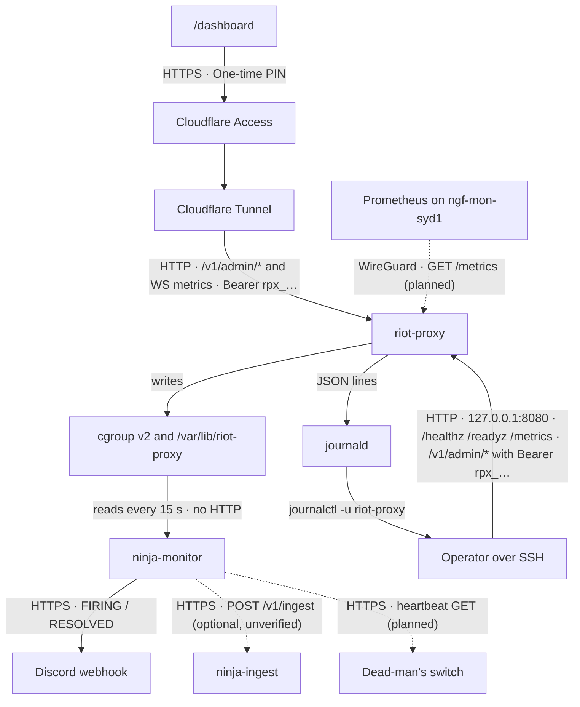

# Monitoring hooks

What ninja-monitor, a Prometheus scraper, a log shipper or a container runtime can read from riot-proxy, with exact semantics and bodies, what is wired up on `ngf-prod-syd1` today, and what is still planned. Operational procedures for each signal are in `../operations/runbook.md`; the full metric catalogue is in `../operations/observability.md`.

## Probes

| Endpoint | Auth | Body | Semantics | Evidence |
|---|---|---|---|---|
| `GET /healthz` | none | `{"ok":true}` | the process is serving; touches nothing | `src/routes/health.rs:59-72` |
| `GET /readyz` | none | `{"ok","sqlite","limiter","keyScope","sqliteReaders","sqliteReadersFree","writerBusy","writerBusyMs","writerQueued"}` | 200 when `sqlite && limiter`, else 503 with the same body | `src/routes/health.rs:73-200` |
| `GET /status` | the admin key, or none from `STATUS_ALLOW_CIDR` on a request no reverse proxy forwarded | the shared ninjagoldfinch status contract, `schema: 1` (design/14) | **200 even when `status` is `down`**; `status` is the worst of `checks`; answered from memory, never calling Riot | `src/status/mod.rs:150-213`; `src/http/auth.rs:381-405` |
| `GET /status/ratelimits` | the admin key only, never keyless | what Riot's rate-limit headers last said, per scope and method (design/14 §Rate-limit table, ADR-207) | answered from memory, empty after a restart; not metered | `src/status/mod.rs:215-246`; `src/http/auth.rs:417-423`; `src/status/ratelimits.rs:103-246` |

`sqlite` depends on the writer thread (WR-02, ADR-180). Idle, it must execute `BEGIN IMMEDIATE; ROLLBACK;` within `READY_TIMEOUT` = 2 s, waiting at most 1.5 s for another process's write lock (`src/routes/health.rs:21-27`, `:148-171`). Busy, nothing is queued behind the running write: `sqlite` is true while SQLite stamped progress on it in the last 5 s (`WRITER_STALL`, `:34`; a job's start counts for 1.5 s, and only if it found the writer idle, `:39`), or the writer thread used at least a quarter of a 250 ms sample of CPU (`:41-46`, `:173-200`), so a rebuild that holds the writer for minutes stays ready. `limiter` is true once the checkpoint restore has run, whether it succeeded or fell back to fresh state (`:123`; `src/cli/serve.rs:103-109`). `sqliteReadersFree` never affects `ok` (`:111-119`). Both routes get CORS headers only when `ADMIN_CORS_ORIGINS` lists an origin (`src/http/cors.rs:40-43`), and neither is written to the recent-requests ring (`src/http/recent.rs:25`).
`writerBusy`, `writerBusyMs` and `writerQueued` say what the writer is doing, from atomics it stamps (`src/db/writer.rs:27-127`); none of them affects `ok`.

**Using `/readyz` as a restart signal.** A 503 with `"writerBusy":true` means the running write has neither made progress nor used CPU for 5 s: it waits on another process's write lock or is stuck, and a restart is reasonable once nothing else holds the database ([troubleshooting §1](../operations/troubleshooting.md#1-readyz-answers-503-with-sqlitefalse-while-everything-else-works)). A 503 with `"writerBusy":false` means another process holds the write lock. Before WR-02 the probe queued behind every write and a rebuild alone made it 503 (ADR-179); a supervisor that still restarts only on `/healthz` loses nothing.

Observed on 2026-10-20 from a scratch run of the WR-02 build on a synthetic database (100 010 matches), idle and then during an `aggregate:analytics` rebuild:

```text
GET /readyz → 200 {"ok":true,"sqlite":true,"limiter":true,"keyScope":"d63166ad","sqliteReaders":4,"sqliteReadersFree":4,"writerBusy":false,"writerBusyMs":0,"writerQueued":0}
GET /readyz → 200 {"ok":true,"sqlite":true,"limiter":true,"keyScope":"d63166ad","sqliteReaders":4,"sqliteReadersFree":4,"writerBusy":true,"writerBusyMs":134797,"writerQueued":9}
```

## `/status`

The status bot's endpoint (STS-02, ADR-203, design/14). Its `metrics` are read from one rendering of the same Prometheus recorder `/metrics` serves, so the two cannot disagree (`src/status/snapshot.rs:73`); the keys and the label values behind them are in `docs/design/metrics.md` §`/status` keys. `metrics_meta.riot_last_success_at` is the Riot client's last 2xx (`src/riot/client.rs:245-247`).

- **Who may read it.** The admin key (admin scope and `ADMIN_IP_ALLOWLIST`), or no key when the TCP peer is inside `STATUS_ALLOW_CIDR` (default loopback) and the request carries none of `Cf-Connecting-IP`, `X-Forwarded-For`, `Forwarded` or `X-Real-IP` (`src/http/auth.rs:236-242,318-323`). cloudflared adds the first to every request it forwards from `127.0.0.1`, and nginx, Caddy or Traefik on the same host typically add one of the others, so a keyless request through such a proxy is 401. A proxy configured to add none of these (nginx without `proxy_set_header X-Forwarded-For`, HAProxy without `option forwardfor`) still reads as local: set `STATUS_ALLOW_CIDR=none`, or have the proxy add one of them. Only the headers' presence is read, never their values, whatever `TRUST_PROXY` says. A key that is sent is always checked: a read key is 403 and an unknown one 401, even from loopback.
- **Cost.** No consumer quota, no entry in the recent-requests ring (`src/http/recent.rs:29`), no Riot call. A local run answered in about 2 ms.
- **Counted.** Every answered request, `/status` included, moves `consumer_requests_total{consumer,group,class}` (`src/app.rs:161`).
- **Checks** (STS-02b, ADR-206). A task runs a round at boot and every `STATUS_CHECK_INTERVAL_S` (default 30) and stores each result, which `/status` reads (`src/status/checks.rs:326-390`); a check with no result yet is `ok` with detail `pending` (`:75-101`).
  - `riot_api`: `lol-status-v4` `platform-data` on each `STATUS_CHECK_PLATFORMS` entry (default `LADDER_PLATFORMS`), through the limiter at bulk priority with a 1 s budget and never through the response cache (`:297-313`, `:395-429`). The first platform is probed every round while idle and every 60 s while it had real traffic in the last 60 s; the others every 60 s (`:250-257`). Only the first's 5xx or network failure is `down`. A probe with no limiter room within 1 s is skipped and the platform's last result stands. A 429, another platform's failure, any scope frozen after a 429, or a platform skipped 4 attempts in a row (`STALE_AFTER_SKIPS`, `:48`) degrades it, and a 401, 403 or 404 leaves it `ok` (`:191-245`, `:110-119`). Absent with no platforms.
  - `riot_key`: the last 2xx, 401 or 403 from any Riot call, probes included (`src/riot/client.rs:268-296`): `down` on a 401 or 403, `degraded` within 48 h of `RIOT_API_KEY_EXPIRES_AT` (`src/status/checks.rs:132-159`).
  - `cache`: a read of L2's `cache` table within 2 s. A read SQLite refuses is `down`. A timeout is `degraded`, and `down` only when the round before failed too: the 2 s include the wait for a free reader, so a busy pool alone reads slow for a round (`:439-459`).
  - `storage`: with `ARCHIVE_OBJECT_URL`, the first entry of the bucket's listing within 5 s, else `degraded` (`:462-474`; `src/archive/objects.rs:307-313`).
  - At most 2 + N Riot calls a minute for N platforms after the first. They count in `riot_requests_total` like any other.
- **Rate limits** (STS-03, ADR-207). Every answer from Riot that has a status, probes included, records the latest `X-App-Rate-Limit` and `-Count` per scope, the latest `X-Method-Rate-Limit` and `-Count` per scope and method, and the last `Retry-After` with its time (`src/riot/client.rs:404-409`, `src/status/ratelimits.rs:104-129`). `metrics` gains `riot_app_limit_remaining_pct_<scope>`, the least headroom across the scope's app windows, rounded down, from its first app headers on (`src/status/ratelimits.rs:131-144`), and `riot_retry_after_s`, the limiter's longest freeze left after a 429 in seconds rounded up, 0 from boot (`src/status/mod.rs:36-45,160-162`). `GET /status/ratelimits` returns the table itself with the admin key only: keyless is 401 even from loopback, a read key 403 (`src/http/auth.rs:391-405,417-423`). It is not in the recent-requests ring (`src/http/recent.rs:30`) or the consumer quota.
- **On production.** `curl http://127.0.0.1:8080/status` from the box needs no key. Through `api.ninjagoldfinch.lol` it needs the admin key, and the WAF rule that covers `/metrics` should gain `/status*` (owner, design/14 §Endpoints).

## `/metrics`

`GET /metrics`, no key, no quota, Prometheus text exposition with `Content-Type: text/plain; version=0.0.4; charset=utf-8` (`src/telemetry.rs:24`, `:101-121`). Names in the `proxy_*` set are v1's byte for byte; v2 additions are unprefixed (`src/metrics.rs:1-4`, `:49`). Reachability on production:

- loopback `http://127.0.0.1:8080/metrics` from the box: yes (`HOST=127.0.0.1`, `PORT=8080`);
- `https://api.ninjagoldfinch.lol/metrics`: blocked by the WAF rule that covers `/metrics`, `/dashboard*`, `/dev*`, `/v1/admin*` on `api.` (`PROGRESS.md:342`; `docs/design/07-deployment.md:225`);
- from `ngf-mon-syd1` over WireGuard: planned for Prometheus, not built (`docs/design/12-object-storage-and-hosting.md:846-848`; `docs/design/13-admin-dashboard.md:69`).

A scraper should sample at least every 60 s to see each disk gauge update (`METRICS_HISTORY_INTERVAL_S`, `src/stats.rs:1074-1119`) and every 15 s to see `jobs_pending` move (`src/jobs/scheduler.rs:49`).

## Admin JSON snapshots

All need a consumer key with the `admin` scope as `Authorization: Bearer rpx_…` (`src/http/auth.rs:301-313`), count against that consumer's quota (`:361-378`) and, through the tunnel, are only on `admin.ninjagoldfinch.lol` behind Cloudflare Access.

| Route | Gives | Evidence |
|---|---|---|
| `GET /v1/admin/metrics` | the live `Snapshot` (`v:1`): totals, queue counts, cache counters, limiter scopes, `process{uptimeSeconds,rssBytes}`, `sqlite{readers,readersFree}`, `sqliteWriter{busySince,busyMs,lastProgress,lastFinished,queued}`, `disk{dbBytes,walBytes,freelistBytes,freeBytes,totalBytes}`, per-route request counts, upstream counts | `src/routes/admin.rs:2408-2415`; `src/stats.rs:319-357` |
| `GET /v1/admin/metrics/history` | `{intervalS:60, maxPoints:1440, points[]}`, 24 h of one-minute points from SQLite | `src/routes/admin.rs:2425-2443`; `src/stats.rs:43` |
| `GET /v1/admin/stats` | archive counts and bytes by location, pack stats, `dbFileBytes`, `walBytes`, `dbFreelistPages`, `diskFreeBytes` | `src/routes/admin.rs:890-924` |
| `GET /v1/admin/jobs/stats` | `kinds{kind→{pending,running,done,failed}}`, `totals` | `src/routes/admin.rs:1371-1395` |
| `GET /v1/admin/limits/{scope}` | `usage[{window,used,limit}]`, `frozenMs` for one Riot scope | `src/routes/admin.rs:1012-1029` |
| `GET /v1/admin/backups` | backup files, `keep`, `lastRun`, `diskFreeBytes` | `src/routes/admin.rs:2599-2622` |
| `GET /v1/admin/recent?kind=requests|errors` | the last 500 requests / 200 error envelopes, in memory | `src/routes/admin.rs:2562-2574`; `src/http/recent.rs:18-20` |
| `GET /v1/admin/info` | version, `gitSha`, `builtAt`, `startedAt`, `uptimeSeconds`, feature switches, redacted config | `src/routes/admin.rs:2454-2493` |

`/v1/admin/metrics` and `/v1/admin/recent` are themselves excluded from the recent ring so a poller does not fill it (`src/http/recent.rs:25`).

## The `metrics` WebSocket topic

`GET /v1/ws` with `Authorization: Bearer` or `?token=` (`src/http/auth.rs:271-285`), then `{"op":"subscribe","topics":["metrics"]}`. The topic is admin-only (`src/ws/protocol.rs:68-71`); a non-admin socket gets `{"op":"error","error":{"code":"FORBIDDEN",…}}` (`src/ws/socket.rs:165-170`). While any socket holds it the server sends `{"op":"event","event":"metrics.snapshot","topic":"metrics","at":<unix ms>,"data":<Snapshot>}` every `METRICS_INTERVAL_S` = 5 s (`src/ws/metrics.rs:14-35`; `src/config.rs:822`; `src/events.rs:159-172`). Heartbeat pings every 30 s, closed after two unanswered (`src/ws/protocol.rs:23-25`); close codes `1001` on shutdown and `4401` on key revocation (`src/ws/socket.rs:36-41`). A lagging consumer gets `{"op":"resync","topic":"metrics","dropped":n}` rather than being dropped (`src/ws/socket.rs:110-116`).

## The `healthcheck` subcommand

`riot-proxy healthcheck [--timeout N]` GETs `http://<host>:<PORT>/healthz` with `HOST` `0.0.0.0` rewritten to `127.0.0.1` and `::` to `[::1]`, exits 0 on 2xx and 1 otherwise with `<url> answered <status>` or the connection error (`src/cli/healthcheck.rs:11`, `:26-34`; `src/cli/mod.rs:44-49`). It needs no CA store, so it works in the `FROM scratch` image where `Dockerfile:24` runs it as the `HEALTHCHECK`. It loads the full configuration first (`src/cli/mod.rs:82-88`), so `RIOT_API_KEY` must be in the container's environment, not only in a mounted file.

## Log format for shippers

One JSON object per line on stdout (`LOG_FORMAT=json`, the default when stdout is not a TTY, `src/config.rs:740-747`): `timestamp` (RFC 3339, microseconds, `Z`), `level` (`TRACE`…`ERROR`), `message`, `target` (Rust module path), the event's own fields flattened, and `span` holding the innermost span's fields (`request_id`, `method`, `path`, `consumer`, `name`) (`src/telemetry.rs:53-66`; `src/app.rs:109-118`). Per-request lines are `finished processing request` with `latency` (a string such as `"12 ms"`) and `status` (integer). Error lines are `request failed` with `code`, `status`, `message`. No keys appear in any line (`src/riot/client.rs:29`; `src/config.rs:436-440`). On production the shipper's source is journald (`journalctl -u riot-proxy -o cat`); `_SYSTEMD_UNIT=riot-proxy.service` is the field to filter on.

## Alert conditions

**Prometheus rules** (`ops/prometheus-alerts.yml`, to load when Prometheus exists):

| Alert | Expression | For | Severity |
|---|---|---|---|
| `RiotKeyRejected` | `increase(proxy_upstream_requests_total{status=~"401\|403"}[10m]) > 0` | 0 m | critical (`:6-14`) |
| `AccountableRateLimit429` | `increase(proxy_rl_429_total{type=~"application\|method"}[10m]) > 0` | 0 m | warning (`:16-24`) |
| `CacheHitRatioLow` | `sum(rate(proxy_cache_reads_total{state=~"hit\|neg\|stale"}[5m])) / sum(rate(proxy_cache_reads_total[5m])) < 0.7` | 15 m | warning (`:26-41`) |
| `UpstreamErrorRateHigh` | `sum(rate(proxy_upstream_requests_total{status=~"5..\|network"}[5m])) / sum(rate(proxy_upstream_requests_total[5m])) > 0.1` | 10 m | warning (`:43-50`) |
| `ProxyDown` | `up{job="riot-proxy"} == 0` | 2 m | critical (`:52-57`) |

The Grafana board `ops/grafana/riot-proxy-dashboard.json` (uid `riot-proxy`) has 12 panels over `proxy_cache_reads_total`, `proxy_rl_429_total`, `proxy_ws_connections`, `proxy_upstream_requests_total`, `proxy_requests_total`, `proxy_upstream_latency_seconds`, `proxy_rl_wait_seconds`, `proxy_jobs_total` and `proxy_archived_matches_total`; none of the v2 additions.

**ninja-monitor rules.** design/12 records the production thresholds as: `riot-proxy` memory 2 GiB (the site 1 GiB, `cloudflared` 512 MiB), "down" after 30 s repeating every 30 min, host memory below 15 %, disk above 70 % and 85 %, host CPU above 90 % for 20 min (`docs/design/12-object-storage-and-hosting.md:832-838`). ninja-monitor's shipped example differs: `mem_anon_bytes > 2 000 000 000` for 5 m, host `mem_available_percent < 10` for 5 m, `disk_used_percent > 85` on `/` for 10 m repeating 6 h, `down` for 1 m, `oom_kill` at once (`ninja-monitor:deploy/config.example.toml:64-99`). Alerts go to a Discord webhook per box and nowhere else (`docs/_meta/scratch/siblings.md` §2.1).

> **TODO (unverified):** the live `/etc/ninja-monitor/config.toml` on `ngf-prod-syd1` and `ngf-mon-syd1`; neither was read, and the two written sources above disagree.

## What ninja-monitor does today

ninja-monitor knows riot-proxy as a systemd unit and a directory: `[[service]] name = "riot-proxy"`, `unit = "riot-proxy.service"`, `paths = ["/var/lib/riot-proxy"]` (`ninja-monitor:deploy/config.example.toml:29-32`). Every 15 s it reads the unit's cgroup v2 files for state, `cpu_percent`, `mem_anon_bytes`, `mem_current_bytes`, `oom_kills`, `pids` and `restarts_seen`, walks the data directory every 10 min for `disk_bytes`, and keeps 24 h in memory (`docs/_meta/scratch/siblings.md` §2.1). It makes **no HTTP request to riot-proxy**: a grep of the ninja-monitor repository for `readyz`, `/metrics` and `prometheus` finds nothing (`docs/_meta/scratch/siblings.md` §2.2). Reading `/var/lib/riot-proxy` needs `SupplementaryGroups=riot-proxy` or an ACL (`ninja-monitor:deploy/ninja-monitor.service:11-14`).

> **TODO (unverified):** whether the production unit carries that drop-in or ACL, and whether the optional push to `ninja-ingest` is deployed anywhere (`docs/_meta/scratch/siblings.md` §2.4).

## Monitoring paths

Caption: every path by which a monitor can learn about riot-proxy on `ngf-prod-syd1`; dashed edges are planned, not built.



Today only the solid paths exist: ninja-monitor watches the process and its disk and alerts to Discord; everything about requests, caches, Riot and jobs is read by a person over SSH or through the dashboard behind Access. The three dashed paths are the open items: a Prometheus scrape of `/metrics` over WireGuard from `ngf-mon-syd1` (`docs/design/12-object-storage-and-hosting.md:846`), a dead-man's switch across the boxes (`:847`, ninja-monitor's `NINJA_MONITOR_HEARTBEAT_URL` is the hook, `ninja-monitor:deploy/env.example:8-15`), and the optional `ninja-ingest` push.

---
**Sources:** `src/routes/health.rs:21-46,59-200`, `src/db/writer.rs:27-127`, `src/cli/serve.rs:103-109`, `src/cli/healthcheck.rs:11,26-34`, `src/cli/mod.rs:44-49,82-88`, `src/db/mod.rs:241-254,343-371`, `src/jobs/analytics.rs:531-778`, `src/jobs/scheduler.rs:49`, `src/telemetry.rs:24,53-66,101-121`, `src/metrics.rs:1-4,49`, `src/stats.rs:43,319-357,1074-1119`, `src/http/auth.rs:271-285,301-313,361-378,381-423`, `src/status/mod.rs:36-45,150-246`, `src/status/ratelimits.rs:103-246`, `src/riot/client.rs:404-409`, `src/http/cors.rs:40-43`, `src/http/recent.rs:18-25`, `src/app.rs:109-118`, `src/config.rs:436-440,740-747,822`, `src/riot/client.rs:29`, `src/ws/protocol.rs:23-25,68-71`, `src/ws/socket.rs:36-41,110-116,165-170`, `src/ws/metrics.rs:14-35`, `src/events.rs:159-172`, `src/routes/admin.rs:890-924,1012-1029,1371-1395,2408-2443,2454-2493,2562-2574,2599-2622`, `Dockerfile:24`, `ops/prometheus-alerts.yml:6-57`, `ops/grafana/riot-proxy-dashboard.json`, `docs/design/07-deployment.md:225`, `docs/design/12-object-storage-and-hosting.md:832-848`, `docs/design/13-admin-dashboard.md:69`, `PROGRESS.md:342`, `docs/_meta/scratch/siblings.md` §2, `ninja-monitor:deploy/config.example.toml:29-32,64-99`, `ninja-monitor:deploy/ninja-monitor.service:11-14`, `ninja-monitor:deploy/env.example:8-15`
**Last verified:** 2026-11-09 against commit `7531561`
