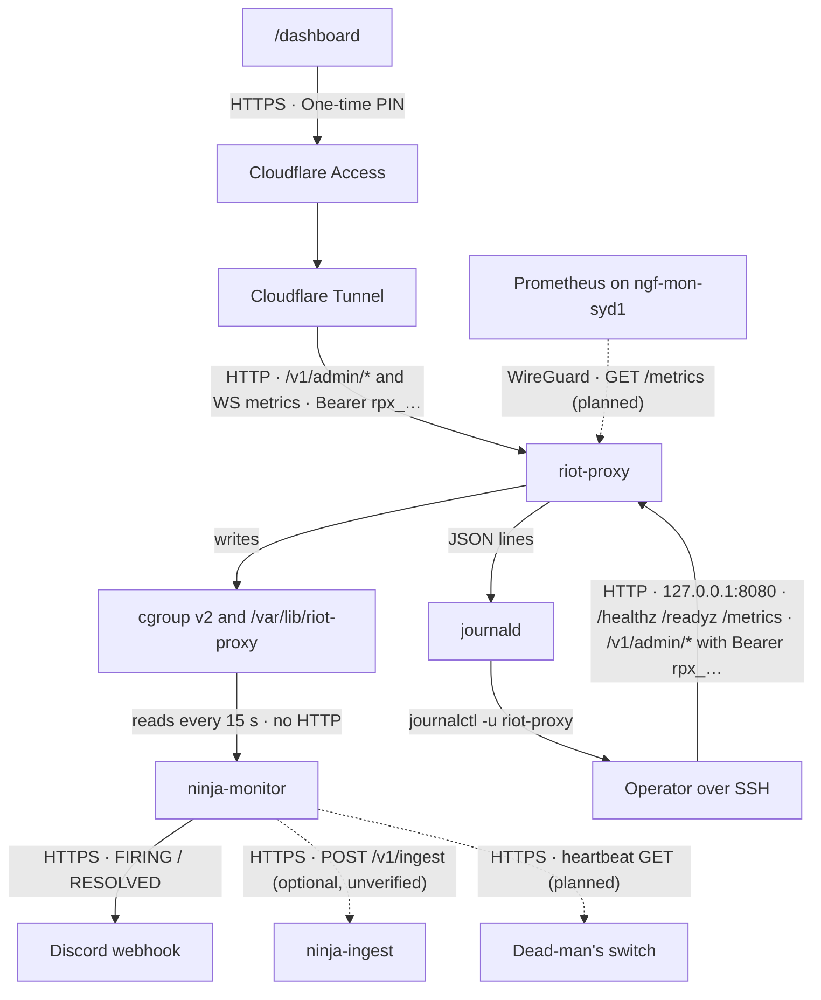

# Monitoring hooks

What ninja-monitor, a Prometheus scraper, a log shipper or a container runtime can read from riot-proxy, with exact semantics and bodies, what is wired up on `ngf-prod-syd1` today, and what is still planned. Operational procedures for each signal are in `../operations/runbook.md`; the full metric catalogue is in `../operations/observability.md`.

## Probes

| Endpoint | Auth | Body | Semantics | Evidence |
|---|---|---|---|---|
| `GET /healthz` | none | `{"ok":true}` | the process is serving; touches nothing | `src/routes/health.rs:32-45` |
| `GET /readyz` | none | `{"ok","sqlite","limiter","keyScope","sqliteReaders","sqliteReadersFree"}` | 200 when `sqlite && limiter`, else 503 with the same body | `src/routes/health.rs:51-105` |

`sqlite` is true when the writer thread executes `BEGIN IMMEDIATE; ROLLBACK;` within `READY_TIMEOUT` = 2 s (`src/routes/health.rs:19`, `:83-87`); `limiter` is true once the checkpoint restore has run, whether it succeeded or fell back to fresh state (`:88`; `src/cli/serve.rs:75-81`). `sqliteReadersFree` never affects `ok` (`:60-62`). Both routes get CORS headers only when `ADMIN_CORS_ORIGINS` lists an origin (`src/http/cors.rs:40-43`), and neither is written to the recent-requests ring (`src/http/recent.rs:25`).

**Caveat before using `/readyz` as a liveness probe.** The probe queues behind every write already handed to the single writer thread (`src/db/mod.rs:152-156`, `:213-230`). An `aggregate:analytics` run commits three write transactions in a row (`src/jobs/analytics.rs:247-385`), so during a rebuild the probe can exceed 2 s and `/readyz` answers 503 with `"sqlite":false` while the process is healthy. This is pre-existing and worth a task; until then, restart on `/healthz`, not on `/readyz`, and treat a `/readyz` 503 as a signal to look at `GET /v1/admin/jobs/queue`.

Observed from a scratch run of the 2.7.0 binary:

```text
GET /readyz → 200 {"ok":true,"sqlite":true,"limiter":true,"keyScope":"95b708b6","sqliteReaders":4,"sqliteReadersFree":4}
```

## `/metrics`

`GET /metrics`, no key, no quota, Prometheus text exposition with `Content-Type: text/plain; version=0.0.4; charset=utf-8` (`src/telemetry.rs:24`, `:101-121`). Names in the `proxy_*` set are v1's byte for byte; v2 additions are unprefixed (`src/metrics.rs:1-4`, `:47`). Reachability on production:

- loopback `http://127.0.0.1:8080/metrics` from the box: yes (`HOST=127.0.0.1`, `PORT=8080`);
- `https://api.ninjagoldfinch.lol/metrics`: blocked by the WAF rule that covers `/metrics`, `/dashboard*`, `/dev*`, `/v1/admin*` on `api.` (`PROGRESS.md:342`; `docs/design/07-deployment.md:221`);
- from `ngf-mon-syd1` over WireGuard: planned for Prometheus, not built (`docs/design/12-object-storage-and-hosting.md:846-848`; `docs/design/13-admin-dashboard.md:69`).

A scraper should sample at least every 60 s to see each disk gauge update (`METRICS_HISTORY_INTERVAL_S`, `src/stats.rs:1005-1036`) and every 15 s to see `jobs_pending` move (`src/jobs/scheduler.rs:49`).

## Admin JSON snapshots

All need a consumer key with the `admin` scope as `Authorization: Bearer rpx_…` (`src/http/auth.rs:276-288`), count against that consumer's quota (`:327-342`) and, through the tunnel, are only on `admin.ninjagoldfinch.lol` behind Cloudflare Access.

| Route | Gives | Evidence |
|---|---|---|
| `GET /v1/admin/metrics` | the live `Snapshot` (`v:1`): totals, queue counts, cache counters, limiter scopes, `process{uptimeSeconds,rssBytes}`, `sqlite{readers,readersFree}`, `disk{dbBytes,walBytes,freelistBytes,freeBytes,totalBytes}`, per-route request counts, upstream counts | `src/routes/admin.rs:2392-2399`; `src/stats.rs:295-331` |
| `GET /v1/admin/metrics/history` | `{intervalS:60, maxPoints:1440, points[]}`, 24 h of one-minute points from SQLite | `src/routes/admin.rs:2409-2427`; `src/stats.rs:43` |
| `GET /v1/admin/stats` | archive counts and bytes by location, pack stats, `dbFileBytes`, `walBytes`, `dbFreelistPages`, `diskFreeBytes` | `src/routes/admin.rs:890-924` |
| `GET /v1/admin/jobs/stats` | `kinds{kind→{pending,running,done,failed}}`, `totals` | `src/routes/admin.rs:1369-1393` |
| `GET /v1/admin/limits/{scope}` | `usage[{window,used,limit}]`, `frozenMs` for one Riot scope | `src/routes/admin.rs:1010-1027` |
| `GET /v1/admin/backups` | backup files, `keep`, `lastRun`, `diskFreeBytes` | `src/routes/admin.rs:2583-2606` |
| `GET /v1/admin/recent?kind=requests|errors` | the last 500 requests / 200 error envelopes, in memory | `src/routes/admin.rs:2546-2558`; `src/http/recent.rs:18-20` |
| `GET /v1/admin/info` | version, `gitSha`, `builtAt`, `startedAt`, `uptimeSeconds`, feature switches, redacted config | `src/routes/admin.rs:2438-2477` |

`/v1/admin/metrics` and `/v1/admin/recent` are themselves excluded from the recent ring so a poller does not fill it (`src/http/recent.rs:25`).

## The `metrics` WebSocket topic

`GET /v1/ws` with `Authorization: Bearer` or `?token=` (`src/http/auth.rs:246-260`), then `{"op":"subscribe","topics":["metrics"]}`. The topic is admin-only (`src/ws/protocol.rs:68-71`); a non-admin socket gets `{"op":"error","error":{"code":"FORBIDDEN",…}}` (`src/ws/socket.rs:165-170`). While any socket holds it the server sends `{"op":"event","event":"metrics.snapshot","topic":"metrics","at":<unix ms>,"data":<Snapshot>}` every `METRICS_INTERVAL_S` = 5 s (`src/ws/metrics.rs:14-35`; `src/config.rs:721`; `src/events.rs:159-172`). Heartbeat pings every 30 s, closed after two unanswered (`src/ws/protocol.rs:23-25`); close codes `1001` on shutdown and `4401` on key revocation (`src/ws/socket.rs:36-41`). A lagging consumer gets `{"op":"resync","topic":"metrics","dropped":n}` rather than being dropped (`src/ws/socket.rs:110-116`).

## The `healthcheck` subcommand

`riot-proxy healthcheck [--timeout N]` GETs `http://<host>:<PORT>/healthz` with `HOST` `0.0.0.0` rewritten to `127.0.0.1` and `::` to `[::1]`, exits 0 on 2xx and 1 otherwise with `<url> answered <status>` or the connection error (`src/cli/healthcheck.rs:11`, `:26-34`; `src/cli/mod.rs:44-49`). It needs no CA store, so it works in the `FROM scratch` image where `Dockerfile:24` runs it as the `HEALTHCHECK`. It loads the full configuration first (`src/cli/mod.rs:82-88`), so `RIOT_API_KEY` must be in the container's environment, not only in a mounted file.

## Log format for shippers

One JSON object per line on stdout (`LOG_FORMAT=json`, the default when stdout is not a TTY, `src/config.rs:649-656`): `timestamp` (RFC 3339, microseconds, `Z`), `level` (`TRACE`…`ERROR`), `message`, `target` (Rust module path), the event's own fields flattened, and `span` holding the innermost span's fields (`request_id`, `method`, `path`, `consumer`, `name`) (`src/telemetry.rs:53-66`; `src/app.rs:107-116`). Per-request lines are `finished processing request` with `latency` (a string such as `"12 ms"`) and `status` (integer). Error lines are `request failed` with `code`, `status`, `message`. No keys appear in any line (`src/riot/client.rs:26`; `src/config.rs:383-387`). On production the shipper's source is journald (`journalctl -u riot-proxy -o cat`); `_SYSTEMD_UNIT=riot-proxy.service` is the field to filter on.

## Alert conditions

**Prometheus rules** (`ops/prometheus-alerts.yml`, to load when Prometheus exists):

| Alert | Expression | For | Severity |
|---|---|---|---|
| `RiotKeyRejected` | `increase(proxy_upstream_requests_total{status=~"401\|403"}[10m]) > 0` | 0 m | critical (`:6-14`) |
| `AccountableRateLimit429` | `increase(proxy_rl_429_total{type=~"application\|method"}[10m]) > 0` | 0 m | warning (`:16-24`) |
| `CacheHitRatioLow` | `sum(rate(proxy_cache_reads_total{state=~"hit\|neg\|stale"}[5m])) / sum(rate(proxy_cache_reads_total[5m])) < 0.7` | 15 m | warning (`:26-41`) |
| `UpstreamErrorRateHigh` | `sum(rate(proxy_upstream_requests_total{status=~"5..\|network"}[5m])) / sum(rate(proxy_upstream_requests_total[5m])) > 0.1` | 10 m | warning (`:43-50`) |
| `ProxyDown` | `up{job="riot-proxy"} == 0` | 2 m | critical (`:52-57`) |

The Grafana board `ops/grafana/riot-proxy-dashboard.json` (uid `riot-proxy`) has 12 panels over `proxy_cache_reads_total`, `proxy_rl_429_total`, `proxy_ws_connections`, `proxy_upstream_requests_total`, `proxy_requests_total`, `proxy_upstream_latency_seconds`, `proxy_rl_wait_seconds`, `proxy_jobs_total` and `proxy_archived_matches_total`; none of the v2 additions.

**ninja-monitor rules.** design/12 records the production thresholds as: `riot-proxy` memory 2 GiB (the site 1 GiB, `cloudflared` 512 MiB), "down" after 30 s repeating every 30 min, host memory below 15 %, disk above 70 % and 85 %, host CPU above 90 % for 20 min (`docs/design/12-object-storage-and-hosting.md:832-838`). ninja-monitor's shipped example differs: `mem_anon_bytes > 2 000 000 000` for 5 m, host `mem_available_percent < 10` for 5 m, `disk_used_percent > 85` on `/` for 10 m repeating 6 h, `down` for 1 m, `oom_kill` at once (`ninja-monitor:deploy/config.example.toml:64-99`). Alerts go to a Discord webhook per box and nowhere else (`docs/_meta/scratch/siblings.md` §2.1).

> **TODO (unverified):** the live `/etc/ninja-monitor/config.toml` on `ngf-prod-syd1` and `ngf-mon-syd1`; neither was read, and the two written sources above disagree.

## What ninja-monitor does today

ninja-monitor knows riot-proxy as a systemd unit and a directory: `[[service]] name = "riot-proxy"`, `unit = "riot-proxy.service"`, `paths = ["/var/lib/riot-proxy"]` (`ninja-monitor:deploy/config.example.toml:29-32`). Every 15 s it reads the unit's cgroup v2 files for state, `cpu_percent`, `mem_anon_bytes`, `mem_current_bytes`, `oom_kills`, `pids` and `restarts_seen`, walks the data directory every 10 min for `disk_bytes`, and keeps 24 h in memory (`docs/_meta/scratch/siblings.md` §2.1). It makes **no HTTP request to riot-proxy**: a grep of the ninja-monitor repository for `readyz`, `/metrics` and `prometheus` finds nothing (`docs/_meta/scratch/siblings.md` §2.2). Reading `/var/lib/riot-proxy` needs `SupplementaryGroups=riot-proxy` or an ACL (`ninja-monitor:deploy/ninja-monitor.service:11-14`).

> **TODO (unverified):** whether the production unit carries that drop-in or ACL, and whether the optional push to `ninja-ingest` is deployed anywhere (`docs/_meta/scratch/siblings.md` §2.4).

## Monitoring paths

Caption: every path by which a monitor can learn about riot-proxy on `ngf-prod-syd1`; dashed edges are planned, not built.



Today only the solid paths exist: ninja-monitor watches the process and its disk and alerts to Discord; everything about requests, caches, Riot and jobs is read by a person over SSH or through the dashboard behind Access. The three dashed paths are the open items: a Prometheus scrape of `/metrics` over WireGuard from `ngf-mon-syd1` (`docs/design/12-object-storage-and-hosting.md:846`), a dead-man's switch across the boxes (`:847`, ninja-monitor's `NINJA_MONITOR_HEARTBEAT_URL` is the hook, `ninja-monitor:deploy/env.example:8-15`), and the optional `ninja-ingest` push.

---
**Sources:** `src/routes/health.rs:19,32-105`, `src/cli/serve.rs:75-81`, `src/cli/healthcheck.rs:11,26-34`, `src/cli/mod.rs:44-49,82-88`, `src/db/mod.rs:152-156,213-230`, `src/jobs/analytics.rs:247-385`, `src/jobs/scheduler.rs:49`, `src/telemetry.rs:24,53-66,101-121`, `src/metrics.rs:1-4,47`, `src/stats.rs:43,295-331,1005-1036`, `src/http/auth.rs:246-260,276-288,327-342`, `src/http/cors.rs:40-43`, `src/http/recent.rs:18-25`, `src/app.rs:107-116`, `src/config.rs:383-387,649-656,721`, `src/riot/client.rs:26`, `src/ws/protocol.rs:23-25,68-71`, `src/ws/socket.rs:36-41,110-116,165-170`, `src/ws/metrics.rs:14-35`, `src/events.rs:159-172`, `src/routes/admin.rs:890-924,1010-1027,1369-1393,2392-2427,2438-2477,2546-2558,2583-2606`, `Dockerfile:24`, `ops/prometheus-alerts.yml:6-57`, `ops/grafana/riot-proxy-dashboard.json`, `docs/design/07-deployment.md:221`, `docs/design/12-object-storage-and-hosting.md:832-848`, `docs/design/13-admin-dashboard.md:69`, `PROGRESS.md:342`, `docs/_meta/scratch/siblings.md` §2, `ninja-monitor:deploy/config.example.toml:29-32,64-99`, `ninja-monitor:deploy/ninja-monitor.service:11-14`, `ninja-monitor:deploy/env.example:8-15`
**Last verified:** 2026-10-19 against commit `52fa67d`
