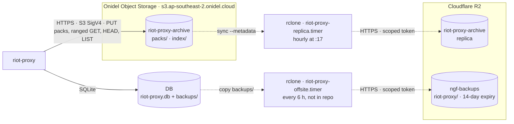
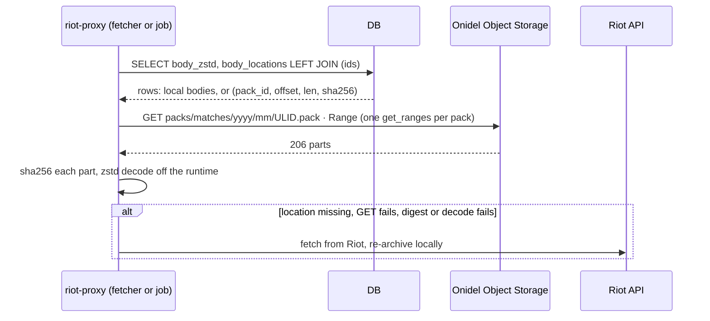
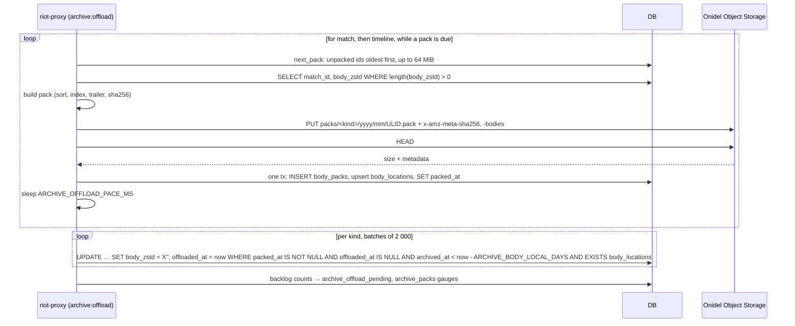

# Object storage: Onidel, Cloudflare R2 and the backups bucket

Every bucket and prefix riot-proxy reads or writes, the pack format it stores there, who holds which credential, what each store costs to touch, and what happens when one is away. The SQLite side of the same data (`body_packs`, `body_locations`, the body state columns) is in [../data/schema.md](../data/schema.md#body_packs).

## Systems of record

- **Onidel Object Storage, bucket `riot-proxy-archive`, is the system of record for raw match and timeline bodies.** Once the offload job has verified a pack and the local window has passed, SQLite holds the empty blob `X''` for that body and the only copies are the pack and its replica (`src/db/migrations/V0023__body_packs.sql:2-5`, `src/archive/offload.rs:147-170`).
- **Cloudflare R2, bucket `riot-proxy-archive`, is a mirror** made by an hourly `rclone sync` from the box. The proxy never reads it (`deploy/README.md:14-18`).
- **SQLite (`riot-proxy.db`), with its daily `VACUUM INTO` backups copied to R2 `ngf-backups`, is the system of record for everything else:** facts, analytics, jobs, players, consumers, the limiter checkpoint and the pack map itself. Raw bodies are not in those backups (`docs/design/12-object-storage-and-hosting.md:424-427`).

The proxy talks to exactly one provider, whichever `ARCHIVE_OBJECT_URL` and `ARCHIVE_OBJECT_ENDPOINT` name; there is no R2-specific code path, only a comment about equal multipart parts (`src/archive/objects.rs:5-6,33-37`). Nobody else reads the bucket: not the browser, not ninjagoldfinch.lol, only the proxy and `rclone`.

## Topology

Where each copy lives and which process moves it.



Only the solid edge is the proxy's own traffic. The two dotted chains are systemd timers on `ngf-prod-syd1`: the replica unit ships in `deploy/` (`deploy/riot-proxy-replica.timer`, `OnCalendar=*-*-* *:17:00`), the backups unit is hand-made on the box (`docs/design/12-object-storage-and-hosting.md:809-823`).

## Buckets, prefixes and keys

| Store | Bucket, prefix | Holds | Key template | Written by | Lifecycle |
|---|---|---|---|---|---|
| Onidel | `riot-proxy-archive`, `packs/` | match and timeline bodies in packs | `packs/matches/<yyyy>/<mm>/<ULID>.pack`, `packs/timelines/<yyyy>/<mm>/<ULID>.pack`; year and month are UTC from the ULID's timestamp (`src/archive/pack.rs:124-134`) | `archive:offload` | none: packs are kept forever (`deploy/README.md:36`) |
| Onidel | `riot-proxy-archive`, `index/` | daily snapshots of the pack map | `index/packs-<yyyy-mm-dd>.jsonl.zst`, `index/locations-<yyyy-mm-dd>.jsonl.zst` (`src/archive/recovery.rs:179-185`) | `archive:index-snapshot`, `riot-proxy packs snapshot` | expire after 14 days (`deploy/README.md:33`) |
| R2 | `riot-proxy-archive` | byte-for-byte replica of both prefixes, metadata included | same keys | `rclone sync` hourly | `index/` expires after 21 days; incomplete multipart uploads aborted after 1 day; `packs/` never (`deploy/README.md:34-36`) |
| R2 | `ngf-backups`, `riot-proxy/` | SQLite backups `riot-proxy-<yyyy-mm-dd>.db` | `riot-proxy/<file>` (`deploy/README.md:151-152`) | `rclone copy` of `$DATA_DIR/backups/` every 6 h | objects deleted after 14 days; multipart abort 1 day (`docs/design/12-object-storage-and-hosting.md:815-818`) |

Example: `packs/matches/2026/10/01K7Q2M3N4P5R6S7T8Z9V0W1X2.pack`. `parse_key` accepts only keys that round-trip through the template, so a stray object under `packs/` is ignored by a reindex (`pack.rs:356-367`).

### Content type and metadata

Every object the proxy writes is `Content-Type: application/octet-stream` plus user metadata, which `object_store` sends as `x-amz-meta-<name>` (`objects.rs:42,278-291`):

| Object | Metadata | Source |
|---|---|---|
| a pack | `x-amz-meta-sha256` (hex of the whole object), `x-amz-meta-bodies` (count) | `pack.rs:115-121` |
| a snapshot | `x-amz-meta-last-pack` (newest pack id covered, empty with no packs), `x-amz-meta-rows` (lines in that object) | `recovery.rs:207-264` |

A `file://` store keeps no metadata, so `put` drops it and `head` returns none there (`objects.rs:8-9,278-282`). `rclone sync --metadata` carries the metadata to R2 so a reindex against the replica can read `sha256` instead of hashing every pack (`deploy/README.md:103`).

## Pack format

A pack is the bodies of one kind, back to back in match-id order, then a zstd-compressed JSON Lines index, then a fixed 16-byte trailer (`src/archive/pack.rs:1-11,140-193`).

```text
[body 0][body 1] … [body n-1][index · zstd level 3][index length · u64 LE][magic "RPXPACK1"]
```

- Each body is the `body_zstd` frame SQLite holds, byte for byte: packing is a copy, not a re-encode (`pack.rs:8`).
- Index lines are `{"kind":"match","matchId":"OC1_700000001","offset":0,"len":10724,"sha256":"<hex>"}`, one per body (`pack.rs:89-97,166-177`). The index alone rebuilds every `body_locations` row.
- `TRAILER_LEN` is 16: the index length as little-endian u64, then `MAGIC = b"RPXPACK1"` (`pack.rs:20-23,183-184`). A reader fetches the trailer, computes the index range, fetches the index, and validates kind, bounds, match-id order and non-overlap (`pack.rs:195-262`).
- `build` refuses an empty input, a duplicate id and an empty body, so an offloaded row's `X''` can never be packed as a body (`pack.rs:140-158`).
- Target size `ARCHIVE_PACK_TARGET_BYTES`, default 64 MiB; a single larger body is a pack of its own (`src/config.rs:750`, `src/archive/offload.rs:175-223`). The pack id is `Ulid::from_parts(now_ms, random)` (`offload.rs:64,300-306`).
- Uploads above 8 MiB go as multipart with 8 MiB parts, 4 in flight, aborted on failure; R2 requires equal parts and S3 at least 5 MiB (`objects.rs:33-41,173-205`).

## Reads: an offloaded body

The sequence when a request or job asks for a body whose local copy was freed (`src/archive/matches.rs:191-328`).



The empty blob alone marks a row as offloaded; `offloaded_at` is not consulted (`matches.rs:212-222`). Offloaded ids are grouped by pack and each pack is fetched with one `get_ranges` call, `object_store` merging close ranges, with `ARCHIVE_OBJECT_CONCURRENCY` (default 16) packs in flight (`matches.rs:265-269`, `config.rs:748`). A range that comes back short is an error, never a short body (`objects.rs:232-249,294-308`). Any failure logs one warning and drops that body, so the archive returns `None` and the fetcher goes to Riot; a body re-fetched from Riot is archived locally again with `offloaded_at = NULL` and its location kept (`matches.rs:232-328,390-399`, `src/archive/mod.rs:128-144`). A body read from the bucket is not written back to SQLite.

## Writes: one offload turn

What `archive:offload` does per run (`src/jobs/offload.rs:146-195`, `src/archive/offload.rs`).



Verification compares the HEAD size and the `sha256` metadata the uploader set; a store without metadata is read back whole and hashed (`offload.rs:89-118`). Nothing is recorded until that passes, so a crash between the PUT and the transaction leaves an orphan object no row names; the bodies stay unpacked and the next turn packs them again (`offload.rs:6-9`). The free step makes no store call and cannot fail halfway. The job is queued when a kind's unpacked bytes reach a full pack, at boot, and after each daily `maintenance` (`src/jobs/offload.rs:51-111`, `src/cli/serve.rs:334-340`, `src/jobs/maintenance.rs:204-211`). A store or database error returns `JobError::Retry`, so the scheduler backs off and retries, giving up after the fifth attempt (`src/jobs/offload.rs:147`, `src/jobs/scheduler.rs:13,39`).

## Index snapshots

`archive:index-snapshot` runs after each `maintenance`: one read transaction streams `body_packs` then `body_locations` as JSON Lines (`PackRow`, `LocationRow`, camelCase, sha256 hex), zstd level 3 with a frame checksum, and PUTs `locations-<date>` first, then `packs-<date>`; a second run on the same day overwrites (`src/archive/recovery.rs:63-88,194-271`, `src/jobs/index_snapshot.rs:16-47`). With the packs' own indexes that makes three copies of the map: SQLite, `index/`, and each pack's trailer.

## Credentials and their scope

| Credential | Where it lives | Scope | Used by |
|---|---|---|---|
| Onidel access key and secret | `/etc/riot-proxy/env` as `ARCHIVE_OBJECT_ACCESS_KEY` / `ARCHIVE_OBJECT_SECRET_KEY` (0600); also in `/etc/riot-proxy/rclone.conf` `[onidel]` | the `riot-proxy-archive` bucket | the proxy; `rclone` as the sync source (`deploy/README.md:24-25,51-62`) |
| R2 API token for the replica | `/etc/riot-proxy/rclone.conf` `[r2]`, root-only, handed to the unit as a systemd credential | Object Read & Write on `riot-proxy-archive` only, so it cannot touch `ngf-backups` (`deploy/README.md:26-28`) | `riot-proxy-replica.service` (`DynamicUser=yes`, `LoadCredential=`) |
| R2 token for backups | `/etc/rclone/r2.conf` on the box, not in this repo | the `ngf-backups` bucket only (`docs/design/12-object-storage-and-hosting.md:815-818`) | the offsite backup timer; the restore drill reads with it (`deploy/README.md:151-152`) |
| Restore-drill token | typed into a scratch `env`, never echoed | read-only on R2 `riot-proxy-archive` (Object Read), so the drill's own `archive:offload` cannot write into the replica (`deploy/README.md:156-160`) | a throwaway `riot-proxy serve` on port 8081 |

`Config` redacts both keys in logs and `/v1/admin/config`; boot logs only `s3://<bucket> at <endpoint>` (`objects.rs:84-85,168-171`, `docs/_meta/scratch/config.md`). The client trusts only the bundled webpki roots, never the host store (`objects.rs:328-338`).

## Configuration

| Variable | Default | Meaning |
|---|---|---|
| `ARCHIVE_OBJECT_URL` | unset | `s3://riot-proxy-archive` or `file:///abs/dir`; unset keeps every body in SQLite and registers neither `archive:offload` nor `archive:index-snapshot` (`src/cli/serve.rs:256-278`) |
| `ARCHIVE_OBJECT_ENDPOINT` | unset, required with `s3://` | `https://s3.ap-southeast-2.onidel.cloud`; a host starting with `<bucket>.` is addressed virtual-hosted, anything else path style; `http://` only outside production (`objects.rs:319-326`, `config.rs:930-942`) |
| `ARCHIVE_OBJECT_REGION` | `auto` | signing region; `ap-southeast-2` for Onidel, `auto` for R2 (`config.rs:745`) |
| `ARCHIVE_OBJECT_ACCESS_KEY`, `ARCHIVE_OBJECT_SECRET_KEY` | unset | both or neither; required with `s3://` when `ENV=production` (`config.rs:995-1011`) |
| `ARCHIVE_OBJECT_CONCURRENCY` | 16 (1–256) | packs read at once by a batch read |
| `ARCHIVE_BODY_LOCAL_DAYS` | 14 (0–365) | how long SQLite keeps a body already in a verified pack; 0 frees every packed body on the next run |
| `ARCHIVE_PACK_TARGET_BYTES` | 67 108 864 (1 MiB–1 GiB) | a pack closes at this size |
| `ARCHIVE_OFFLOAD_PACE_MS` | 50 (0–60 000) | pause between packs and between free batches |

In production `file://` is refused and `s3://` without both keys is refused (`config.rs:1006-1015`). The `file://` form is for development and tests: a directory that holds `packs/` and `index/` exactly as a bucket would, via `object_store::LocalFileSystem`, with no metadata (`objects.rs:102-113`).

> **TODO (unverified):** the effective request timeout, connect timeout and retry count against the bucket are `object_store`'s defaults for the version pinned in `Cargo.lock`; `src/archive/objects.rs:328-338` configures only the root certificates.

## Cost-relevant access patterns

- **Why packs.** Onidel caps a bucket at 3 million objects by default; one object per body would pass that within months, and R2 bills writes per object (about US$4.50 per million). Packing keeps the bucket at hundreds of objects, so an hourly full `sync` lists one page and copies a handful of new packs (`docs/design/12-object-storage-and-hosting.md:83-98,359-372`).
- **Writes:** one PUT (multipart above 8 MiB) per 64 MiB pack, matches fill one in under a day and timelines in a few hours at the crawl's pace; two small PUTs a day for the snapshots.
- **Reads:** nothing on the request path for bodies inside the 14-day window, which covers the player page's recent matches. Outside it, ranged GETs, one per pack touched, merged by `object_store`; bulk jobs walk the archive in match-id order so a batch lands in a few packs (`docs/design/12-object-storage-and-hosting.md:257-267`). Egress is free on both stores.
- **Replica:** `rclone sync` hourly, listing both buckets and copying new packs; R2 reads and egress are free, storage about US$0.015/GB-month (`docs/design/12-object-storage-and-hosting.md:368-369`).
- **Backups:** one `VACUUM INTO` copy a day, copied to R2 every 6 h; after the offload a backup is a few GB instead of 22 (`docs/design/12-object-storage-and-hosting.md:424-427`).

## When a store is unavailable

| Store away | Effect |
|---|---|
| Onidel, reads | an offloaded body cannot be fetched: one warning per pack, the archive answers `None`, the fetcher fetches from Riot and re-archives the body locally; local and packed-but-not-freed bodies are unaffected |
| Onidel, writes | `archive:offload` fails its PUT or HEAD, records nothing, returns `Retry`; local bodies stay in SQLite and are packed on a later run; `archive:index-snapshot` likewise retries. Nothing is lost, SQLite simply stops shrinking |
| Onidel gone for good | point `ARCHIVE_OBJECT_ENDPOINT` at `https://<account id>.r2.cloudflarestorage.com`, set `ARCHIVE_OBJECT_REGION=auto` and keys for R2, restart; nothing else changes (`deploy/README.md:140-142`) |
| R2 away | the proxy does not notice; the hourly sync fails and `Persistent=true` catches up the missed run; the replica lags by the outage |
| Bucket present, `ARCHIVE_OBJECT_URL` unset | offloaded rows read `None` and are re-fetched from Riot on demand; re-setting the URL restores reads (`docs/design/12-object-storage-and-hosting.md:943`) |

## Recovery

The map of where every body is has three copies. Which to use (`deploy/README.md:107-142`):

1. **Database lost, backup fine:** restore the backup, then `riot-proxy packs reindex --since <newest pack_id in the backup>` reads only the packs written after it.
2. **Backup lost or its map damaged:** `riot-proxy packs restore-index` loads the newest snapshot date that has both objects and validates (unique ULIDs, 32-byte digests, every location in a listed pack of its kind, `live_bytes` equal to the sum of its locations), replaces both tables in one transaction, sets `packed_at` on located rows, then reindexes from the snapshot's newest pack id; an unreadable snapshot is passed over for the day before, and with none every pack is reindexed (`src/archive/recovery.rs:592-622`). Run it with the service stopped.
3. **Nothing but the bucket:** `riot-proxy packs reindex` lists `packs/`, reads each pack's HEAD, trailer and index (two ranged GETs) and records it in its own transaction; a pack that cannot be read is listed and the command exits non-zero after recording the rest (`recovery.rs:468-493`, `src/cli/packs.rs`).

The quarterly restore drill against R2 (`deploy/README.md:144-220`) exercises an offloaded read from the replica and a `restore-index` on a scratch copy of the newest backup.

> **TODO (unverified):** OBJ-06 (orphan-pack sweep and compaction of packs under half live, `ARCHIVE_COMPACT_BELOW`) is described in `docs/design/12-object-storage-and-hosting.md:328-333,448` but no implementation was found in `src/archive/` or `src/jobs/`; `Objects::delete` has no caller. Until it exists, an orphan pack from a crash mid-offload stays in the bucket.

---
**Sources:** `src/archive/objects.rs:L1-L139`, `src/archive/objects.rs:L173-L338`, `src/archive/pack.rs:L1-L134`, `src/archive/pack.rs:L140-L262`, `src/archive/pack.rs:L356-L367`, `src/archive/offload.rs:L1-L223`, `src/archive/offload.rs:L300-L306`, `src/archive/matches.rs:L191-L328`, `src/archive/matches.rs:L390-L399`, `src/archive/mod.rs:L128-L144`, `src/archive/recovery.rs:L1-L88`, `src/archive/recovery.rs:L179-L271`, `src/archive/recovery.rs:L468-L493`, `src/archive/recovery.rs:L592-L622`, `src/jobs/offload.rs:L41-L111`, `src/jobs/offload.rs:L146-L217`, `src/jobs/index_snapshot.rs:L16-L47`, `src/jobs/maintenance.rs:L204-L211`, `src/jobs/scheduler.rs:L13`, `src/jobs/scheduler.rs:L39`, `src/cli/serve.rs:L98-L105`, `src/cli/serve.rs:L256-L278`, `src/cli/serve.rs:L334-L340`, `src/config.rs:L745-L751`, `src/config.rs:L900-L942`, `src/config.rs:L995-L1015`, `src/db/migrations/V0023__body_packs.sql:L1-L48`, `deploy/README.md:L12-L142`, `deploy/README.md:L144-L220`, `deploy/riot-proxy-replica.service`, `deploy/riot-proxy-replica.timer`, `docs/design/12-object-storage-and-hosting.md:L58-L157`, `docs/design/12-object-storage-and-hosting.md:L223-L435`, `docs/design/12-object-storage-and-hosting.md:L809-L823`, `docs/design/12-object-storage-and-hosting.md:L938-L976`, `docs/_meta/scratch/persistence.md`, `docs/_meta/scratch/config.md`
**Last verified:** 2026-10-22 against commit `6eda84e`
