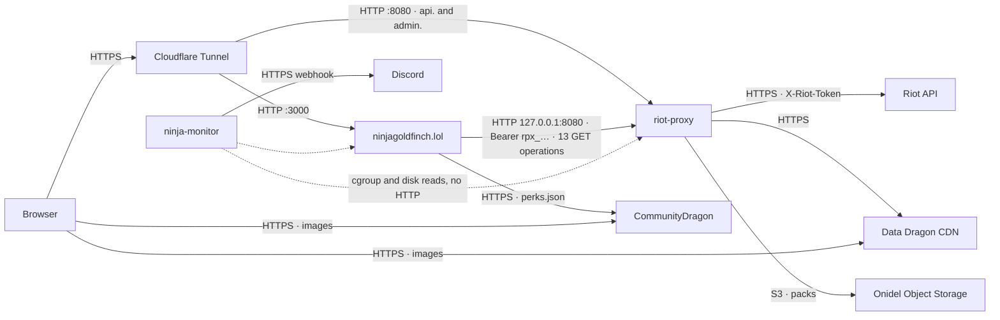
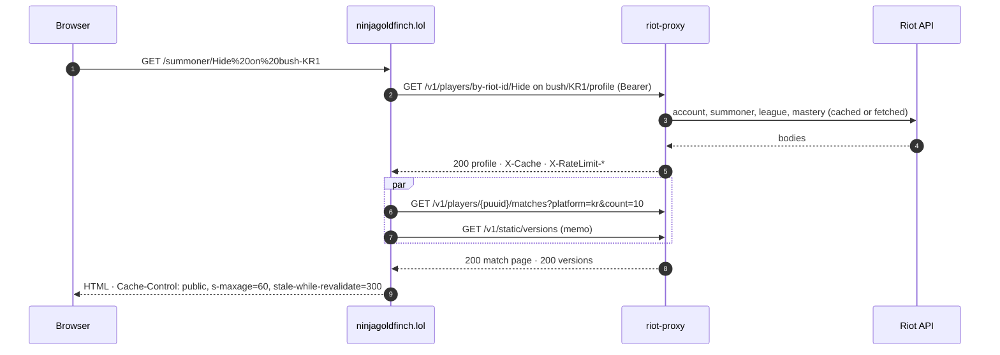

# Service communication

Every interaction between riot-proxy and the other services on the platform: who calls whom, over what, with which credential, how often, and what happens when it fails.

## Interaction map

Only two of the three services talk to each other over the network, and only in one direction.

The site never calls Riot and the browser never calls riot-proxy; ninja-monitor watches processes, not endpoints (`ninjagoldfinch-lol/CLAUDE.md:13-20`, `ninja-monitor` grep for `readyz|metrics|prometheus`: none).

## ninjagoldfinch.lol to riot-proxy

Direction: site server to proxy, over loopback in production (`PROXY_URL=http://127.0.0.1:8080`), with `Authorization: Bearer <PROXY_KEY>` on every call (`ninjagoldfinch-lol/src/lib/server/proxy.ts:28-32`). The client is generated from the proxy's OpenAPI document with `openapi-fetch`; the site pins the document it was generated from (2.6.0 on the site's `origin/main`). All calls are server-side GETs made by page loads; there is no polling, no WebSocket and no retry on the site's side.

| # | Call | When | Essential? | On failure |
|---|---|---|---|---|
| 1 | `GET /v1/players/by-riot-id/{gameName}/{tagLine}/profile` (`?refresh=true` on the Refresh form action) | every profile view | yes | 404 / 429 / 503 page |
| 2 | `GET /v1/players/{puuid}/matches?platform=…&count=10[&start][&queue][&champion][&refresh=true]` | every profile view | no | page without matches, sent `no-store` |
| 3 | `GET /v1/static/versions` | every data page (memoised 5 min on `origin/main`) | yes | 503 |
| 4 | `GET /v1/static/{champion,item,summoner,runesReforged}?version=<patch>` | once per patch per process | varies | names fall back to ids; champion page 503 |
| 5 | `GET /v1/static/queues` | with 4 | as 4 | as 4 |
| 6 | `GET /v1/lol/matches/{region}/{matchId}` | every match view | yes | 404 / 429 / 503 |
| 7 | `GET /v1/lol/matches/{region}/{matchId}/timeline` | every match view | no | page without build data |
| 8 | `GET /v1/lol/analytics/champions?queue=RANKED_SOLO_5x5&minGames=0&limit=500[&patch][&role]` | every `/champions` view | yes | error page |
| 9 | `GET /v1/lol/analytics/patches?queue=RANKED_SOLO_5x5` | every `/champions` view | no | default picker |
| 10 | `GET /v1/lol/analytics/champions/{championId}?…&limit=10` | every champion page | yes | error page |
| 11 | `GET /v1/lol/analytics/champions/{championId}/builds?…` | every champion page | no | detail's lists instead |
| 12 | `GET /v1/lol/analytics/champions/{championId}/matchups?…&limit=200` | every champion page | no | section hidden |
| 13 | `GET /v1/lol/analytics/patches?queue=RANKED_SOLO_5x5&championId=…` | every champion page | no | empty list |

Sources: `ninjagoldfinch-lol/src/lib/server/{profile,patch,static-data,match,champions,champion-page}.ts`, cited line by line in `docs/_meta/scratch/siblings.md` §1.5.

Timeouts and errors on the site's side (`origin/main`): 5 s for analytics and static calls, 30 s otherwise, then a 503; proxy responses are collapsed to three visitor states: 404 for `NOT_FOUND` and `VALIDATION`, 429 with `retryAfter` for `QUOTA_EXCEEDED` and `RATE_LIMITED`, 503 for everything else (`src/lib/server/errors.ts:16-33`, `proxy.ts:55-87`). The site reads `X-Request-Id` on failure and `Retry-After` on 429, logs `X-Cache` for slow analytics calls, and ignores `X-RateLimit-*`, `X-Cache-Age` and `ETag`.

The following sequence shows the profile page, the most common interaction.

Two sequential round trips are the minimum because the match page needs the profile's `platform` (`profile.ts:55-57`).

## riot-proxy to Riot and Data Dragon

| Target | Protocol and auth | Frequency | Failure and retries |
|---|---|---|---|
| `https://<platform or region>.api.riotgames.com` | HTTPS, `X-Riot-Token`, `User-Agent: riot-proxy/2.0 (+…)`, connect 10 s, total 25 s | every cache miss, archive miss and job fetch, paced by the limiter | the fetcher retries 5xx twice, backs off untyped 429s three times, honours typed 429 freezes, never retries 401/403/404; see [../architecture/request-lifecycle.md](../architecture/request-lifecycle.md) |
| `https://ddragon.leagueoflegends.com` (`/api/versions.json`, `/cdn/<v>/data/<locale>/*.json`, images) | HTTPS, no auth, connect 15 s, total 60 s | `ddragon:sync` every `DDRAGON_SYNC_S` (3600 s) and at boot; images on first request | a failed sync keeps what is on disk and retries as a job; a failed image is a 502 and nothing is kept |
| `https://static.developer.riotgames.com/docs/lol/queues.json` | HTTPS, no auth | every sync | keeps the previous file |

Sources: `src/riot/client.rs:27-31,241-252`, `src/jobs/ddragon.rs:22-32,260-261`, `src/static/images.rs`.

## riot-proxy to object storage

Direction: proxy to the Onidel bucket only, with the S3 access key pair from the environment file; the R2 replica and the backups bucket are written by rclone timers on the box, never by the proxy. PUTs happen when a 64 MiB pack closes (a few times a day at the crawl's pace) and once a day for the index snapshot; GETs are ranged reads of bodies outside the 14-day window. A store failure makes the offload job retry with backoff and makes a body read fall back to Riot. Details in [object-storage.md](./object-storage.md).

## ninja-monitor and riot-proxy

ninja-monitor samples `riot-proxy.service` through cgroup v2 every 15 s (CPU, anonymous and file memory, pids, OOM kills, restarts) and walks `/var/lib/riot-proxy` every 10 minutes for disk use; it needs group membership or an ACL on the data directory to do so (`ninja-monitor/README.md:50-81,471-496`, `deploy/config.example.toml:29-32`). It makes no HTTP request to the proxy. Alerts go to a Discord webhook per host. What it could scrape instead is in [monitoring-hooks.md](./monitoring-hooks.md).

## The operator and riot-proxy

The dashboard at `https://admin.ninjagoldfinch.lol/dashboard` (Cloudflare Access, then the `admin-main` key typed into the page) calls `/v1/admin/*` and holds the `metrics` and `firehose` WebSocket topics; CLI commands run on the box as the service user with its environment file (`deploy/README.md` §Index snapshots and recovery). GitHub Actions publishes releases but never contacts the box.

## What does not exist

- No call from riot-proxy to the site, no webhook, no shared database, no shared cache.
- No browser call to riot-proxy; the showcase and dev explorer pages are served by the proxy itself and are off in production.
- No HTTP from ninja-monitor to either service.

> **TODO (unverified):** the production value of the site's `PROXY_URL` and the name of its consumer key were not read (`/etc/ninjagoldfinch-lol/env` is not in any repo); loopback and a `read`-scoped key are inferred from the site's README and `docs/design/12-object-storage-and-hosting.md` §As executed.

---
**Sources:** `docs/_meta/scratch/siblings.md` §1.3-§1.5, §2.2, §4, `ninjagoldfinch-lol/src/lib/server/proxy.ts:L28-L87`, `ninjagoldfinch-lol/src/lib/server/errors.ts:L16-L33`, `src/riot/client.rs:L27-L31,L241-L252`, `src/jobs/ddragon.rs:L22-L32,L260-L261`, `deploy/README.md`, `ninja-monitor/README.md:L50-L81`
**Last verified:** 2026-10-19 against commit `52fa67d`
