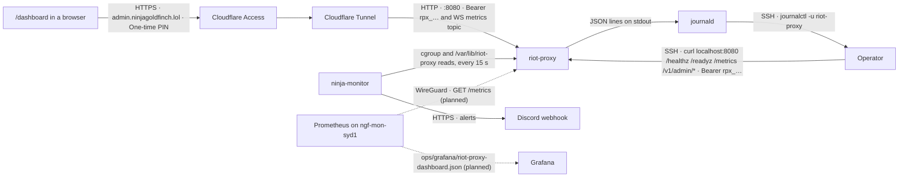

# Observability

What riot-proxy emits (logs, metrics, request ids, health bodies, in-memory rings, the `metrics` WebSocket topic), the exact shapes, and how each is consumed on `ngf-prod-syd1` today. Sample output below comes from a scratch run of the 2.7.0 debug binary with a fake key; production differs only in values.

## Logging

`serve` is the only command that installs a `tracing` subscriber (`src/cli/serve.rs:96`; `src/telemetry.rs:41-51`). Output is stdout; under the systemd unit (`docs/design/07-deployment.md:74-97`) that is journald, read with `sudo journalctl -u riot-proxy -o cat`.

- `LOG_FORMAT`: `json` or `pretty`; default `pretty` when stdout is a TTY, else `json` (`src/config.rs:766-773`).
- `LOG_LEVEL`: a `tracing_subscriber::EnvFilter` directive, default `info` (`src/config.rs:829`; `src/telemetry.rs:42`). Examples: `info`, `riot_proxy=debug,info`, `riot_proxy::jobs::ladder=debug,riot_proxy=info,tower_http=warn`. An invalid filter fails `serve` with `invalid LOG_LEVEL filter: …` (`src/telemetry.rs:31`).

The JSON layer flattens event fields to the top level and puts the innermost span's fields under `span`, with no span list (`src/telemetry.rs:53-66`). Every line has `timestamp`, `level`, `message`, `target`, the event's own fields, and `span` when inside one. Two lines from the scratch run (ids and paths real to that run):

```json
{"timestamp":"2026-10-18T23:22:29.181281Z","level":"INFO","message":"finished processing request","latency":"0 ms","status":200,"target":"tower_http::trace::on_response","span":{"consumer":"dev-local","method":"GET","path":"/v1/admin/info","request_id":"01M58N5RXWVJQ93WMEK4G4QVKV","name":"http"}}
{"timestamp":"2026-10-18T23:22:29.326814Z","level":"WARN","message":"request failed","code":"BadRegion","status":400,"message":"params/platform must be equal to one of the allowed values","target":"riot_proxy::http::error","span":{"consumer":"dev-local","method":"GET","path":"/v1/lol/summoners/by-puuid/EUW1/AbC…","request_id":"01M58N5S2EJ1TCH49N26KVGW69","name":"http"}}
```

- The per-request line is tower-http's `finished processing request` at INFO with `latency` and `status` (`src/app.rs:109-118`); the `http` span carries `request_id`, `method`, `path` and `consumer` (recorded after auth, `src/http/auth.rs:359`). No `x_cache` or `upstream_ms` field is on that line; design/07's claim of both (`docs/design/07-deployment.md:222`) is not what the code does.
- Error envelopes log `request failed` with `code` (the enum's Debug name, `BadRegion` not `BAD_REGION`), `status`, `message`: `warn` for 4xx, `error` for 5xx (`src/http/error.rs:176-181`).
- Boot prints refinery's own lines first (`schema history table is empty…`, `going to batch apply 27 migrations in single transaction.`), then `database ready path=` (`src/cli/serve.rs:113`).
- The bootstrap admin key is written to stderr with `eprintln!`, not through tracing (`src/cli/serve.rs:619-625`); the unit does not redirect stderr, so it is in the journal once and nowhere else.

Fixed-text lines operators should recognise (level, text, source):

| Level | Text | Source |
|---|---|---|
| info | `riot-proxy starting` (`version=`, `dev` unless a release build; `commit=`, 7 characters; `built_at=`, RFC 3339), the first line `serve` logs (STS-01) | `src/cli/serve.rs:99-104` |
| info | `database ready`, `listening` (the server accepts from here on, ADR-209), `starting job workers` (`workers=`, `kind_limits=`; after the boot catch-up) | `src/cli/serve.rs:113`, `:421`, `:447-451` |
| info | `boot catch-up done` (`ms=`, the catch-up's whole duration) / `boot catch-up stopped; job workers not started` (`reason=shutdown signal`: a shutdown during it, the usual case; `reason=server ended`: the server task ended first and no signal had fired) | `src/cli/serve.rs:602-605`, `:466`, `:627-641` |
| info / warn | `limiter checkpoint restored` / `limiter checkpoint could not be read; starting fresh` | `src/cli/serve.rs:135-137` |
| info / warn | `L1 warmed from L2` (`entries=`, `bytes=` against `CACHE_L1_MAX_MB`, `full=true` when L2 held more than the budget and the rest was left; AVL-08) / `L2 warm failed; starting with a cold cache` / `L2 sweep failed` | `src/cli/serve.rs:144-155` |
| info | `object store configured` (`store=`) | `src/cli/serve.rs:167` |
| warn | `failed jobs a previous process left running on their last attempt` (ADR-189) | `src/cli/serve.rs` |
| warn | `DEV_UI=true ignored: /dev is never served when ENV=production`; `CACHE_TTL_OVERRIDES key matches no cacheable endpoint; ignored` | `src/cli/serve.rs:160`, `:171` |
| info | `re-queued jobs a previous process left running`, `queued the missing halves of archived matches`, `queued archive:offload` | `src/cli/serve.rs:524-598` |
| info / warn | `tick deferred` (`kind=`, `key=` for a ladder or region, `next_in_s=`): at boot, a tick whose last run is within its period waits (ADR-214) / `tick could not read its last run; firing now`, `tick could not enqueue` | `src/jobs/ticks.rs:283-294`, `:350-376` |
| warn | `AUTH_DISABLED=true: every request runs as the synthetic dev-local consumer (read+admin)`; `ADMIN_IP_ALLOWLIST entry is not an IP or CIDR; ignored` | `src/http/auth.rs:200-207` |
| warn | `rejected unknown key`; `admin request from disallowed IP` | `src/http/auth.rs:298`, `:308` |
| error | `RIOT KEY REJECTED` (then `check RIOT_API_KEY`) | `src/riot/client.rs:431` |
| warn | `upstream 5xx`; `unexpected upstream status`; `network failure contacting Riot API` | `src/riot/client.rs:446`, `:451`, `:474` |
| error / warn | `accountable 429: limiter accounting is out of sync; scope frozen` / `service 429 with Retry-After; scope frozen` | `src/riot/limiter/mod.rs:416-428` |
| info / warn | `service 429, trying the next cluster`, `service 429, backing off`, `upstream unavailable, retrying`, `serving stale on upstream failure`, `serving stale while rate limited` | `src/fetcher.rs:639-774` |
| warn | `job failed` (`job=`, `id=`, `attempts=`, `next=`, `error=`); `jobs still running at shutdown; they resume on the next boot` | `src/jobs/scheduler.rs:1133`, `:1355` |
| info / warn | At shutdown, after the job grace (ADR-211): `could not put back a claim whose worker was gone; the row stays running until the next boot` (`id=`, `kind=`; `warn`, AVL-10; the put-back itself is `claim put back: its worker was gone` at `debug`); `job write interrupted at shutdown; its transaction rolled back` (writer thread) and `interrupted a running job write`; `a job write is still running after the interrupt; the final checkpoint waits for it` (`wait_ms=`) when it ran on past the 5 s; `could not roll back an interrupted job write` | `src/db/store.rs:178-180`, `src/db/writer.rs:357`, `src/jobs/scheduler.rs:1360`, `:1361-1364`, `src/db/writer.rs:364` |
| error | `job claim failed`; `could not record job outcome`; `a SQLite write closure panicked` | `src/jobs/scheduler.rs:1265`, `:1199`; `src/db/writer.rs:373` |
| warn | `slow SQLite write` (`duration_ms=`, `queued=`): a write that ran over 1 s on the writer thread, logged when it finishes | `src/db/writer.rs:377` |
| warn | `detached SQLite write waited for the writer` (`what=`, `waited_ms=`): a write behind a response (AVL-02) that took 30 s or more, the wait included; `detached SQLite writes at their bound; write dropped` (`what=`, `bytes=`, `in_flight=`) | `src/db/mod.rs:193`, `:455` |
| warn | `L2 write queue full; entry not persisted`; `L2 flush failed; entries stay in L1 only` | `src/cache/l2.rs:171`, `:215` |
| warn | `status poll results not stored` (`error=`); `status recording not written` (`path=`, `error=`); `a status body with an incident holds an RGAPI- string; not recorded` (`platform=`). A failed or skipped read is `debug` only (`status poll failed`, `status poll skipped, no room in the rate limiter`); `status_polls_total` counts them (SITE-13) | `src/status/poll.rs:413`, `:148`, `:141`, `:391-396` |
| warn | `… reading from Riot` (six variants) | `src/archive/matches.rs:250-317` |
| info | `ladder crawl started` / `moved on` / `finished` / `collecting match ids`; `ladder matches handed to the archive queue` | `src/jobs/ladder.rs:322-1018` |
| info | `analytics recomputed`, `facts re-extracted`, `builds extracted`, `match tiers stamped`; `analytics counted` (an `aggregate:delta` ladder), `full rebuilds queued for ladders not stamped yet`, `rebuilds queued after the re-extraction`, and at boot `queued full analytics rebuilds to stamp counted matches` (THR-03) | `src/jobs/analytics.rs:622-1195`; `src/cli/serve.rs:585-588` |
| info / warn | `backup written`, `maintenance done` / `backup skipped: not enough disk`, `backup failed; maintenance goes on` | `src/jobs/maintenance.rs:312-323`, `:275` |
| info | `pack written`, `offload done`, `index snapshot written` | `src/jobs/offload.rs:163`, `:193`; `src/jobs/index_snapshot.rs:598` |
| info | `syncing Data Dragon`, `Data Dragon sync complete` | `src/jobs/ddragon.rs:241`, `:258` |
| info | `SIGTERM` / `SIGINT`; `shutdown signal received; draining`; `limiter checkpoint and L2 flushed; stopped` | `src/app.rs:313-314`, `:286`; `src/cli/serve.rs:505` |

What is not logged: the Riot key (a sensitive header value, `src/riot/client.rs:29`, `:327-329`; absent even from the redacted config, `src/config.rs:448-452`), consumer keys (only their hash is stored, `src/consumers.rs:105-107`; `rejected unknown key` carries the path only), object-storage keys (`[REDACTED]`, `src/config.rs:511-522`; `describe()` prints bucket and endpoint only, `src/archive/objects.rs:142`), request bodies and query strings (the recent ring keeps the path cut to 200 characters, no query, `src/http/recent.rs:22`, `:106-108`).

## Metrics

`GET /metrics` serves Prometheus text exposition, `Content-Type: text/plain; version=0.0.4; charset=utf-8`, no key, no quota (`src/telemetry.rs:24`, `:101-121`). Names, types, labels and histogram buckets of the `proxy_*` set are v1's byte for byte so the Grafana board and alert rules import unchanged; v2 additions carry no prefix (ADR-014; `src/metrics.rs:1-4`, `:49`). Label-less metrics are registered at 0 on boot; labelled ones appear on their first series (`src/metrics.rs:445-471`). Histograms are drained into the render buffer every 5 s (`src/telemetry.rs:27`, `:91-99`). A unit test keeps `docs/design/metrics.md` in step with the catalogue (`src/metrics.rs:523-536`).

| Name | Type | Labels | Meaning | Recorded at |
|---|---|---|---|---|
| `proxy_requests_total` | counter | route, status, cache | downstream requests; `route` in `:param` form or `unmatched`; `cache` from `X-Cache` (hit/miss/neg/stale/archive/bypass/none) | `src/app.rs:123-182` |
| `proxy_upstream_requests_total` | counter | region, method, status | Riot calls; `status` is the HTTP code or `network` | `src/riot/client.rs:485-487` |
| `proxy_upstream_latency_seconds` | histogram | region, method | Riot round trip; buckets 0.025 to 10 | `src/riot/client.rs:488` |
| `proxy_rl_wait_seconds` | histogram | region, priority | limiter wait before dispatch; buckets 0.001 to 10 | `src/riot/limiter/mod.rs:283` |
| `proxy_rl_429_total` | counter | region, type | 429s; `type` = `X-Rate-Limit-Type` or `service` | `src/riot/client.rs:438-439` |
| `proxy_cache_reads_total` | counter | state | Riot-cache reads: hit, miss, neg, stale (analytics hits excluded) | `src/fetcher.rs:551-553`; `src/routes/players.rs:754` |
| `proxy_ws_connections` | gauge | | open sockets | `src/ws/hub.rs:78`, `:180` |
| `proxy_jobs_total` | counter | job, status | job outcomes completed/failed (yields excluded) | `src/jobs/scheduler.rs:1085`, `:1092` |
| `proxy_backfills_queued_total` | counter | reason, status | backfill requests (lookup/track/catchup/admin × queued/already-queued) | `src/jobs/archive.rs:241` |
| `proxy_refresh_claims_total` | counter | part, outcome | `?refresh=true` windows claimed/coalesced | `src/routes/players/refresh.rs:53`, `:61` |
| `proxy_ladder_pages_total` | counter | platform, queue | ladder pages fetched | `src/jobs/ladder.rs:550` |
| `proxy_ladder_entries_total` | counter | platform, queue | entries upserted | `src/jobs/ladder.rs:553` |
| `proxy_ladder_match_ids_total` | counter | platform, queue | distinct ids collected | `src/jobs/ladder.rs:655` |
| `proxy_ladder_matches_queued_total` | counter | platform, queue | unarchived ids handed to `archive:match` | `src/jobs/ladder.rs:831` |
| `proxy_ladder_crawl_duration_seconds` | histogram | platform, queue, status | crawl wall time; buckets 10 to 28 800 | `src/jobs/ladder.rs:924` |
| `proxy_rank_lookups_total` | counter | platform, queue | `ranks:lookup` lookups | `src/jobs/ladder/ranks.rs:135` |
| `proxy_aggregate_runs_total` | counter | platform, queue, status, kind | analytics recomputes; `kind` is `rebuild` or `delta` (THR-03) | `src/jobs/analytics.rs:572`, `:1191` |
| `proxy_aggregate_duration_seconds` | histogram | platform, queue, step | per rebuild step; buckets 1 to 1200 | `src/jobs/analytics.rs:585` |
| `proxy_aggregate_rows` | gauge | platform, queue, table | rows written by the last recompute | `src/jobs/analytics.rs:591` |
| `aggregate_delta_matches_total` | counter | platform, queue, kind | matches an `aggregate:delta` batch counted (`added`) or took a count back for first (`retracted`) | `src/jobs/analytics.rs:1284`, `:1287` |
| `aggregate_delta_batch_seconds` | histogram | platform, queue, part | one delta batch's statements (`sql`) and its `COMMIT` (`commit`); buckets 0.01 to 5 | `src/jobs/analytics.rs:1278`, `:1281` |
| `aggregate_delta_batch_size` | gauge | | matches in the last delta batch, sized to `AGGREGATE_DELTA_TARGET_MS` | `src/jobs/analytics.rs:1291` |
| `aggregate_delta_pending` | gauge | | matches no rebuild or delta has fully counted, at the start of the last delta | `src/jobs/analytics.rs:1154` |
| `proxy_facts_reextract_progress` | gauge | | 0 to 1 | `src/jobs/analytics.rs:867-871` |
| `proxy_archived_matches_total` | counter | | matches upserted | `src/archive/matches.rs:419` |
| `limiter_interactive_waiters` | gauge | | interactive acquires waiting | `src/riot/limiter/mod.rs:240` |
| `limiter_bulk_waiters` | gauge | | bulk acquires waiting | `src/riot/limiter/mod.rs:242` |
| `events_published_total` | counter | name | events handed to the hub | `src/events.rs:198` |
| `jobs_pending` | gauge | kind | pending rows, sampled every 15 s; 0 once drained | `src/jobs/scheduler.rs:49`, `:1234-1256` |
| `sqlite_readers_free` | gauge | | idle reader connections | `src/db/mod.rs:203` |
| `sqlite_write_seconds` | histogram | | how long each write ran on the writer thread, queue wait excluded; buckets 0.001 to 60 | `src/db/writer.rs:369` |
| `sqlite_write_wait_seconds` | histogram | | how long each write waited in the writer's queue; same buckets | `src/db/writer.rs:349-350` |
| `sqlite_detached_writes` | gauge | | writes running behind the request that fetched their data (AVL-02), queued or running; returns to 0 once the writer is free | `src/db/behind.rs:123-126` |
| `sqlite_detached_writes_dropped_total` | counter | | detached writes dropped at the bound (4,096 writes or 256 MiB) | `src/db/behind.rs:71` |
| `sqlite_write_queue` | gauge | | writes queued behind the running one, set on every enqueue and completion | `src/db/mod.rs:410`; `src/db/writer.rs:371` |
| `timeline_backfill_fetched_total` | counter | region | timelines fetched by the backfill | `src/jobs/timelines.rs:344` |
| `timeline_backfill_not_found_total` | counter | region | timelines Riot answered 404 for | `src/jobs/timelines.rs:345` |
| `sqlite_db_bytes` | gauge | | database file size | `src/db/disk.rs:70` |
| `sqlite_wal_bytes` | gauge | | `-wal` size; 0 after a truncating checkpoint | `src/db/disk.rs:71` |
| `sqlite_freelist_bytes` | gauge | | freed pages not yet reused | `src/db/disk.rs:72` |
| `data_dir_free_bytes` | gauge | | `statvfs` available space on the data directory | `src/db/disk.rs:73`, `:96-116` |
| `cache_l2_dropped_total` | counter | | L2 writes dropped on a full 10 000 queue | `src/cache/l2.rs:170` |
| `archive_offload_pending` | gauge | kind, step | backlog after each offload run (`pack` / `free`) | `src/jobs/offload.rs:204-207` |
| `archive_offload_bytes_total` | counter | kind | pack bytes uploaded and verified | `src/jobs/offload.rs:164` |
| `archive_packs` | gauge | | rows in `body_packs` | `src/jobs/offload.rs:215` |
| `status_polls_total` | counter | platform, result | the status poller's reads of `lol-status-v4` (SITE-13): `ok` (a 200 stored), `failed` (the body stays), `skipped` (no limiter room within 1 s); one per platform per round, every `STATUS_POLL_INTERVAL_S` | `src/status/poll.rs:399-405` |

The four disk gauges are sampled once at boot and then with each history point, every `METRICS_HISTORY_INTERVAL_S` (60 s) (`src/stats.rs:885`, `:1074-1119`). The archive's counts and byte sums behind `GET /v1/admin/stats` (`matches::stats`, a pass over every stored body) are sampled separately, when the sampler starts and then every `ARCHIVE_STATS_INTERVAL_S` (3600 s), and reused in between; the route's `sampledAt.slow` is the older of the two samples (AVL-06, ADR-213). Before AVL-06 that scan ran with every history point, a read of every stored body each minute.

**History in SQLite.** The sampler writes a `HistoryPoint` (`t`, `totals`, `queues{active,pending,failed}`, `analytics{rows,ageSeconds}`, `cache{hit,miss,neg,stale}`, `disk`, `requests`, `upstream`; `src/stats.rs:379-394`) to `metrics_history(at, point)` every 60 s and keeps the newest 1440 rows, 24 hours (`HISTORY_MAX_POINTS`, `src/stats.rs:43`, `:1023-1046`; `src/db/migrations/V0001__init.sql:47-50`); `maintenance` also deletes rows older than 24 h (`src/jobs/maintenance.rs:40`, `:254-257`). `GET /v1/admin/metrics/history` returns `{"intervalS":60,"maxPoints":1440,"points":[…]}` (`src/routes/admin.rs:2426-2444`). `GET /v1/admin/metrics` returns the live `Snapshot` (`v:1`) with the keys `keyScope, totals, queues, ws, events, cache, limiter, worker, flows, ladder, analytics, process{uptimeSeconds,rssBytes}, sampledAt, cacheStore{l1Entries,l1Bytes,l1MaxBytes,l2Rows,l2Dropped}, gates, inflight, quotas, sqlite{readers,readersFree}, sqliteWriter{busySince,busyMs,lastProgress,lastFinished,queued}, disk{dbBytes,walBytes,freelistBytes,freeBytes,totalBytes}, requests, upstream` (observed; `src/stats.rs:319-357`). `/dashboard` (`DASHBOARD_UI`, default on) renders these and needs an admin key for everything it calls (`src/routes/ui.rs:5-8`, `:218-221`).

## Tracing and request ids

- An inbound `X-Request-Id` is honoured when non-empty, at most 128 characters and only `[A-Za-z0-9-_.:]`; otherwise a ULID is generated (`src/http/request_id.rs:14`, `:31-41`). It is echoed as `X-Request-Id` on every response, including 404s, panics and preflights (`:64`), and appears in error envelopes as `requestId` (`src/http/error.rs:133`, `:187`).
- Spans: the outermost layer opens `request{request_id}`; `TraceLayer` opens `http{request_id, method, path, consumer}` (`src/app.rs:105-120`; `src/http/request_id.rs:57-60`). JSON lines show only the innermost span, which is why `span.name` reads `http` on request lines.
- There is no distributed tracing: `init_tracing` installs a fmt layer only (`src/telemetry.rs:41-51`), and the Riot client sends `X-Riot-Token`, `Accept`, `User-Agent` and (with a mock base) `x-riot-host`, never the request id (`src/riot/client.rs:381-389`). Correlation ends at the proxy; the site logs the `X-Request-Id` it receives on failures (`docs/_meta/scratch/siblings.md` §1.3).

## Health endpoints

Both public, no key, no quota, not recorded in the recent ring (`src/routes/health.rs:1`; `src/http/recent.rs:25`, `:102-103`).

```text
GET /healthz  → 200 {"ok":true}
GET /readyz   → 200 {"ok":true,"sqlite":true,"limiter":true,"keyScope":"95b708b6","sqliteReaders":4,"sqliteReadersFree":4,"writerBusy":false,"writerBusyMs":0,"writerQueued":0}
              → 503 with the same body and the failing boolean false
```

`sqlite` is, with the writer idle, a `BEGIN IMMEDIATE; ROLLBACK;` on the writer within 2 s; with the writer busy, whether SQLite stamped progress on the running write in the last 5 s or the writer thread is using CPU, without queueing anything behind it (WR-02, ADR-180). `limiter` is the checkpoint-restored flag; `sqliteReadersFree`, `writerBusy`, `writerBusyMs` and `writerQueued` are informational (`src/routes/health.rs:21-46`, `:75-200`). The same writer status is in `GET /v1/admin/metrics` as `sqliteWriter` (`src/stats.rs:455-483`). Both get `Content-Type: application/json` from `axum::Json`.

## `/status`

`GET /status` (STS-02, design/14) is the shared ninjagoldfinch status contract the status bot polls: build identity, uptime, `checks`, and flat `metrics` read from the same recorder as `/metrics` (`src/status/snapshot.rs:73`). It takes the admin key, or no key from a `STATUS_ALLOW_CIDR` peer on a request no reverse proxy forwarded (none of `Cf-Connecting-IP`, `X-Forwarded-For`, `Forwarded`, `X-Real-IP`); it is not metered and not in the recent ring (`src/http/recent.rs:31`). Every answered request counts in `consumer_requests_total{consumer,group,class}` (`src/app.rs:175`), which feeds its `requests_total_*` keys. `checks` (STS-02b) are `riot_api`, `riot_key`, `cache` and `storage`, run by a background task every `STATUS_CHECK_INTERVAL_S` (`src/status/checks.rs:260-391`, spawned in `src/cli/serve.rs:467`); `status` is the worst of them. Details, auth and an example are in `../integration/monitoring-hooks.md` §`/status`.

Its `metrics` also carry what Riot's rate-limit headers last said (STS-03, ADR-207): `riot_app_limit_remaining_pct_<scope>`, the least headroom across a scope's app windows, for each scope Riot has sent app headers on since the start, and `riot_retry_after_s`, the longest freeze the limiter still holds after a 429, rounded up, 0 from boot (`src/status/mod.rs:37-46,161-163`). `GET /status/ratelimits` returns the table behind them (per scope the app windows, per method the method windows, and the last `Retry-After`) to the admin key only, never keyless; it is in memory only, written for every Riot answer with a status, probes included (`src/riot/client.rs:404-409`, `src/status/ratelimits.rs:103-246`), not metered and not in the recent ring (`src/http/recent.rs:30`). These are not Prometheus series: `/metrics` is unchanged.

## Recent requests and errors

Two process-global rings: the last 500 requests (`{at,method,route,path,status,cache,latencyMs,consumer,requestId}`) and the last 200 error envelopes (`{at,code,status,message,requestId}`) (`src/http/recent.rs:18-22`, `:38-59`). `/healthz`, `/readyz`, `/metrics`, `/status`, `/status/ratelimits`, `/v1/admin/recent` and `/v1/admin/metrics` are not recorded (`:25`). Read with `GET /v1/admin/recent?kind=requests|errors&limit=1..500` (`src/routes/admin.rs:2562-2574`). The rings are process memory only, so nothing survives a restart (`:81-82`). Observed:

```json
{"kind":"errors","capacity":200,"errors":[{"at":1792365749319,"code":"NOT_FOUND","status":404,"message":"No route for GET /v1/nothing","requestId":"docs-trace-001"}]}
```

## The `metrics` WebSocket topic

Subscribe on `/v1/ws` with an admin-capable key to `metrics`; the server publishes `metrics.snapshot` (the same `Snapshot` as `/v1/admin/metrics`) every `METRICS_INTERVAL_S` (5 s) only while at least one socket holds the topic (`src/ws/metrics.rs:14-35`; `src/config.rs:849`). Frame shape `{"op":"event","event":"metrics.snapshot","topic":"metrics","at":<unix ms>,"data":{…}}` (`src/events.rs:159-172`). The dashboard unsubscribes while hidden so no snapshots are built for it (`docs/design/13-admin-dashboard.md:342`).

## How each is consumed today

Caption: where each signal goes on `ngf-prod-syd1` at 2.7.0; dashed edges are planned, not built.



Logs reach journald and are read over SSH; the dashboard reaches the admin JSON routes and the `metrics` topic through the tunnel on `admin.ninjagoldfinch.lol` behind Cloudflare Access, while the WAF blocks `/metrics`, `/dashboard*`, `/dev*` and `/v1/admin*` on `api.` (`PROGRESS.md:342`; `docs/design/07-deployment.md:225`); ninja-monitor samples the service's cgroup and data directory and alerts to Discord without calling any endpoint (`docs/_meta/scratch/siblings.md` §2.2); Prometheus and Grafana on `ngf-mon-syd1`, scraping `/metrics` over WireGuard, are planned and not done (`docs/design/12-object-storage-and-hosting.md:846-848`; `docs/design/13-admin-dashboard.md:69`). `ops/grafana/riot-proxy-dashboard.json` (uid `riot-proxy`, 12 panels over nine `proxy_*` metrics) and `ops/prometheus-alerts.yml` (five rules) are ready for that day.

---
**Sources:** `src/telemetry.rs:24,27,31,41-66,91-121`, `src/cli/serve.rs:96,99-104,113,135-171,421,447-451,466,505,524-605,619-625`, `src/app.rs:105-120,123-182,286,313-314`, `src/http/auth.rs:200-207,298,308,359`, `src/status/mod.rs:37-46,161-163`, `src/status/ratelimits.rs:103-246`, `src/http/error.rs:133,176-187`, `src/http/request_id.rs:14,31-41,57-64`, `src/http/recent.rs:18-25,38-59,83-84,102-108`, `src/config.rs:448-452,511-522,766-773,829,849`, `src/consumers.rs:105-107`, `src/riot/client.rs:29,327-329,381-389,431-488`, `src/riot/limiter/mod.rs:240-283,416-428`, `src/fetcher.rs:551-553,639-774`, `src/metrics.rs:1-4,49,103-471,523-536`, `src/db/writer.rs:326-380`, `src/db/store.rs:178-180`, `src/stats.rs:43,319-394,885,1023-1119`, `src/routes/health.rs:1,21-46,75-200`, `src/routes/admin.rs:2426-2444,2563-2575`, `src/routes/ui.rs:5-8,218-221`, `src/ws/metrics.rs:14-35`, `src/events.rs:159-172,198`, `src/jobs/scheduler.rs:49,1085-1098,1162,1227,1234-1256,1311`, `src/jobs/maintenance.rs:40,250-253,272,313-324`, `src/jobs/offload.rs:163-215`, `src/jobs/ladder.rs:322-1018`, `src/jobs/analytics.rs:572-1308`, `src/jobs/ddragon.rs:241,258`, `src/jobs/index_snapshot.rs:598`, `src/archive/matches.rs:250-317,419`, `src/archive/objects.rs:142`, `src/cache/l2.rs:170-215`, `src/db/mod.rs:203,556`, `src/db/disk.rs:70-116`, `src/db/migrations/V0001__init.sql:47-50`, `docs/design/07-deployment.md:74-97,222,225`, `docs/design/12-object-storage-and-hosting.md:846-848`, `docs/design/13-admin-dashboard.md:69,342`, `docs/design/metrics.md`, `ops/grafana/riot-proxy-dashboard.json`, `ops/prometheus-alerts.yml`, `PROGRESS.md:342`
**Last verified:** 2026-11-10 against commit `8bcfd77`
