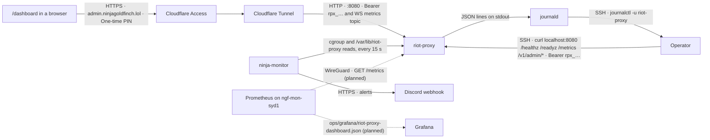

# Observability

What riot-proxy emits (logs, metrics, request ids, health bodies, in-memory rings, the `metrics` WebSocket topic), the exact shapes, and how each is consumed on `ngf-prod-syd1` today. Sample output below comes from a scratch run of the 2.7.0 debug binary with a fake key; production differs only in values.

## Logging

`serve` is the only command that installs a `tracing` subscriber (`src/cli/serve.rs:45`; `src/telemetry.rs:41-51`). Output is stdout; under the systemd unit (`docs/design/07-deployment.md:74-95`) that is journald, read with `sudo journalctl -u riot-proxy -o cat`.

- `LOG_FORMAT`: `json` or `pretty`; default `pretty` when stdout is a TTY, else `json` (`src/config.rs:649-656`).
- `LOG_LEVEL`: a `tracing_subscriber::EnvFilter` directive, default `info` (`src/config.rs:701`; `src/telemetry.rs:42`). Examples: `info`, `riot_proxy=debug,info`, `riot_proxy::jobs::ladder=debug,riot_proxy=info,tower_http=warn`. An invalid filter fails `serve` with `invalid LOG_LEVEL filter: …` (`src/telemetry.rs:31`).

The JSON layer flattens event fields to the top level and puts the innermost span's fields under `span`, with no span list (`src/telemetry.rs:53-66`). Every line has `timestamp`, `level`, `message`, `target`, the event's own fields, and `span` when inside one. Two lines from the scratch run (ids and paths real to that run):

```json
{"timestamp":"2026-10-18T23:22:29.181281Z","level":"INFO","message":"finished processing request","latency":"0 ms","status":200,"target":"tower_http::trace::on_response","span":{"consumer":"dev-local","method":"GET","path":"/v1/admin/info","request_id":"01M58N5RXWVJQ93WMEK4G4QVKV","name":"http"}}
{"timestamp":"2026-10-18T23:22:29.326814Z","level":"WARN","message":"request failed","code":"BadRegion","status":400,"message":"params/platform must be equal to one of the allowed values","target":"riot_proxy::http::error","span":{"consumer":"dev-local","method":"GET","path":"/v1/lol/summoners/by-puuid/EUW1/AbC…","request_id":"01M58N5S2EJ1TCH49N26KVGW69","name":"http"}}
```

- The per-request line is tower-http's `finished processing request` at INFO with `latency` and `status` (`src/app.rs:107-116`); the `http` span carries `request_id`, `method`, `path` and `consumer` (recorded after auth, `src/http/auth.rs:325`). No `x_cache` or `upstream_ms` field is on that line; design/07's claim of both (`docs/design/07-deployment.md:218`) is not what the code does.
- Error envelopes log `request failed` with `code` (the enum's Debug name, `BadRegion` not `BAD_REGION`), `status`, `message`: `warn` for 4xx, `error` for 5xx (`src/http/error.rs:176-181`).
- Boot prints refinery's own lines first (`schema history table is empty…`, `going to batch apply 27 migrations in single transaction.`), then `database ready path=` (`src/cli/serve.rs:55`).
- The bootstrap admin key is written to stderr with `eprintln!`, not through tracing (`src/cli/serve.rs:399-405`); the unit does not redirect stderr, so it is in the journal once and nowhere else.

Fixed-text lines operators should recognise (level, text, source):

| Level | Text | Source |
|---|---|---|
| info | `database ready`, `listening`, `starting job workers` (`workers=`, `kind_limits=`) | `src/cli/serve.rs:55`, `:148`, `:319-323` |
| info / warn | `limiter checkpoint restored` / `limiter checkpoint could not be read; starting fresh` | `src/cli/serve.rs:77-79` |
| info / warn | `L1 warmed from L2` / `L2 warm failed; starting with a cold cache` / `L2 sweep failed` | `src/cli/serve.rs:87-91` |
| info | `object store configured` (`store=`) | `src/cli/serve.rs:103` |
| warn | `DEV_UI=true ignored: /dev is never served when ENV=production`; `CACHE_TTL_OVERRIDES key matches no cacheable endpoint; ignored` | `src/cli/serve.rs:96`, `:107` |
| info | `re-queued jobs a previous process left running`, `queued the missing halves of archived matches`, `queued archive:offload` | `src/cli/serve.rs:276-318` |
| warn | `AUTH_DISABLED=true: every request runs as the synthetic dev-local consumer (read+admin)`; `ADMIN_IP_ALLOWLIST entry is not an IP or CIDR; ignored` | `src/http/auth.rs:197-204` |
| warn | `rejected unknown key`; `admin request from disallowed IP` | `src/http/auth.rs:273`, `:283` |
| error | `RIOT KEY REJECTED` (then `check RIOT_API_KEY`) | `src/riot/client.rs:305` |
| warn | `upstream 5xx`; `unexpected upstream status`; `network failure contacting Riot API` | `src/riot/client.rs:320`, `:325`, `:348` |
| error / warn | `accountable 429: limiter accounting is out of sync; scope frozen` / `service 429 with Retry-After; scope frozen` | `src/riot/limiter/mod.rs:416-428` |
| info / warn | `service 429, trying the next cluster`, `service 429, backing off`, `upstream unavailable, retrying`, `serving stale on upstream failure`, `serving stale while rate limited` | `src/fetcher.rs:462-602` |
| warn | `job failed` (`job=`, `id=`, `attempts=`, `next=`, `error=`); `jobs still running at shutdown; they resume on the next boot` | `src/jobs/scheduler.rs:1092`, `:1296` |
| error | `job claim failed`; `could not record job outcome`; `a SQLite write closure panicked` | `src/jobs/scheduler.rs:1219`, `:1156`; `src/db/mod.rs:323` |
| warn | `L2 write queue full; entry not persisted`; `L2 flush failed; entries stay in L1 only` | `src/cache/l2.rs:110`, `:154` |
| warn | `… reading from Riot` (six variants) | `src/archive/matches.rs:235-302` |
| info | `ladder crawl started` / `moved on` / `finished` / `collecting match ids`; `ladder matches handed to the archive queue` | `src/jobs/ladder.rs:312-917` |
| info | `analytics recomputed`, `facts re-extracted`, `builds extracted`, `match tiers stamped` | `src/jobs/analytics.rs:301-623` |
| info / warn | `backup written`, `maintenance done` / `backup skipped: not enough disk`, `backup failed; maintenance goes on` | `src/jobs/maintenance.rs:304-315`, `:263` |
| info | `pack written`, `offload done`, `index snapshot written` | `src/jobs/offload.rs:163`, `:193`; `src/jobs/index_snapshot.rs:598` |
| info | `syncing Data Dragon`, `Data Dragon sync complete` | `src/jobs/ddragon.rs:241`, `:258` |
| info | `SIGTERM` / `SIGINT`; `shutdown signal received; draining`; `limiter checkpoint and L2 flushed; stopped` | `src/app.rs:244-245`, `:217`; `src/cli/serve.rs:391` |

What is not logged: the Riot key (a sensitive header value, `src/riot/client.rs:26`, `:234-236`; absent even from the redacted config, `src/config.rs:383-387`), consumer keys (only their hash is stored, `src/consumers.rs:105-107`; `rejected unknown key` carries the path only), object-storage keys (`[REDACTED]`, `src/config.rs:444-455`; `describe()` prints bucket and endpoint only, `src/archive/objects.rs:134`), request bodies and query strings (the recent ring keeps the path cut to 200 characters, no query, `src/http/recent.rs:22`, `:104-106`).

## Metrics

`GET /metrics` serves Prometheus text exposition, `Content-Type: text/plain; version=0.0.4; charset=utf-8`, no key, no quota (`src/telemetry.rs:24`, `:101-121`). Names, types, labels and histogram buckets of the `proxy_*` set are v1's byte for byte so the Grafana board and alert rules import unchanged; v2 additions carry no prefix (ADR-014; `src/metrics.rs:1-4`, `:47`). Label-less metrics are registered at 0 on boot; labelled ones appear on their first series (`src/metrics.rs:348-374`). Histograms are drained into the render buffer every 5 s (`src/telemetry.rs:27`, `:91-99`). A unit test keeps `docs/design/metrics.md` in step with the catalogue (`src/metrics.rs:426-439`).

| Name | Type | Labels | Meaning | Recorded at |
|---|---|---|---|---|
| `proxy_requests_total` | counter | route, status, cache | downstream requests; `route` in `:param` form or `unmatched`; `cache` from `X-Cache` (hit/miss/neg/stale/archive/bypass/none) | `src/app.rs:121-171` |
| `proxy_upstream_requests_total` | counter | region, method, status | Riot calls; `status` is the HTTP code or `network` | `src/riot/client.rs:359-361` |
| `proxy_upstream_latency_seconds` | histogram | region, method | Riot round trip; buckets 0.025 to 10 | `src/riot/client.rs:362` |
| `proxy_rl_wait_seconds` | histogram | region, priority | limiter wait before dispatch; buckets 0.001 to 10 | `src/riot/limiter/mod.rs:283` |
| `proxy_rl_429_total` | counter | region, type | 429s; `type` = `X-Rate-Limit-Type` or `service` | `src/riot/client.rs:312-313` |
| `proxy_cache_reads_total` | counter | state | Riot-cache reads: hit, miss, neg, stale (analytics hits excluded) | `src/fetcher.rs:401-403`; `src/routes/players.rs:733` |
| `proxy_ws_connections` | gauge | | open sockets | `src/ws/hub.rs:78`, `:180` |
| `proxy_jobs_total` | counter | job, status | job outcomes completed/failed (yields excluded) | `src/jobs/scheduler.rs:1079`, `:1086` |
| `proxy_backfills_queued_total` | counter | reason, status | backfill requests (lookup/track/catchup/admin × queued/already-queued) | `src/jobs/archive.rs:223` |
| `proxy_refresh_claims_total` | counter | part, outcome | `?refresh=true` windows claimed/coalesced | `src/routes/players/refresh.rs:53`, `:61` |
| `proxy_ladder_pages_total` | counter | platform, queue | ladder pages fetched | `src/jobs/ladder.rs:540` |
| `proxy_ladder_entries_total` | counter | platform, queue | entries upserted | `src/jobs/ladder.rs:543` |
| `proxy_ladder_match_ids_total` | counter | platform, queue | distinct ids collected | `src/jobs/ladder.rs:635` |
| `proxy_ladder_matches_queued_total` | counter | platform, queue | unarchived ids handed to `archive:match` | `src/jobs/ladder.rs:769` |
| `proxy_ladder_crawl_duration_seconds` | histogram | platform, queue, status | crawl wall time; buckets 10 to 28 800 | `src/jobs/ladder.rs:833` |
| `proxy_rank_lookups_total` | counter | platform, queue | `ranks:lookup` lookups | `src/jobs/ladder/ranks.rs:135` |
| `proxy_aggregate_runs_total` | counter | platform, queue, status | analytics recomputes | `src/jobs/analytics.rs:275` |
| `proxy_aggregate_duration_seconds` | histogram | platform, queue, step | per rebuild step; buckets 1 to 1200 | `src/jobs/analytics.rs:365` |
| `proxy_aggregate_rows` | gauge | platform, queue, table | rows written by the last recompute | `src/jobs/analytics.rs:371` |
| `proxy_facts_reextract_progress` | gauge | | 0 to 1 | `src/jobs/analytics.rs:470-474` |
| `proxy_archived_matches_total` | counter | | matches upserted | `src/archive/matches.rs:404` |
| `limiter_interactive_waiters` | gauge | | interactive acquires waiting | `src/riot/limiter/mod.rs:240` |
| `limiter_bulk_waiters` | gauge | | bulk acquires waiting | `src/riot/limiter/mod.rs:242` |
| `events_published_total` | counter | name | events handed to the hub | `src/events.rs:198` |
| `jobs_pending` | gauge | kind | pending rows, sampled every 15 s; 0 once drained | `src/jobs/scheduler.rs:49`, `:1226-1245` |
| `sqlite_readers_free` | gauge | | idle reader connections | `src/db/mod.rs:119` |
| `timeline_backfill_fetched_total` | counter | region | timelines fetched by the backfill | `src/jobs/timelines.rs:365` |
| `timeline_backfill_not_found_total` | counter | region | timelines Riot answered 404 for | `src/jobs/timelines.rs:366` |
| `sqlite_db_bytes` | gauge | | database file size | `src/db/disk.rs:70` |
| `sqlite_wal_bytes` | gauge | | `-wal` size; 0 after a truncating checkpoint | `src/db/disk.rs:71` |
| `sqlite_freelist_bytes` | gauge | | freed pages not yet reused | `src/db/disk.rs:72` |
| `data_dir_free_bytes` | gauge | | `statvfs` available space on the data directory | `src/db/disk.rs:73`, `:96-116` |
| `cache_l2_dropped_total` | counter | | L2 writes dropped on a full 10 000 queue | `src/cache/l2.rs:109` |
| `archive_offload_pending` | gauge | kind, step | backlog after each offload run (`pack` / `free`) | `src/jobs/offload.rs:204-207` |
| `archive_offload_bytes_total` | counter | kind | pack bytes uploaded and verified | `src/jobs/offload.rs:164` |
| `archive_packs` | gauge | | rows in `body_packs` | `src/jobs/offload.rs:215` |

The four disk gauges are sampled once at boot and then with each history point, every `METRICS_HISTORY_INTERVAL_S` (60 s) (`src/stats.rs:828`, `:1005-1036`).

**History in SQLite.** The sampler writes a `HistoryPoint` (`t`, `totals`, `queues{active,pending,failed}`, `analytics{rows,ageSeconds}`, `cache{hit,miss,neg,stale}`, `disk`, `requests`, `upstream`; `src/stats.rs:353-368`) to `metrics_history(at, point)` every 60 s and keeps the newest 1440 rows, 24 hours (`HISTORY_MAX_POINTS`, `src/stats.rs:43`, `:960-982`; `src/db/migrations/V0001__init.sql:47-50`); `maintenance` also deletes rows older than 24 h (`src/jobs/maintenance.rs:38`, `:241-244`). `GET /v1/admin/metrics/history` returns `{"intervalS":60,"maxPoints":1440,"points":[…]}` (`src/routes/admin.rs:2409-2427`). `GET /v1/admin/metrics` returns the live `Snapshot` (`v:1`) with the keys `keyScope, totals, queues, ws, events, cache, limiter, worker, flows, ladder, analytics, process{uptimeSeconds,rssBytes}, sampledAt, cacheStore{l1Entries,l1Bytes,l1MaxBytes,l2Rows,l2Dropped}, gates, inflight, quotas, sqlite{readers,readersFree}, disk{dbBytes,walBytes,freelistBytes,freeBytes,totalBytes}, requests, upstream` (observed; `src/stats.rs:295-331`). `/dashboard` (`DASHBOARD_UI`, default on) renders these and needs an admin key for everything it calls (`src/routes/ui.rs:5-8`, `:218-221`).

## Tracing and request ids

- An inbound `X-Request-Id` is honoured when non-empty, at most 128 characters and only `[A-Za-z0-9-_.:]`; otherwise a ULID is generated (`src/http/request_id.rs:14`, `:31-41`). It is echoed as `X-Request-Id` on every response, including 404s, panics and preflights (`:64`), and appears in error envelopes as `requestId` (`src/http/error.rs:133`, `:187`).
- Spans: the outermost layer opens `request{request_id}`; `TraceLayer` opens `http{request_id, method, path, consumer}` (`src/app.rs:103-118`; `src/http/request_id.rs:57-60`). JSON lines show only the innermost span, which is why `span.name` reads `http` on request lines.
- There is no distributed tracing: `init_tracing` installs a fmt layer only (`src/telemetry.rs:41-51`), and the Riot client sends `X-Riot-Token`, `Accept`, `User-Agent` and (with a mock base) `x-riot-host`, never the request id (`src/riot/client.rs:267-275`). Correlation ends at the proxy; the site logs the `X-Request-Id` it receives on failures (`docs/_meta/scratch/siblings.md` §1.3).

## Health endpoints

Both public, no key, no quota, not recorded in the recent ring (`src/routes/health.rs:1`; `src/http/recent.rs:25`, `:100-101`).

```text
GET /healthz  → 200 {"ok":true}
GET /readyz   → 200 {"ok":true,"sqlite":true,"limiter":true,"keyScope":"95b708b6","sqliteReaders":4,"sqliteReadersFree":4}
              → 503 with the same body and the failing boolean false
```

`sqlite` is a `BEGIN IMMEDIATE; ROLLBACK;` on the writer within 2 s; `limiter` is the checkpoint-restored flag; `sqliteReadersFree` is informational (`src/routes/health.rs:19`, `:51-105`). Both get `Content-Type: application/json` from `axum::Json`.

## Recent requests and errors

Two process-global rings: the last 500 requests (`{at,method,route,path,status,cache,latencyMs,consumer,requestId}`) and the last 200 error envelopes (`{at,code,status,message,requestId}`) (`src/http/recent.rs:18-22`, `:36-57`). `/healthz`, `/readyz`, `/metrics`, `/v1/admin/recent` and `/v1/admin/metrics` are not recorded (`:25`). Read with `GET /v1/admin/recent?kind=requests|errors&limit=1..500` (`src/routes/admin.rs:2546-2558`). The rings are process memory only, so nothing survives a restart (`:81-82`). Observed:

```json
{"kind":"errors","capacity":200,"errors":[{"at":1792365749319,"code":"NOT_FOUND","status":404,"message":"No route for GET /v1/nothing","requestId":"docs-trace-001"}]}
```

## The `metrics` WebSocket topic

Subscribe on `/v1/ws` with an admin-capable key to `metrics`; the server publishes `metrics.snapshot` (the same `Snapshot` as `/v1/admin/metrics`) every `METRICS_INTERVAL_S` (5 s) only while at least one socket holds the topic (`src/ws/metrics.rs:14-35`; `src/config.rs:721`). Frame shape `{"op":"event","event":"metrics.snapshot","topic":"metrics","at":<unix ms>,"data":{…}}` (`src/events.rs:159-172`). The dashboard unsubscribes while hidden so no snapshots are built for it (`docs/design/13-admin-dashboard.md:341`).

## How each is consumed today

Caption: where each signal goes on `ngf-prod-syd1` at 2.7.0; dashed edges are planned, not built.



Logs reach journald and are read over SSH; the dashboard reaches the admin JSON routes and the `metrics` topic through the tunnel on `admin.ninjagoldfinch.lol` behind Cloudflare Access, while the WAF blocks `/metrics`, `/dashboard*`, `/dev*` and `/v1/admin*` on `api.` (`PROGRESS.md:342`; `docs/design/07-deployment.md:221`); ninja-monitor samples the service's cgroup and data directory and alerts to Discord without calling any endpoint (`docs/_meta/scratch/siblings.md` §2.2); Prometheus and Grafana on `ngf-mon-syd1`, scraping `/metrics` over WireGuard, are planned and not done (`docs/design/12-object-storage-and-hosting.md:846-848`; `docs/design/13-admin-dashboard.md:69`). `ops/grafana/riot-proxy-dashboard.json` (uid `riot-proxy`, 12 panels over nine `proxy_*` metrics) and `ops/prometheus-alerts.yml` (five rules) are ready for that day.

---
**Sources:** `src/telemetry.rs:24,27,31,41-66,91-121`, `src/cli/serve.rs:45,55,77-107,148,276-323,391,399-405`, `src/app.rs:103-118,121-171,217,244-245`, `src/http/auth.rs:197-204,273,283,325`, `src/http/error.rs:133,176-187`, `src/http/request_id.rs:14,31-41,57-64`, `src/http/recent.rs:18-25,36-57,81-82,100-106`, `src/config.rs:383-387,444-455,649-656,701,721`, `src/consumers.rs:105-107`, `src/riot/client.rs:26,234-236,267-275,305-362`, `src/riot/limiter/mod.rs:240-283,416-428`, `src/fetcher.rs:401-403,462-602`, `src/metrics.rs:1-4,47,89-374,426-439`, `src/stats.rs:43,295-368,828,960-1036`, `src/routes/health.rs:1,19,51-105`, `src/routes/admin.rs:2409-2427,2546-2558`, `src/routes/ui.rs:5-8,218-221`, `src/ws/metrics.rs:14-35`, `src/events.rs:159-172,198`, `src/jobs/scheduler.rs:49,1079-1092,1156,1219,1226-1245,1296`, `src/jobs/maintenance.rs:38,241-244,263,304-315`, `src/jobs/offload.rs:163-215`, `src/jobs/ladder.rs:312-917`, `src/jobs/analytics.rs:275-623`, `src/jobs/ddragon.rs:241,258`, `src/jobs/index_snapshot.rs:598`, `src/archive/matches.rs:235-302,404`, `src/archive/objects.rs:134`, `src/cache/l2.rs:109-154`, `src/db/mod.rs:119,323`, `src/db/disk.rs:70-116`, `src/db/migrations/V0001__init.sql:47-50`, `docs/design/07-deployment.md:74-95,218,221`, `docs/design/12-object-storage-and-hosting.md:846-848`, `docs/design/13-admin-dashboard.md:69,341`, `docs/design/metrics.md`, `ops/grafana/riot-proxy-dashboard.json`, `ops/prometheus-alerts.yml`, `PROGRESS.md:342`
**Last verified:** 2026-10-19 against commit `52fa67d`
