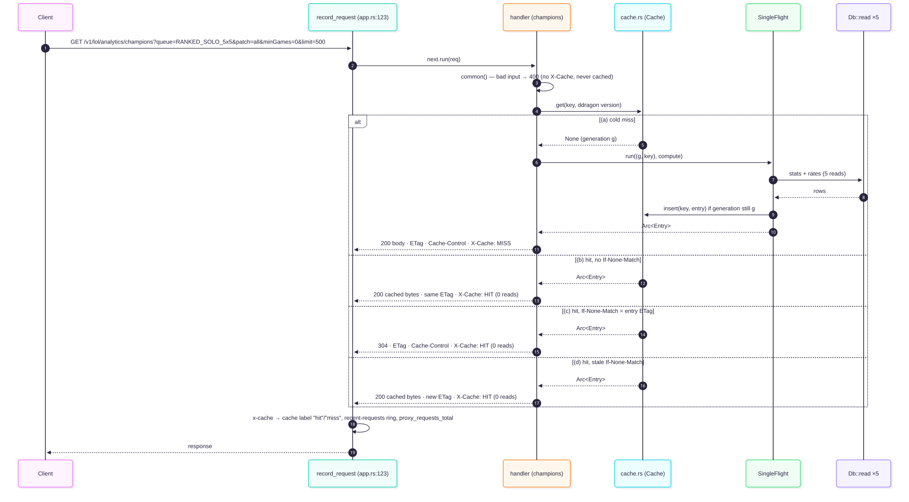
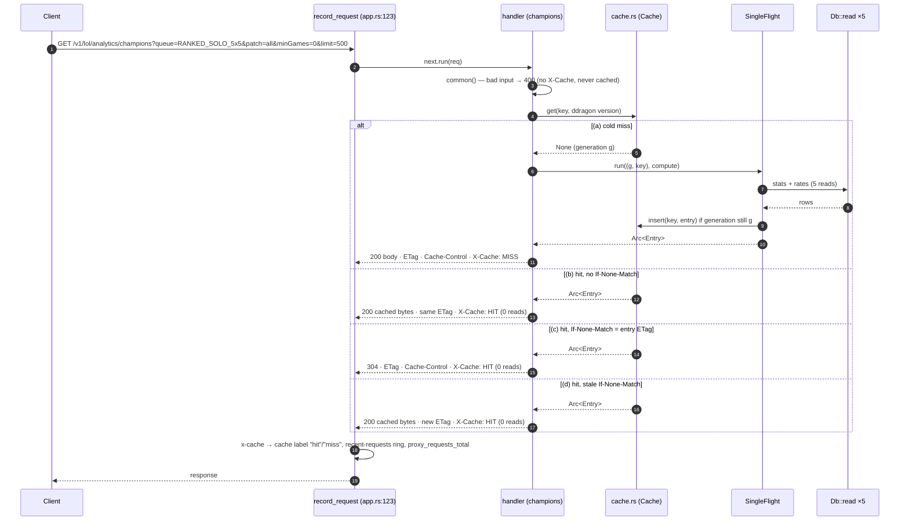
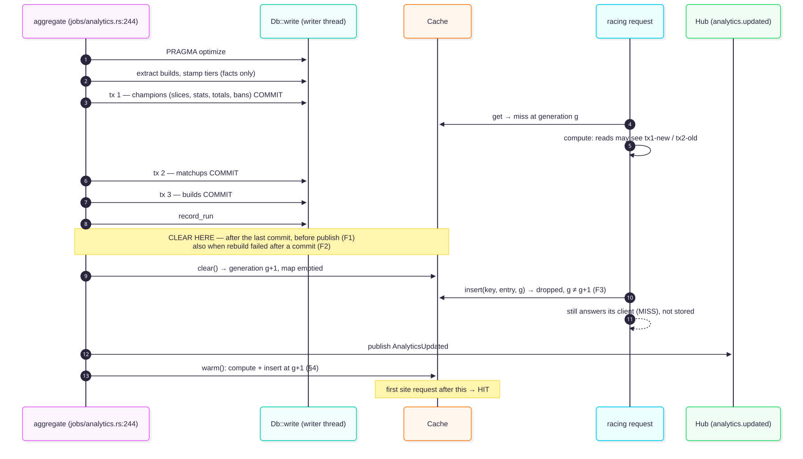
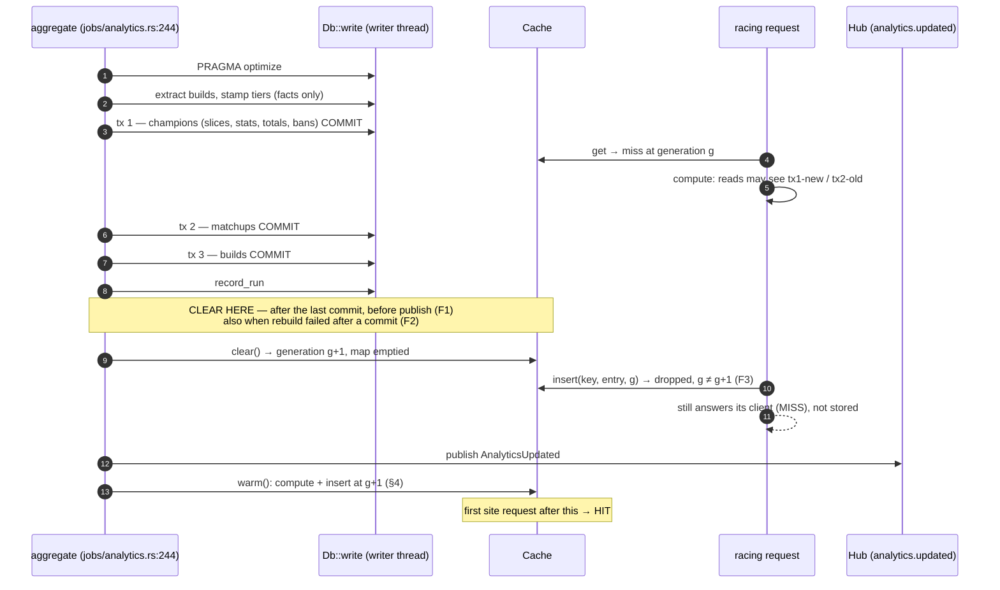
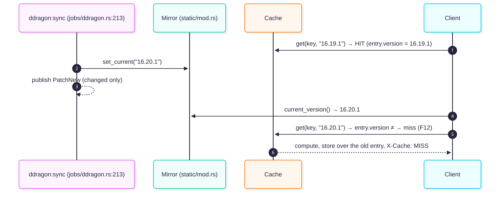
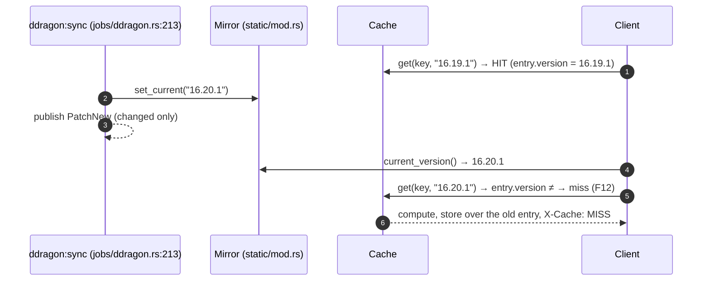
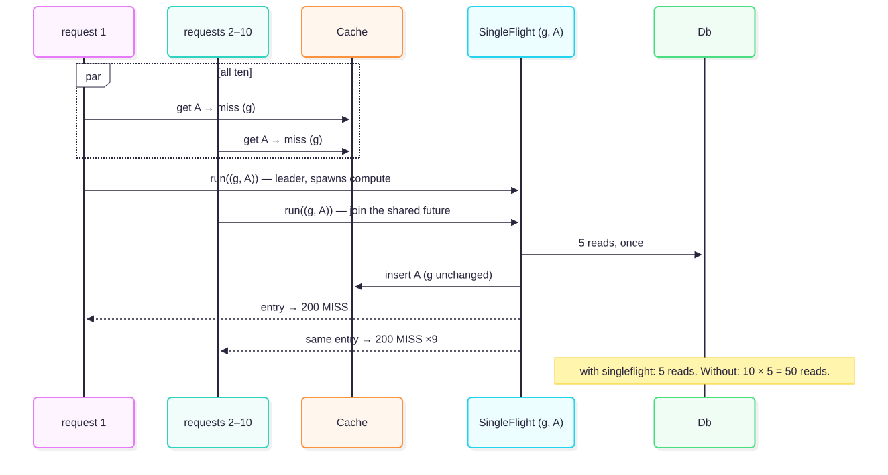
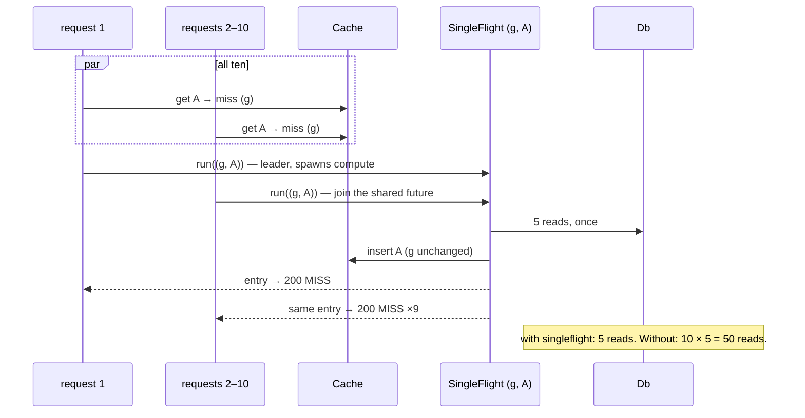

# PERF-03 design — analytics responses cached per aggregate generation

Kept in the repo as `docs/perf/PERF-03-design.md` (the handoff calls it `reports/PERF-03 design.md`). Written 2026-10-15 against `origin/main` at `cb7f5fc` (PERF-02 merged, #212). Every `file:line` is at that commit unless it says otherwise. The brief is `reports/PERF-03 handoff.md`; §n below follows its §7.

**Status: describes the code as merged (branch `perf/PERF-03-analytics-cache`).** Phase A's design was written together with the Phase B plan, because the Phase A doc was never saved: no `reports/PERF-03 design.md` existed anywhere on the box when Phase B started. So it is written now, from the merged code. During implementation each section got an **Observed** block from a real server. Where the code and the design differed, the commit says which one changed; the places the design was updated are marked *diagram updated*.

Renders: `docs/perf/PERF-03/*.svg`. The Mermaid sources sit beside them as `*.mmd`. They are rendered with `@mermaid-js/mermaid-cli` and Playwright's `chrome-headless-shell` (there is no `/opt/pw-browsers` on this box).

---

## 8. Findings (read first)

Each finding states what the brief says, what the code says, and the resolution proposed for the plan. **F1–F6 change the brief's design. F7–F16 refine or settle it.**

| # | Finding | Proposed resolution |
|---|---|---|
| **F1** | **Clearing after `publish` serves stale data to the event's own listeners.** The brief orders it `publish(AnalyticsUpdated)` → clear → warm. A client that refetches on `analytics.updated` can reach the cache before the clear and get the pre-rebuild body as a `HIT` (the dashboard and the showcase listen on the hub). | Order it **commit → `record_run` → clear → publish → warm**. The clear is synchronous: a mutex and a counter, no `.await` in between. |
| **F2** | **A failed rebuild can still change the tables.** `rebuild` runs three transactions (`jobs/analytics.rs:328-366`). If `matchups` fails after `champions` committed, `aggregate` returns at `let tables = result?` (`:293`) without publishing. Today that is harmless, because the next read sees the new champions rows. With a cache, those rows stay hidden until the next successful rebuild. | Clear whenever `rebuild` *ran*, whether it succeeded or failed, and warm and publish only on success. |
| **F3** | **A request racing the clear can store a pre-commit body after the clear.** A miss that started before the clear, and finishes after it, would insert a body read from the old tables. | Use a **generation counter** inside the cache. `clear()` bumps it under the same lock that empties the map. A miss records the generation before it computes, and its insert is dropped if the generation has moved. The singleflight key carries the generation too, so a request that arrives after a clear never joins a flight that started before it (§6). |
| **F4** | **`key_scope` is per process, not per consumer.** The brief says "the consumer's `key_scope` … different consumers must never share an entry". But `state.fetcher.key_scope()` (`fetcher.rs:268`) is derived from `RIOT_API_KEY` at boot, and the handlers ignore the consumer (`Extension(_c)`, `routes/analytics.rs:710`). Every consumer gets the same body for the same query, so sharing entries between consumers is correct. | Keep `key_scope` in the key, as the canonical L1 key does (design/04 §Canonical key). It costs nothing and stays right if a process ever serves two scopes. The "two consumers" test becomes: two consumers, same query → **one** entry (a HIT for the second). Two scopes is a unit test on the key. |
| **F5** | **The site's "newest patch" sends no `patch`, not `patch=<newest>`.** `analyticsQuery` (ninjagoldfinch-lol `src/lib/domain/champion-stats.ts:93-102`) leaves `patch` out when the filter is "newest". That is a different key from `patch=25.21`, and the brief's warm list doesn't have it. | Warm the form each client actually sends: the site's `patch=all` and *no `patch`*, and the showcase's `patch=all`. §4 has the list. |
| **F6** | **Existing tests read, write the tables directly, then read again.** `rows_v0017_could_not_split_are_rebuilt_over_every_patch_once` (`tests/analytics.rs:1244`) rewrites tier and side in SQL (`:1331`) and asserts the reads didn't change (`:1345`). With a cache, that assertion passes by serving the cached `before`, so it no longer proves anything. Also, each test builds its own `AnalyticsContext` (`tests/analytics.rs:81`, `tests/builds.rs:61`, `tests/ladder.rs:783`, `tests/timelines.rs:390`), so a rebuild there would not clear the router's cache. | *As built (diagram updated):* the two tests that rewrite the tables in SQL, this one and `patch_all_sums_every_patch_and_the_patch_list_offers_them` (found when it failed), call `state.analytics.clear()` right after the write, as a rebuild would. Their later reads then really are of the rewritten rows, and the cache stays on. The test contexts take `Arc::clone(&state.analytics)` (`tests/ladder.rs`'s own harness gets a cap-0 one). "Existing tests pass unchanged" holds for their assertions, not their setup: four constructors gain one field and two tests one line. |
| F7 | **Analytics hits shouldn't count in `proxy_cache_reads_total`.** That counter is the Riot fetch cache's hit ratio (`fetcher.rs:402`, `routes/players.rs:733`, read by the dashboard at `stats.rs:507`). Mixing in analytics hits would inflate the Riot hit ratio. The `X-Cache` header already feeds `proxy_requests_total{cache}` and the recent-requests list (`app.rs:141-166`), per route. | No new metric, and no increment of `CACHE_READS_TOTAL`. Hits and misses show up per route through the `cache` label and on the Traffic tab (ADR-166 "no new metric"). |
| F8 | `ANALYTICS_CACHE_ENTRIES` bounds. | `0` = disabled: nothing stored, every response `X-Cache: MISS`. Default `512`, max `4096`. `v.int("ANALYTICS_CACHE_ENTRIES", 512, 0, 4096)`; out of range → the usual range error. Worst case at the max is ~170 MB (§5), which still fits a 2-vCPU VPS. |
| F9 | **Use an entry cap, not a byte cap.** The largest body is the champions list. It has at most one row per champion (≈ 172), so it is bounded by the champion count, not by `limit=500`. Measured: **40,295 B** for 171 rows (§5). | Entry cap. 512 × ~41 kB ≈ **21 MB** worst case. |
| F10 | **Use a hand-rolled LRU, not `moka`.** `moka` 0.12 (`Cargo.toml:30`) defaults to TinyLFU *admission*, which can refuse a new entry instead of evicting the oldest. Its eviction also runs in batches (`run_pending_tasks`), so "cap 2, three keys → the first is a MISS" is not deterministic. | Use a `HashMap<Key, Slot>` plus a `u64` use counter under a `std::sync::Mutex`. When the map is full, an insert evicts the smallest counter, which is an O(n) scan over at most 4096 entries and only on a miss. No new crate, and the lock is never held across an `.await`. |
| F11 | **Singleflight: yes, keyed `(generation, key)`.** `SingleFlight` (`singleflight.rs:75`) runs the work on its own task (`:88`), so a client that goes away doesn't waste the read. Without it, ten cold requests for the site's call run 10 × 5 `Db::read`s. With it they run 5 (§6). Cold misses are rare after a warm, but every restart starts cold. | Use it. The work returns `Result<Arc<Entry>, Failed>`. `Failed` is a `Clone` unit error, which `SingleFlight` needs; the cause is logged inside the work. Everyone who shares a flight gets `X-Cache: MISS`. |
| F12 | **Detect the Data Dragon version by comparison, not by wiring.** `sync` calls `set_current` on *every* run, changed or not (`jobs/ddragon.rs:230` and `:257`). `PatchNew` is published only on a change (`:305`), and also on a forced re-sync of the *same* version. | Each entry records the `current_version()` it was computed with. A lookup whose version differs is a miss, and the next store overwrites the entry. That covers every way the version can move (sync, tests, the lazy disk scan at `static/mod.rs:150`) without the mirror knowing the cache exists. The check is one `RwLock` read, which the handlers already do today. |
| F13 | **`/dev/reset` empties the analytics tables** (`routes/dev.rs:58-71`, wiped at `:204`). | It calls `state.analytics.clear()` after the wipe, as it already invalidates L1 (`:202`). Nothing else writes the analytics tables outside `aggregate`. The admin recompute (`routes/admin.rs:2358`) enqueues the job. `facts:reextract`, `builds:extract` and `tiers:backfill` write facts, not aggregates. The CLI has no analytics writer: `migrate-v1` skips analytics, and `backup` / `packs` don't touch them. |
| F14 | **`X-Cache-Age` isn't sent.** For the other read routes the OpenAPI document lists `X-Cache` and `X-Cache-Age` together (`routes/docs.rs:223-227`), and `tests/openapi.rs:203` mirrors the analytics exclusion. | Analytics responses send `X-Cache` only, and their freshness is `computedAt`. `docs.rs` lists `X-Cache` (not `-Age`) for analytics 2xx, and `tests/openapi.rs:203` follows. The OpenAPI snapshot changes. |
| F15 | **The minGames ETag inconsistency.** The matchups tag hashes `minGames` as sent (`routes/analytics.rs:849`), so `minGames` omitted and `minGames=0` give *different* tags. The other routes hash the defaulted value (`:754`, `:997`, `:1231`). | The cache key is built from **the same request parts the tag hashes**: one list per route, used by both. So a HIT's tag equals a MISS's by construction, and matchups keeps its two keys. Changing the tag is out of scope (it would be a one-time 200 for every client). |
| F16 | **`ROLE=api|worker` would split the cache from the job.** Clearing is in-process. These roles only exist with Postgres, and that store is a stub (ADR-062). | Note it in the ADR. If the roles ever become real, the clear moves to a hub subscriber, with a generation in the event so it stays ordered. |
| F17 | Out of scope, noted with task ids | **PERF-04**: cache the gzip/br bytes too. `CompressionLayer` (`app.rs:103`) recompresses about 40 kB on every hit. **PERF-05**: warm the site's champion pages (detail, builds and matchups for each champion) if the Traffic tab shows them slow. |

### §5 open questions, answered

1. **How the job reaches the cache:** through a shared `Arc<analytics::Cache>`, built in `cli/serve.rs` before `AnalyticsContext` (`:217`) and `AppState` (`:354`), and handed to both. A hub subscriber can't order the clear before the warm (F1). A future `aggregate:delta` (THR-03) gets the same `Arc` and calls the same `clear()` + `warm()`.
2. **`0`:** disabled. **Max:** 4096 (F8).
3. **Cap:** entries, with a measured body of 40,295 B (F9).
4. **`proxy_cache_reads_total`:** no (F7).
5. **Singleflight:** yes, keyed by `(generation, key)` (F11).
6. **Warm list:** confirmed against design/11's page map and the site's code (F5, §4).

---

## 1. Request flow

Today (`routes/analytics.rs:708-773`) the handler parses (`common()`, `:418`), then reads. Without `patch` it first resolves the newest patch with `latest_patch` (1 read, `:635`). It then runs `stats` + `rates` (1 + 4 reads, `:731`, `:646`), builds the body, hashes the tag (`:743`) and calls `respond()` (`:520`). `respond()` returns 304 if `If-None-Match` matches, else 200. Either way it sets `Cache-Control: private, max-age=300` and `ETag`. **A 304 today still runs all 5 reads.**

Proposed: the parse stays first, so a 400 never reaches the cache. Then the key is built, the cache is consulted, and only a miss runs `compute()`. `X-Cache` is set by the one shared `serve()` and read by the middleware `record_request` (`app.rs:141`).





Designed headers (the site's call; ETag from the synthetic run below):

| case | status | `X-Cache` | `ETag` | `Cache-Control` | `Db::read`s |
|---|---|---|---|---|---|
| (a) cold | 200 | `MISS` | `W/"r2GM8IHP…"` | `private, max-age=300` | 5 |
| (b) hit | 200 | `HIT` | same | same | 0 |
| (c) hit + matching tag | 304 | `HIT` | same | same | 0 |
| (d) hit + stale tag | 200 | `HIT` | same | same | 0 |
| bad `queue=X` | 400 | — | — | — | 0 |

Today, on origin/main, with the synthetic DB and a debug build (case (a) only, since there is no cache yet):

```
GET /v1/lol/analytics/champions?queue=RANKED_SOLO_5x5&patch=all&minGames=0&limit=500
200  40295 B  78 ms
cache-control: private, max-age=300
etag: W/"r2GM8IHPRZe5VmDLgeLTVVNZGOM2EwMIai3yLizfnqE"
(no x-cache)
```

**Observed** (branch `perf/PERF-03-analytics-cache`, release build, synthetic DB, `/tmp/p3m/req.sh`; `log` is the server's analytics debug line, whose `reads` counts the `Db::read`s run while computing):

```
(a) status=200 OK          X-Cache=MISS  ETag=W/"r2GM8IHPRZe5VmDLgeLTVVNZGOM2EwMIai3yLizfnqE"  Cache-Control=private, max-age=300  bytes=40295  log: read reads:5
(b) status=200 OK          X-Cache=HIT   ETag=W/"r2GM8IHPRZe5VmDLgeLTVVNZGOM2EwMIai3yLizfnqE"  Cache-Control=private, max-age=300  bytes=40295  log: from memory
(c) status=304 Not Modified X-Cache=HIT  ETag=W/"r2GM8IHPRZe5VmDLgeLTVVNZGOM2EwMIai3yLizfnqE"  Cache-Control=private, max-age=300  bytes=0      log: from memory
(d) status=200 OK          X-Cache=HIT   ETag=W/"r2GM8IHPRZe5VmDLgeLTVVNZGOM2EwMIai3yLizfnqE"  Cache-Control=private, max-age=300  bytes=40295  log: from memory
400 status=400 Bad Request X-Cache=-     ETag=-  Cache-Control=-  bytes=145  log: -   (never looked up or stored)
```

The MISS's `ETag` is byte-identical to origin/main's for the same query (`W/"r2GM8IHP…"` above, measured before any change): the refactor moved the tag code, it didn't change it.

---

## 2. Key derivation

The key is `(route, key_scope, championId?, every parameter as parsed)`: `Request::key` (`src/routes/analytics.rs`). The parse applies each route's defaults from its `(min, max, default)` limit tuple, in `Request::parse`:

| route | roles | limit (min, max, default) |
|---|---|---|
| champions | `TEAM_POSITIONS` | (1, 500, 200) |
| matchups | `LANE_POSITIONS` | (1, 200, 50) |
| detail | `TEAM_POSITIONS` | (1, 50, 10) |
| builds | `TEAM_POSITIONS` | (1, 10, 3) |
| patches | — (no `limit`) | — |

What each parameter becomes:
- `queue` defaults to the first of `LADDER_QUEUES`.
- `remakes` defaults to `exclude`.
- `limit` defaults as in the table.
- `patch` stays as sent: `all`, `major.minor`, or absent, which means "the newest" and needs a read to resolve.
- **`minGames` stays as sent on every route** (*diagram updated to match the code*). The Phase A table defaulted it to `0` except on matchups. Keeping it raw everywhere is simpler and can only split one entry into two, never merge two different tags: matchups' tag tells an omitted `minGames` from `0`, the others don't (F15).
- Unknown parameters (`?_=123`) are ignored by the parse.

The key's parts are `route|scope|id|platform|queue|tier|side|patch|role|minGames|limit|remakes` (patches: `…|platform|queue|championId|side|remakes`), with `~` for a part left open. The scope is `c2811ca1`, the dev key's.

| # | request | normalised key | **Observed** (fresh server, rows run in this order) |
|---|---|---|---|
| 1 | site: `/champions?queue=RANKED_SOLO_5x5&patch=all&minGames=0&limit=500` | `champions\|c2811ca1\|~\|~\|RANKED_SOLO_5x5\|~\|~\|all\|~\|0\|500\|exclude` | `MISS` 5 reads, then `HIT` · `W/"r2GM8IHP…"` · 40,295 B |
| 2 | same, reordered: `?limit=500&minGames=0&patch=all&queue=…` | = #1 | `HIT` · `W/"r2GM8IHP…"` |
| 3 | showcase: `/champions?platform=oc1&queue=RANKED_SOLO_5x5&patch=all&limit=500` | `champions\|c2811ca1\|~\|oc1\|RANKED_SOLO_5x5\|~\|~\|all\|~\|~\|500\|exclude` | `MISS` 5 reads · `W/"apsrJLuq…"` · 40,212 B |
| 4 | `/champions?queue=RANKED_SOLO_5x5&patch=all` (no limit) | `…\|all\|~\|~\|200\|exclude` | `MISS` 5 reads · `W/"rma-XowT…"` |
| 5 | `…&patch=all&limit=200` | = #4 | `HIT` · `W/"rma-XowT…"` |
| 6 | #1 + `&remakes=exclude` | = #1 | `HIT` · `W/"r2GM8IHP…"` |
| 7 | #1 + `&remakes=include` | `…\|0\|500\|include` | `MISS` 5 reads · `W/"xVxX2ePl…"` · 40,377 B |
| 8 | `…&patch=25.21&minGames=0&limit=500` | `…\|~\|25.21\|~\|0\|500\|exclude` | `MISS` 5 reads · `W/"7obzHU_l…"` |
| 9 | site "newest": `…?queue=RANKED_SOLO_5x5&minGames=0&limit=500` | `…\|~\|~\|~\|0\|500\|exclude` | `MISS` **6** reads (`latest_patch` + 5) · `W/"7obzHU_l…"`, the same tag as #8 under its own key |
| 10 | two consumers, the same #1 | = #1 | the dev server runs `AUTH_DISABLED`; covered by `consumers_share_an_entry` (2nd is `HIT`) |
| 11 | two key scopes | different keys | unit test `two_scopes_are_two_keys` |
| 12 | `/champions/103?queue=RANKED_SOLO_5x5&patch=all&minGames=0&limit=10` | `detail\|c2811ca1\|103\|~\|RANKED_SOLO_5x5\|~\|~\|all\|~\|0\|10\|exclude` | `MISS` **10** reads · 2,074 B |
| 13 | `/champions/103/matchups?…&patch=all&limit=200` vs `…&minGames=0&limit=200` | two keys | `MISS` 1 read · `W/"782Uv9lB…"`; `MISS` 1 read · `W/"_q3HYmhr…"`: two tags, so two keys are needed (F15) |
| 14 | `/patches?queue=RANKED_SOLO_5x5` | `patches\|c2811ca1\|~\|~\|RANKED_SOLO_5x5\|~\|~\|exclude` | `MISS` 1 read · 677 B |
| 15 | `/champions?queue=X` | — | 400, no `X-Cache`, no `ETag` |
| 16 | #1 + `&_=123` | = #1 | `HIT` |

Every `Cache-Control` was `private, max-age=300`. Row 8 vs 9: when a rebuild adds 25.22, the clear drops both. The warm re-fills #9, which then resolves to 25.22, and #8 refills on demand.

---

## 3. Invalidation

### 3.1 `aggregate:analytics`

`Analytics::aggregate` (`jobs/analytics.rs:244`): `optimize` (`:252`) → `extract_builds` (`:259`) → `backfill_tiers` (`:266`) → `rebuild` (`:270`), which is three write transactions (`:328-366`): champions (slices, stats, totals, bans), then matchups, then builds → `record_run` (`:290`) → `publish(AnalyticsUpdated)` (`:295`).





The clear must sit after tx 3's commit and `record_run`, and before `publish`. A request that computed before the clear either stored its body before the clear, and the clear removes it, or it tries to store after the clear and the generation check drops it. Any request that starts after the clear reads only committed tables.

### 3.2 Data Dragon

`ddragon:sync` → `sync()` (`jobs/ddragon.rs:213`) → `mirror.set_current(&version)` (`:230` unchanged, `:257` changed) → `PatchNew` only if `changed` (`:305`). Names (`champion_names`) and `current_version()` are in the body and the tag (`routes/analytics.rs:741, :747`).





No clear call and no wiring: an entry is valid only for the version it was computed with. A sync that finds the same version (`:230`) changes nothing, and neither does a forced re-sync of the same version.

### 3.3 Other writers of the analytics tables

| writer | at | needs a clear? |
|---|---|---|
| `aggregate:analytics` | `jobs/analytics.rs:244` | yes, §3.1 |
| `/dev/reset` (`wipe`) | `routes/dev.rs:204` (tables `:58-71`) | **yes**: `state.analytics.clear()` after the wipe (F13) |
| admin `POST /v1/admin/analytics/recompute` | `routes/admin.rs:2340` | no: it enqueues `aggregate:analytics` |
| `facts:reextract`, `builds:extract`, `tiers:backfill` | `jobs/analytics.rs:394, :478, :580` | no: they write facts and match tables, not the aggregates the routes read |
| `analytics_runs` (`record_run`) | `jobs/analytics.rs:165` | no: not read by these routes |
| CLI `migrate-v1`, `backup`, `packs` | `src/cli/` | no: none writes an analytics table; a DB file swap means a restart, which starts cold |
| tests writing SQL directly | `tests/analytics.rs` (two tests), `tests/dashboard.rs` | the two clear after their write (F6); dashboard reads don't go through these routes |

**Observed: a real rebuild on the dev server.** `POST /v1/admin/analytics/recompute {"platform":"oc1","queue":"RANKED_SOLO_5x5"}` ran `aggregate:analytics` on a worker. The warm calls the cache directly, not over HTTP, so it shows in the server's debug log rather than in the recent-requests list (`GET /v1/admin/recent`). Times are from both, in order:

| time | source | what | `X-Cache` / `cache` | reads |
|---|---|---|---|---|
| 15:58:59.560 | recent | `GET /v1/lol/analytics/champions` (the site's call, before) | `hit` | 0 |
| 15:58:59.776 | recent | `POST /v1/admin/analytics/recompute` | 202 | — |
| 15:58:59.800 | log | `analytics recomputed` (oc1, 18 ms); clear ran just before this line | — | — |
| 15:58:59.843 | log (warm) | `champions\|…\|~\|RANKED_SOLO_5x5\|~\|~\|all\|~\|0\|500\|exclude` kept | — | 5 |
| 15:58:59.850 | log (warm) | `champions\|…\|~\|RANKED_SOLO_5x5\|~\|~\|~\|~\|0\|500\|exclude` kept | — | 6 |
| 15:58:59.861 | log (warm) | `champions\|…\|oc1\|RANKED_SOLO_5x5\|~\|~\|all\|~\|~\|500\|exclude` kept | — | 5 |
| 15:58:59.889 | log (warm) | `patches\|…\|~\|RANKED_SOLO_5x5\|~\|~\|exclude` kept | — | 1 |
| 15:58:59.893 | log (warm) | `patches\|…\|oc1\|RANKED_SOLO_5x5\|~\|~\|exclude` kept | — | 1 |
| 15:59:01.796 | recent | `GET /v1/lol/analytics/champions` (the site's call) | **`hit`**, 0 ms | 0 |
| 15:59:02.013 | recent | `GET /v1/lol/analytics/patches` (the site's) | `hit` | 0 |
| 15:59:02.230 | recent | `GET /v1/lol/analytics/champions?platform=oc1…` (the showcase's) | `hit` | 0 |

Two queries cached *before* the rebuild but not warmed, `…&remakes=include` and `/champions/103?…`, were `MISS` afterwards: the clear dropped them. On this synthetic copy the ladder has no facts, so the rebuild rewrote no rows and the tags didn't change. The changed-data case, with a new `computedAt`, a new tag and an old validator getting a 200, is `a_rebuild_clears_and_warms_what_sites_open_first` (tests/analytics.rs). The failed-rebuild case is `a_failed_rebuild_still_clears`.

**Data Dragon**, observed in `a_new_patch_misses_the_analytics_cache` (tests/ddragon.rs, a real `ddragon::sync` against wiremock): synced 16.17.1, then `MISS`, `HIT`; synced 16.18.1 (`changed`), then `MISS`, `HIT`.

---

## 4. The warm list

After a rebuild of `(oc1, RANKED_SOLO_5x5)`, with `LADDER_QUEUES` = the queues in config (`config.rs:735`, default `RANKED_SOLO_5x5`), for **each** configured queue `q` (the clear dropped every queue's entries):

| # | URL | who sends it |
|---|---|---|
| 1 | `/v1/lol/analytics/champions?queue=q&patch=all&minGames=0&limit=500` | the site's default (`champions.ts:38`) |
| 2 | `/v1/lol/analytics/champions?queue=q&minGames=0&limit=500` | the site's "newest" (F5) |
| 3 | `/v1/lol/analytics/champions?platform=oc1&queue=q&patch=all&limit=500` | the showcase home's default (design/11 page map) |
| 4 | `/v1/lol/analytics/patches?queue=q` | the site (`champions.ts:39`) |
| 5 | `/v1/lol/analytics/patches?queue=q&platform=oc1` | the showcase home |

That is **5 per queue**: 5 with the default config, 10 with `RANKED_SOLO_5x5,RANKED_FLEX_SR`. The brief's "showcase at the newest patch" is dropped. The showcase sends a numeric patch only when someone picks one, which is a demand miss, and the showcase is never in production. The site's champion pages (detail, builds, matchups per champion) are not warmed (F17, PERF-05).

Reads per warm, per queue: #1 5, #2 6 (incl. `latest_patch`), #3 5, #4 1, #5 1 = **18 `Db::read`s**. On the synthetic copy that is about 40 ms each for #1 and #2 (ADR-168, 3.51) and under 2 ms for the rest. So **~85 ms per queue**, or ~170 ms for two.

**Back to back.** The ladder tick rebuilds every `(platform, queue)` whose crawl finished, and `JOB_KIND_LIMITS` runs one `aggregate:analytics` at a time (ADR-134). With N ladders: clear, warm, clear, warm, … N times. Each warm but the last is thrown away: (N−1) × ~170 ms. For 4 platforms × 2 queues that is 7 × 170 ms ≈ 1.2 s of reads, next to rebuilds that take seconds to minutes each. It's acceptable, and simpler than clearing by ladder (rejected in the ADR: the all-platform entries depend on every platform, so most entries go either way).

**Observed** (the rebuild trace in §3.3): exactly these 5 keys, 18 reads, 93 ms from `analytics recomputed` to the last warm line (synthetic copy, release build, LADDER_QUEUES default). `a_rebuild_clears_and_warms_what_sites_open_first` asserts the same 5 keys after a rebuild of `(kr, RANKED_SOLO_5x5)`.

---

## 5. Memory

Measured on origin/main, debug build, with the synthetic copy (171 champions, 4 platforms, 8 patches, `scripts/perf-synthetic.py`) loaded under the dev key and Data Dragon 16.19.1 mirrored:

| body | bytes |
|---|---|
| champions, site query (171 rows) | **40,295** |
| champions, `platform=oc1` | 40,212 |
| champions, newest patch | 40,376 |
| patches, `queue=RANKED_SOLO_5x5` | 677 |

The champions body has one row per champion that has games, so its size is bounded by the champion count (~172), not by `limit`. An entry is the body + a ~55 B tag + a ~100 B key + overhead ≈ 41 kB at most. **Worst case: 512 × 41 kB ≈ 21 MB; at the max 4096, ≈ 168 MB.** A realistic mix (matchups ≤ 200 rows of ~100 B, detail ≤ 10 per section, patches < 1 kB) is far below that. An entry cap is enough (F9).

---

## 6. Eviction and concurrency

**LRU at cap 2**, with keys A = site `patch=all`, B = site newest, C = `patches?queue=RANKED_SOLO_5x5`:

| step | request | result | map after (most recent last) | reads |
|---|---|---|---|---|
| 1 | A | MISS | A | 5 |
| 2 | B | MISS | A, B | 6 |
| 3 | C | MISS, evicts A (least recently used) | B, C | 1 |
| 4 | A | MISS, evicts B | C, A | 5 |
| 5 | C | HIT | A, C | 0 |

A variant: if step 3.5 is a B hit, B becomes the most recent and step 4 evicts C instead.

**Ten concurrent cold requests for A:**





**Observed, cap 2** (`ANALYTICS_CACHE_ENTRIES=2`, live server, `req.sh`):

```
step 1 A  status=200 OK  X-Cache=MISS  bytes=40295  log: read reads:5
step 2 B  status=200 OK  X-Cache=MISS  bytes=40376  log: read reads:6
step 3 C  status=200 OK  X-Cache=MISS  bytes=677    log: read reads:1
step 4 A  status=200 OK  X-Cache=MISS  bytes=40295  log: read reads:5
step 5 C  status=200 OK  X-Cache=HIT   bytes=677    log: from memory
```

That matches the table above. `the_cap_evicts_the_least_recently_used` (tests/analytics.rs) runs the same sequence with other keys and asserts `MISS 5, MISS 5, MISS 1, MISS 5, HIT 0`.

**Observed, ten concurrent cold curls** for A (fresh server):

```
curl  1: 200 40295B 0.051315s X-Cache=MISS
curl  2: 200 40295B 0.038128s X-Cache=MISS
…        (3–9 the same, 33–49 ms)
curl 10: 200 40295B 0.034922s X-Cache=MISS
--- server log:
analytics response read | champions|c2811ca1|~|~|RANKED_SOLO_5x5|~|~|all|~|0|500|exclude | reads 5 | kept True
```

One computation and 5 reads for ten requests (`concurrent_misses_read_once` asserts Δ = 5). Without singleflight it would be ten computations, 50 reads.

**Observed, latency** of the site's call, release build, synthetic copy, 30 sequential requests each:

| | p50 | p95 |
|---|---|---|
| `ANALYTICS_CACHE_ENTRIES=0` (= before PERF-03), 200 | 41.9 ms | 43.9 ms |
| same, 304 | 41.2 ms | 43.4 ms |
| default, 200 `HIT` | **0.5 ms** | 0.6 ms |
| default, 304 `HIT` | **0.4 ms** | 0.5 ms |

---

## 7. Test matrix (as merged, all passing)

`Δ` is the change in `Db::read`s across a request. Each test first resolves the consumers' keys with a 400, so `Auth::resolve`'s one-time lookup (`src/http/auth.rs:221`) isn't counted. `S` is the site's call.

| test (file) | sequence | asserted |
|---|---|---|
| `a_hit_runs_no_read_and_a_304_comes_from_memory` (tests/analytics.rs) | seed, aggregate (warms), GET `S`, GET `S` + `If-None-Match` | 200 `HIT` Δ0; 304 `HIT` Δ0, same `ETag`, `Cache-Control`, empty body |
| `a_miss_is_read_once_then_served_from_memory_with_the_same_tag` | an unwarmed slice ×2; `clear()`; again | `MISS` Δ5 → `HIT` Δ0, same tag and bytes → `MISS` Δ5, same tag and bytes as the hit |
| `a_rebuild_clears_and_warms_what_sites_open_first` | aggregate → the 5 warm keys; GET `S`; aggregate; GET `S`; GET `S` + old tag | exact key list; `HIT` Δ0 with a newer `computedAt`; old tag → 200 `HIT`, new tag |
| `a_failed_rebuild_still_clears` | HIT; `DROP TABLE champion_matchups`; aggregate → Err; GET `S` | `MISS` Δ5 |
| `the_cap_evicts_the_least_recently_used` (`=2`) | A, B, C, A, C | `MISS 5, MISS 5, MISS 1, MISS 5, HIT 0`; 2 entries |
| `zero_keeps_nothing` (`=0`) | GET `S` ×2 | `MISS` Δ5 each; nothing stored |
| `reordered_queries_and_other_consumers_share_an_entry` | `web`: `?queue&limit=7&patch=16.19`; `ops`: reordered + `remakes=exclude` | `MISS`, then `HIT` with the same bytes |
| `errors_are_not_cached` | `?queue=X` ×2 | 400, no `X-Cache`, Δ0; nothing stored |
| `concurrent_misses_read_once` | `clear()`; 10 concurrent GET `S` | Δ5 in total, all 200 `MISS`, identical bodies |
| `a_new_patch_misses_the_analytics_cache` (tests/ddragon.rs) | sync 16.17.1; GET ×2; sync 16.18.1; GET ×2 | `MISS, HIT, MISS, HIT` |
| `a_reset_drops_the_analytics_responses` (tests/dev_reset.rs) | GET ×2; `POST /dev/reset`; GET | `MISS, HIT`; empty; `MISS` |
| `the_cap_evicts_the_least_recently_used`, `a_get_keeps_an_entry`, `cap_zero_stores_nothing`, `a_miss_from_before_a_clear_is_not_stored`, `another_data_dragon_version_is_a_miss` (src/routes/analytics/cache.rs) | the LRU alone | as named |
| `the_cache_key_names_everything_that_shapes_the_answer` (src/routes/analytics.rs) | keys | two scopes → two keys; matchups' omitted `minGames` ≠ `0` |
| `analytics_cache_entries_defaults_and_bounds` (src/config/tests.rs) | unset, `0`, `2`, `4096`, `4097`, `-1`, `x`, the flag | 512; ok ×3; range errors ×3; the flag wins |
| `the_reads_counter_counts_every_read` (src/db/tests.rs) | 3 reads, 1 write | +3 |
| `responses_declare_the_headers_they_send` (tests/openapi.rs) + snapshot | the OpenAPI document | analytics 200 and 304 list `X-Cache`, not `X-Cache-Age` (10 responses) |
| existing tests/analytics.rs, builds, ladder, timelines | unchanged assertions | pass |

## Appendix — how the measurements were taken

- `/tmp/p3m/start.sh PORT [ANALYTICS_CACHE_ENTRIES]` serves the branch's release build on the loaded copy with `LOG_LEVEL=info,riot_proxy::routes::analytics=debug`. `/tmp/p3m/req.sh PORT URI [If-None-Match]` prints the status, cache headers, bytes and the server's analytics log line for that request. Its `reads` is `Db::read`s measured around the computation, so on a quiet server it is the request's own.

- `/tmp/p3m`: `riot-proxy migrate` on a fresh `DATA_DIR`. `load.py` copies `champion_*` and `analytics_*` from `/tmp/perf/p3.db` (the PERF-02 synthetic copy, key scope `k1`) under the dev key's scope `c2811ca1`. `data/ddragon/16.19.1` is copied from the local mirror. Served with `AUTH_DISABLED=true PORT=18731`.
- The debug build of origin/main (`cb7f5fc`). Timings from it are only indicative; sizes are exact.
