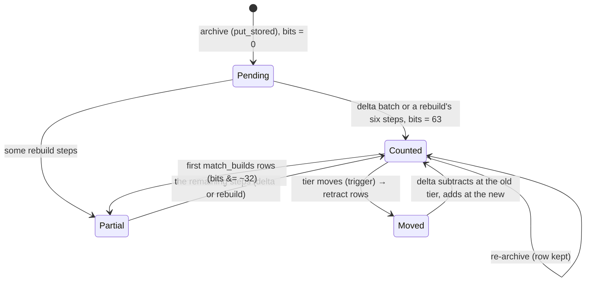
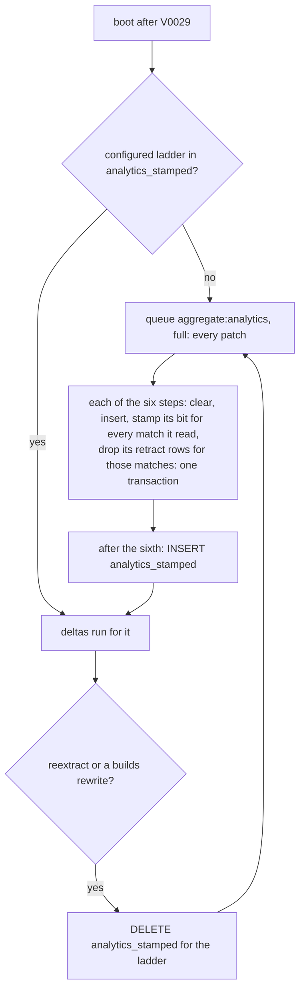
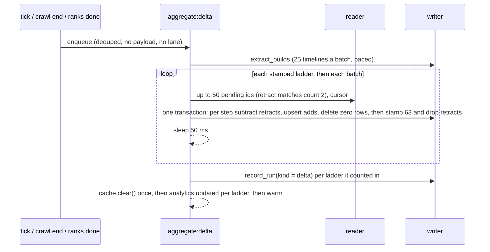

# THR-03 plan: incremental analytics (`aggregate:delta`)

Written 2026-10-21 against `origin/main` **32c4672** (v2.7.2, the version on production). Every `file:line` is at 32c4672. Every number below was produced in this session by the prototype in §16. Nothing under `src/` or `tests/` was edited before approval.

**Preflight.**
- `git fetch origin main` gives 32c4672. There are no open PRs.
- The latest migration is `V0028__jobs_crawl_matches.sql`, so this task's is **V0029**. The latest ADR is ADR-180. WR-03's handoff reserves **ADR-181** and adds no migration, so this task takes **ADR-182** (re-checked before merging).
- The implementation goes on `feat/THR-03-aggregate-delta`, in its own worktree (`../rp-thr03`), cut from `origin/main` after this plan merges.

**Implementation record.** *(Filled in after approval.)*

---

**The recommendation in one paragraph.** Every analytics table is a sum over disjoint matches, so all sixteen tables can be counted a batch at a time, set builds included. Nothing stored is a top-N: ADR-171's "four parts" is a list of four part kinds, and every `LIMIT` is applied at read time. So the hybrid the brief suggested isn't needed, and it would keep a set-build transaction of about 52 s (synthetic). What isn't additive is time: three inputs of a match change after it is counted. A late tier stamp (`UNKNOWN` → a tier, within 14 days) moves facts between tiers. A late timeline adds set builds. A re-extraction rewrites everything. The plan handles each one exactly:
- **Stamps, one bit per rebuild step.** A side table `analytics_counted (match_id, key_scope, bits)` holds one bit per rebuild step: champions, matchups, items, runes, spells, sets. The bits let a delta interleave with a rebuild and stay exact, and they settle gaps (j) and (k).
- **Late tier stamps.** A trigger on `match_facts.tier` records what each counted step saw (`analytics_retract`). The delta subtracts that and adds the match back at its new tier.
- **Late timelines.** A match's first `match_builds` rows clear only its sets bit.
- **Re-extraction.** Anything else un-stamps the ladder, and a full rebuild follows.

A delta batch is **50 matches in one write transaction: 138–154 ms at the median, 163 ms at worst in a run without a checkpoint stall**, on tables the size of production's oc1. On this container a WAL checkpoint inside a commit can stall any write for 1–2 s (§1.3, risk R1), and production already shows writes of 5–10 s with no rebuild running (§1.2). Production's rebuilds take 532–1,012 s a ladder and may run ~4× slower per match than here, so the batch sizes itself to a 150 ms target instead of a fixed count. A 100-match batch is 247–294 ms, so the row's 500 would take about 600 ms. Today's rebuild of the same archive holds the writer for 101 s, 52 s of it in one transaction. On the synthetic archive the delta's output equals a rebuild's, table by table. That held after 100,000 matches in 1,000 batches, after 5 % of `UNKNOWN` facts were late-stamped, and with a delta run between a rebuild's steps. V0029 is DDL only, 6–25 ms.

---

## 1. Measurements

### 1.1 The synthetic archive

The WR-02 database in `/tmp/wr02` couldn't measure this task. It has no `match_builds`, so the set builds are empty. Its runes predate DSK-05, so the runes step finds nothing. Its facts are at `facts_version` 3. So the prototype builds its own archive from `src/db/migrations` V0001–V0028 (`proto.py gen`, seed 1):
- 100,000 OC1 solo matches over four patches, ten participants each, two teams, five lanes.
- 2 % of players have no position and 2 % share a lane. 3 % of matches have a mirror lane, and 1 % are remakes.
- Champions are Zipf-weighted over 171. Each match has a base tier from Diamond to Challenger, with players ±1 around it, and **20 % `UNKNOWN`**.
- Items, positional runes (DSK-05), summoners and ten bans per match.
- 90 % of players have a `match_builds` row with 1–5 finished items.

After a rebuild it holds 660,818 `champion_matchup_builds` rows. Production's oc1 had 656,652 after its first FLT-04 rebuild (FLT-04 plan, production check), so these tables are the size of production's oc1 ladder. The other ladders are larger.

The rebuild is a port of `src/archive/analytics.rs:118-566` into Python, string for string (`proto.py`, "today's rebuild"). It runs on Python's SQLite 3.46.1; rusqlite bundles 3.5x. The time is in the SQL engine, so the two should agree within run-to-run noise. The implementation's Observed block re-measures through the binary.

### 1.2 Today's rebuild (the baseline)

`proto.py rebuild`, one ladder, every patch, each step one transaction (`src/jobs/analytics.rs:318-385`):

| step | transaction | ms |
|---|---|---|
| champions | slices, totals, stats, stats totals, bans, ban totals, floor totals (`rebuild_champions`, `analytics.rs:135`) | 23,218 |
| matchups | `rebuild_matchups` (`:352`) | 5,177 |
| items | first transaction of `rebuild_builds` (`:379`) | 14,427 |
| runes | second | 2,960 |
| spells | third | 2,901 |
| sets | set builds, parts, matchup builds, parts (`:447-488`) | **52,476** |
| **total** | | **101,159** |

The writer is held for the whole of each step. Anything queued behind a step waits for it, which is the queueing WR-02 made visible (`writerBusyMs:120688, writerQueued:8` on production's na1, ADR-180). The same rebuild took 114.9 s after 10,000 more arrivals (§1.5's reference) and 122.8 s after 11,500 (§1.6's).

**Production's numbers** (Q1, run by the owner on `ngf-prod-syd1` on 2026-10-21). Each ladder's last rebuild from `analytics_runs`; `builds` is four transactions: items, runes, spells, sets:

| ladder | ended (box clock) | champions s | matchups s | builds s | total s | games |
|---|---|---|---|---|---|---|
| oc1 solo | 2026-10-20 18:18 | 87.5 | 20.6 | 339.2 | 532.1 | 967,350 |
| na1 solo | 2026-10-20 17:06 | 199.3 | 46.3 | 712.3 | 969.9 | 2,402,760 |
| kr solo | 2026-10-20 03:12 | 208.1 | 46.8 | 710.5 | 1,012.3 | 2,224,260 |
| euw1 solo | 2026-10-19 21:52 | 187.7 | 41.2 | 704.9 | 980.1 | 2,079,490 |

- **The archive.** Ranked matches: EUW1 235,284, KR 241,063, NA1 240,276 and OC1 96,742 (solo), plus 3 OC1 flex and 383 on platforms with no ladder. `match_facts`: 6,815,503 rows with a known tier, 1,322,007 `UNKNOWN` (16.2 %, against the synthetic archive's 20 %) and 1,734 NULL (the facts of unranked queues, which `tiers::stamp` leaves alone, `tiers.rs:51-54`).
- **The synthetic oc1 is production's oc1.** It matches on matches (100,000 against 96,742), games (1,000,000 against 967,350), `UNKNOWN` share and matchup-build rows (§1.1). Production's rebuild takes 3.8× as long on champions (87.5 s against 23.2 s), 4.0× on matchups and 4.7× on builds (339 s against 72.7 s for the synthetic items, runes, spells and sets).
  - **Two causes, not separable from here.** Production's statements scan every platform's facts (8.1 M rows against 1.0 M), and its CPU and disk differ. The delta seeks by key, so only the second cause reaches it. It could still run up to ~4× slower per match than measured here.
  - **The answer is a self-sizing batch** (§1.3).
- **One switch-over is about an hour of writer.** It is 3,494 s over the four ladders (§6, Q3). Production already pays that once per round of crawl ends.
- **`sqlite_write_seconds` since the last restart** covers 1,145 writes with no rebuild among them: the longest rebuild step on record ran 87–712 s, and none appears.
  - **Already over the target without a rebuild.** 1,123 writes (98.1 %) took ≤ 100 ms, 15 took 100–250 ms, and **7 took over 250 ms**: one 0.25–0.5 s, two 0.5–1 s, two 1–2 s, one 2–5 s, one 5–10 s. The longest write with no rebuild running is already 5–10 s, which is R1 (§1.3) on production.
  - **What THR-03 can be held to.** Accept is "no delta transaction over 250 ms" (`proxy_aggregate_delta_batch_seconds`), plus "no write over a few seconds during a crawl that wasn't already there before THR-03". The longest write overall belongs to WR-03.
- **`sqlite_write_wait_seconds`:** 1,123 waits ≤ 100 ms and 4 over 5 s (5–10 s), mean 34 ms: writes queued behind those same slow ones.

### 1.3 A delta batch: cost against batch size

`proto.py delta DB N` with the server's pragmas: `cache_size=-65536`, `mmap_size=256 MiB`, `wal_autocheckpoint=1000`, `temp_store=MEMORY` (`src/db/mod.rs:27-38`). The measured span is one write transaction: `BEGIN IMMEDIATE` … `COMMIT`. The pending ids are read before it, as a reader would.

| tables | batch | tx ms p50 | p90 | max |
|---|---|---|---|---|
| empty (first batches of a from-scratch count) | 100 | 129 | 137 | 139 |
| empty | 250 | 307 | 330 | 341 |
| empty | 500 | 604 | 677 | 681 |
| full (oc1-sized), 2,000 arrivals, 5 runs | 100 | 247–294 | 259–359 | 272–633 in 3 runs; 2,376 and 2,388 in the 2 runs that hit a checkpoint stall |
| full, 2,000 arrivals, 4 runs | **50** | **138–154** | 148 in the clean run | **163** in the clean run; in the other 3, 5–9 of 40 batches took 1,009–1,437 ms |

The cost is linear: about 1.3 ms per match with empty tables and 2.5–2.9 ms per match with full ones. Most of it goes to upserting the per-match rows:
- 80 `champion_build_parts` rows a match (ten players, eight parts)
- about 50 `champion_items` rows
- about 32 `champion_matchup_build_parts` rows

In one profiled run (2,000 matches at 50, 5.6 s in all; `prof.py`), `COMMIT` took 2,236 ms (56 ms a batch), `champion_build_parts` 741 ms, `champion_items` 605 ms and `champion_matchup_build_parts` 335 ms.

**The outliers are SQLite's checkpoint, not the delta's SQL.** Two batch-100 runs were profiled per batch (`prof2.py`). Both slow batches (2,035 and 2,388 ms) spent 1,881 and 2,222 ms in `COMMIT`; their SQL took the usual ~150 ms. That is `wal_autocheckpoint` (1,000 pages) running inside the commit that crosses it, with its `fsync`. The batch-50 clusters have the same shape (several consecutive batches at about 1 s), but weren't profiled.
- **Any write can land on one.** On this container's storage a checkpoint can stall for seconds. Production's disk measured 3 ms p50 and 9 ms p99 for fsync when the box was set up (2026-10-13), and its `sqlite_write_seconds` will show whether it stalls too.
- **No extra checkpoints.** The delta doesn't make checkpoints more frequent than the same rows written in any other shape would.
- **The risk (R1).** Checkpoint stalls can break "longest write transaction under 250 ms" whatever the batch size. If production shows them, the remedy is WR-03's (checkpointing outside the writer's transactions), not a smaller batch. The ADR reports the delta's SQL time and the commit time separately, from `proxy_aggregate_delta_batch_seconds` and `sqlite_write_seconds`.

**So the batch sizes itself.** On this container 50 matches is about 150 ms. Production may be up to ~4× slower per match (§1.2), and a fixed 50 could then pass 500 ms. Each batch starts from the last one's measured time: `next = clamp(n × AGGREGATE_DELTA_TARGET_MS / elapsed_ms, 5, AGGREGATE_DELTA_BATCH)`.
- **The settings.** The first batch is 50, `AGGREGATE_DELTA_TARGET_MS` defaults to 150 and `AGGREGATE_DELTA_BATCH` (the cap) to 500.
- **Retracts.** A match with a retract to apply counts as two (§1.5).
- **Checkpoint stalls are ignored.** A commit that spent most of its time in a checkpoint (R1) would shrink the batch for no gain. So `elapsed` is the time before `COMMIT`, and the commit is reported apart (§11).
- **Throughput.** With a 50 ms pace between batches, even 10 matches a batch is about 50 matches a second, above any crawl's fetch rate (a few a second under the app limit).

### 1.4 Delta equals rebuild

All 100,000 matches were counted from nothing, 100 at a time (1,000 transactions, 259 s in total), and diffed against a rebuild (`proto.py diff`). Every table is compared on every column but `computed_at`:

| table | rows | |
|---|---|---|
| `analytics_slices` | 48 | same |
| `analytics_match_totals` | 8 | same |
| `champion_stats` | 54,111 | same |
| `champion_stats_totals` | 12,644 | same |
| `champion_bans` | 8,097 | same |
| `champion_ban_totals` | 1,368 | same |
| `analytics_floor_totals` | 80 | same |
| `champion_ban_floor_totals` | 13,680 | same |
| `champion_matchups` | 654,463 | same |
| `champion_items` | 2,110,636 | same |
| `champion_runes` | 407,745 | same |
| `champion_spells` | 225,676 | same |
| `champion_builds` | 747,399 | same |
| `champion_build_parts` | 4,690,353 | same |
| `champion_matchup_builds` | 660,818 | same |
| `champion_matchup_build_parts` | 2,417,306 | same |

### 1.5 Late tier stamps

`proto.py late DB 5` upgrades 5 % of the `UNKNOWN` facts to `MASTER`, one `UPDATE` each, as `late_stamp` would (`src/archive/tiers.rs:86`).
- 10,976 facts took **344 ms with the trigger**. The trigger wrote 65,856 retract rows over 10,492 matches: six steps had counted each fact.
- The delta then took back those matches' counts at the old tier and added them at the new one: 210 transactions, 50 matches each, **p50 301 ms**.
- The result equals a fresh rebuild in all sixteen tables.

A retract batch does twice the SQL of an add-only one, hence "counts as two". A second run late-stamped 4,210 facts in 150 ms.

### 1.6 A delta between a rebuild's steps

The sequence, on the full archive:
1. 1,000 arrivals, then 2 % of `UNKNOWN` late-stamped.
2. The rebuild's champions step alone (27.3 s).
3. A delta: 5,087 matches, p50 235 ms.
4. 500 more arrivals, then the other five steps (88.1 s).
5. A delta: 500 matches, p50 **26 ms**. Steps 2–6 had already counted them, so only their champions bit was missing.

The diff against a fresh rebuild: sixteen of sixteen the same. **So a delta needn't wait for a rebuild** (§6.3). The brief's "a delta queued while a rebuild runs waits" becomes a stronger test: an interleaved delta gives the rebuild's output.

### 1.7 Stamping inside the rebuild, and the migration

- The rebuild with stamps: 104.1 s when it creates every match's row (the first rebuild after V0029) and 106.5 s when all of them exist, against 101.2 s without. About 3 %.
- `analytics_counted` is about 25 bytes a match (2.8 MB for 111,500 matches, `dbstat`). A million matches would be about 25 MB.
- V0029 (§9) is three empty tables, one partial index, a trigger and a column on the 8-row `analytics_runs`. It took 5.7–24.4 ms on the 600 MB–1.8 GB copies. It reads no data, so production's 25 GB costs the same, and the journal's `current version: 29` follows at once.

---

## 2. What the row says that the code no longer does

| row says | 32c4672 | effect |
|---|---|---|
| (d) tier from `match_tiers` | `match_facts.tier` (V0019, DSK-04). `match_tiers` was dropped by V0019 (`V0019__tier_on_facts.sql:13`); only comments name it (`src/archive/tiers.rs:2`, `src/db/disk.rs:148`) | the delta reads `match_facts` as the rebuild does |
| "Depends on THR-02: … once a fact's tier never changes" | it does change. `late_stamp` upgrades `UNKNOWN` on matches that ended within `TIER_LATE_STAMP_DAYS` (14). It is called from ladder pages (`src/jobs/ladder/store.rs:270`) and every league lookup (`src/archive/ranks.rs:65`). `tiers::stamp` fills NULLs (`tiers.rs:37`) | §4.1: retracts |
| set builds are in "`rebuild_builds`" with the facts | they read `match_builds`, which `builds:extract` writes when a timeline arrives (`src/jobs/analytics.rs:488`). A timeline can come later than its match: TL-01's catch-up, TL-02's backfill | §4.2: the sets bit |
| (a) `matches.aggregated_at` | one match can hold facts under two key scopes: a re-archive under another key writes new encrypted PUUIDs (`src/archive/facts.rs:329`) | a side table keyed `(match_id, key_scope)` (gap (l)) |
| (f)/(k) "stamp in the last step" with "`archived_at ≤` start" | `archived_at` is rewritten on a re-archive (`src/archive/matches.rs:383`) and read only by offload | per-step bits instead (§3) |
| `_v` tables | `champion_stats_v17`, `…_v20`, `match_facts_v21`: temporaries inside V0017/V0020/V0021, renamed back to the real names. Nothing in `src/` names them | nothing to plan |
| ADR-171's "four-part limit" | four part kinds (`item3`, `boots`, `runes`, `spells`; `analytics.rs:527`). No `LIMIT` or rank in any rebuild statement; every `LIMIT` is in a read (`analytics.rs:1130`, `:1315`, `:1362`) | every table is additive (§3) |
| `winRateLow` | computed at read time (ADR-171, `rate()`'s neighbour in `src/routes/analytics.rs`) | nothing stored depends on a whole slice |
| (i) the `ETag` follows `computed_at` | it follows the newest `computed_at` **of the rows returned** (`src/routes/analytics.rs:1049`, `:1153`, `:1285`). The pick and ban rates come from the slices and totals (`rates`, `:760`), whose stamp isn't in the tag. Today every row of a ladder shares one `computed_at`, so it never mattered | §7: the slice's stamp joins the tag |
| (e) `archive:batch` | doesn't exist (THR-01 is open) | — |
| `AGGREGATE_INTERVAL_S` ticks | default 0, and production doesn't set it. Production rebuilds at crawl end (`src/jobs/ladder.rs:797-805`), after `ranks:lookup` (`src/jobs/ladder/ranks.rs:145`) and from the dashboard | §8 |

## 3. Which tables are additive

A match is in exactly one batch, and every statement groups by keys that include the patch and remake. So a sum, a `count(*)` or a `count(DISTINCT match_id)` over a batch adds to the same over another batch. The lane head count (`lanes`, `analytics.rs:325-337`) is a window over one match's facts, and `floor_top` (`:255-259`) is a `GROUP BY match_id`. Both sit inside one match, so batching can't split them.

| step (bit) | tables | inputs | additive |
|---|---|---|---|
| champions (1) | `analytics_slices`, `analytics_match_totals`, `champion_stats`, `champion_stats_totals`, `champion_bans`, `champion_ban_totals`, `analytics_floor_totals`, `champion_ban_floor_totals` | facts, `matches` (patch, remake, duration), `match_bans` | yes. `champion_stats_totals` is the batch's own stats rows summed over tier, as the rebuild sums its own (`:189-201`) |
| matchups (2) | `champion_matchups` | facts | yes |
| items (4) | `champion_items` | facts (`items`) | yes. Its `count(DISTINCT match_id ‖ puuid)` is per player |
| runes (8) | `champion_runes` | facts | yes |
| spells (16) | `champion_spells` | facts | yes |
| sets (32) | `champion_builds`, `champion_build_parts`, `champion_matchup_builds`, `champion_matchup_build_parts` | facts, **`match_builds`** | yes, given its `match_builds` (§4.2) |

The bits are the rebuild's six transactions, because a rebuild stamps a step's bit in that step's own transaction (§6). ADR-171 chose to keep every row, the owner accepted the size (ADR-171 "Size: accepted"), and a read caps it. So keeping every row costs nothing new. That answers the brief's question 2: no table needs its own slower cadence.

## 4. Inputs that change after a match is counted

Every writer of an input after a match's first archive, from a sweep of `src/`, and what each does after V0029:

| writer | change | handled by |
|---|---|---|
| `late_stamp` (`tiers.rs:86`; ladder pages, league lookups) | `UNKNOWN` → tier, matches that ended in the last 14 days | trigger → `analytics_retract` → the delta subtracts and re-adds (§4.1) |
| `tiers::stamp` (`tiers.rs:37`; at archive, `tiers:backfill`) | NULL → tier | the same trigger. At archive the match has no bits yet, so the trigger writes nothing |
| `builds::write` (`src/archive/builds.rs:381`), first rows for a match | none → some | clears the match's sets bit (§4.2) |
| `builds::write` replacing rows (a `BUILDS_VERSION` bump) | old builds → new | un-stamps the ladder (§4.3) |
| `facts:reextract` (`src/jobs/analytics.rs:404`) | facts, bans, remake, duration at a new `FACTS_VERSION` | un-stamps the ladder of each counted match it rewrites, in that batch's transaction; queues the rebuilds when it ends (§4.3, gap (g)) |
| re-archive (`put_stored`, `matches.rs:351`; `?refresh=true` or an unreadable body) | the same body gives the same facts; `facts::write` never touches `tier` (`facts.rs:324-328`) | nothing: the stamp row survives (`INSERT OR IGNORE`), so the match isn't counted again |
| re-archive under another key scope | new facts under that scope | a new `(match_id, key_scope)` row. The analytics are per key scope, so counting it there is right |

### 4.1 Retracts

```sql
CREATE TRIGGER match_facts_tier_moved AFTER UPDATE OF tier ON match_facts
  WHEN OLD.tier IS NOT NEW.tier
BEGIN
  INSERT OR IGNORE INTO analytics_retract (match_id, key_scope, puuid, step, tier)
  SELECT OLD.match_id, OLD.key_scope, OLD.puuid, s.bit, OLD.tier
    FROM analytics_counted c
    JOIN (SELECT 1 AS bit UNION ALL SELECT 2 UNION ALL SELECT 4 UNION ALL SELECT 8
          UNION ALL SELECT 16 UNION ALL SELECT 32) s ON c.bits & s.bit
   WHERE c.match_id = OLD.match_id AND c.key_scope = OLD.key_scope;
END;
```

How a retract works:
- **One row per step that counted the fact**, holding the tier that step counted it at. `OR IGNORE` keeps the oldest row, so a fact that moves twice (NULL → `UNKNOWN` by backfill, then `UNKNOWN` → `MASTER` late) keeps what was counted.
- **Per step, because the steps can differ.** Between a rebuild's champions step and its sets step, a late stamp can land. Then champions counted the old tier and sets the new one, and only champions' row is written.
- **The delta's handling.** For each step, the delta subtracts that step's counts for the match with its facts at the recorded tiers (`temp.rf`). It adds the counts back at today's tiers. It deletes the retract rows in the same transaction.
- **A rebuild step that recounts the match** deletes that step's retract rows for the matches it counted (§6).
- **Rows that reach zero are deleted** (`games`, `matches` or `bans` = 0; the rebuild never writes one), so the delta's output is the rebuild's. Only a batch with a retract can produce one, so the add-only path skips the check.

**A trigger, not code in `tiers.rs`:** every path that moves a tier, now and later, writes the row, and the trigger's cost is one key seek per updated fact. **Rejected:**
- subtracting inline in `late_stamp`: a ladder page can place 200 players with several matches each, which would put seconds of analytics work into the page's transaction;
- waiting 14 days before counting a match with an `UNKNOWN` player: 20 % of the synthetic facts are `UNKNOWN`, so most matches would wait two weeks.

### 4.2 Late timelines

`builds::write` checks whether the match had any `match_builds` rows before its `DELETE` (`builds.rs:381-407`).
- **No rows before.** The match's set-build count was zero, so `UPDATE analytics_counted SET bits = bits & ~32` leaves the match due for its sets step only. The next delta adds it.
- **Rows before.** This is a version rewrite, so §4.3 applies.

The delta runs `extract_builds` first, as the rebuild does (`analytics.rs:261-264`), so a crawl's timelines are derived before their matches are counted, and the bit is seldom cleared.

### 4.3 Un-stamping a ladder

Deleting a ladder's `analytics_stamped` row (§6) means "this ladder's tables no longer match its stamps". The writer that rewrites a counted match's inputs deletes it in the same transaction as the rewrite: a `facts:reextract` batch, or `builds::write` replacing rows. A sweep that stops part-way has then already un-stamped every ladder it touched. The delta skips the ladder and queues `aggregate:analytics` for it. That rebuild is full, as an unsplit ladder's is (`analytics.rs:329-336`), stamps every match it counts, and writes the row back. Until it runs, the old numbers stand, as they do today between a re-extraction and the next rebuild.

## 5. The stamp



- **`analytics_counted (match_id, key_scope, bits) WITHOUT ROWID`.** The key is gap (l)'s `(match_id, key_scope)`. `bits` holds the six steps of §3, and 63 means counted.
- **Created where the facts are written.** `put_stored` (`matches.rs:351`) and `facts:reextract` insert `(id, scope, 0) OR IGNORE` for solo and flex, in the transaction that writes the facts (`matches.rs:397-400`). A match is pending from the moment it has facts.
- **Selected through a partial index.** `analytics_uncounted ON analytics_counted (key_scope, match_id) WHERE bits <> 63` serves the delta's pending read. The read seeks one platform's id range (`OC1_` up to the next character), as `LATE_STAMP` does (`tiers.rs:88`).
- **Facts that aren't current wait.** A pending match whose `matches.facts_version` is below `FACTS_VERSION` isn't counted; it waits for the sweep (the brief's point 5). The delta walks the index with a cursor, so it doesn't re-read those matches in one run.

## 6. The switch-over and the rebuild contract (gaps (j), (k))



1. **V0029 creates `analytics_stamped (key_scope, platform, queue, at)` empty.** No ladder is stamped, so no delta runs anywhere before a full rebuild (gap (j)).
2. **At boot,** every `LADDER_PLATFORMS` × `LADDER_QUEUES` ladder without a row queues `aggregate:analytics`, as `split_if_needed` does for V0017 (`src/cli/serve.rs:302-304`). `JOB_KIND_LIMITS` runs one at a time (`src/config.rs:111`). Q3 asks whether the owner would rather press Recompute per ladder instead.
3. **A rebuild of an unstamped ladder is full** (every patch, ignoring `AGGREGATE_PATCH_LIMIT`; gap (j)).
4. **Each step stamps in its own transaction** (gap (k)). After its `INSERT`s it runs `INSERT INTO analytics_counted … SELECT DISTINCT match_id, ?1, bit {the step's match set} ON CONFLICT DO UPDATE SET bits = bits | bit WHERE bits & bit = 0`, then deletes that step's `analytics_retract` rows for those matches. Each step stamps what it counted, so the match set needn't be fixed at the start: a match archived between steps gets the later steps' bits, and a delta adds the rest (§1.6).
5. **The stamped row is written after the sixth step.** `analytics_stamped` gets its row only once all six succeed. A rebuild stopped part-way leaves the ladder unstamped, so the next rebuild is full again.
6. **A rebuild of a stamped ladder** limited to the newest `AGGREGATE_PATCH_LIMIT` patches stamps only those patches' matches; older ones keep their bits (gap (k)'s last sentence).
7. **Deltas and rebuilds may interleave.** A step replaces its tables wholesale for its patches and stamps exactly what it read. A delta adds only the missing bits. So any order of the two is exact (§1.6). No lock or wait is needed, and `ranks_done`'s wait for a running recompute (`src/jobs/ladder/ranks.rs:142-167`) goes away.

## 7. The delta (`aggregate:delta`)



- **The job.** `kinds::AGGREGATE_DELTA`, priority `MAINTENANCE`, deduped to one (`.dedupe(kind)`, as `reextract_job`, `analytics.rs:86-88`). It has no lane, as it calls no Riot (`src/jobs/lanes.rs:4-6`).
- **Per ladder.** It walks `analytics_stamped`, and within a ladder `analytics_uncounted` by match id. A batch's matches are grouped by `matches.queue_id`, so one job serves every ladder (the brief's "group by `(platform, queue)`"). A ladder with pending matches but no stamped row, if configured, gets an `aggregate:analytics` queued (§6).
- **One write transaction per batch:**
  - `CREATE TEMP TABLE batch`: the ids with their bits.
  - `temp.df`: the batch's facts, read by key through a `CROSS JOIN`. Without the `CROSS JOIN` the planner scanned `match_facts` instead: 2.2 s a batch on the prototype.
  - Per step: for its retract matches, its statements over `temp.rf` (the facts at the recorded tiers) into `temp.d_*`, negated. Then its statements over `temp.df`, restricted to the matches missing the bit or holding a retract for it.
  - The add-only path, with no retract in the batch, upserts straight from each `INSERT … SELECT`. The rebuild's SQL is reused unchanged: `ladder_facts`, `lanes` and `set_build_players` gain a facts-source argument (`match_facts` or `temp.df`/`temp.rf`) and an extra predicate, as `ladder_facts(join)` gained its join.
  - Every upsert is `ON CONFLICT (pk) DO UPDATE SET c = c + excluded.c, …, computed_at = excluded.computed_at` (row (i)).
  - Then `bits = 63` and the batch's retract rows deleted, in the same transaction. A crash between batches loses nothing and counts nothing twice.
- **Pacing.** `REEXTRACT_PACE` (50 ms, `analytics.rs:38`) between batches. The job stops when every ladder's read comes back empty.
- **Once a run, not per batch:**
  - `cache.clear()` (PERF-03's generation), then `analytics.updated` for each ladder it counted in, then `cache.warm`. Clearing per batch would make the response cache useless during a crawl: at 50 matches a batch it would clear several times a second.
  - The cost of once a run: a cached response can be up to one run old. A run is about 0.2 s per 50 matches, and with the tick at 60 s, a response is at most one tick plus one run old. The ADR says so.
  - The event's `tables` holds the rows upserted per table, keyed like the rebuild's (the nine keys `acceptance/phase7-ladder.test.ts:296-305` lists), so a client reading it needs no change.
- **Any patch.** The delta ignores `AGGREGATE_PATCH_LIMIT`: a match is counted in its own patch, however old. The limit only bounds what a rebuild recomputes.
- **What it doesn't do.** It doesn't run `tiers:backfill`: the trigger makes a late NULL fill a retract. It doesn't run `optimize` (`analytics.rs:255`): ADR-102's statistics matter for the rebuild's full scans, not for seeks by key.

**`ETag`s (row (i), extended).** Every touched row gets `computed_at = now`. That isn't enough for the routes whose body carries pick or ban rates. Their tag is the newest stamp of the rows returned (`src/routes/analytics.rs:1049`, `:1153`, `:1285`), so a batch that adds a game only to a champion outside the returned list changes the rates' denominator (`rates`, `:760`) and leaves the tag alone: a stale `304`. The fix:
- **The new part.** Every analytics tag gains one part, the newest `computed_at` of the read's `analytics_match_totals` rows (key scope, queue, platform or all, patch or all). That is a seek on its key.
- **Why it covers every route.** Every counted match upserts its patch's totals row, so any batch that touches a slice moves every tag in that slice. It over-invalidates (another champion's game moves this champion's tag) and never misses.
- **The cost.** Every analytics `ETag` changes once at deploy (Q4).
- **The integration tests' slice.** It is `(platform, queue, patch)`: a delta in another patch or platform leaves the tag alone and still gives `304`.

## 8. Triggers and settings

| when | today | after |
|---|---|---|
| every `AGGREGATE_DELTA_S` (new, **default 60**, 0 = off) | — | `aggregate:delta` |
| crawl completed (`ladder.rs:800-802`) | `aggregate:analytics` | `aggregate:delta` (with the delta off: as today) |
| `ranks:lookup` done (`ladder/ranks.rs:145-167`) | `aggregate:analytics`, waiting out a running one | `aggregate:delta`, no wait |
| `facts:reextract` | nothing | each batch un-stamps the ladders of the counted matches it rewrites; at the end, `aggregate:analytics` for every configured ladder left unstamped |
| `AGGREGATE_INTERVAL_S` (default 0) | `aggregate:analytics` | unchanged: a periodic repair, off by default |
| dashboard Recompute, `POST /v1/admin/analytics/recompute` | `aggregate:analytics` ahead of the queue | unchanged: the repair path |
| `archive:match` archived something new | nothing | nothing (Q2) |

- **The brief's `archive:match` trigger is dropped** (Q2). The tick bounds staleness at 60 s on its own. A trigger per archive would either run the delta at fetch rate, clearing the response cache every few seconds, or need a delay. And a dedupe key that is also held while the job runs drops the wake-up of a match archived as the delta finishes (`jobs_dedupe`, `V0001__init.sql:44`; `enqueue_on`, `src/jobs/scheduler.rs:225-254`). The tick costs one job row and one indexed read a minute.
- **`AGGREGATE_DELTA_S=0` is the kill switch.** Everything is then as at 32c4672: crawl end and lookups queue the rebuild. The stamps still go on, so turning the delta back on needs no new full rebuild.
- **`AGGREGATE_DELTA_TARGET_MS`** (default 150, 20–1,000) and **`AGGREGATE_DELTA_BATCH`** (the cap, default 500, 5–5,000) size the batches (§1.3). `JOB_KIND_LIMITS`'s default gains nothing: the dedupe already keeps one delta.

## 9. V0029

```sql
-- THR-03 (ADR-182): which rebuild steps count each match (bits: 1 champions, 2 matchups,
-- 4 items, 8 runes, 16 spells, 32 sets; 63 = all), what a step counted for a fact whose
-- tier has moved since, and which ladders' tables agree with their stamps. Empty tables:
-- the first rebuild of each ladder stamps it.
CREATE TABLE analytics_counted (
  match_id  TEXT NOT NULL REFERENCES matches(match_id) ON DELETE CASCADE,
  key_scope TEXT NOT NULL,
  bits      INTEGER NOT NULL,
  PRIMARY KEY (match_id, key_scope)
) WITHOUT ROWID;
CREATE INDEX analytics_uncounted ON analytics_counted (key_scope, match_id) WHERE bits <> 63;
CREATE TABLE analytics_retract (
  match_id  TEXT NOT NULL REFERENCES matches(match_id) ON DELETE CASCADE,
  key_scope TEXT NOT NULL,
  puuid     TEXT NOT NULL,
  step      INTEGER NOT NULL,                 -- one bit
  tier      TEXT,                             -- the tier that step counted the player at
  PRIMARY KEY (match_id, key_scope, puuid, step)
) WITHOUT ROWID;
CREATE TABLE analytics_stamped (
  key_scope TEXT NOT NULL, platform TEXT NOT NULL, queue TEXT NOT NULL,
  at        INTEGER NOT NULL,                 -- when its last full rebuild finished
  PRIMARY KEY (key_scope, platform, queue)
) WITHOUT ROWID;
-- the trigger of §4.1
-- analytics_runs: a delta's last run beside the rebuild's
CREATE TABLE analytics_runs_v29 (… as V0006, plus kind TEXT NOT NULL DEFAULT 'rebuild',
  PRIMARY KEY (key_scope, platform, queue, kind));
INSERT INTO analytics_runs_v29 SELECT *, 'rebuild' FROM analytics_runs;
DROP TABLE analytics_runs; ALTER TABLE analytics_runs_v29 RENAME TO analytics_runs;
```

- **`ON DELETE CASCADE` to `matches`**, as `match_facts`, `match_bans` and `match_builds` have (V0020, V0021), so a deleted match takes its stamp and retracts with it (`foreign_keys = ON`, `src/db/mod.rs:30`).
- **The trigger's step list** is a `UNION ALL`, the form measured in §1.5.

## 10. Dashboard and admin

- **`analytics_runs` gains `kind`** (`rebuild`, `delta`). `record_run` (`analytics.rs:165`) takes it, and `/v1/admin/analytics/runs` and `/v1/admin/metrics`' `lastRuns` return both rows per ladder with a `kind` field.
- **A delta's row:**
  - `steps` is `{"delta": seconds}`;
  - `rows` holds the rows upserted under the nine keys;
  - `games` is the ladder's.
- **`admin.html` is at 159,842 of 160,000 bytes** and needs no change. Its runs table prints each run's steps (`src/ui/admin.html:1942`), so a delta's row reads "delta 0.4", and the Recompute button stays the repair path.
- **One wrong word.** The panel's meta line says "N ladder(s)" from the row count (`admin.html:1933`) and will count two per ladder. That costs no bytes to leave; changing the word is a follow-up if the owner wants it.
- **`acceptance/phase7-ladder.test.ts:270-305`** finds the ladder's newest run. A delta's row carries the same nine `rows` keys, so the test is unchanged. The FLT-05 gotcha is checked in CI either way.

## 11. Metrics

| name | type | labels | |
|---|---|---|---|
| `proxy_aggregate_delta_matches_total` | counter | `platform`, `queue`, `kind` (`added`, `retracted`) | matches counted or taken back |
| `proxy_aggregate_delta_batch_seconds` | histogram | `platform`, `queue`, `part` (`sql`, `commit`) | one batch's write transaction, its statements and its `COMMIT` apart, buckets 0.01–5 s |
| `proxy_aggregate_delta_batch_size` | gauge | — | the last batch's matches |
| `proxy_aggregate_delta_pending` | gauge | — | pending matches at a run's start, read from `analytics_uncounted` |

`proxy_aggregate_runs_total` gains `kind`. `sqlite_write_seconds` (WR-02) remains the judge of the Accept column. All of these go in `CATALOGUE` (`src/metrics.rs`) and `docs/design/metrics.md`.

## 12. WR-03

A batch is one transaction of about 150 ms. Interrupted at shutdown, it rolls back with its stamps, so the restarted delta counts it again exactly once. A stop loses at most one batch and never double-counts (test §13, "a crash between two batches"). The ADR notes it. Neither task depends on the other's code.

## 13. Tests

**`src/archive/analytics/tests.rs`**, seeded from its hand-computed fixtures:
- *property*: random matches built from the fixtures' players with `proptest` (already a dev-dependency), split into random batches; delta output equals rebuild output, table by table, all sixteen;
- a crash between two batches (a forced error in batch 2) loses nothing and counts nothing twice;
- rebuild then delta changes no row; delta then rebuild changes no row;
- a re-archived match (same id) isn't counted again;
- a match with one Master and one Grandmaster player adds 1 to `analytics_slices.matches` in both tiers and 1 to `analytics_match_totals`;
- the first aggregation after V0029 is a full rebuild and leaves every table unchanged, while a delta before it does nothing;
- a delta between a rebuild's steps gives the rebuild's output (§1.6);
- late stamp: a fact `UNKNOWN` → `MASTER` after counting; the delta equals a rebuild. The same between a rebuild's champions and sets steps (the per-step retract), and for a fact that moves twice;
- the first `match_builds` for a counted match clears only bit 32, and the delta adds only set builds; a rewrite un-stamps the ladder;
- a stale `facts_version` match waits; `facts:reextract` un-stamps its ladders;
- zero rows deleted after a retract.

**`src/jobs/analytics.rs`**: the sizing rule (a slow batch halves the next, a fast one grows it to the cap, never under 5, the commit's time left out).

**`src/jobs/analytics.rs`** (paused time): a delta over 10,000 pending matches never holds the writer longer than one batch. `Db::writer_status()` is sampled between batches and the per-batch histogram is checked; no batch over its size is recorded.

**`src/db/tests.rs`**: `v0029_creates_the_stamp_tables_and_trigger`; the trigger writes one row per counted step and none for an uncounted match.

**`tests/analytics.rs`** (`tests/it.rs` modules; a new file is added to `tests/it.rs`, or the CI-04 guard fails):
- a read; a delta adding one game to a row in that slice; the same read with `If-None-Match` gives `200` with a new `ETag`;
- a delta touching only another patch gives `304`;
- a delta adding a game to a champion *outside* the returned list moves the champions route's tag (§7, the stale-`304` case);
- PERF-03: the cache serves the old generation until the run ends, then misses once;
- the OpenAPI snapshot gains `kind` on runs.

**Mutation checks**, as FLT-04 did: drop the `excluded.` sum for one column; stamp before the upsert in a separate transaction; the trigger without `WHEN OLD.tier IS NOT NEW.tier`; the rebuild stamping all bits in its first step; the selection without the `facts_version` check; the tag without the totals part. Each must fail a test.

## 14. Docs in the same PR

- `docs/design/04-data-and-cache.md`: §Analytics (the stamp, the additive rule, retracts, un-stamping) and §Analytics reads (the line "change only when `aggregate:analytics` commits" becomes "a delta or a rebuild").
- `docs/design/06-jobs-and-realtime.md`: §Job catalogue (`aggregate:delta`), the crawl-end and `ranks:lookup` rows.
- `docs/design/07-deployment.md`: config (`AGGREGATE_DELTA_S`, `AGGREGATE_DELTA_TARGET_MS`, `AGGREGATE_DELTA_BATCH`).
- `docs/design/metrics.md`.
- `docs/data/schema.md`, `docs/data/migrations.md`, `docs/workflows/adding-a-migration.md` and `docs/_meta/inventory.md` (29 migrations; V0030 next; `docs/thr/` beside `docs/flt/` and `docs/perf/`, which this plan's PR left out to keep that page's footer honest).
- `docs/operations/runbook.md` and `troubleshooting.md`: when to press Recompute now (after a manual DB edit, after `AGGREGATE_DELTA_S=0`, or when a diff shows drift).
- `docs/api/*`: `kind` on runs; the `ETag` paragraph.
- `docs/_meta/changelog.md`.
- ADR-182 with the Observed blocks. Every page whose **Sources:** cite a changed file is refreshed; `docs-guard.py origin/main HEAD`, `linkcheck.py docs` and `mermaidcheck.sh docs` are run.
- The THR-03 row's Files/Tests columns in `docs/IMPLEMENTATION.md:337` are refreshed; `PROGRESS.md:260` is ticked.
- `scripts/thr03-synthetic.py`: the prototype, so the numbers can be re-measured as `scripts/perf-synthetic.py` lets PERF's be.

## 15. Questions for the owner

**Q1. Production's numbers.** Answered 2026-10-21; they are in §1.2.

**Q2. Triggers:** a 60 s tick instead of a trigger per archived match (§8)? *Recommended: the tick.*

**Q3. The one-time full rebuilds** after deploy (one per ladder, one at a time: about 58 minutes of writer in all by the last runs, oc1 532 s, na1 970 s, kr 1,012 s, euw1 980 s; §1.2). Queued at boot, or left for you to press Recompute per ladder at a quiet hour? Until a ladder's rebuild finishes, that ladder gets no delta and is aggregated by rebuilds, as today. *Recommended: queued at boot.* Crawls are paused, so nothing is waiting on the writer. A restart during the hour costs only the rebuild in progress. **Rejected:** stamping from each ladder's last run instead of rebuilding. Late stamps since those runs moved tiers the tables still count at the old value, and the trigger didn't exist to record them, so the stamps would bake in a drift that no delta corrects.

**Q4. Every analytics `ETag` changes once** at deploy (the totals' stamp joins the tag, §7). *Recommended: yes; it fixes a stale `304` the delta would otherwise cause.*

**Q5. A self-sizing batch** (target 150 ms, first batch 50, cap 500; §1.3) instead of a fixed 500? *Recommended: self-sizing.*

## 16. The prototype (in `/home/dev/thr03`, not in the repo)

- `proto.py`, with these modes:
  - `gen`: the archive of §1.1;
  - `rebuild` and `rebuild-stamp`: §1.2 and §1.7;
  - `rebuild-steps`: §1.6;
  - `migrate`: V0029's DDL;
  - `pending`;
  - `arrive DB N SEED`: a crawl's arrivals, ids from `10,000,000 × SEED` up, pending;
  - `late DB PCT`: late-stamp PCT % of the `UNKNOWN` facts (seed 2);
  - `delta` and `deltas`: §1.3;
  - `diff`.
- `prof.py`: per-statement totals.
- `prof2.py`: a breakdown of each slow batch.

The databases were deleted after use to stay inside the container's disk.
