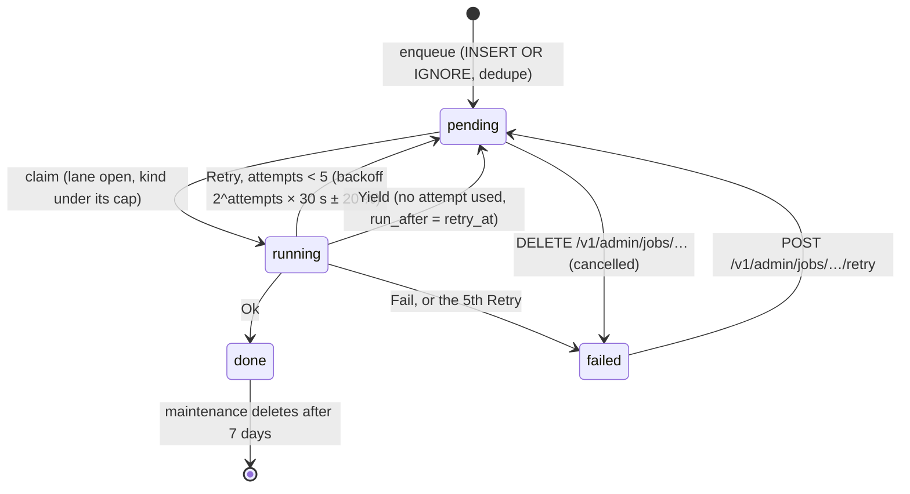

# Adding a background job

How to add a job kind to the durable queue: the kind string, its lane, the handler and its registration, priority and dedupe, how it talks to Riot and the limiter, how failures are retried, how it is enqueued, and the tests and documents that go with it.

## How the queue works, in one paragraph

The `jobs` table is the queue. `JOB_CONCURRENCY` workers claim the best ready row with one `UPDATE … RETURNING` on the single writer, run the kind's handler, and mark the row `done`, or put it back to `pending` with backoff or a yield (`src/jobs/scheduler.rs:1-19`). Enqueue is `INSERT OR IGNORE` against `UNIQUE(kind, dedupe_key) WHERE state IN ('pending','running')` (`src/db/migrations/V0001__init.sql:44`). Rows left `running` by a dead process go back to `pending` at boot (`Scheduler::recover`). Handlers must be idempotent: a job can run again after a crash between its work and its `done` (`src/jobs/scheduler.rs:153-154`). The design is `docs/design/06-jobs-and-realtime.md`; the running system is described in [../architecture/concurrency-and-rate-limiting.md](../architecture/concurrency-and-rate-limiting.md).

One-sentence caption: the states a job row moves through and what sends it back.



The numbers are `MAX_ATTEMPTS = 5`, `BACKOFF_BASE = 30 s` and `backoff()` (`src/jobs/scheduler.rs:39-42`, `159-165`); the admin transitions are `retry`, `cancel` and `purge` (`docs/design/06-jobs-and-realtime.md:105-107`).

## Steps

### 1. The kind string

Add a constant to `jobs::kinds` and append it to `kinds::ALL` (`src/jobs/mod.rs:19-68`). The name is `area:verb` in v1's style (`poll:live`, `archive:match`). `ALL` is what `JOB_KIND_LIMITS` validates against and what `GET /v1/admin/jobs?kind=` accepts (`src/config.rs:1108-1139`; ADR-137).

### 2. Lane, or cap

Decide whether the job calls Riot:

- **It calls Riot.** Give it a lane in `jobs::lanes::of` and add the kind to `LANED` (`src/jobs/lanes.rs:44-78`). The lane is the limiter scope its requests hit (the platform for league and spectator methods, the region for match-v5) and the method it mainly calls, derived from the kind and payload at enqueue so every producer agrees (`src/jobs/lanes.rs:1-6`); use `on(method, platform)` or `on_region(method, region)` (`src/jobs/lanes.rs:26-40`). The claim then skips the kind while the limiter has no bulk room for that lane and method, and spreads workers across lanes (`src/jobs/scheduler.rs:7-9`). A laned kind **cannot** be capped by `JOB_KIND_LIMITS`: the config refuses it with `'<kind>' calls Riot; the rate limiter paces it` (ADR-134, `docs/DECISIONS.md:1448`).
- **It does not.** Leave it out of `of` and `LANED`. It is then always claimable and becomes cappable: operators may write `JOB_KIND_LIMITS=<kind>=1`, and the default already caps `aggregate:analytics` and `archive:offload` at one (`src/config.rs:111`). If the job is heavy on CPU or the write lock, say so in `.env.example`'s comment for `JOB_KIND_LIMITS` (`.env.example:31-34`) and consider adding it to the default.

### 3. The handler

The trait is one method (`src/jobs/scheduler.rs:153-157`):

```rust
pub trait Handler: Send + Sync + 'static {
    fn run<'a>(&'a self, job: &'a Job) -> BoxFuture<'a, Result<(), JobError>>;
}
```

`Job` carries `id`, `kind`, `dedupe_key`, `priority`, the JSON `payload`, `attempts` (including this run) and `run_after` (`src/jobs/scheduler.rs:94-106`); `job.payload::<T>()` deserialises it and turns a bad payload into `JobError::Fail` (`src/jobs/scheduler.rs:108-111`). The pattern in every module is a context struct shared by `Arc`, a thin newtype handler, and the work in an `async fn` on the context (`src/jobs/names.rs:193`, `208-212`):

```rust
pub struct ClashSyncHandler(pub Arc<ClashContext>);   // hypothetical

impl Handler for ClashSyncHandler {
    fn run<'a>(&'a self, job: &'a Job) -> BoxFuture<'a, Result<(), JobError>> {
        Box::pin(self.0.sync(job))
    }
}
```

Register it in `jobs::handlers`, which builds the `Registry` with `.with(kinds::X, handler)` and is called once by `serve` (`src/jobs/mod.rs:88-162`). A kind that exists only under some configuration is added afterwards in `serve`, as the two bucket kinds are (`src/cli/serve.rs:248-270`). A job whose kind has no handler fails with `no handler for job kind '…'` (`src/jobs/scheduler.rs:1126-1129`).

### 4. Priority, dedupe, payload

- **Priority bands** are constants in `jobs::priority`: `INTERACTIVE` 0, `ARCHIVE_DEPTH` 100 (+ depth/10), `POLL` 10 000, `BACKFILL` 20 000, `MAINTENANCE` 30 000, `TIMELINE_BACKFILL` 40 000; lower runs first (`src/jobs/mod.rs:71-86`; `docs/design/06-jobs-and-realtime.md:84-97`). Pick the band by who waits for it; every enqueue sets one explicitly.
- **Dedupe key.** `NewJob::new(kind, priority, payload).dedupe(key)`; a job without a key is never deduped (`src/jobs/scheduler.rs:51-78`). The key names the unit of work: a PUUID for polls, a match id for `archive:match`, `platform:queue` for a ladder, the kind itself for a singleton (`src/jobs/ticks.rs:58-63`, `76-80`). `Queue::enqueue` returns `Enqueued { id, created }`; `enqueue_or_promote` lifts a pending duplicate to the better priority instead (`src/jobs/scheduler.rs:80-92`, `418-450`).
- **Payload** is a `serde_json::Value`, stored as text; keep it small and camelCase as the existing ones are (`{"puuid", "platform"}`, `{"matchId", "puuid", "fetchTimeline"}`).

### 5. Calling Riot from a job

Every job fetch uses `Fetcher::fetch(req, FetchOptions::JOB)`: bulk priority, no bypass, and a wait of at most `JOB_YIELD_BUDGET_MS` for the limiter before the fetch fails with `limited_until` set (`src/fetcher.rs:123-140`). Convert the error with `JobError::from_fetch`, which yields when the limiter had no room and retries otherwise (`src/jobs/scheduler.rs:131-142`); `archive:match` is the model, including treating an upstream 404 as `Fail` because retrying cannot help (`src/jobs/archive.rs:227-262`). A long job hands its worker back between batches with `JobError::take_turns()` (yield with `retry_at = now`), optionally carrying a new payload so it resumes where it stopped (`src/jobs/scheduler.rs:123-129`, `144-150`; `ladder:walk` every 10 pages, `timelines:backfill` every 25 timelines).

### 6. Activity tracing

Call `activity::step("GOLD II page 12 on na1")` at each unit of progress, `activity::event(kind, text, ms)` for something to log without changing the "now" line, and `activity::now(text)` for the momentary (`src/jobs/activity.rs:363-378`). They do nothing outside a job and feed `GET /v1/admin/jobs/activity` and the dashboard's Jobs tab (`docs/design/06-jobs-and-realtime.md:120-127`). The fetcher reports each Riot call on its own.

### 7. Failure semantics

| Return | Effect | Lines |
|---|---|---|
| `Ok(())` | `done`, `proxy_jobs_total{job,status="completed"}` | `src/jobs/scheduler.rs:1078-1081` |
| `Err(JobError::Retry(msg))`, `attempts < 5` | `pending`, `run_after = now + 2^attempts × 30 s × [0.8, 1.2]`, `error` kept; `proxy_jobs_total{status="failed"}` counted; warn `job failed … next=pending` | `:1070-1074`, `:1086-1092`, `:159-165` |
| the 5th `Retry`, or any `Err(JobError::Fail(msg))` | `failed`, `finished_at`, `error`; shown in `GET /v1/admin/jobs?state=failed` | `:1075`, `:1112-1115` |
| `Err(JobError::Yield { retry_at, payload })` | `pending` at `retry_at`, attempt not counted, payload replaced if given, not in `jobs_total` | `:1082-1084`, `:1102-1107` |
| a panic | contained; `Retry("handler panicked")` | `:1144` |

`attempts` already includes the current run, so the first retry waits about 60 s, not 30 s. Use `Retry` for anything transient (store errors, Riot down), `Fail` for what cannot improve (bad payload, an id Riot does not know).

### 8. Enqueuing

- **From a tick.** `jobs::ticks::schedule` lists every tick and its period from config (`src/jobs/ticks.rs:108-137`); a kind that is off by default is chained on only when its variable is set, as `ladder:crawl` and `aggregate:analytics` are (`:123-129`). The tick loop in `Ticks::start_with` matches the kind: polls `fan_out` one job per tracked player, ladders use their helpers, and the default arm queues a deduped singleton at `priority::MAINTENANCE` (`src/jobs/ticks.rs:178-200`; `singleton`, `:76-80`). The first tick of every loop fires at boot and nothing is persisted (`src/jobs/ticks.rs:1-4`). A new period needs a config variable in `src/config.rs` and a documented line in `.env.example`, which a config test checks against `VARS` (`src/config/tests.rs:430-449`).
- **From a route or another job.** `state.jobs` is the `Queue` (`src/app.rs:53`); `POST /v1/admin/players/names/backfill` is the model: validate, `crate::jobs::names::enqueue(&state.jobs).await`, answer `202` with `{"ok": true, …}` (`src/routes/admin.rs:2278-2289`). Inside a handler, `enqueue_on(&tx, &job, now)` queues in the same transaction as the work (`src/jobs/ticks.rs:54-68`; `src/jobs/scheduler.rs:225-254`).

### 9. Events and metrics

- **Events.** The `Event` enum and its `NAMES` list are in `src/events.rs:113-124`; a job publishes through the hub (`Hub::publish`, `src/ws/hub.rs:100-103`) as `archive:match` does with `announce` (`src/jobs/archive.rs:264-270`, `423`). A new event is a new variant, a `NAMES` entry, the WebSocket protocol document ([../integration/contract.md](../integration/contract.md)) and the dashboard if it listens; events keep v1's names plus v2's additions (`PROGRESS.md:387`).
- **Metrics.** `proxy_jobs_total{job,status}` and `jobs_pending{kind}` come for free (`src/jobs/scheduler.rs:36`, `48-49`). A job-specific metric is a constant in `src/metrics.rs`, a `def(...)` row in `CATALOGUE`, and a row in `docs/design/metrics.md`; a unit test fails when the document lacks the row (`src/metrics.rs:91-93`, `426-437`).

### 10. Tests

- **Real workers, real SQLite:** `tests/jobs.rs` is the pattern. A test handler implements `Handler`, `Scheduler::new(db, Registry::new().with("kind", handler))`, `s.enqueue(NewJob::new(...))`, `s.start(n)`, a polling `until(...)`, then `workers.shutdown(Duration)` (`tests/jobs.rs:43-101`). With Riot in the loop use `common::app_with(env, wiremock_uri)` and assert the upstream calls, as `tests/archive_jobs.rs` and `tests/timelines.rs` do.
- **Unit:** the handler's pure parts beside the code (`src/jobs/<kind>/tests.rs` or `#[cfg(test)]`, `src/jobs/names.rs:214-232`); the tick with paused time (`src/jobs/ticks/tests.rs:36-45`); the lane in `src/jobs/lanes.rs`'s tests; enqueue and dedupe in `src/jobs/scheduler/tests.rs:31-40`.
- Run `cargo test --test it jobs:: lanes::` and the lot ([testing.md](./testing.md)).

### 11. Documents

- `docs/design/06-jobs-and-realtime.md` §Job catalogue: a row (kind, trigger, does) (`:135-158`), and §Priority if a new band were ever needed.
- This set: [../architecture/concurrency-and-rate-limiting.md](../architecture/concurrency-and-rate-limiting.md) (lanes, caps, bands) and [../operations/runbook.md](../operations/runbook.md) (what to do when it fails, how to retry or purge it).
- `.env.example` for any new variable; `docs/design/metrics.md` for any new metric; ADR in `docs/DECISIONS.md`; `PROGRESS.md` tick.

## Worked example (hypothetical)

A daily **`clash:sync`** that refreshes a local table from a Riot Clash method, one platform per job. It calls Riot, so it is laned.

```rust
// src/jobs/mod.rs
pub const CLASH_SYNC: &str = "clash:sync";       // and in ALL

// src/jobs/lanes.rs, in of()
kinds::CLASH_SYNC => on("clash.tournaments", platform()?),   // and CLASH_SYNC in LANED

// src/jobs/clash.rs
pub struct ClashContext { pub db: Db, pub fetcher: Fetcher, pub key_scope: String }
pub struct ClashSyncHandler(pub Arc<ClashContext>);

#[derive(serde::Deserialize)]
#[serde(rename_all = "camelCase")]
struct Payload { platform: String }

impl ClashContext {
    async fn sync(&self, job: &Job) -> Result<(), JobError> {
        let p: Payload = job.payload()?;
        let platform = Platform::parse(&p.platform)
            .map_err(|e| JobError::Fail(format!("bad platform: {}", e.message)))?;
        activity::step(format!("fetching tournaments on {platform}"));
        let ep = Endpoint::by_id("clash.tournaments").ok_or_else(|| JobError::Fail("unknown endpoint".into()))?;
        let req = RiotRequest::new(ep, ep.target_for_platform(platform), &[])
            .map_err(|e| JobError::Fail(e.to_string()))?;
        let got = self.fetcher.fetch(req, FetchOptions::JOB).await.map_err(|e| JobError::from_fetch(&e))?;
        self.db.write(move |c| { /* upsert rows; return Err(DbError) on failure */ Ok::<_, DbError>(()) })
            .await
            .map_err(|e| JobError::Retry(format!("store: {e}")))?;
        Ok(())
    }
}

// src/jobs/ticks.rs: in schedule(), chained on only when CLASH_SYNC_S > 0; in start_with(),
// an arm that enqueues one job per platform in LADDER_PLATFORMS, deduped by platform:
//   NewJob::new(kinds::CLASH_SYNC, priority::MAINTENANCE, json!({"platform": p})).dedupe(p)
```

Then: `jobs::handlers` gets `.with(kinds::CLASH_SYNC, clash::ClashSyncHandler(Arc::clone(&clash)))`, `src/config.rs` and `.env.example` get `CLASH_SYNC_S` (0 = off), the lane test and a `tests/clash_jobs.rs` with wiremock, the design/06 row, the ADR.

> **TODO (unverified):** `clash.tournaments` and its platform routing are placeholders; the Riot method must be added first per [adding-a-riot-call.md](./adding-a-riot-call.md), from the developer portal, not from this example.

## Checklist

1. `kinds::X` and `ALL`.
2. `lanes::of` and `LANED` if it calls Riot; otherwise a `JOB_KIND_LIMITS` note.
3. Handler (idempotent), registered in `jobs::handlers` or in `serve` when conditional.
4. Priority band, dedupe key, camelCase payload.
5. `FetchOptions::JOB`, `JobError::from_fetch`, `take_turns` for long runs; `activity::step`.
6. Enqueue path: tick (config variable, `.env.example`) or route (`202`).
7. Events and metrics with their catalogue rows.
8. `tests/jobs.rs`-style test, unit tests, lane test.
9. design/06 catalogue row, concurrency and runbook docs, ADR, `PROGRESS.md`.

---
**Sources:** `src/jobs/mod.rs:L19-L167`, `src/jobs/scheduler.rs:L1-L19`, `L36-L165`, `L225-L254`, `L418-L450`, `L1070-L1144`, `src/jobs/lanes.rs:L1-L78`, `src/jobs/ticks.rs:L1-L4`, `L44-L80`, `L108-L137`, `L178-L200`, `src/jobs/activity.rs:L363-L378`, `src/jobs/archive.rs:L227-L270`, `L423`, `src/jobs/names.rs:L193`, `L208-L232`, `src/fetcher.rs:L123-L140`, `src/cli/serve.rs:L248-L270`, `src/routes/admin.rs:L2278-L2289`, `src/app.rs:L53`, `src/events.rs:L113-L124`, `src/ws/hub.rs:L100-L103`, `src/metrics.rs:L91-L93`, `L426-L437`, `src/config.rs:L111`, `src/config/tests.rs:L430-L449`, `src/db/migrations/V0001__init.sql:L44`, `tests/jobs.rs:L43-L101`, `src/jobs/ticks/tests.rs:L36-L45`, `src/jobs/scheduler/tests.rs:L31-L40`, `docs/design/06-jobs-and-realtime.md:L84-L158`, `docs/DECISIONS.md:L1443-L1452` (ADR-134), `.env.example:L31-L34`, `PROGRESS.md:L387`
**Last verified:** 2026-10-20 against commit `b7b363c`
