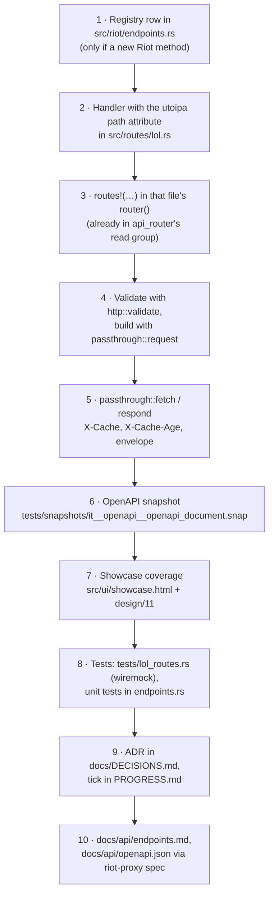

# Adding an endpoint

The files to touch, in order, for a new HTTP route on riot-proxy, with a worked example of a passthrough to a Riot method. A route that composes several Riot calls or reads the archive follows the same skeleton; only the handler body differs.

## The worked example (hypothetical)

Everything below uses **`GET /v1/lol/clash/players/{platform}/{puuid}`**, a passthrough to clash-v1's "players by PUUID". It does not exist in the code; it is here to make each step concrete. Nothing about Riot's side of it (path, body, limits, how long a player's Clash registration stays valid) may be invented: source it from the developer portal before writing a line (`docs/IMPLEMENTATION.md:18`; [adding-a-riot-call.md](./adding-a-riot-call.md)).

> **TODO (unverified):** the clash-v1 path, response shape and a defensible soft TTL. The example writes `/lol/clash/v1/players/by-puuid/{puuid}` and `secs(300)` as placeholders to show the mechanics; neither was checked against the portal, and `docs/design/04-data-and-cache.md` §TTLs has no Clash row.

## The steps

One-sentence caption: the order a new read route moves through the repository, from the registry to the documentation set.



Steps 1 to 5 are code; 6 and 7 are tests that fail until the route is documented and shown; 8 to 10 are what makes the pull request complete under [code-style-and-conventions.md](./code-style-and-conventions.md#commits-branches-and-pull-requests).

### 1. Registry entry (only when it fans out to Riot)

If the route calls a Riot method the proxy does not yet know, add its `ep(` row to `ENDPOINTS` and its id to `V2_ADDED` in `src/riot/endpoints.rs` first; the unit tests there pin the table (`src/riot/endpoints.rs:92-288`, `539-578`). The whole procedure, the TTL sources and the replay fixture are in [adding-a-riot-call.md](./adding-a-riot-call.md). For the example the id is `clash.playerByPuuid` on `HostKind::Platform`. A route that only reads what is already archived skips this step.

### 2. The handler

Routes live one file per area under `src/routes/` (`src/routes/mod.rs:3-15`): account-v1 in `riot.rs`, League in `lol.rs`, composites in `players.rs`, Data Dragon in `statics.rs`, analytics in `analytics.rs`, administration in `admin.rs`. `src/routes/riot.rs` is the model (`PROGRESS.md:388`). A handler is an `async fn` with a `#[utoipa::path]` attribute carrying `get`, `path`, `tag`, `summary`, `description`, `params` and `responses(PassthroughResponses)` (`src/routes/riot.rs:54-65`), and it takes:

- `State(state): State<AppState>` for the fetcher (`src/routes/riot.rs:67`);
- `Extension(consumer): Extension<Arc<Consumer>>`, injected by the auth layer (`src/routes/riot.rs:68`; `PROGRESS.md:391`);
- `path: Result<Path<(String, String)>, PathRejection>` so a malformed segment becomes a `VALIDATION` envelope through `bad_path` instead of axum's text (`src/routes/riot.rs:30-33`, `69-75`);
- `Query(query): Query<HashMap<String, String>>` for `?refresh=` and the route's own query parameters (`src/routes/riot.rs:70`).

`lol.rs` wraps the common platform-and-PUUID shape in `platform_puuid` (`src/routes/lol.rs:70-88`), which the example reuses:

```rust
// src/routes/lol.rs (hypothetical)
#[utoipa::path(
    get, path = "/v1/lol/clash/players/{platform}/{puuid}", tag = "lol",
    summary = "Clash registrations by PUUID", description = "clash-v1 players by PUUID, passed through.",
    params(("platform" = String, Path, description = "Platform routing value, e.g. euw1"),
           ("puuid" = String, Path, description = "Encrypted player UUID")),
    responses(PassthroughResponses),
)]
async fn clash_players_by_puuid(
    State(s): State<AppState>,
    Extension(c): Who,
    Query(q): Q,
    path: Result<Path<(String, String)>, PathRejection>,
) -> Response {
    platform_puuid(s, c, q, path, "clash.playerByPuuid").await
}
```

The path template uses `{name}` segments; a wildcard is `{*name}` (`src/routes/statics.rs:71`). The `tag` decides the group in `/docs` and whether the showcase rule applies (step 7): `players`, `riot`, `lol`, `static` are read tags (`tests/ui.rs:427`).

### 3. Register it

Add `.routes(routes!(clash_players_by_puuid))` to the file's `router()` (`src/routes/lol.rs:30-43`). Every area router is already merged into the `read` group of `routes::docs::api_router`, which gets the `require_read` guard, and `admin::router()` into the `admin` group with `require_admin` (`src/routes/docs.rs:118-141`). A new file needs a `pub mod` line in `src/routes/mod.rs` and a `.merge(routes::<file>::router())` in the right group of `api_router`; nothing else, since `api_router` is the single source for both the served routes and the OpenAPI document (`src/routes/docs.rs:116-117`, `368-371`). Auth, per-key quota, `X-RateLimit-*`, `X-Request-Id`, the request metric labelled with the matched template, compression and the body limit all come from the app layers (`src/app.rs:69-131`).

### 4. Validate

Use `http::validate` for v1's rules, before any upstream call, and never hand-roll a check that exists there: `region`, `platform`, `platform_at`, `game_name`, `tag_line`, `puuid`, `match_id`, `int_query`, `bool_query`, `query_platform`, `required_query_platform`, `one_of_str`, `query_one_of`, `patch_query`, `version_query`, `remakes_query`, `consumer_id` (`src/http/validate.rs:67-253`). Messages follow ajv wording; a message mentioning platform or region maps to `BAD_REGION`, anything else to `VALIDATION` (`src/http/validate.rs:21-31`). `platform_puuid` already calls `validate::platform` and `validate::puuid` (`src/routes/lol.rs:83-84`). Query parameters are read from the `HashMap` and validated with `int_query(name, raw, min, max)` and friends (`src/routes/lol.rs:217-229` for `match_ids`).

### 5. Fetch and respond

`passthrough::fetch(&state, &consumer, &query, || …)` builds the request inside a closure so a validation error never reaches upstream, then calls `respond` (`src/routes/passthrough.rs:94-106`). `request(id, target, params, query)` resolves the endpoint by id, fills the path template in order and appends queries (`src/routes/passthrough.rs:108-124`); the target comes from `Endpoint::target_for_platform` or `target_for_region` (`src/routes/lol.rs:45-51`). `respond` sends status 200, `Content-Type: application/json; charset=utf-8`, Riot's bytes untouched, `X-Cache`, `X-Cache-Age` (rounded to whole seconds) and `X-Cache-Fetched-Age` when there is one; on error the `ApiError` envelope plus `X-Cache` when the fetcher set it (`HIT-NEG`) (`src/routes/passthrough.rs:126-157`). `options` turns `?refresh=true|1` into a cache bypass for admin-scoped keys only (`src/routes/passthrough.rs:159-167`). Account-v1 methods that may pick a cluster use `RiotRequest::account` instead of a pinned target (`src/routes/riot.rs:43-47`).

### 6. The OpenAPI snapshot

`tests/openapi.rs` snapshots the whole document with insta (`tests/openapi.rs:9-13`), so the new route makes `cargo test --test it openapi::` fail until `tests/snapshots/it__openapi__openapi_document.snap` is updated (every `tests/*.rs` is a module of the single `it` binary since CI-04, ADR-176). Review the diff deliberately: the new path, its parameters, the `PassthroughResponses` set (200/400/401/403/404/429/502/503, `src/routes/passthrough.rs:17-89`) and nothing else should change (`docs/IMPLEMENTATION.md:94`; `PROGRESS.md:389`). The pull request template has a box for it (`.github/PULL_REQUEST_TEMPLATE.md:21`).

> **TODO (unverified):** how the snapshot is meant to be accepted. Nothing in the repository mentions `cargo insta` or `INSTA_UPDATE`; insta's own workflow (a `.snap.new` beside the snapshot, then `cargo insta review`) is the assumption.

The same test also checks `/openapi.json` equals what `riot-proxy spec` prints (`tests/openapi.rs:52-60`), and `scripts/compare-openapi.py` compares operations against v1's document for the `/v1/riot/` and `/v1/lol/` prefixes (`PROGRESS.md:389`).

### 7. The showcase coverage rule

`/dev/showcase` must either use every `GET` operation tagged `players`, `riot`, `lol` or `static`, or list it under `notShowcased` with a reason; `tests/ui.rs::showcase_covers_every_read_route` reads the OpenAPI document and fails otherwise (`docs/design/11-showcase.md:117-131`; `tests/ui.rs:426-467`). The two maps sit in `<script type="application/json" id="coverage">` in `src/ui/showcase.html` (`src/ui/showcase.html:231-241` for `notShowcased`). For the example, either a card calls it (and the path up to its first parameter must appear in the page's script, `tests/ui.rs:469-470`) or:

```json
"GET /v1/lol/clash/players/{platform}/{puuid}": "planned: a Clash card in a later task"
```

Then update `docs/design/11-showcase.md` (its page map or the `notShowcased` reasoning); CLAUDE.md requires both (`docs/IMPLEMENTATION.md:24`). Admin and `ws` routes are outside the rule.

### 8. Tests

- **Integration, wiremock.** Add cases to `tests/lol_routes.rs`: its `env()` starts a `MockServer` that answers everything with `{"from":"riot"}`, builds the app with `common::app_with(&[], &server.uri())` and mints a read key (`tests/lol_routes.rs:22-49`); `last_upstream` returns the exact upstream path and query (`tests/lol_routes.rs:59-67`), and `every_route_reaches_the_right_upstream_endpoint` snapshots every route once (`tests/lol_routes.rs:69-80`), so add the new route to its list and review `tests/snapshots/lol_routes__lol_routes_upstream_calls.snap`. `tests/riot_routes.rs` shows the fuller pattern: a read and an admin key, cache headers on a passthrough, `x-riot-host` matchers for cluster routing, validation errors and the contract check (`tests/riot_routes.rs:16-80`, `243-245`).
- **Unit.** The registry tests in `src/riot/endpoints.rs` (step 1).
- Run `cargo test --test it lol_routes:: openapi:: ui::` and then the lot (`just test` or `just nextest`); see [testing.md](./testing.md).

### 9. Decision and progress

Record the decision as the next free `ADR-nnn` in `docs/DECISIONS.md` and tick the task in `PROGRESS.md` with the pull request number (`docs/IMPLEMENTATION.md:22-23`). Check `origin/main` for the next ADR number: parallel sessions have collided on it before ([code-style-and-conventions.md](./code-style-and-conventions.md#commits-branches-and-pull-requests)).

### 10. This documentation set

- `docs/api/endpoints.md` and its per-group file (`docs/api/endpoints-riot-lol.md` for a `/v1/lol` route): a row for the route (auth, parameters, Riot method, `X-Cache` states).
- `docs/api/openapi.json`: regenerate with `riot-proxy spec > docs/api/openapi.json`; `spec` needs no configuration or key (`src/cli/mod.rs:72-81`).
- `docs/reference/riot-api-usage.md` if a Riot method was added.

## Checklist

1. Registry row and `V2_ADDED` (if a new Riot method), unit tests green.
2. Handler with `#[utoipa::path]`, registered with `routes!` in the area router.
3. Validation through `http::validate`; request through `passthrough::request`.
4. Response through `passthrough::fetch` or `respond`.
5. OpenAPI snapshot reviewed and updated.
6. Showcase: card or `notShowcased` reason, and `docs/design/11-showcase.md`.
7. wiremock tests, upstream-call snapshot.
8. ADR, `PROGRESS.md`, `docs/api/*`.
9. `just lint`, `just test`; CI green ([ci.md](./ci.md)).

---
**Sources:** `src/routes/docs.rs:L116-L141`, `L368-L371`, `src/routes/riot.rs:L21-L84`, `src/routes/lol.rs:L30-L104`, `L217-L229`, `src/routes/passthrough.rs:L17-L89`, `L94-L167`, `src/routes/mod.rs:L3-L15`, `src/routes/statics.rs:L71`, `src/http/validate.rs:L21-L31`, `L67-L253`, `src/app.rs:L69-L131`, `src/riot/endpoints.rs:L92-L288`, `L539-L578`, `src/cli/mod.rs:L72-L81`, `src/ui/showcase.html:L231-L241`, `tests/ui.rs:L426-L470`, `tests/openapi.rs:L9-L60`, `tests/lol_routes.rs:L22-L80`, `tests/riot_routes.rs:L16-L80`, `L243-L245`, `docs/design/11-showcase.md:L117-L131`, `docs/IMPLEMENTATION.md:L18`, `L22-L24`, `L94`, `PROGRESS.md:L388-L389`, `L391`, `.github/PULL_REQUEST_TEMPLATE.md:L21`
**Last verified:** 2026-10-19 against commit `52fa67d`
