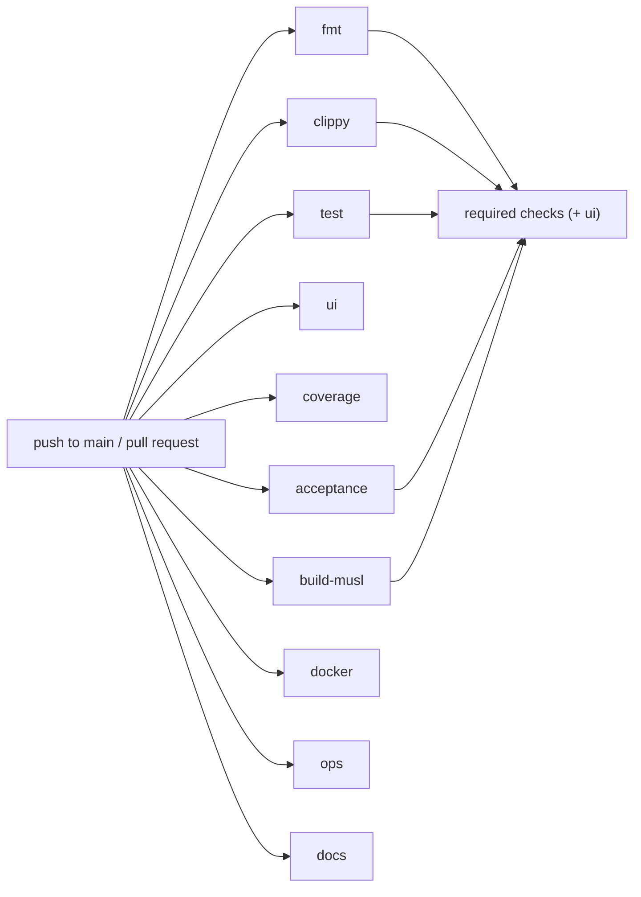
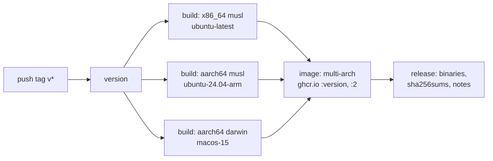

# Continuous integration reference

Every GitHub Actions workflow in `.github/workflows/`, job by job: what triggers it, what each step checks, which secrets it needs, how to run the same checks locally, and how to read a failed run.

There are three workflows. None of them deploys to production; see [release-process.md](./release-process.md) for the manual hand-off.

| File | Name | Runs on | Produces |
|---|---|---|---|
| `ci.yml` | `ci` | every push to `main`, every pull request | pass/fail checks, a coverage summary, showcase screenshots, the documentation gate |
| `edge.yml` | `edge` | every push to `main` (and pull requests that touch the workflow or its scripts) | `ghcr.io/ninjagoldfinch/riot-proxy:edge` and `:sha-<short>` |
| `release.yml` | `release` | a pushed `v*` tag (and pull requests that touch the workflow or its scripts) | three binaries, `sha256sums`, a GitHub release, `ghcr.io/ninjagoldfinch/riot-proxy:<version>` and `:2` |

## Secrets and variables

No repository secret is required. Every workflow uses only the automatic `GITHUB_TOKEN`:

| Workflow | Use of `GITHUB_TOKEN` | Permission requested |
|---|---|---|
| `ci.yml` | none | default |
| `edge.yml` | `docker/login-action` to GHCR on push events | `contents: read`, `packages: write` |
| `release.yml` | GHCR login (job `image`), `gh release create` (job `release`) | `packages: write`, `contents: write` |

The Riot key is never used in CI. Smoke tests start the binary with the literal `RIOT_API_KEY=ci-dummy-key-not-a-riot-key` (`ci.yml`, `build-musl` and `docker` jobs). The `test` job greps `tests/`, `src/` and `docs/` for anything matching `RGAPI-[0-9a-f-]{20,}` and fails if a key leaked.

## Branch protection

Job ids are the required status checks on `main`. The comment at the top of `ci.yml` lists them: `fmt`, `clippy`, `test`, `build-musl`, `acceptance`, and `ui` once the owner adds it (ADR-175). `coverage`, `docker`, `ops` and `docs` (ADR-178) are informational until added. Renaming a job means updating branch protection.

> **TODO (unverified):** whether `ui` has been added to the required checks. Branch-protection settings are not visible from the clone; `.github/workflows/ci.yml` only states the intent.

## `ci.yml`

Workflow-level environment: `CARGO_TERM_COLOR=always`, `RUSTFLAGS=-D warnings`, `GIT_SHA=${{ github.sha }}` (embedded by `build.rs` for `GET /v1/admin/info`).

Rust caches (`Swatinem/rust-cache@v2`) are saved from `main` only (`save-if: github.ref == 'refs/heads/main'`); pull requests restore them (ADR-079). The toolchain, components and the musl target come from `rust-toolchain.toml`, installed by a bare `rustup toolchain install`.

The jobs run in parallel; none depends on another.

Each job is independent; the required set on the right gates merging.

### `fmt`

1. `cargo fmt --all --check`.

### `clippy`

1. `cargo clippy --all-targets --all-features -- -D warnings`.
2. `cargo check --all-targets --features postgres`: the Postgres store stub compiles on its own (P8-04).
3. `cargo test --lib --features postgres db::store`: its unit tests pass.

### `test`

1. Installs `cargo-nextest` (`taiki-e/install-action@nextest`).
2. `cargo nextest run --profile ci --all-features --workspace`. The `ci` profile (`.config/nextest.toml`) disables fail-fast, allows no retries, flags a test slow after 60 s and kills it after 3 minutes, and prints failures immediately and again at the end (CI-02, ADR-174). Every test runs in its own process and the test binaries run in parallel.
3. `! grep -rE "RGAPI-[0-9a-f-]{20,}" tests/ src/ docs/`: no leaked Riot key.

### `ui`

The dev explorer, showcase and dashboard pages driven in jsdom (DEV-03, ADR-074) and laid out in headless Chromium (DEV-12, ADR-084). They read the pages from `src/ui/` and need no Rust, so they run beside `test` (CI-03, ADR-175).

1. `actions/setup-node@v7` with Node 22 and the npm cache keyed on `tests/dom/package-lock.json`.
2. `npm ci --no-audit --no-fund` in `tests/dom`.
3. `npx playwright-core install --with-deps chromium-headless-shell`.
4. `npm test` in `tests/dom`.
5. Always uploads `tests/dom/screenshots/` as the `showcase-screenshots` artifact (ignored if empty).

### `coverage`

Reported, not gated (IMPLEMENTATION.md §0.6; CI-02, ADR-174).

1. Adds the `llvm-tools` component; installs `cargo-llvm-cov` and `nextest`.
2. `cargo llvm-cov nextest --profile ci --all-features --workspace --summary-only`.

### `acceptance`

v1's black-box suite (vitest) against a real `riot-proxy serve` and a mock Riot (P8-01, ADR-059). Mock mode only.

1. `cargo build` (the debug binary, which the suite starts).
2. Node 22 with the npm cache keyed on `acceptance/package-lock.json`; `npm ci` in `acceptance`.
3. `npm test` in `acceptance`.

### `build-musl`

1. `sudo apt-get install -y musl-tools`.
2. `cargo build --release --target x86_64-unknown-linux-musl`.
3. "static and under 24 MiB": `file` must report `static(ally|-pie) linked`; `stat -c %s` must be below `24 * 1024 * 1024`; the binary must contain the first 12 characters of `GIT_SHA` (`grep -qa`).
4. Copies the binary to `dist/riot-proxy-linux-amd64` and builds `Dockerfile.release` into `riot-proxy:ci` with `docker buildx build --load --platform linux/amd64`.
5. Runs the image: `--version` prints; a detached container with the dummy key answers `/riot-proxy healthcheck` (polled up to 30 s), `curl /healthz`, `curl /readyz`; its logs contain `bootstrap admin key (shown once)`; `docker stop -t 15` exits 0; the image size is printed.
6. On failure, dumps `docker logs rp`.

### `docker`

Builds the source `Dockerfile` (the one `docker compose up --build` uses) with its layers cached in GitHub Actions, so the dependency layer is reused until `Cargo.toml` or `Cargo.lock` change (ADR-079). On a pull request the job builds only when the diff touches something the Dockerfile reads beyond the source tree (CI-01, ADR-173); on `main` it always builds.

1. Checkout with `fetch-depth: 2`.
2. Step `paths`: on `pull_request`, `git diff --name-only HEAD^1 HEAD | scripts/docker-paths.sh` prints `build=true` if any of `Dockerfile`, `.dockerignore`, `docker-compose.yml`, `Cargo.toml`, `Cargo.lock`, `build.rs`, `rust-toolchain.toml`, `.github/workflows/ci.yml` or `scripts/docker-paths.sh` changed; otherwise `build=false`. Pushes always set `build=true`.
3. If building: `docker/build-push-action@v7` with `build-args: GIT_SHA`, `load: true`, tag `ghcr.io/ninjagoldfinch/riot-proxy:2`, `cache-from: type=gha,scope=dockerfile`, and `cache-to … mode=max` only on `main`.
4. Smoke: `--version`; writes a `.env` with the dummy key; `docker compose up -d --no-build --wait`; polls `/healthz`; `/docs` contains `<html`; `/openapi.json` contains `"openapi"` (the P8 exit check); `docker compose down`.

### `docs`

The documentation gate (DOC-01, ADR-178). Not a required check until the owner adds it.

1. Checkout with full history.
2. `python3 docs/_meta/tools/linkcheck.py docs`: every relative link and `#anchor` resolves.
3. On a pull request, `docs-guard.py origin/<base> HEAD`: a page whose `Sources` footer cites a file the PR changed must itself change; a PR that changes `src/`, `deploy/`, `.github/`, `Cargo.toml` or `.env.example` must change something under `docs/`; a changed page's `Last verified` commit must be newer than the base; every footer names a real commit. The design record (`docs/design/`, `DECISIONS.md`, `IMPLEMENTATION.md`, `CUTOVER.md`, `docs/flt/`, `docs/perf/`) is exempt.
4. Node 22, then `mermaidcheck.sh docs`: every Mermaid block renders with mermaid-cli (puppeteer's own Chromium on the runner).
5. The marker count in `docs/_meta/gaps.md` equals the number of `TODO (unverified)` markers under `docs/`.

The `test` job also regenerates the OpenAPI document from the built binary and compares paths, methods, parameters, response codes, schema names and `info.version` with `docs/api/openapi.json` (`openapi-check.py`).

### `ops`

Shell and unit-file tests for the operational kit. Not a required check (ADR-070).

1. `apt-get install shellcheck python3-yaml cloud-init rclone`.
2. `deploy/proxmox/test.sh` (the dev VM kit, OPS-02).
3. `deploy/test.sh` (the archive replica units, OBJ-04).
4. `scripts/image-description.test.sh`, `scripts/edge-tags.test.sh`, `scripts/docker-paths.test.sh`.

## `edge.yml`

Publishes the amd64 image of every push to `main` as `:edge` and `:sha-<short>` so a dev box can follow `main` by pulling (OPS-01, ADR-069; OPS-02). A pull request that touches `.github/workflows/edge.yml`, `Dockerfile.release`, `scripts/image-description.sh` or `scripts/edge-tags.sh` builds and smoke-tests but pushes nothing. Concurrency group `edge-<ref>` with `cancel-in-progress: true`.

One job, `image`:

1. Checkout with full history (`fetch-depth: 0`, for the description).
2. Installs the toolchain and the musl target; `apt-get install musl-tools`; restores the Rust cache.
3. `cargo build --release --locked --target x86_64-unknown-linux-musl`.
4. Copies to `dist/riot-proxy-linux-amd64`; checks it is static and carries `GIT_SHA`.
5. Builds `Dockerfile.release` locally as `riot-proxy:edge`, runs it with the dummy key and waits for `/riot-proxy healthcheck`.
6. Step `tags`: `scripts/edge-tags.sh "$GITHUB_SHA"` fetches `origin/main` and prints `sha=sha-<7 hex>` always, and `edge=true` only if the commit is still the head of `main`. A run GitHub starts late therefore never moves `:edge` back to an older image (INC-02, ADR-114).
7. Step `desc`: reads the `org.opencontainers.image.revision` label of the current `:edge` (falling back to `github.event.before`) and runs `scripts/image-description.sh` to list the commits since it, within GHCR's 512-character limit (OPS-05, ADR-107).
8. `docker/metadata-action@v6` with `latest=false`, tags `edge` (if `edge=true`) and the `sha-…` tag, and the description as label and annotation at manifest and index level.
9. On `push` only: `docker/login-action@v4` to `ghcr.io` with `GITHUB_TOKEN`.
10. `docker/build-push-action@v7` for `linux/amd64`: pushes on `push`, otherwise writes an OCI tarball to `$RUNNER_TEMP/image.tar`.
11. `scripts/check-image-description.sh` verifies the image index carries the description (from the registry on push, from the tarball on a pull request).

## `release.yml`

A `v*` tag builds three binaries, pushes the multi-arch image and publishes a GitHub release (P8-05, ADR-063). A tag with a pre-release suffix (`v2.0.0-rc.0`) makes a pre-release and does not move `:2`. Pull requests that touch `.github/workflows/release.yml`, `Dockerfile.release`, `scripts/image-description.sh` or `scripts/check-image-description.sh` run the builds and publish nothing.

The matrix fans out after the version check and joins again before the image and release jobs.

### `version`

Extracts `version = "…"` from `Cargo.toml`. On a tag, fails unless the tag is exactly `v<version>`.

### `build` (matrix)

| target | runner | asset |
|---|---|---|
| `x86_64-unknown-linux-musl` | `ubuntu-latest` | `riot-proxy-linux-amd64` |
| `aarch64-unknown-linux-musl` | `ubuntu-24.04-arm` | `riot-proxy-linux-arm64` |
| `aarch64-apple-darwin` | `macos-15` | `riot-proxy-darwin-arm64` |

1. Toolchain plus the matrix target; `musl-tools` on Linux.
2. `cargo build --release --locked --target <target>`.
3. `--version` must print exactly `riot-proxy <version>`; the binary must contain the 12-character `GIT_SHA` (ADM-03).
4. On Linux: static and under 24 MiB.
5. Uploads `dist/<asset>` as an artifact (`if-no-files-found: error`).

### `image`

1. Downloads the two Linux artifacts into `dist/`.
2. Describes the image with the commits since the previous `v*` tag (`git describe --tags --abbrev=0 --match 'v*' "$GITHUB_SHA^"`).
3. `docker/metadata-action@v6` with semver tags `{{version}}` and `{{major}}`; `{{major}}` is skipped for pre-releases so an rc never moves `:2`.
4. Logs in to GHCR on push; `docker/build-push-action@v7` for `linux/amd64,linux/arm64` from `Dockerfile.release` (which copies `dist/riot-proxy-linux-${TARGETARCH}`).
5. Checks the index description; builds and smoke-tests the amd64 image locally as `riot-proxy:release`.

### `release` (push only)

1. Downloads every `riot-proxy-*` artifact.
2. `sha256sum riot-proxy-* > sha256sums`.
3. `gh release create <tag> dist/* --title <tag> --notes-file notes.md --generate-notes --verify-tag [--prerelease]`. The notes name the image tag and digest and say the binaries are static (Linux) or native (macOS).

## Running the same checks locally

| CI job | Local command |
|---|---|
| `fmt` + `clippy` | `just lint` |
| `test` | `just nextest` (needs `cargo-nextest`) or `cargo test --all-features` |
| `ui` | `just ui-test` (needs Node 22; installs `chromium-headless-shell`) |
| `coverage` | `just cov` (needs `cargo-llvm-cov`) |
| `acceptance` | `just acceptance` (needs Node 22) |
| `build-musl` | `just musl` (needs `musl-tools`); `just docker` for the scratch image |
| `docs` | `python3 docs/_meta/tools/linkcheck.py docs && python3 docs/_meta/tools/docs-guard.py origin/main HEAD && docs/_meta/tools/mermaidcheck.sh docs` (see the script header for the dev box's Chromium) |
| `ops` | `deploy/proxmox/test.sh && deploy/test.sh && scripts/*.test.sh` (needs `shellcheck`, `rclone`, `cloud-init`, `python3-yaml`) |
| `edge` / `release` image | `cargo build --release --locked --target x86_64-unknown-linux-musl`, copy to `dist/riot-proxy-linux-amd64`, `docker buildx build -f Dockerfile.release .` |

## Debugging a failed run

1. `gh run list --branch <branch>` then `gh run view <id> --log-failed` shows only the failing steps.
2. A `test` failure names the test with its output twice (immediately and in the final summary) because of `failure-output = "immediate-final"`. Re-run one integration module locally with `cargo test --test it <module>::` (every `tests/*.rs` is a module of the single `it` binary since CI-04, ADR-176; `telemetry` keeps its own binary) or one test by name with `cargo test <name>`.
3. A `build-musl` size failure means the static binary crossed 24 MiB (ADR-162). `ls -la` in the step output shows the size; dependencies build at `opt-level = "s"` for this reason (`Cargo.toml` `[profile.release.package."*"]`).
4. "the binary does not carry its commit" means `build.rs` did not see `GIT_SHA`; the workflow sets it at the top level, so check for an edit that removed the `env:` block.
5. `docker` skipped on a pull request is expected unless the diff touched a path in `scripts/docker-paths.sh`; the step log on stderr says why.
6. `edge` logging "is no longer the head of main" is expected when commits land close together; only `:sha-<short>` is pushed and `:edge` stays on the newer image.
7. A `release` failure at `version` means the tag and `Cargo.toml` disagree; retag after bumping the version (see [release-process.md](./release-process.md)).

---
**Sources:** `.github/workflows/ci.yml`, `docs/_meta/tools/docs-guard.py`, `docs/_meta/tools/openapi-check.py`, `.github/workflows/edge.yml`, `.github/workflows/release.yml`, `.config/nextest.toml`, `scripts/docker-paths.sh`, `scripts/edge-tags.sh`, `scripts/image-description.sh`, `scripts/check-image-description.sh`, `justfile`, `Dockerfile.release`
**Last verified:** 2026-10-19 against commit `52fa67d`
