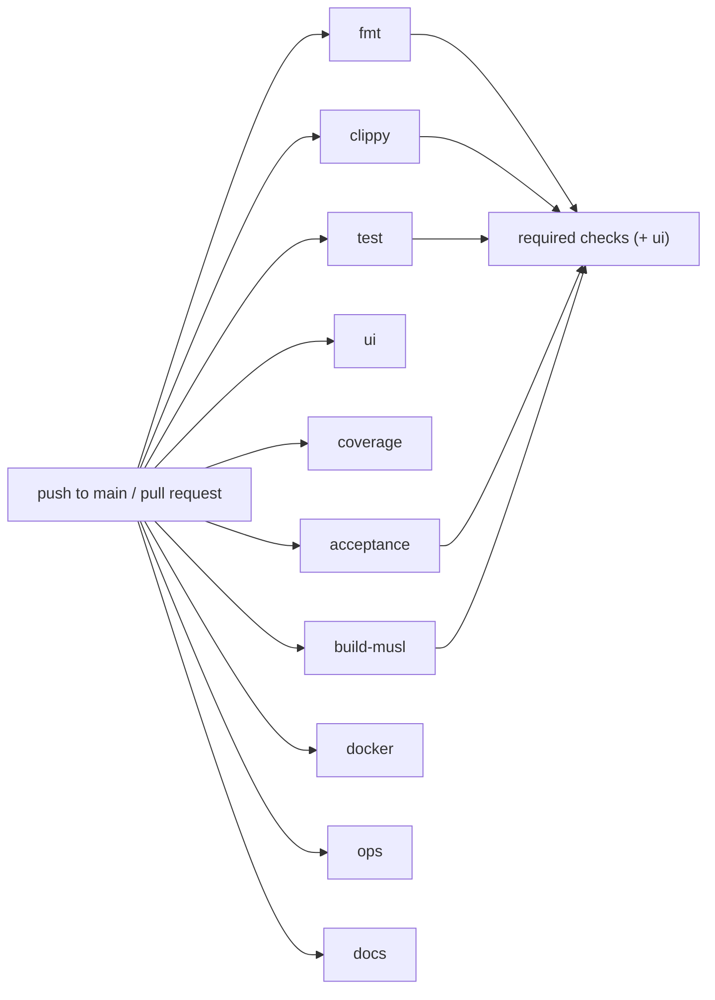
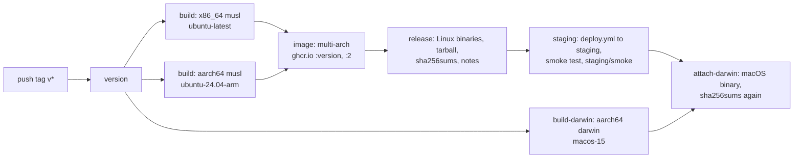

# Continuous integration reference

Every GitHub Actions workflow in `.github/workflows/`, job by job: what triggers it, what each step checks, which secrets it needs, how to run the same checks locally, and how to read a failed run.

There are four workflows. `release.yml` deploys every release to staging through `deploy.yml`; production is deployed only by hand, behind an approval, and only a version that passed on staging (see [release-process.md](./release-process.md)).

| File | Name | Runs on | Produces |
|---|---|---|---|
| `ci.yml` | `ci` | every push to `main`, every pull request | pass/fail checks, a coverage summary, showcase screenshots, the documentation gate |
| `edge.yml` | `edge` | every push to `main` (and pull requests that touch the workflow or its scripts) | `ghcr.io/ninjagoldfinch/riot-proxy:edge` and `:sha-<short>` |
| `release.yml` | `release` | a pushed `v*` tag (and pull requests that touch the workflow or its scripts) | three binaries, `sha256sums`, a GitHub release, `ghcr.io/ninjagoldfinch/riot-proxy:<version>` and `:2`, a staging deploy and its `staging/smoke` status |
| `deploy.yml` | `deploy` | called by `release.yml` for staging; started by hand for either | a release live on staging or production; the statuses `staging/smoke` and `prod/deployed` |

## Secrets and variables

No repository secret is required. `deploy.yml` reads its environment's secrets (`DEPLOY_SSH_KEY`; on `staging` also `CF_ACCESS_CLIENT_ID` and `CF_ACCESS_CLIENT_SECRET`, the Access service token) and variables (`DEPLOY_HOST`, `DEPLOY_KNOWN_HOSTS`); `release.yml`'s `staging` job passes them on with `secrets: inherit`. Otherwise every workflow uses only the automatic `GITHUB_TOKEN`:

| Workflow | Use of `GITHUB_TOKEN` | Permission requested |
|---|---|---|
| `ci.yml` | none | default |
| `edge.yml` | `docker/login-action` to GHCR on push events | `contents: read`, `packages: write` |
| `release.yml` | GHCR login (job `image`), `gh release create` (job `release`), the staging deploy's status (job `staging`) | `packages: write`, `contents: write`, `statuses: write` |
| `deploy.yml` | reads and sets the commit statuses `staging/smoke` and `prod/deployed` | `contents: read`, `statuses: write` |

The Riot key is never used in CI. Smoke tests start the binary with the literal `RIOT_API_KEY=ci-dummy-key-not-a-riot-key` (`ci.yml`, `build-musl` and `docker` jobs). The `test` job greps `tests/`, `src/` and `docs/` for anything matching `RGAPI-[0-9a-f-]{20,}` and fails if a key leaked.

## Branch protection

Job ids are the required status checks on `main`. The comment at the top of `ci.yml` lists them: `fmt`, `clippy`, `test`, `build-musl`, `acceptance`, and `ui` once the owner adds it (ADR-175). `coverage`, `docker`, `ops` and `docs` (ADR-178) are informational until added. Renaming a job means updating branch protection.

> **TODO (unverified):** whether `ui` has been added to the required checks. Branch-protection settings are not visible from the clone; `.github/workflows/ci.yml` only states the intent.

## `ci.yml`

Workflow-level environment: `CARGO_TERM_COLOR=always`, `RUSTFLAGS=-D warnings`, `GIT_SHA=${{ github.sha }}` (embedded by `build.rs` for `GET /v1/admin/info`).

Rust caches (`Swatinem/rust-cache@v2`) are saved from `main` only (`save-if: github.ref == 'refs/heads/main'`); pull requests restore them (ADR-079). The toolchain, components and the musl target come from `rust-toolchain.toml`, installed by a bare `rustup toolchain install`.

The jobs run in parallel; none depends on another.

Each job is independent; the required set on the right gates merging.

### `fmt`

1. `cargo fmt --all --check`.

### `clippy`

1. `cargo clippy --all-targets --all-features -- -D warnings`.
2. `cargo check --all-targets --features postgres`: the Postgres store stub compiles on its own (P8-04).
3. `cargo test --lib --features postgres db::store`: its unit tests pass.

### `test`

1. Installs `cargo-nextest` (`taiki-e/install-action@nextest`).
2. `cargo nextest run --profile ci --all-features --workspace`. The `ci` profile (`.config/nextest.toml`) disables fail-fast, allows no retries, flags a test slow after 60 s and kills it after 3 minutes, and prints failures immediately and again at the end (CI-02, ADR-174). Every test runs in its own process and the test binaries run in parallel.
3. `! grep -rE "RGAPI-[0-9a-f-]{20,}" tests/ src/ docs/`: no leaked Riot key.

### `ui`

The dev explorer, showcase and dashboard pages driven in jsdom (DEV-03, ADR-074) and laid out in headless Chromium (DEV-12, ADR-084). They read the pages from `src/ui/` and need no Rust, so they run beside `test` (CI-03, ADR-175).

1. `actions/setup-node@v7` with Node 22 and the npm cache keyed on `tests/dom/package-lock.json`.
2. `npm ci --no-audit --no-fund` in `tests/dom`.
3. `npx playwright-core install --with-deps chromium-headless-shell`.
4. `npm test` in `tests/dom`.
5. Always uploads `tests/dom/screenshots/` as the `showcase-screenshots` artifact (ignored if empty).

### `coverage`

Reported, not gated (IMPLEMENTATION.md §0.6; CI-02, ADR-174).

1. Adds the `llvm-tools` component; installs `cargo-llvm-cov` and `nextest`.
2. `cargo llvm-cov nextest --profile ci --all-features --workspace --summary-only`.

### `acceptance`

v1's black-box suite (vitest) against a real `riot-proxy serve` and a mock Riot (P8-01, ADR-059). Mock mode only.

1. `cargo build` (the debug binary, which the suite starts).
2. Node 22 with the npm cache keyed on `acceptance/package-lock.json`; `npm ci` in `acceptance`.
3. `npm test` in `acceptance`.

### `build-musl`

1. `sudo apt-get install -y musl-tools`.
2. `cargo build --release --target x86_64-unknown-linux-musl`.
3. "static and under 24 MiB": `file` must report `static(ally|-pie) linked`; `stat -c %s` must be below `24 * 1024 * 1024`; the binary must contain the first 12 characters of `GIT_SHA` (`grep -qa`).
4. Copies the binary to `dist/riot-proxy-linux-amd64` and builds `Dockerfile.release` into `riot-proxy:ci` with `docker buildx build --load --platform linux/amd64`.
5. Runs the image: `--version` prints; a detached container with the dummy key answers `/riot-proxy healthcheck` (polled up to 30 s), `curl /healthz`, `curl /readyz`; its logs contain `bootstrap admin key (shown once)`; `docker stop -t 15` exits 0; the image size is printed.
6. On failure, dumps `docker logs rp`.

### `docker`

Builds the source `Dockerfile` (the one `docker compose up --build` uses) with its layers cached in GitHub Actions, so the dependency layer is reused until `Cargo.toml` or `Cargo.lock` change (ADR-079). On a pull request the job builds only when the diff touches something the Dockerfile reads beyond the source tree (CI-01, ADR-173); on `main` it always builds.

1. Checkout with `fetch-depth: 2`.
2. Step `paths`: on `pull_request`, `git diff --name-only HEAD^1 HEAD | scripts/docker-paths.sh` prints `build=true` if any of `Dockerfile`, `.dockerignore`, `docker-compose.yml`, `Cargo.toml`, `Cargo.lock`, `build.rs`, `rust-toolchain.toml`, `.github/workflows/ci.yml` or `scripts/docker-paths.sh` changed; otherwise `build=false`. Pushes always set `build=true`.
3. If building: `docker/build-push-action@v7` with `build-args: GIT_SHA`, `load: true`, tag `ghcr.io/ninjagoldfinch/riot-proxy:2`, `cache-from: type=gha,scope=dockerfile`, and `cache-to … mode=max` only on `main`.
4. Smoke: `--version`; writes a `.env` with the dummy key; `docker compose up -d --no-build --wait`; polls `/healthz`; `/docs` contains `<html`; `/openapi.json` contains `"openapi"` (the P8 exit check); `docker compose down`.

### `docs`

The documentation gate (DOC-01, ADR-178). Not a required check until the owner adds it.

1. Checkout with full history.
2. `python3 docs/_meta/tools/linkcheck.py docs`: every relative link and `#anchor` resolves.
3. On a pull request, `docs-guard.py origin/<base> HEAD`: a page whose `Sources` footer cites a file the PR changed must itself change; a PR that changes `src/`, `deploy/`, `.github/`, `Cargo.toml` or `.env.example` must change something under `docs/`; a changed page's `Last verified` commit must be newer than the base; every footer names a real commit. The design record (`docs/design/`, `DECISIONS.md`, `IMPLEMENTATION.md`, `CUTOVER.md`, `docs/flt/`, `docs/perf/`) is exempt.
4. Node 22, then `mermaidcheck.sh docs`: every Mermaid block renders with mermaid-cli (puppeteer's own Chromium on the runner).
5. The marker count in `docs/_meta/gaps.md` equals the number of `TODO (unverified)` markers under `docs/`.

The `test` job also regenerates the OpenAPI document from the built binary and compares paths, methods, parameters, response codes, schema names and `info.version` with `docs/api/openapi.json` (`openapi-check.py`).

### `ops`

Shell and unit-file tests for the operational kit. Not a required check (ADR-070).

1. `apt-get install shellcheck python3-yaml cloud-init rclone sqlite3`.
2. `deploy/proxmox/test.sh` (the dev VM kit, OPS-02).
3. `deploy/test.sh` (the archive replica units, OBJ-04; and `scripts/deploy-workflow.test.sh` and `scripts/smoke.test.sh`, below).
4. `scripts/image-description.test.sh`, `scripts/edge-tags.test.sh`, `scripts/docker-paths.test.sh`, `scripts/release-workflow.test.sh` (both release builds set `RELEASE_VERSION` on tag builds only, nothing else sets it, and the image job checks the startup line; STS-01).
5. `scripts/deploy-workflow.test.sh`, run by `deploy/test.sh`: `deploy.yml` deploys the tarball `release.yml` builds, against the checksum file it writes, on the Proxmox runner behind the chosen environment, through `ninja-actions/deploy@v1` (DEP-03, ADR-196); prod requires `staging/smoke` or `prod/deployed` and sets `prod/deployed`; staging is smoke-tested and records `staging/smoke`; `release.yml` calls it for staging with `secrets: inherit` (DEP-05, ADR-198).
6. `scripts/smoke.test.sh`, run by `deploy/test.sh`: `scripts/smoke.sh` against a stub server, one case for each way a release can be wrong and for Access refusing the token (DEP-05).
7. `deploy/staging-seed.test.sh`, run by `deploy/test.sh` after shellcheck: `deploy/staging-seed.sh` with `rclone`, `systemctl` and `curl` stubbed and the real `sqlite3`. Each refusal leaves staging untouched: no `KEY_SCOPE`, a writable bucket, a production env file, an older binary, an old backup, no room, no confirmation. A seed and a reseed replace and scrub the database and start the service, and a served scope other than `KEY_SCOPE` fails (STG-04).

## `edge.yml`

Publishes the amd64 image of every push to `main` as `:edge` and `:sha-<short>` so a dev box can follow `main` by pulling (OPS-01, ADR-069; OPS-02). A pull request that touches `.github/workflows/edge.yml`, `Dockerfile.release`, `scripts/image-description.sh` or `scripts/edge-tags.sh` builds and smoke-tests but pushes nothing. Concurrency group `edge-<ref>` with `cancel-in-progress: true`.

One job, `image`:

1. Checkout with full history (`fetch-depth: 0`, for the description).
2. Installs the toolchain and the musl target; `apt-get install musl-tools`; restores the Rust cache.
3. `cargo build --release --locked --target x86_64-unknown-linux-musl`.
4. Copies to `dist/riot-proxy-linux-amd64`; checks it is static and carries `GIT_SHA`.
5. Builds `Dockerfile.release` locally as `riot-proxy:edge`, runs it with the dummy key and waits for `/riot-proxy healthcheck`.
6. Step `tags`: `scripts/edge-tags.sh "$GITHUB_SHA"` fetches `origin/main` and prints `sha=sha-<7 hex>` always, and `edge=true` only if the commit is still the head of `main`. A run GitHub starts late therefore never moves `:edge` back to an older image (INC-02, ADR-114).
7. Step `desc`: reads the `org.opencontainers.image.revision` label of the current `:edge` (falling back to `github.event.before`) and runs `scripts/image-description.sh` to list the commits since it, within GHCR's 512-character limit (OPS-05, ADR-107).
8. `docker/metadata-action@v6` with `latest=false`, tags `edge` (if `edge=true`) and the `sha-…` tag, and the description as label and annotation at manifest and index level.
9. On `push` only: `docker/login-action@v4` to `ghcr.io` with `GITHUB_TOKEN`.
10. `docker/build-push-action@v7` for `linux/amd64`: pushes on `push`, otherwise writes an OCI tarball to `$RUNNER_TEMP/image.tar`.
11. `scripts/check-image-description.sh` verifies the image index carries the description (from the registry on push, from the tarball on a pull request).

## `release.yml`

A `v*` tag builds three binaries, pushes the multi-arch image and publishes a GitHub release (P8-05, ADR-063). A tag with a pre-release suffix (`v2.0.0-rc.0`) makes a pre-release and does not move `:2`. Pull requests that touch `.github/workflows/release.yml`, `Dockerfile.release`, `scripts/image-description.sh` or `scripts/check-image-description.sh` run the builds and publish nothing.

The Linux matrix fans out after the version check and joins again before the image and release jobs. The macOS build runs beside it but the release does not wait for it: GitHub's macOS arm64 runners can go unacquired long enough to cancel the job, which held v2.10.0 back. `attach-darwin` adds the binary to the published release once it exists (DEP-04, ADR-197), after the staging deploy (DEP-05, ADR-198).

### `version`

Extracts `version = "…"` from `Cargo.toml`. On a tag, fails unless the tag is exactly `v<version>`.

### `build` (matrix)

| target | runner | asset |
|---|---|---|
| `x86_64-unknown-linux-musl` | `ubuntu-latest` | `riot-proxy-linux-amd64` |
| `aarch64-unknown-linux-musl` | `ubuntu-24.04-arm` | `riot-proxy-linux-arm64` |

1. Toolchain plus the matrix target; `musl-tools`.
2. `cargo build --release --locked --target <target>`, with `RELEASE_VERSION` set to the version on a tag build and empty on any other, so `/status` reports `dev` off a tag (STS-01, design/14).
3. `--version` must print exactly `riot-proxy <version>`; the binary must contain the 12-character `GIT_SHA` (ADM-03).
4. Static and under 24 MiB.
5. On x86_64: `riot-proxy-x86_64-linux.tar.gz`, the binary as `riot-proxy/riot-proxy` with `riot-proxy/version.json` (`version`, `commit`, `built_at`), the form `ninja-deploy` uploads to a host. The step checks it holds exactly those two files, that `version.json` names the tag, and that the unpacked binary reports it (DEP-02, ADR-195). Uploaded as its own artifact, which the `release` job downloads by name, so it is in `sha256sums`.
6. Uploads `dist/<asset>` as an artifact (`if-no-files-found: error`).

### `build-darwin`

`aarch64-apple-darwin` on `macos-15`, 60-minute timeout: the toolchain, `cargo build --release --locked` with the same `RELEASE_VERSION`, the same `--version` and `GIT_SHA` checks, then the artifact `riot-proxy-darwin-arm64`. No job but `attach-darwin` needs it (DEP-04).

### `image`

1. Downloads the two Linux artifacts into `dist/`.
2. Describes the image with the commits since the previous `v*` tag (`git describe --tags --abbrev=0 --match 'v*' "$GITHUB_SHA^"`).
3. `docker/metadata-action@v6` with semver tags `{{version}}` and `{{major}}`; `{{major}}` is skipped for pre-releases so an rc never moves `:2`.
4. Logs in to GHCR on push; `docker/build-push-action@v7` for `linux/amd64,linux/arm64` from `Dockerfile.release` (which copies `dist/riot-proxy-linux-${TARGETARCH}`).
5. Checks the index description; builds and smoke-tests the amd64 image locally as `riot-proxy:release`: its own healthcheck, the `riot-proxy starting` log line (its `version` is the tag's on a tag build and `dev` on a pull request, its `commit` the first 7 characters of `GIT_SHA`, its `built_at` RFC 3339; STS-01), then `scripts/smoke.sh http://127.0.0.1:8080 v<version>`, the test staging's deploy runs, which needs no Riot key (DEP-05).

### `release` (push only)

1. Downloads the `riot-proxy-linux-*` artifacts and `riot-proxy-x86_64-linux.tar.gz` by name, never the macOS binary, so what the first publish holds does not depend on how far `build-darwin` got.
2. `sha256sum riot-proxy-* > sha256sums`.
3. `gh release create <tag> dist/* --title <tag> --notes-file notes.md --generate-notes --verify-tag [--prerelease]`. The notes name the image tag and digest, say the binaries are static (Linux) or native (macOS), and that the macOS binary is attached once built.

### `staging` (push only)

Calls `deploy.yml` with `env: staging` and the tag, `secrets: inherit` (without it the called job's `DEPLOY_SSH_KEY` is empty) and `contents: read`, `statuses: write`. A failure fails the release run: that version does not go to production (`deploy.yml`, below).

### `attach-darwin` (push only)

Needs `build-darwin`, `release` and `staging`, and runs unless the run was cancelled once the first two succeeded, whatever the staging deploy did: `--clobber` deletes `sha256sums` for a moment, and a deploy reading it then would fail (DEP-05, ADR-198). Downloads the macOS artifact and the release's `sha256sums`, replaces any earlier `riot-proxy-darwin-arm64` line with the binary's checksum, checks the file, and uploads both with `gh release upload --clobber`. Re-running a failed or cancelled `build-darwin` (`gh run rerun <id> --failed`) runs it again; it is idempotent.

## Running the same checks locally

| CI job | Local command |
|---|---|
| `fmt` + `clippy` | `just lint` |
| `test` | `just nextest` (needs `cargo-nextest`) or `cargo test --all-features` |
| `ui` | `just ui-test` (needs Node 22; installs `chromium-headless-shell`) |
| `coverage` | `just cov` (needs `cargo-llvm-cov`) |
| `acceptance` | `just acceptance` (needs Node 22) |
| `build-musl` | `just musl` (needs `musl-tools`); `just docker` for the scratch image |
| `docs` | `python3 docs/_meta/tools/linkcheck.py docs && python3 docs/_meta/tools/docs-guard.py origin/main HEAD && docs/_meta/tools/mermaidcheck.sh docs` (see the script header for the dev box's Chromium) |
| `ops` | `deploy/proxmox/test.sh && deploy/test.sh && scripts/*.test.sh` (needs `shellcheck`, `rclone`, `cloud-init`, `python3-yaml`, `sqlite3`) |
| `edge` / `release` image | `cargo build --release --locked --target x86_64-unknown-linux-musl`, copy to `dist/riot-proxy-linux-amd64`, `docker buildx build -f Dockerfile.release .` |

## Debugging a failed run

1. `gh run list --branch <branch>` then `gh run view <id> --log-failed` shows only the failing steps.
2. A `test` failure names the test with its output twice (immediately and in the final summary) because of `failure-output = "immediate-final"`. Re-run one integration module locally with `cargo test --test it <module>::` (every `tests/*.rs` is a module of the single `it` binary since CI-04, ADR-176; `telemetry` keeps its own binary) or one test by name with `cargo test <name>`.
3. A `build-musl` size failure means the static binary crossed 24 MiB (ADR-162). `ls -la` in the step output shows the size; dependencies build at `opt-level = "s"` for this reason (`Cargo.toml` `[profile.release.package."*"]`).
4. "the binary does not carry its commit" means `build.rs` did not see `GIT_SHA`; the workflow sets it at the top level, so check for an edit that removed the `env:` block.
5. `docker` skipped on a pull request is expected unless the diff touched a path in `scripts/docker-paths.sh`; the step log on stderr says why.
6. `edge` logging "is no longer the head of main" is expected when commits land close together; only `:sha-<short>` is pushed and `:edge` stays on the newer image.
7. A `release` failure at `version` means the tag and `Cargo.toml` disagree; retag after bumping the version (see [release-process.md](./release-process.md)).
8. `build-darwin` cancelled with "The job was not acquired by Runner of type hosted" is GitHub's macOS capacity, not the build. The release is already out without it; `gh run rerun <id> --failed` builds and attaches it later (DEP-04).

---
## `deploy.yml`

Deploys a release to staging or production (DEP-03, ADR-196; DEP-05, ADR-198). `workflow_dispatch` with `env` (`staging`, the default, or `prod`), `version` (a release tag) and `break_glass`, and `workflow_call` with `env` and `version`, which is how `release.yml` deploys every release to staging. The owner starts a production deploy, with `ngf-deploy riot-proxy` or from the Actions tab, and approves it on the `prod` environment.

1. `check`: refuses an `env` other than `staging` or `prod`, before a called workflow could create an unprotected environment by that name.
2. `deploy`, on the Proxmox runner (`self-hosted, linux, proxmox`) behind the chosen environment, 30-minute timeout, concurrency group `deploy-<env>` on the job (so it holds when called), never cancelled, `contents: read` and `statuses: write`. It calls `NinjaGoldfinch/ninja-actions/deploy@v1` with `riot-proxy-x86_64-linux.tar.gz`, `sha256sums`, and the environment's `DEPLOY_HOST`, `DEPLOY_KNOWN_HOSTS` and `DEPLOY_SSH_KEY`. For prod it also passes `require-status: staging/smoke prod/deployed` (a version with neither at success is refused before anything is downloaded), `set-status: prod/deployed`, and `break_glass` as `unverified-reason` (skips the check; the reason goes to the log and the summary).
3. On staging, after the action: checkout, then `scripts/smoke.sh https://riot-proxy-staging.ninjagoldfinch.com <tag>` with the `CF_ACCESS_CLIENT_ID` and `CF_ACCESS_CLIENT_SECRET` secrets as the Access service token. It calls nothing that needs Riot, so staging's expiring development key cannot fail it.
4. On staging, whether the smoke test passed or failed: the commit status `staging/smoke` on the tag's commit, linking the run.

What happens on the host is in [release-process.md](./release-process.md), "Staging" and "Deploying to production"; `scripts/deploy-workflow.test.sh` and `scripts/smoke.test.sh` (the `ops` job, through `deploy/test.sh`) check the wiring and the smoke test, since the workflow cannot run in CI.

**Sources:** `.github/workflows/ci.yml`, `.github/workflows/deploy.yml`, `scripts/deploy-workflow.test.sh`, `scripts/release-workflow.test.sh`, `scripts/smoke.sh`, `scripts/smoke.test.sh`, `deploy/test.sh`, `docs/_meta/tools/docs-guard.py`, `docs/_meta/tools/openapi-check.py`, `.github/workflows/edge.yml`, `.github/workflows/release.yml`, `.config/nextest.toml`, `scripts/docker-paths.sh`, `scripts/edge-tags.sh`, `scripts/image-description.sh`, `scripts/check-image-description.sh`, `justfile`, `Dockerfile.release`
**Last verified:** 2026-11-06 against commit `587438c`
