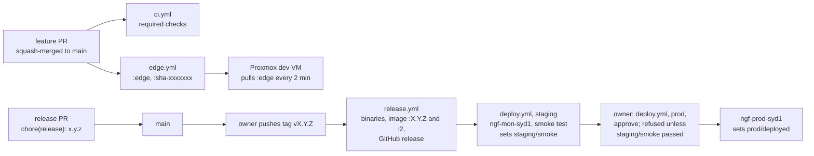

# Release process

How a change travels from a branch to production: versioning, the release commit and tag, what GitHub Actions publishes, the staging deploy and smoke test that follow by themselves, and the approved production deploy.



Everything up to the staging smoke test is automated; production waits for a person, and takes only a version that passed on staging (ADR-198).

## Versioning

- Semantic versions in `Cargo.toml` (`version = "2.10.0"` at the verified commit). Tags are `v<version>`; pre-releases carry a suffix (`v2.0.0-rc.3`).
- `release.yml` refuses a tag whose name is not exactly `v` plus the `Cargo.toml` version.
- The binary reports its version with `--version` and in `GET /v1/admin/info` together with the embedded commit (`gitSha`), `rustc` and build time (ADM-03).
- `/status` and the `riot-proxy starting` log line carry a separate build identity (STS-01, design/14): `version` is the tag without `v` only when `release.yml` built from a tag (it sets `RELEASE_VERSION` on the build steps, and `build.rs` embeds it), and `dev` for every other build; `commit` is the first 7 characters of the embedded sha; `built_at` is the build time in RFC 3339. Nothing reads git at run time.
- Cadence so far: `v2.0.0` on 2026-10-10 after four release candidates, then `v2.1.0` to `v2.7.0` between 2026-10-11 and 2026-10-19 (`git tag -l --format='%(refname:short) %(creatordate:short)'`). Minor versions carry features; `v2.4.1` was a fix release.

## Changelog

There is no `CHANGELOG.md`. The record is:

- the release commit body, which lists the pull requests and migrations since the previous release (for example the `v2.7.0` commit names `#215` and `#217` to `#219`, `V0026` and `V0027`);
- the GitHub release notes, generated from merged pull requests by `gh release create --generate-notes`, plus the image tag and digest;
- `docs/DECISIONS.md` (one ADR per decision) and `PROGRESS.md` (one ticked line per task with its pull request number);
- the GHCR image description, which lists the commits since the previous tag (`scripts/image-description.sh`, OPS-05).

## Cutting a release

Releases are published only with the owner's approval. The steps, as performed for `v2.6.0` and `v2.7.0`:

1. Branch from `origin/main`: `git switch -c chore/release-X.Y.Z`.
2. Bump `version` in `Cargo.toml`; run `cargo build` so `Cargo.lock` follows.
3. Update the version that `tests/snapshots/it__openapi__openapi_document.snap` records (`info.version`) and the version mentioned in `deploy/proxmox/README.md` and `deploy/proxmox/files/env.example` (both name a release as the example `RIOT_PROXY_TAG`). Run `cargo test --test it openapi::`.
4. Add the release line to `PROGRESS.md`.
5. Commit as `chore(release): X.Y.Z` with a body listing the pull requests and migrations since the last release, footer `Task: release-X.Y.Z`; open the pull request; wait for CI; squash-merge.
6. On the merge commit: `git tag -s vX.Y.Z -m vX.Y.Z && git push origin vX.Y.Z` (tags so far are SSH-signed annotated tags).
7. `release.yml` runs. Check it: `gh run watch` or `gh run list --workflow release`. It publishes `riot-proxy-linux-amd64`, `riot-proxy-linux-arm64`, `riot-proxy-x86_64-linux.tar.gz` (the deploy tarball, DEP-02), `sha256sums`, the release notes, and pushes `ghcr.io/ninjagoldfinch/riot-proxy:X.Y.Z` and `:2` (`:2` only for a non-pre-release). `riot-proxy-darwin-arm64` follows when its build finishes, and `sha256sums` is updated to list it (DEP-04); if GitHub's macOS runners leave it unacquired, `gh run rerun <id> --failed` attaches it later. A deploy does not wait for it.
8. The same run deploys the release to staging and smoke-tests it there (next section). A failed `staging` job means that version does not go to production.

What CI checks on the way is in [ci.md](./ci.md).

## Staging

Every release goes to staging by itself (DEP-05, ADR-198): `release.yml`'s `staging` job calls `deploy.yml` with `env: staging` and the tag, without approval. Staging is the OVH VPS `ngf-mon-syd1`, shared with ninja-monitor and the staging site, set up like production (`ninja-deploy`, `/srv/riot-proxy/releases/`, `current`). Its riot-proxy listens on `127.0.0.1:8080`, reached from outside only through the `ngf-staging` tunnel as `https://riot-proxy-staging.ninjagoldfinch.com`, behind the `staging` Access application. Nothing else uses it: the staging site reads production riot-proxy (site ADR-058), so staging exists to test riot-proxy releases.

1. The deploy goes as for production (below): the tarball checked against `sha256sums`, uploaded, activated, and `/readyz` waited for until it reports the new version, or rolled back.
2. `scripts/smoke.sh https://riot-proxy-staging.ninjagoldfinch.com <tag>` runs on the Proxmox runner, sending the environment's Access service token as `CF-Access-Client-Id` and `CF-Access-Client-Secret`. It checks `/healthz`, `/readyz` (`ok` and the version), `/openapi.json` (the version), `/metrics`, and that `/v1/lol/status/oc1` without a client key is refused with `401 UNAUTHORIZED` and an `X-Request-Id`.
3. The result, success or failure, becomes the commit status `staging/smoke` on the tag's commit. Production accepts only success.

Neither the health check nor the smoke test calls Riot. Staging runs on a Riot development key, which expires every 24 hours and the owner renews by hand; a lapsed key does not fail a deploy or block production. It shows only when someone uses a Riot-backed route on staging. To renew it, replace `RIOT_API_KEY` in `/etc/riot-proxy/env` on `ngf-mon-syd1` and `sudo systemctl restart riot-proxy`.

To redeploy or re-test a version on staging: `gh workflow run deploy.yml -f env=staging -f version=vX.Y.Z`, or Actions → `deploy` → Run workflow. A deploy of a version already on the host uploads nothing; the smoke test and `staging/smoke` run again. To see what a version has passed:

```sh
gh api repos/NinjaGoldfinch/riot-proxy/commits/vX.Y.Z/status --jq '.statuses[] | "\(.context) \(.state)"'
```

### The staging host

Set up once by the owner (ninja-actions README, "Setting up a host"): a fresh install, not an adoption. Staging differs from production in its environment file only:

| Setting | Staging | Why |
|---|---|---|
| `ENV` | `development` | config takes only `development`, `test` or `production` |
| `RIOT_API_KEY` | a development key | renewed by hand every 24 hours |
| `HOST` | `127.0.0.1` | only the tunnel reaches it |
| `KEY_SCOPE` | production's `/readyz` `keyScope` | staging reads a copy of production's database, whose rows are under production's scope; the pin also survives each development-key renewal (STG-01, ADR-200) |
| `ARCHIVE_OBJECT_URL`, `ARCHIVE_OBJECT_ENDPOINT`, `ARCHIVE_OBJECT_REGION` | `s3://riot-proxy-archive`, `https://<account id>.r2.cloudflarestorage.com`, `auto` | production's packs, from the R2 replica |
| `ARCHIVE_OBJECT_READ_ONLY`, `ARCHIVE_OBJECT_ACCESS_KEY`, `ARCHIVE_OBJECT_SECRET_KEY` | `true`, a read-only R2 token | reads only: no offload, no index snapshot, nothing freed, and the token can write nothing (STG-02, ADR-201). No R2 replica timer |
| `JOB_CONCURRENCY`, `CACHE_L1_MAX_MB`, `ANALYTICS_CACHE_ENTRIES` | `2`, `32`, `64` | the box is shared (3.7 GiB RAM) |
| `BACKUP_KEEP` | `0` | staging is reseeded, never restored; a daily backup of a production-sized copy would need 1.2 times its size free |
| `LOOKUP_BACKFILL_LIMIT`, `ARCHIVE_TIMELINES` | `100`, `false` | a development key's rate limit; with timelines on, boot would queue a download for every production match without one (TL-03) |
| `LADDER_CRAWL_MATCH_LIMIT` | `10000` | a crawl started by hand cannot fill the box; every match on a platform counts, so a platform production crawls is already full and its crawls archive nothing (STG-03, ADR-202) |

The unit is design/07's Option C with `ExecStart=/srv/riot-proxy/current/riot-proxy serve` and `MemoryMax=1G`. `deploy-host-add.sh riot-proxy --unit riot-proxy.service --health-url http://127.0.0.1:8080/readyz --health-wait 600` registers it (raised to 1800 in `/etc/ninja-deploy/riot-proxy.conf` once staging holds production's data, below), without `--smoke-urls`: every other page needs Riot or a client key. Nothing is live until the first deploy creates `current`. The first boot prints the bootstrap admin key to the journal (`journalctl -u riot-proxy`).

### Seeding staging from production

Staging does not crawl on its development key: it runs on a copy of production's newest daily backup, reads production's packed bodies from the R2 replica, and uses the key only for live calls (STG-04, ADR-204). `deploy/staging-seed.sh`, run as root on `ngf-mon-syd1`, makes the copy, and running it again refreshes it:

1. It refuses before changing anything unless `/etc/riot-proxy/env` has `KEY_SCOPE`, `ARCHIVE_OBJECT_READ_ONLY=true` with any bucket, and not `ENV=production`; the installed binary knows those settings; the newest `riot-proxy-YYYY-MM-DD.db` under `r2:ngf-backups/riot-proxy` is at most 3 days old (`--allow-old` overrides); and the disk has room for the copy plus 4 GiB, plus 1.2 times the copy if `BACKUP_KEEP` is not 0. The database and staging's own backups it replaces count as free.
2. It stops `riot-proxy`, deletes the database and staging's backups, downloads the backup with a read-only token for `ngf-backups` (`/etc/riot-proxy/seed-rclone.conf`, remote `r2`), and checks its size and header.
3. It scrubs the copy: production's consumer keys, its job queue, the response cache (production-key PUUIDs a development key cannot use), the limiter checkpoint, metrics history and rank-lookup queue are deleted; every player is untracked, so no poll asks Riot about a production PUUID; a running crawl is cancelled and its working set dropped.
4. It starts the service and waits up to 30 minutes for `/readyz`, which must report `KEY_SCOPE`. It prints how long that took and where the new bootstrap admin key is (`journalctl -u riot-proxy --since … | grep -A2 'shown once'`), unless `BOOTSTRAP_ADMIN_KEY` fixes one.

`--dry-run` shows the backup, the room and the plan. On staging, production's players, matches, facts, ladders and analytics read as they do in production; a body freed in production reads from R2. A Riot call with a production PUUID fails under the development key, so anything that needs one (a player's match history, their rank) is fetched live. Rows staging writes from live calls carry development-key PUUIDs and last until the next seed.

**Migrations run on production's data first.** Each release's staging deploy migrates this copy before production sees the release. If `/readyz` is not up within the health wait, `ninja-deploy` rolls back. If the migration had not committed (migrations apply in one transaction), the previous release starts on the unchanged copy and the deploy fails, so `staging/smoke` is not set and production refuses the version. If it had committed but boot was still running, the previous release refuses the newer database (`MissingVersion`, [../deployment/upgrade-and-rollback.md](../deployment/upgrade-and-rollback.md#rolling-back-the-binary)) and staging stays down until the version is redeployed with a longer wait or staging is reseeded. Either way production is not touched. Staging's wait is 1800 s because the box is smaller than production's and its page cache starts cold. When a staging deploy's boot takes more than about two thirds of production's `HEALTH_WAIT` (600 s), raise production's before promoting the version.

The `staging` GitHub environment has no reviewer, deployment branches `main` and the tag pattern `v*`, the variables `DEPLOY_HOST` and `DEPLOY_KNOWN_HOSTS`, and the secrets `DEPLOY_SSH_KEY` (`ci-riot-proxy-staging`, forced to `ninja-deploy riot-proxy` on that host), `CF_ACCESS_CLIENT_ID` and `CF_ACCESS_CLIENT_SECRET` (a service token in the `staging` Access application's Service Auth policy).

## Deploying to production

Production (`ngf-prod-syd1`) runs the static amd64 binary under systemd, not Docker, from `/srv/riot-proxy/current/` (`/usr/local/bin/riot-proxy` is a symlink to it). `.github/workflows/deploy.yml` deploys a release there through the shared pipeline in `NinjaGoldfinch/ninja-actions`, and only when the owner starts and approves it (DEP-03, ADR-196), and only a version that passed on staging (DEP-05, ADR-198):

1. If the release carries a migration, take the manual backup first ([../deployment/upgrade-and-rollback.md](../deployment/upgrade-and-rollback.md), "Upgrade procedure", step 1).
2. Start the deploy: `ngf-deploy riot-proxy` on the owner's machine (the latest release; `-v vX.Y.Z` for another), or Actions → `deploy` → Run workflow with `env` prod and the tag, or `gh workflow run deploy.yml -f env=prod -f version=vX.Y.Z`.
3. Approve it: the run waits on the `prod` environment.
4. The job runs on the Proxmox runner. Before anything is downloaded, the action refuses a version whose commit has neither `staging/smoke` nor `prod/deployed` at success. It downloads `riot-proxy-x86_64-linux.tar.gz` and checks it against `sha256sums`, uploads it to `/srv/riot-proxy/releases/vX.Y.Z/` over SSH unless the host already has it, and has the host point `current` at it, restart `riot-proxy` and wait for `/readyz` to report the new `version` (ADR-194). If it does not within the host's health wait, the host points `current` back, restarts, and the job fails. Once it is live, the action sets `prod/deployed` on the version's commit. The run's summary holds the host's log.
5. Verify as in [../deployment/upgrade-and-rollback.md](../deployment/upgrade-and-rollback.md), "Upgrade procedure", step 3.

Rolling back on purpose is deploying the previous tag: the host keeps the last five releases, so there is no upload, and its `prod/deployed` lets it through the gate. A migration is not undone that way (same page, "Rolling back a migration").

In an emergency (a fix that cannot wait for staging, or staging itself down), deploy with a reason: `gh workflow run deploy.yml -f env=prod -f version=vX.Y.Z -f break_glass='<why>'`. The check is skipped, and the reason is written to the log and the job summary as a warning. On the host, `ngf-host update riot-proxy` refuses the same way without `--unverified '<why>'`.

The versions live in production before the gate existed, `v2.9.0` and `v2.10.0`, are marked `prod/deployed` once, by hand, so a rollback to them passes the gate:

```sh
for t in v2.9.0 v2.10.0; do gh api -X POST "repos/NinjaGoldfinch/riot-proxy/statuses/$(gh api repos/NinjaGoldfinch/riot-proxy/commits/$t --jq .sha)" -f state=success -f context=prod/deployed -f description='live before the gate'; done
```

The host side is set up once with `infra/deploy-host-setup.sh` and `infra/deploy-host-add.sh` from `NinjaGoldfinch/ninja-actions` (its README, "Setting up a host"); for riot-proxy, `--adopt` moved the running binary into `/srv` as the first release and `--link` left the symlink.

## The dev VM

The Proxmox dev VM (`deploy/proxmox/`) is not part of the release: it follows `:edge`, which every push to `main` publishes, and `riot-proxy-update.timer` pulls it every 2 minutes. A pushed image must pass its Docker healthcheck within 120 s or the updater rolls back to `riot-proxy:previous` and refuses that image until a newer one appears (INC-03, ADR-115). Set `RIOT_PROXY_TAG=2.7.0` in its `.env` to hold a release instead.

## The site

ninjagoldfinch.lol pins the proxy contract it was verified against (its generated client comes from `riot-proxy spec`; the site's SPD series records `2.6.0`). A release that changes a response shape the site reads needs a matching site change and the site's own manual deploy; see [../integration/contract.md](../integration/contract.md).

---
**Sources:** `.github/workflows/release.yml`, `build.rs`, `src/build_info.rs`, `scripts/release-workflow.test.sh`, `.github/workflows/deploy.yml`, `scripts/smoke.sh`, `src/routes/health.rs`, ninja-actions README at `9d6ce2f` ("Staging", "Nothing reaches production without passing staging"), `infra/deploy-host-add.sh` at `9d6ce2f`, `.github/workflows/edge.yml`, `Cargo.toml:L3`, `git show --stat v2.7.0` (commit `10cf81d`), `git tag -l`, `docs/design/07-deployment.md#upgrade-procedure`, `docs/design/07-deployment.md#build-identity-adm-03`, `deploy/README.md`, `deploy/proxmox/README.md`, `deploy/proxmox/files/riot-proxy-update`
**Last verified:** 2026-11-06 against commit `e5d5c1d`
