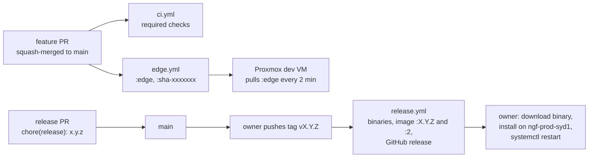

# Release process

How a change travels from a branch to production: versioning, the release commit and tag, what GitHub Actions publishes, and the manual deploy that follows.



Everything up to the GitHub release is automated; the last step is a person.

## Versioning

- Semantic versions in `Cargo.toml` (`version = "2.7.2"` at the verified commit). Tags are `v<version>`; pre-releases carry a suffix (`v2.0.0-rc.3`).
- `release.yml` refuses a tag whose name is not exactly `v` plus the `Cargo.toml` version.
- The binary reports its version with `--version` and in `GET /v1/admin/info` together with the embedded commit (`gitSha`), `rustc` and build time (ADM-03).
- Cadence so far: `v2.0.0` on 2026-10-10 after four release candidates, then `v2.1.0` to `v2.7.0` between 2026-10-11 and 2026-10-19 (`git tag -l --format='%(refname:short) %(creatordate:short)'`). Minor versions carry features; `v2.4.1` was a fix release.

## Changelog

There is no `CHANGELOG.md`. The record is:

- the release commit body, which lists the pull requests and migrations since the previous release (for example the `v2.7.0` commit names `#215` and `#217` to `#219`, `V0026` and `V0027`);
- the GitHub release notes, generated from merged pull requests by `gh release create --generate-notes`, plus the image tag and digest;
- `docs/DECISIONS.md` (one ADR per decision) and `PROGRESS.md` (one ticked line per task with its pull request number);
- the GHCR image description, which lists the commits since the previous tag (`scripts/image-description.sh`, OPS-05).

## Cutting a release

Releases are published only with the owner's approval. The steps, as performed for `v2.6.0` and `v2.7.0`:

1. Branch from `origin/main`: `git switch -c chore/release-X.Y.Z`.
2. Bump `version` in `Cargo.toml`; run `cargo build` so `Cargo.lock` follows.
3. Update the version that `tests/snapshots/it__openapi__openapi_document.snap` records (`info.version`) and the version mentioned in `deploy/proxmox/README.md` and `deploy/proxmox/files/env.example` (both name a release as the example `RIOT_PROXY_TAG`). Run `cargo test --test it openapi::`.
4. Add the release line to `PROGRESS.md`.
5. Commit as `chore(release): X.Y.Z` with a body listing the pull requests and migrations since the last release, footer `Task: release-X.Y.Z`; open the pull request; wait for CI; squash-merge.
6. On the merge commit: `git tag -s vX.Y.Z -m vX.Y.Z && git push origin vX.Y.Z` (tags so far are SSH-signed annotated tags).
7. `release.yml` runs. Check it: `gh run watch` or `gh run list --workflow release`. It publishes `riot-proxy-linux-amd64`, `riot-proxy-linux-arm64`, `riot-proxy-darwin-arm64`, `sha256sums`, the release notes, and pushes `ghcr.io/ninjagoldfinch/riot-proxy:X.Y.Z` and `:2` (`:2` only for a non-pre-release).

What CI checks on the way is in [ci.md](./ci.md).

## Deploying to production

Production (`ngf-prod-syd1`) runs the static amd64 binary under systemd, not Docker. Nothing in the repository deploys it; the owner does, after the release workflow finishes. The procedure follows `docs/design/07-deployment.md#upgrade-procedure` and `deploy/README.md`:

1. On the box, download the asset and check it:

   ```bash
   v=X.Y.Z
   curl -fsSLO https://github.com/NinjaGoldfinch/riot-proxy/releases/download/v$v/riot-proxy-linux-amd64
   curl -fsSLO https://github.com/NinjaGoldfinch/riot-proxy/releases/download/v$v/sha256sums
   sha256sum -c --ignore-missing sha256sums
   ```

2. Keep the running binary as the rollback: `sudo cp /usr/local/bin/riot-proxy /usr/local/bin/riot-proxy.<old version>`.
3. Install: `sudo install -m 0755 riot-proxy-linux-amd64 /usr/local/bin/riot-proxy`.
4. If the release adds a migration that rewrites a large table, take a manual backup first: `riot-proxy backup /var/lib/riot-proxy/data/pre-$v.db` (run as the service user with its environment; `deploy/README.md` defines an `rp` helper for this).
5. `sudo systemctl restart riot-proxy`. Migrations apply on boot; the limiter checkpoint is restored; L1 warms from L2. Downtime is the restart, under a second plus any migration.
6. Verify: `curl -s localhost:8080/readyz` is `{"ok":true,…}`; `curl -s -H "Authorization: Bearer $ADMIN_KEY" localhost:8080/v1/admin/info | jq '.version,.gitSha'` shows the new version; `sudo journalctl -u riot-proxy -n 50` shows `database ready` and `listening`.
7. Note the deployment in `PROGRESS.md` if the release line asks for it.

Rollback is the reverse: stop, copy `riot-proxy.<old version>` back, start. Migrations are forward-only, so a release whose migration must be undone needs the backup from step 4 (see [../deployment/upgrade-and-rollback.md](../deployment/upgrade-and-rollback.md)).

> **TODO (unverified):** the exact commands the owner uses on `ngf-prod-syd1` are not in the repository. The steps above are assembled from design/07 §Upgrade procedure, deploy/README.md and the rollback copy naming (`/usr/local/bin/riot-proxy.2.5.0`) recorded in the session notes for the v2.6.0 deploy. Confirm against the owner's own notes.

## The dev VM

The Proxmox dev VM (`deploy/proxmox/`) is not part of the release: it follows `:edge`, which every push to `main` publishes, and `riot-proxy-update.timer` pulls it every 2 minutes. A pushed image must pass its Docker healthcheck within 120 s or the updater rolls back to `riot-proxy:previous` and refuses that image until a newer one appears (INC-03, ADR-115). Set `RIOT_PROXY_TAG=2.7.0` in its `.env` to hold a release instead.

## The site

ninjagoldfinch.lol pins the proxy contract it was verified against (its generated client comes from `riot-proxy spec`; the site's SPD series records `2.6.0`). A release that changes a response shape the site reads needs a matching site change and the site's own manual deploy; see [../integration/contract.md](../integration/contract.md).

---
**Sources:** `.github/workflows/release.yml`, `.github/workflows/edge.yml`, `Cargo.toml:L3`, `git show --stat v2.7.0` (commit `10cf81d`), `git tag -l`, `docs/design/07-deployment.md#upgrade-procedure`, `docs/design/07-deployment.md#build-identity-adm-03`, `deploy/README.md`, `deploy/proxmox/README.md`, `deploy/proxmox/files/riot-proxy-update`
**Last verified:** 2026-10-20 against commit `b7b363c`
